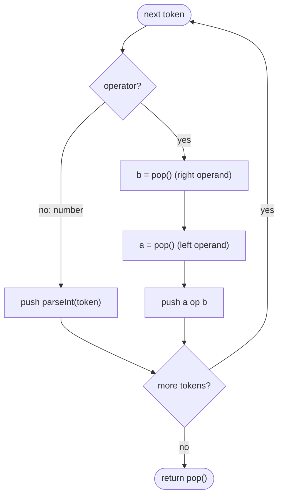

# LC 150 Evaluate Reverse Polish Notation

> [!abstract] In one sentence
> In postfix notation an operator always follows its two operands, so the two most recent unconsumed values are exactly its arguments — a stack of values and a pop-pop-apply-push step per operator evaluates the whole expression in one pass without parentheses or precedence.

**Map:** [[NeetCode 150 MOC]] → [[DSA Dashboard]] · Pattern: [[Stack & Monotonic Stack]]

> [!question] Predict before you read
> Tokens `["4", "13", "5", "/", "+"]`. Which of `13 / 5` and `5 / 13` does the `/` compute, and which popped value is the divisor? Then: what does Java give for `6 / -132`, and is that what the problem wants?

## Problem

You are given an arithmetic expression in Reverse Polish (postfix) notation as an array of tokens: integers (possibly negative, written like `"-11"`) and the four operators `+ − * /`. Evaluate it and return the integer result. Division truncates toward zero, there is never a division by zero, the expression is always valid, and every intermediate value fits in a 32-bit integer.

- `["2","1","+","3","*"]` → `9`, i.e. `(2 + 1) * 3`
- `["4","13","5","/","+"]` → `6`, i.e. `4 + (13 / 5)`
- `["10","6","9","3","+","-11","*","/","*","17","+","5","+"]` → `22`

Constraints that matter: `1 ≤ tokens.length ≤ 10⁴`, operands in `[−200, 200]`, intermediate results fit an `int` — so a single pass with an `int` stack is the target and no `long` is needed.

## Clarifying questions

1. Is the expression guaranteed well-formed (enough operands for every operator, exactly one value left at the end)? — Yes; otherwise `pop` on an empty stack is the error to report.
2. Division semantics for negatives: truncate toward zero or floor? — Toward zero, which is exactly Java's `/` on `int`.
3. Can a token be a negative number, and how do I tell `"-"` from `"-11"`? — Yes; a token is an operator iff it is one of the four single-character strings, so match the whole token, not its first character.
4. Can intermediate results overflow? — Not here by the constraints; in a variant, use `long` or `Math.addExact`.

## Brute force

Scan for the first operator, find its two preceding numbers, replace the three tokens by the result, repeat from the start. Each round is O(n) and there are O(n) operators, so O(n²) with list surgery. The waste: after a reduction, the next operator's operands are always the values immediately to its left, i.e. the most recently produced ones — the brute force rescans from the beginning to rediscover what a stack would hand it directly.

## The key insight

Postfix means an operator comes *after* both of its operands, and because sub-expressions are themselves postfix, when you reach an operator the two values it applies to are the two most recently completed values — the top two of a stack. Push numbers; for an operator pop twice, compute, push once. The stack is a bottom-up fold of the expression tree, and no parentheses or precedence rules are needed because postfix encodes the tree shape in the token order. Recognition cue: "evaluate / parse an expression", "operator applies to the most recent results", "nested structure given as a linear sequence" → stack of partial results.

## Optimal approach

1. Walk the tokens left to right with an `ArrayDeque<Integer>`.
2. Number: push it.
3. Operator: `b = pop()`, `a = pop()` — `b` was pushed last, so it is the *right* operand; push `a op b`.
4. The single value left at the end is the answer.



> [!example]- Excalidraw version — the same diagram as an editable canvas
> ![[LC 150 Evaluate Reverse Polish Notation — Optimal approach.excalidraw]]
> [[LC 150 Evaluate Reverse Polish Notation — Optimal approach.excalidraw|Open in Excalidraw]] — needs the Excalidraw plugin (see [[Plugins to Install]]).

## Walkthrough

`["10","6","9","3","+","-11","*","/","*","17","+","5","+"]`, stack shown bottom to top:

| token | a | b | pushed | stack after |
|---|---|---|---|---|
| 10, 6, 9, 3 | | | numbers | 10 6 9 3 |
| `+` | 9 | 3 | 12 | 10 6 12 |
| -11 | | | number | 10 6 12 -11 |
| `*` | 12 | -11 | -132 | 10 6 -132 |
| `/` | 6 | -132 | `6 / -132 = 0` (toward zero) | 10 0 |
| `*` | 10 | 0 | 0 | 0 |
| 17 | | | number | 0 17 |
| `+` | 0 | 17 | 17 | 17 |
| 5 | | | number | 17 5 |
| `+` | 17 | 5 | 22 | 22 → answer |

The `/` row is the one to look at: `b` (popped first) is the divisor, and Java's `int` division gives `0`, not `−1` — floor division would be wrong here.

## Java solution

```java
import java.util.*;

class Solution {
    public int evalRPN(String[] tokens) {
        Deque<Integer> stack = new ArrayDeque<>();        // completed values, most recent on top
        for (String t : tokens) {
            switch (t) {
                case "+" -> stack.push(stack.pop() + stack.pop());      // commutative: order irrelevant
                case "*" -> stack.push(stack.pop() * stack.pop());
                case "-" -> { int b = stack.pop(), a = stack.pop(); stack.push(a - b); }   // b was on top: right operand
                case "/" -> { int b = stack.pop(), a = stack.pop(); stack.push(a / b); }   // int division truncates toward zero
                default  -> stack.push(Integer.parseInt(t));            // handles "-11" as a number
            }
        }
        return stack.pop();
    }
}
```

**Time** O(n) · **Space** O(n) (the stack holds at most the operands seen so far; a well-formed expression never exceeds n/2 + 1)

## Why it works

Invariant: after processing a prefix of the tokens, the stack holds, bottom to top, the values of the maximal complete sub-expressions in that prefix, in order. A number is a complete sub-expression and is pushed. An operator in a valid postfix expression is preceded by exactly two complete sub-expressions — the last two — so popping twice yields its operands in order (`a` below `b`), and pushing `a op b` replaces them with the value of the larger sub-expression, restoring the invariant. At the end the whole expression is one complete sub-expression, so exactly one value remains. Each token causes O(1) deque work, hence O(n).

## Edge cases

- Single token (`["18"]`): pushed, then popped as the answer.
- Negative operands (`"-11"`): `Integer.parseInt` handles the sign; the `switch` matches whole strings, so `"-"` and `"-11"` never collide.
- Division with a negative result (`"-7" "2" "/"` → `−3`): Java truncates toward zero, which the problem specifies; `Math.floorDiv` would give `−4` and be wrong.
- Division where `|a| < |b|` (`6 / -132` → `0`): truncation again; the sign of the dividend does not matter.
- Deep expressions (`10⁴` tokens): `ArrayDeque` grows as needed; no recursion involved.
- Malformed input is excluded; if it were not, an empty-stack `pop` (`NoSuchElementException`) or a leftover stack at the end are the two failure signals.

## Common mistakes

> [!warning] What goes wrong
> - Operand order for `−` and `/`: the first `pop()` is the *right* operand. `stack.pop() - stack.pop()` computes `b − a`. Writing it on one line for `+` and `*` is fine because they commute; for the others name `b` first, then `a`.
> - Detecting an operator with `t.charAt(0) == '-'`: `"-11"` is then treated as subtraction. Compare whole strings (`switch` on `String` or `equals`).
> - Using `Math.floorDiv`, or casting through `double` and rounding: both break the truncation-toward-zero rule for negatives.
> - `Stack<Integer>` with `==` comparisons elsewhere; here no comparison is needed, but unboxing arithmetic on `Integer` is fine and `ArrayDeque` is the idiomatic choice.
> - Returning `stack.peek()` without checking the stack has exactly one element in a variant where malformed input is possible.
> - Parsing with `Integer.valueOf(t)` and then `==`: again boxed identity if compared; not an issue for arithmetic.

## Variants & follow-ups

- Infix with precedence and parentheses (LC 224, LC 227 Basic Calculator): shunting-yard converts infix to postfix with an operator stack, then this evaluator runs; or evaluate in one pass with two stacks (values and operators).
- Postfix to expression tree: the same loop, but push nodes and make an operator a parent of the two popped nodes; the final node is the root — the stack *is* a bottom-up tree builder.
- Recursive evaluation from the right end: the last token is the root operator, its right subtree ends just before it; equivalent to the stack with the call stack doing the bookkeeping, see [[Recursion]].
- Prefix (Polish) notation: scan right to left, and now the first `pop()` is the *left* operand.
- Overflow-checked variant: `Math.addExact`, `multiplyExact`, or `long` with a range check per step.
- Unary minus or functions (`sqrt`, `max`): the operator's arity decides how many values to pop; the structure stays.

## Interview script

Restate: "tokens in postfix: integers, possibly negative, and `+ − * /`; division truncates toward zero; the expression is valid and fits in `int`." Brute force: "repeatedly reduce the first operator with its two preceding numbers, O(n²) with list edits." Insight: "an operator's operands are always the two most recently completed values, so a stack hands them to me in O(1)." Approach: "push numbers; on an operator pop `b` then `a`, push `a op b`; return the last value. I match whole tokens so `-11` is a number." Complexity: "O(n) time and O(n) space, one pass." Tests: single token, negative operand, `6 / -132 = 0`, `-7 / 2 = -3`, a long chain of `+`. If they push: "for infix I run shunting-yard to postfix first, or keep an operator stack with precedence."

## Related

- Pattern: [[Stack & Monotonic Stack]] (stack as "pending partial results"); the same fold expressed recursively: [[Recursion]]
- Prerequisites: [[LC 20 Valid Parentheses]] (stack API and parsing shape)
- Siblings: [[LC 155 Min Stack]], [[LC 22 Generate Parentheses]], [[LC 739 Daily Temperatures]]
- Java: [[Java Collections Cheat Sheet]] (`ArrayDeque` push/pop, `Integer.parseInt`, `switch` on `String`), [[Java Pitfalls in Interviews]] (integer division of negatives, `%` and `/` toward zero), [[DSA Patterns in Java]]

## Attempt log

| Date | Result | Minutes | What I got wrong |
|---|---|---|---|
| | | | |

### Mastery checklist
- [ ] Solved without hints in under 25 minutes
- [ ] Stated complexity before coding
- [ ] Handled every edge case above
- [ ] Code compiled first time
- [ ] Can do the follow-up variant

## Open questions
- [ ] Write the shunting-yard conversion for `3 + 4 * (2 - 1)` by hand and feed the postfix output to this evaluator; where does the operator stack's precedence comparison need `>=` rather than `>` for left-associative operators?
- [ ] Spot the bug: `case "-" -> stack.push(stack.pop() - stack.pop());` — which test input exposes it, and does `["5","3","-"]` do so?
