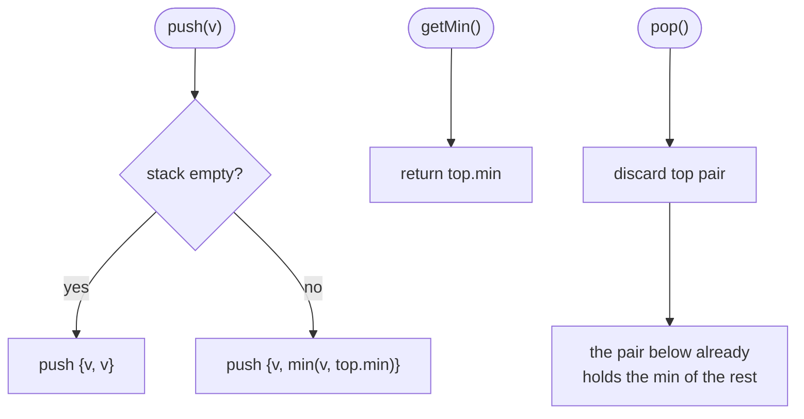

# LC 155 Min Stack

> [!abstract] In one sentence
> The minimum of a stack only changes when the stack changes, and a stack changes only at its top — so record "minimum so far" next to each pushed element and the current minimum is simply whatever sits on top, surviving pops for free.

**Map:** [[NeetCode 150 MOC]] → [[DSA Dashboard]] · Pattern: [[Stack & Monotonic Stack]]

> [!question] Predict before you read
> You keep a single `int min` field, updated on `push`. After `push(2)`, `push(1)`, `pop()`, what is `min`, and what information would you need to repair it? That missing information is what the solution stores.

## Problem

Design a stack that supports `push(val)`, `pop()`, `top()` and `getMin()` — retrieve the minimum element currently in the stack — with every operation in O(1) time.

- `push(-2)`, `push(0)`, `push(-3)`, `getMin()` → `-3`, `pop()`, `top()` → `0`, `getMin()` → `-2`

Constraints that matter: values in `[−2³¹, 2³¹ − 1]` (so a sentinel such as `Integer.MAX_VALUE` is a valid input, not a safe "empty" marker), up to 3 · 10⁴ operations, and `pop`/`top`/`getMin` are only ever called on a non-empty stack.

## Clarifying questions

1. Must `getMin` be O(1), or is O(1) amortised acceptable? — Strictly O(1) per call; this rules out scanning.
2. Can `pop`, `top` or `getMin` be called on an empty stack? — No, by the problem statement; otherwise say what you would throw or return.
3. Are duplicates possible, and does `getMin` after popping one copy still report the value? — Yes and yes; this decides `<` versus `<=` in the two-stack variant.
4. Is extra memory proportional to the stack acceptable? — Yes; the O(1)-extra-space version exists but needs `long` arithmetic and is a follow-up, not the baseline.

## Brute force

Plain stack; `getMin` scans every element. `push`/`pop`/`top` O(1), `getMin` O(n). Alternatively keep a `min` field: `push` updates it in O(1), but after `pop` removes the minimum you must rescan to find the next one — O(n) again. The waste: the "next minimum after popping" was known at the moment the popped element was pushed (it was the minimum of the stack *underneath*), and the brute force throws that fact away.

## The key insight

Attach to each element the minimum of the stack *as it was when that element became the top*. Because a stack is only ever modified at its top, the minimum of the whole stack is the value attached to the top element, and popping an element also pops its attached minimum, revealing the correct minimum of the remaining stack with no computation. This is a general design move: when a query needs an aggregate (min, max, sum) over a structure that changes only at one end, snapshot the aggregate at that end. Recognition cue: "O(1) for a query that normally needs a scan" on a stack/queue → carry the aggregate with the data (stack) or keep a monotonic helper (queue, see [[LC 239 Sliding Window Maximum]]).

## Optimal approach

1. Each stack entry is a pair `{value, minBelowOrHere}`.
2. `push(v)`: `newMin = stack empty ? v : min(v, top.min)`; push `{v, newMin}`.
3. `pop()`: pop the pair; the pair underneath already carries the right minimum.
4. `top()`: top pair's value. `getMin()`: top pair's min.



> [!example]- Excalidraw version — the same diagram as an editable canvas
> ![[LC 155 Min Stack — Optimal approach.excalidraw]]
> [[LC 155 Min Stack — Optimal approach.excalidraw|Open in Excalidraw]] — needs the Excalidraw plugin (see [[Plugins to Install]]).

## Walkthrough

The example sequence, showing both halves of every pair (top on the right):

| operation | stack of {value, min} | returns |
|---|---|---|
| `push(-2)` | `{-2,-2}` | |
| `push(0)` | `{-2,-2} {0,-2}` | |
| `push(-3)` | `{-2,-2} {0,-2} {-3,-3}` | |
| `getMin()` | unchanged | `-3` (top.min) |
| `pop()` | `{-2,-2} {0,-2}` | |
| `top()` | unchanged | `0` |
| `getMin()` | unchanged | `-2` (top.min, no scan) |

> [!example] Stack after push(-2), push(0), push(-3): each cell is value | min-so-far
> ![[LC 155 Min Stack — Stack after push(-2), push(0), push(-3)- each cell is value - min-so-far.excalidraw]]
> [[LC 155 Min Stack — Stack after push(-2), push(0), push(-3)- each cell is value - min-so-far.excalidraw|Open in Excalidraw]] — the min column is non-increasing from bottom to top, so the answer is always at the top

%% excalidraw-spec
{"kind": "array", "title": "Stack after push(-2), push(0), push(-3): each cell is value | min-so-far", "values": ["-2 | -2", "0 | -2", "-3 | -3"], "pointers": {"top": 2}, "highlight": [2], "labels": {"1": "survives the pop: min = -2", "2": "getMin reads here"}, "caption": "the min column is non-increasing from bottom to top, so the answer is always at the top"}
%%

## Java solution

```java
import java.util.*;

class MinStack {
    private final Deque<int[]> stack = new ArrayDeque<>();   // {value, min of this element and everything below}

    public void push(int val) {
        int min = stack.isEmpty() ? val : Math.min(val, stack.peek()[1]);
        stack.push(new int[]{val, min});
    }

    public void pop() {
        stack.pop();                                      // the pair below already carries the min of the rest
    }

    public int top() {
        return stack.peek()[0];
    }

    public int getMin() {
        return stack.peek()[1];
    }
}
```

**Time** O(1) for every operation · **Space** O(n) (two ints per element)

The classic alternative keeps a second stack holding only the values that *were* a new minimum when pushed, and pops it only when the popped value equals its top. It stores fewer entries when minima are rare, at the cost of the duplicate trap (`<=`, not `<`):

```java
// snippet
Deque<Integer> vals = new ArrayDeque<>(), mins = new ArrayDeque<>();
void push(int v) { vals.push(v); if (mins.isEmpty() || v <= mins.peek()) mins.push(v); }   // <= : a duplicate minimum must be pushed too
void pop()       { if (vals.pop().equals(mins.peek())) mins.pop(); }                        // equals, not == : boxed Integers
int getMin()     { return mins.peek(); }
```

## Why it works

Invariant: for every entry `e` in the stack, `e.min` equals the minimum of all values from the bottom up to and including `e`. `push` establishes it for the new top from the old top's `min` (which, by the invariant, summarises everything underneath) and the new value. `pop` removes the top entry only, and the invariant for the remaining entries never depended on it, so it still holds. `getMin` returns `top.min`, which by the invariant is the minimum of the entire stack. Nothing is ever recomputed, so every operation is a constant number of deque operations, and `ArrayDeque` gives O(1) amortised push/pop with no boxing of the pair array itself.

## Edge cases

- `push(Integer.MIN_VALUE)`: stored as a plain int pair; no sentinel arithmetic, so no overflow (the O(1)-space "store the difference" trick needs `long` precisely here).
- Duplicate minimums (`push(1)`, `push(1)`, `pop()`, `getMin()` → `1`): the pair version is immune; the two-stack version needs `<=` on push.
- Popping the current minimum: the pair below exposes the previous minimum — this is the case the single-field approach cannot handle.
- Single element: `top()` and `getMin()` return the same value.
- 3 · 10⁴ pushes with no pops: 3 · 10⁴ small arrays; fine.
- Operations on an empty stack are excluded by the problem; `peek()` would return `null` and throw a `NullPointerException` on `[0]` — say that you would guard it in production code.

## Common mistakes

> [!warning] What goes wrong
> - A single `min` field with no history — correct until the first `pop` of the minimum.
> - Two-stack version with `v < mins.peek()`: `push(1)`, `push(1)`, `pop()` now reports an empty `mins` or a wrong minimum.
> - Two-stack version comparing `vals.pop() == mins.peek()` on boxed `Integer`s: identity comparison, wrong outside the `[-128, 127]` cache. Use `equals` or `intValue()`.
> - Recomputing the minimum in `pop` with a scan "just to be safe": O(n) and the whole point lost.
> - `java.util.Stack` and `Vector` synchronisation overhead; use `ArrayDeque`.
> - Storing `Integer.MAX_VALUE` as the minimum of an empty stack and comparing against it: a legal input value collides with the sentinel; branch on `isEmpty()` instead.

## Variants & follow-ups

- O(1) extra space: store `val − min` as a `long` on a single stack and keep one `min` field; a negative stored difference marks "this push changed the minimum" and lets `pop` restore the old one as `min − diff`. Overflow-safe only with `long`.
- Max stack with `popMax()` (LC 716): the minimum trick does not survive deleting from the middle; use a `TreeMap` of values to a stack of positions plus a doubly linked list, O(log n).
- Min *queue*: two min-stacks simulate a queue (amortised O(1)), or a monotonic deque when only the front is popped — the structure behind [[LC 239 Sliding Window Maximum]].
- Carrying an aggregate alongside data appears again in [[LC 146 LRU Cache]] (order next to values) and [[LC 295 Find Median from Data Stream]] (two heaps keep the middle at the tops).
- Thread safety: wrap operations in a lock or use `ConcurrentLinkedDeque` plus an atomic pair; the pair approach still works because each entry is immutable once pushed.

## Interview script

Restate: "a stack with O(1) push, pop, top and getMin; values span the full int range; no calls on an empty stack." Brute force: "scan for the minimum on `getMin`, or keep a `min` field that breaks the first time I pop the minimum." Insight: "the stack only changes at its top, so I snapshot the minimum-so-far next to each element; popping restores the previous snapshot automatically." Approach: "a deque of `{value, min}` pairs; `push` takes `min(value, top.min)`; `pop` discards a pair; `getMin` reads `top.min`." Complexity: "O(1) per operation, O(n) memory, two ints per element." Tests: pop the minimum, duplicate minimums, `Integer.MIN_VALUE`, single element. If they push: "an auxiliary stack of minimums only, with `<=` for duplicates, or O(1) extra space via stored differences in `long`."

## Related

- Pattern: [[Stack & Monotonic Stack]] (stack as a data structure to *design* with, before it becomes an algorithmic tool)
- Prerequisites: [[LC 20 Valid Parentheses]] (stack API in Java)
- Siblings: [[LC 739 Daily Temperatures]] (the stack as an algorithm), [[LC 146 LRU Cache]], [[LC 295 Find Median from Data Stream]], [[LC 239 Sliding Window Maximum]]
- Java: [[Java Collections Cheat Sheet]] (`ArrayDeque` methods, `int[]` as a pair, `Math.min`), [[Java Pitfalls in Interviews]] (boxed `Integer` equality, `peek()` returning `null`), [[DSA Patterns in Java]]

## Attempt log

| Date | Result | Minutes | What I got wrong |
|---|---|---|---|
| | | | |

### Mastery checklist
- [ ] Solved without hints in under 25 minutes
- [ ] Stated complexity before coding
- [ ] Handled every edge case above
- [ ] Code compiled first time
- [ ] Can do the follow-up variant

## Open questions
- [ ] Implement the O(1)-extra-space difference version and find the exact `push` sequence of two values that overflows an `int` difference but not a `long`.
- [ ] Why can the same snapshot trick not give O(1) `getMin` for a *queue*? What property of a stack does the proof use?
