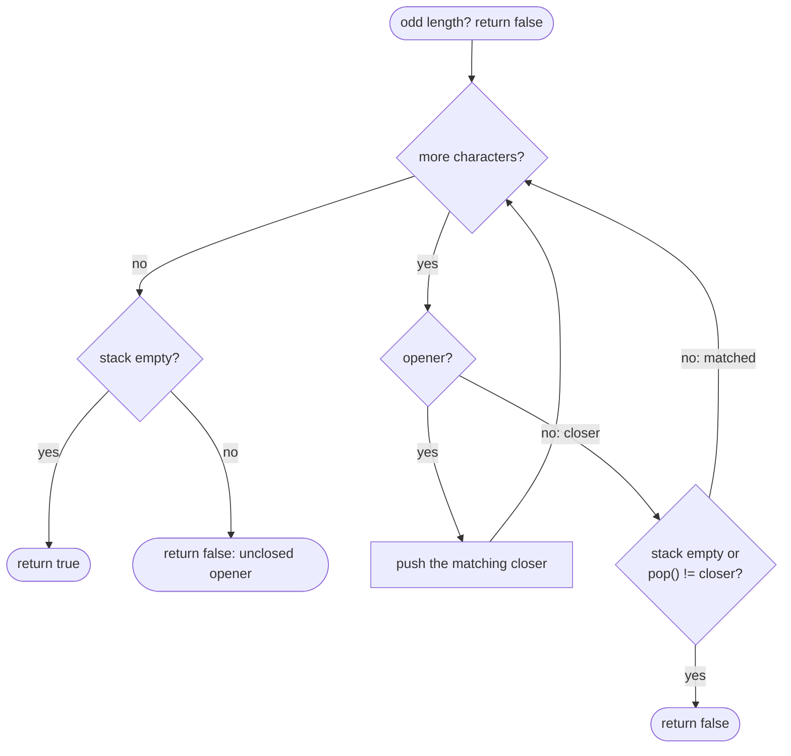

# LC 20 Valid Parentheses

> [!abstract] In one sentence
> The bracket opened most recently must be the one closed next, which is exactly last-in-first-out — so push openers, and every closer must match the top of the stack; nothing may be left open at the end.

**Map:** [[NeetCode 150 MOC]] → [[DSA Dashboard]] · Pattern: [[Stack & Monotonic Stack]]

> [!question] Predict before you read
> Counting alone — `opens++` on `(` and `opens--` on `)`, never negative, zero at the end — correctly validates a string with a single bracket type. Write a three-type input that counting accepts but a stack rejects.

## Problem

Given a string made only of the six characters `(`, `)`, `[`, `]`, `{`, `}`, return `true` if every opening bracket is closed by the same type of bracket and the brackets close in the correct order, with every closer having a matching opener.

- `"()[]{}"` → `true`
- `"([{}])"` → `true`
- `"([)]"` → `false` (the `[` is still open when `)` arrives)
- `"]"` → `false` (closer with nothing open)

Constraints that matter: `1 ≤ |s| ≤ 10⁴`, only the six bracket characters — so one pass with a stack is the obvious target and there is no parsing of other characters to worry about.

## Clarifying questions

1. Only brackets, no letters or spaces? — Yes; if other characters could appear, skip them (the algorithm does not change).
2. Is the empty string valid? — Not in the constraints here, but conventionally yes (nothing is unmatched); the code below returns `true` for it.
3. Does `"(]"` count as the right *number* of brackets but wrong type? — It is invalid; type must match, not just count.
4. Can I assume the length fits a stack in memory? — Yes, 10⁴; in a streaming setting you would need the same stack anyway, bounded by the nesting depth.

## Brute force

Repeatedly delete any adjacent pair `()`, `[]`, `{}` with `replace` until nothing changes; valid iff the string becomes empty. Each `replace` is O(n) and up to n/2 rounds may be needed (`"((((...))))"` removes one pair per round), so O(n²). The waste: every round rescans the whole string to find a pair, when the only pair that can ever be removed is the one formed at the *most recently opened* bracket — which the stack keeps at its top.

## The key insight

Validity is a nesting rule: when a closer arrives, the only opener it may close is the latest one still open. That is a last-in-first-out discipline, so a stack holds "openers still waiting", and three checks decide everything: a closer with an empty stack is invalid, a closer whose type differs from the top is invalid, anything left on the stack at the end is invalid. The small trick that keeps the code free of a lookup table: when you see `(`, push `)` — the closer you now expect — so the closing step is a single equality test. Recognition cue: "properly nested", "balanced", "matching pairs in order", "most recent open thing must be resolved first" → stack.

## Optimal approach

1. If the length is odd, return `false` immediately (every bracket needs a partner).
2. Walk the string. For an opener push its matching closer onto the stack.
3. For a closer: if the stack is empty, or the popped element differs from it, return `false`.
4. After the walk, return `true` iff the stack is empty.



> [!example]- Excalidraw version — the same diagram as an editable canvas
> ![[LC 20 Valid Parentheses — Optimal approach.excalidraw]]
> [[LC 20 Valid Parentheses — Optimal approach.excalidraw|Open in Excalidraw]] — needs the Excalidraw plugin (see [[Plugins to Install]]).

## Walkthrough

`s = "([{}])"` — every closer meets the closer that was pushed for its opener:

| i | s[i] | action | stack after (top on the right) |
|---|---|---|---|
| 0 | `(` | push `)` | `)` |
| 1 | `[` | push `]` | `)` `]` |
| 2 | `{` | push `}` | `)` `]` `}` |
| 3 | `}` | pop `}` == `}` | `)` `]` |
| 4 | `]` | pop `]` == `]` | `)` |
| 5 | `)` | pop `)` == `)` | empty → `true` |

`s = "([)]"`: after `(` and `[` the stack is `)` `]`; the `)` at index 2 pops `]`, which is not `)`, so the answer is `false` at once — the stack never needs to look deeper than its top.

> [!example] Stack of expected closers while scanning ([{}])
> ![[LC 20 Valid Parentheses — Stack of expected closers while scanning (-{}-).excalidraw]]
> [[LC 20 Valid Parentheses — Stack of expected closers while scanning (-{}-).excalidraw|Open in Excalidraw]] — the last closer pushed is the first one that may be consumed — LIFO is the whole algorithm

%% excalidraw-spec
{"kind": "array", "title": "Stack of expected closers while scanning ([{}])", "values": [")", "]", "}"], "pointers": {"top": 2}, "highlight": [2], "labels": {"0": "pushed at i = 0", "2": "popped first (i = 3)"}, "caption": "the last closer pushed is the first one that may be consumed — LIFO is the whole algorithm"}
%%

## Java solution

```java
import java.util.*;

class Solution {
    public boolean isValid(String s) {
        if (s.length() % 2 != 0) return false;            // an odd count can never pair up
        Deque<Character> stack = new ArrayDeque<>();      // closers we still expect, latest on top
        for (char c : s.toCharArray()) {
            switch (c) {
                case '(' -> stack.push(')');              // push what must come back, not what came in
                case '[' -> stack.push(']');
                case '{' -> stack.push('}');
                default -> {                               // a closer: must equal the most recent expectation
                    if (stack.isEmpty() || stack.pop() != c) return false;
                }
            }
        }
        return stack.isEmpty();                           // anything left is an opener that never closed
    }
}
```

**Time** O(n) · **Space** O(n) (worst case `"((((("` pushes everything)

## Why it works

Invariant: after processing a prefix, the stack holds, bottom to top, the closers of exactly the openers in that prefix that are not yet closed, in the order they were opened. An opener extends it; a closer is legal only if it closes the newest open bracket, which sits on top, and popping restores the invariant for the shorter set of open brackets. A valid string closes every opener in nesting order, so each closer finds its partner on top and the stack is empty at the end; an invalid string either produces a closer that does not match the top (wrong type or wrong order, as in `"([)]"`), a closer on an empty stack (`")("`), or leaves openers behind (`"(("`). The three checks are therefore exactly the three ways to be invalid, and each character is pushed and popped at most once.

## Edge cases

- Odd length (`"(()"`): rejected before the loop by the parity check; the loop would also reject it at the end.
- Closer first (`")("`): empty stack on the first character → `false`.
- Only openers (`"{{{"`): the loop finishes with three items on the stack → `false`.
- Deep nesting (`"((((...))))"`, 10⁴ characters): `ArrayDeque` grows to 5 000 entries and shrinks back; no recursion, so no stack overflow.
- Right counts, wrong order (`"([)]"`): caught by the type comparison at the first mismatching closer.
- Empty string: returns `true` (nothing to match) — say so out loud if the interviewer's constraints allow it.

## Common mistakes

> [!warning] What goes wrong
> - Using `Stack<Character>` — it works, but it is a synchronised legacy class; `ArrayDeque` with `push`/`pop`/`peek` is the idiomatic Java stack.
> - `stack.pop()` on an empty deque throws `NoSuchElementException`; check `isEmpty()` first (a `peek()` returns `null` instead, which then fails on unboxing).
> - Comparing two boxed `Character` values with `==` (`stack.peek() == pairs.get(c)`): identity, not equality — it happens to work for ASCII because of the `Character` cache for values ≤ 127, which is luck, not correctness. Compare against a `char` (auto-unboxes) or use `equals`.
> - Forgetting the final `isEmpty()` check: `"(("` passes the loop with no mismatch.
> - Counting instead of matching: a counter per type accepts `"([)]"`; order matters, and only a stack remembers order.
> - Pushing the opener and then needing a map/switch at the closer to translate it — fine, but pushing the expected closer removes that lookup and a class of bugs.

## Variants & follow-ups

- Minimum insertions to make the string valid (LC 921): count unmatched closers as you go and unmatched openers at the end; no stack needed for one type.
- Minimum removals to make it valid (LC 1249): stack of *indices* of unmatched `(`, mark unmatched `)` immediately, delete all marked positions.
- Longest valid parentheses substring (LC 32): stack of indices with a sentinel `-1`; the length is `i − top` after each pop.
- Wildcards `*` that may be `(`, `)` or empty → [[LC 678 Valid Parenthesis String]]: the stack becomes a range of possible open counts, a greedy argument.
- Generate every valid string of `n` pairs → [[LC 22 Generate Parentheses]]: the validity condition (never more closers than openers, equal at the end) becomes the pruning rule.
- Streaming input with bounded memory: the stack depth is the nesting depth; if only the *count* of open brackets of one type is needed, O(1) space suffices.

## Interview script

Restate: "six bracket characters; valid means every opener is closed by the same type, in nesting order, nothing left over." Brute force: "repeatedly delete adjacent pairs until the string is empty — O(n²) because each pass rescans." Insight: "the closer must match the most recently opened bracket, which is LIFO, so a stack of pending openers decides it in one pass." Approach: "for an opener I push the closer I expect; for a closer I require a non-empty stack whose top equals it; at the end the stack must be empty." Complexity: "O(n) time, O(n) stack in the worst case." Tests: `"([)]"`, `")("`, `"(("`, odd length, deep nesting. If they push: "with one bracket type a counter is enough; with several, order matters and a counter cannot see it."

## Related

- Pattern: [[Stack & Monotonic Stack]] (the parsing shape); recursion depth equals nesting depth: [[Recursion]]
- Prerequisites: none — this is the first stack problem of the sheet
- Siblings: [[LC 155 Min Stack]], [[LC 150 Evaluate Reverse Polish Notation]], [[LC 22 Generate Parentheses]], [[LC 678 Valid Parenthesis String]]
- Java: [[Java Collections Cheat Sheet]] (`ArrayDeque` as a stack: `push`, `pop`, `peek`, `isEmpty`; `switch` with arrows), [[Java Pitfalls in Interviews]] (boxed `Character` and `==`), [[DSA Patterns in Java]] (stack template)

## Attempt log

| Date | Result | Minutes | What I got wrong |
|---|---|---|---|
| | | | |

### Mastery checklist
- [ ] Solved without hints in under 25 minutes
- [ ] Stated complexity before coding
- [ ] Handled every edge case above
- [ ] Code compiled first time
- [ ] Can do the follow-up variant

## Open questions
- [ ] Rewrite the solution pushing the *opener* and matching with a `Map<Character, Character>`; which version has fewer places to make an off-by-one or null mistake, and why?
- [ ] For LC 32 (longest valid substring), why does the stack need the sentinel `-1` at the bottom, and what breaks without it?
