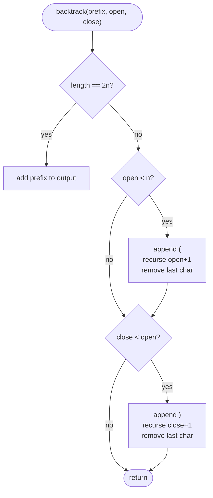

# LC 22 Generate Parentheses

> [!abstract] In one sentence
> A prefix of a valid string is characterised by two counters — opens used and closes used — and the two rules "open < n" and "close < open" are the only choices that can still lead to a valid string, so a depth-first build with those two guards enumerates exactly the valid strings and nothing else.

**Map:** [[NeetCode 150 MOC]] → [[DSA Dashboard]] · Pattern: [[Stack & Monotonic Stack]] · also [[Backtracking]]

> [!question] Predict before you read
> For `n = 3` there are 20 strings of three `(` and three `)`. How many are valid, and which prefix of length 2 can never be completed? Say the rule that rejects that prefix before you read on.

## Problem

Given `n`, return all strings consisting of exactly `n` opening and `n` closing parentheses that are well-formed (every closer matches an earlier opener, as in [[LC 20 Valid Parentheses]]). Any order of the output is accepted.

- `n = 1` → `["()"]`
- `n = 3` → `["((()))", "(()())", "(())()", "()(())", "()()()"]`

Constraints that matter: `1 ≤ n ≤ 8`, so the output has at most C(8) = 1 430 strings of length 16 — the answer set itself is the lower bound on work, and the goal is to never generate a string that is later thrown away.

## Clarifying questions

1. Must the output be in a particular order (lexicographic)? — No; the backtracking below happens to produce lexicographic order anyway because `(` is tried before `)`.
2. Only round brackets, or several types? — Only `(` and `)`; with k types the count becomes k^n · C(n), same shape.
3. How large can `n` get — do I need to worry about the output size? — `n ≤ 8`; the count is Catalan, exponential, so any solution is output-bound.
4. Should I return the count only, or the strings? — The strings; counting alone has a closed form (Catalan) and a simple DP.

## Brute force

Generate all 2^(2n) strings of `(` and `)`, keep those with n of each that pass the LC 20 check: O(2^(2n) · n) = O(4^n · n). For n = 8 that is 65 536 candidates for 1 430 answers. The waste: a prefix such as `())` can never be completed, yet the brute force extends it in every possible way and validates each extension from scratch. Generating only strings with n of each symbol (C(2n, n) of them) still wastes most of the work.

## The key insight

Validity of a full string is a property of its prefixes: at every point the number of `)` must not exceed the number of `(`, and at the end both equal n. So a prefix is extendable to a valid string exactly when `open ≤ n` and `close ≤ open`, and the two legal moves from an extendable prefix are "add `(` if `open < n`" and "add `)` if `close < open`". Building depth-first with those two guards means every path of length 2n is a valid string and no dead end is ever entered — the pruning is perfect. The connection to the stack category: `open − close` is the current stack depth of the LC 20 check; the guard `close < open` says "never pop an empty stack", and `open < n` bounds the total pushes. Recognition cue: "generate all valid …", "all combinations that satisfy a rule checkable on prefixes" → backtracking with the rule as the pruning condition.

## Optimal approach

1. Keep a `StringBuilder` prefix and the counters `open`, `close`.
2. If the prefix has length `2n`, record it (it is valid by construction) and return.
3. If `open < n`: append `(`, recurse with `open + 1`, remove it (unchoose).
4. If `close < open`: append `)`, recurse with `close + 1`, remove it.



> [!example]- Excalidraw version — the same diagram as an editable canvas
> ![[LC 22 Generate Parentheses — Optimal approach.excalidraw]]
> [[LC 22 Generate Parentheses — Optimal approach.excalidraw|Open in Excalidraw]] — needs the Excalidraw plugin (see [[Plugins to Install]]).

## Walkthrough

`n = 2`: the recursion tree has one leaf per answer and no dead branches. The prefix `)` is never created (`close < open` fails at the root) and `(()` cannot take a third `(` (`open < n` fails):

> [!example] Backtracking tree for n = 2 — every leaf is a valid string
> ![[LC 22 Generate Parentheses — Backtracking tree for n = 2 — every leaf is a valid string.excalidraw]]
> [[LC 22 Generate Parentheses — Backtracking tree for n = 2 — every leaf is a valid string.excalidraw|Open in Excalidraw]] — labels show prefix (open, close); the root has one child because ) is refused while close == open

%% excalidraw-spec
{"kind": "tree", "title": "Backtracking tree for n = 2 — every leaf is a valid string", "nodes": [{"id": "r", "label": "\"\" (0,0)", "children": ["a"]}, {"id": "a", "label": "( (1,0)", "children": ["b", "c"]}, {"id": "b", "label": "(( (2,0)", "children": ["d"]}, {"id": "c", "label": "() (1,1)", "children": ["e"]}, {"id": "d", "label": "(() (2,1)", "children": ["f"]}, {"id": "e", "label": "()( (2,1)", "children": ["g"]}, {"id": "f", "label": "(()) leaf", "children": []}, {"id": "g", "label": "()() leaf", "children": []}], "root": "r", "highlight": ["f", "g"], "caption": "labels show prefix (open, close); the root has one child because ) is refused while close == open"}
%%

| call (prefix, open, close) | `(` allowed? | `)` allowed? | result |
|---|---|---|---|
| `""`, 0, 0 | yes | no (0 < 0 false) | one child |
| `(`, 1, 0 | yes | yes | two children |
| `((`, 2, 0 | no | yes | one child |
| `(()`, 2, 1 | no | yes | leaf `(())` |
| `()`, 1, 1 | yes | no | one child |
| `()(`, 2, 1 | no | yes | leaf `()()` |

## Java solution

```java
import java.util.*;

class Solution {
    public List<String> generateParenthesis(int n) {
        List<String> out = new ArrayList<>();
        backtrack(new StringBuilder(), 0, 0, n, out);
        return out;
    }

    private void backtrack(StringBuilder sb, int open, int close, int n, List<String> out) {
        if (sb.length() == 2 * n) {                       // valid by construction: open == close == n here
            out.add(sb.toString());
            return;
        }
        if (open < n) {                                   // choose '(' while openers remain
            sb.append('(');
            backtrack(sb, open + 1, close, n, out);
            sb.deleteCharAt(sb.length() - 1);             // unchoose: restore the shared prefix
        }
        if (close < open) {                               // choose ')' only if it has an unmatched partner
            sb.append(')');
            backtrack(sb, open, close + 1, n, out);
            sb.deleteCharAt(sb.length() - 1);
        }
    }
}
```

**Time** O(4^n / √n) — each of the C(n) ≈ 4^n / (n^(3/2) √π) answers costs O(n) to copy, and the tree has O(n · C(n)) nodes · **Space** O(n) recursion and prefix, plus the output

## Why it works

Claim: a string of `(` and `)` is valid iff every prefix has `close ≤ open` and the full string has `open = close = n`. The recursion maintains `close ≤ open ≤ n` as an invariant on the prefix (the two guards are exactly the conditions under which appending preserves it), so every prefix it builds satisfies the prefix condition. At length 2n, `open ≤ n` and `close ≤ open` with `open + close = 2n` force `open = close = n`, so every leaf is valid. Conversely every valid string is reached: at each position its next character is a legal choice (if it is `(` then `open < n` because the string has only n openers; if `)` then `close < open` by the prefix condition), so the DFS follows it to a leaf. Distinct paths produce distinct strings, hence no duplicates. The tree has no dead ends, so the work is proportional to the output.

## Edge cases

- `n = 1`: root → `(` → `()`; one string.
- `n = 8` (maximum): 1 430 strings of length 16; recursion depth 16; trivial.
- Prefix sharing: `StringBuilder` is mutated and restored; forgetting the restore corrupts later branches — the walkthrough's `()` branch depends on `((`'s appends having been undone.
- Order of guards: trying `(` before `)` yields lexicographic output (`(` < `)` in ASCII); swapping them is still correct, just a different order.
- The leaf test `sb.length() == 2 * n` could equally be `open == n && close == n`; both hold at the same moment.

## Common mistakes

> [!warning] What goes wrong
> - Guard `close < n` instead of `close < open`: generates `)(` and every other string with n of each symbol, then needs a validity filter — the pruning is gone.
> - Forgetting `deleteCharAt` after the recursive call (or using `sb.append` with a `String` parameter and expecting immutability): later branches see a polluted prefix. With `String` concatenation instead of `StringBuilder` there is nothing to undo, at O(n) per append.
> - Recording `sb` itself (`out.add(sb)`) rather than `sb.toString()`: every entry is the same mutable object, empty at the end.
> - Generating all 2^(2n) strings and filtering, then claiming O(C(n)) time.
> - Stating the complexity as O(2^n): the count is Catalan, ~4^n / n^(3/2); say "output-bound, Catalan".
> - Using a `Set` to dedupe: unnecessary — distinct paths give distinct strings — and it hides a wrong guard.

## Variants & follow-ups

- Count only: Catalan numbers, `C(0) = 1`, `C(n) = Σ C(i) · C(n − 1 − i)` — the "first pair encloses i pairs, n − 1 − i pairs follow" decomposition; O(n²) DP.
- Closure-number construction (same decomposition, generating strings): for each `c` in `0..n−1`, `"(" + left + ")" + right` for `left` in gen(c), `right` in gen(n − 1 − c); no pruning needed because it only ever composes valid pieces.
- Several bracket types: at each step choose which type to open; the close move must match the top of a stack of open types — the stack reappears literally.
- Check validity instead of generating it → [[LC 20 Valid Parentheses]]; validity with wildcards → [[LC 678 Valid Parenthesis String]] (the `open − close` range argument).
- Same choose/explore/unchoose skeleton with a different guard: [[LC 78 Subsets]] (index guard), [[LC 39 Combination Sum]] (remaining-sum guard), see [[Backtracking]].
- k-th valid string in lexicographic order without generating all: walk the tree counting how many leaves each subtree has (a Catalan-shaped table), skipping subtrees.

## Interview script

Restate: "all well-formed strings of n pairs; n ≤ 8; any order." Brute force: "enumerate 2^(2n) strings and validate each — exponential waste on prefixes like `())`." Insight: "validity is a prefix property: never more `)` than `(` so far, and at most n `(`; those two guards make backtracking prune perfectly, so every leaf is an answer." Approach: "DFS with a shared `StringBuilder` and two counters; append `(` if `open < n`, append `)` if `close < open`, remove after each recursive call; record at length 2n." Complexity: "output-bound: C(n) strings, roughly 4^n / n^(3/2), each copied in O(n); O(n) recursion depth." Tests: `n = 1`, check `n = 3` gives five strings, ensure the restore step runs for both branches. If they push: "counting only is the Catalan recurrence in O(n²); for several bracket types the close move consults a stack of open types."

## Related

- Pattern: [[Stack & Monotonic Stack]] (the depth counter `open − close` is the LC 20 stack); the enumeration skeleton: [[Backtracking]]; call tree and unwinding: [[Recursion]]
- Prerequisites: [[LC 20 Valid Parentheses]] (why the guard is `close < open`)
- Siblings: [[LC 78 Subsets]], [[LC 39 Combination Sum]], [[LC 46 Permutations]], [[LC 678 Valid Parenthesis String]]
- Java: [[Java Collections Cheat Sheet]] (`StringBuilder.append`, `deleteCharAt`, `setLength`), [[DSA Patterns in Java]] (backtracking template), [[Java Pitfalls in Interviews]] (`String` concatenation in loops)

## Attempt log

| Date | Result | Minutes | What I got wrong |
|---|---|---|---|
| | | | |

### Mastery checklist
- [ ] Solved without hints in under 25 minutes
- [ ] Stated complexity before coding
- [ ] Handled every edge case above
- [ ] Code compiled first time
- [ ] Can do the follow-up variant

## Open questions
- [ ] Implement the closure-number version and verify it produces the same five strings for `n = 3` in a different order; which version is easier to adapt to k bracket types?
- [ ] Spot the bug: the leaf test is `if (open == n) { out.add(sb.toString()); return; }`. What does it output for `n = 2`, and which guard would have to change to make it correct?
