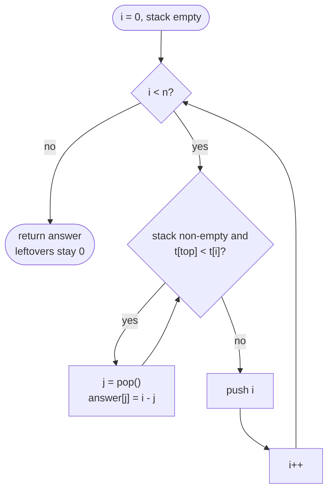

# LC 739 Daily Temperatures

> [!abstract] In one sentence
> A day that is still waiting for a warmer day is useless to every later day if a warmer one has already arrived — so keep only the waiting days on a stack (necessarily in non-increasing temperature order), and when a new day arrives it answers every waiting day colder than itself in one burst of pops.

**Map:** [[NeetCode 150 MOC]] → [[DSA Dashboard]] · Pattern: [[Stack & Monotonic Stack]]

> [!question] Predict before you read
> Temperatures `[75, 71, 69, 72]`. Day 3 (72) arrives. Which earlier days get their answer now, in what order, and why can day 0 (75) never be answered by a day that fails to answer day 1 (71)?

## Problem

Given an array `temperatures` of daily temperatures, return an array `answer` where `answer[i]` is the number of days you must wait after day `i` for a *strictly* warmer temperature, or `0` if no such day exists.

- `[73,74,75,71,69,72,76,73]` → `[1,1,4,2,1,1,0,0]`
- `[30,40,50,60]` → `[1,1,1,0]`
- `[30,60,90]` → `[1,1,0]`

Constraints that matter: `1 ≤ n ≤ 10⁵`, temperatures in `[30, 100]` — n² = 10¹⁰ rules out the double loop, and the tiny value range hints at a second (value-indexed) solution.

## Clarifying questions

1. Strictly warmer, or warmer-or-equal? — Strictly; this decides whether equal temperatures pop (`<`) or stay (`<=`).
2. The answer is the distance in days, not the warmer temperature or its index? — The distance `j − i`.
3. What if no warmer day exists? — `0`; the stack version gets this for free from the default array value.
4. Can I modify the input or must I allocate the output? — Allocate `int[n]`; the O(1)-extra-space variant reuses the output array as jump pointers.

## Brute force

For each `i`, scan right until a temperature greater than `temperatures[i]`: O(n²) worst case (a non-increasing sequence scans to the end every time). The waste: the scan from `i` and the scan from `i + 1` cover almost the same days, and once some day `j` has been found warmer than day `i + 1`, every day in between is colder than day `i + 1` and so can never be the answer for any earlier, warmer day either — yet the brute force rescans them for each `i`.

## The key insight

Walk left to right and keep the days whose answer is still unknown. Those days form a non-increasing sequence of temperatures: if a waiting day `a` were followed by a waiting day `b` with `t[b] > t[a]`, then `b` would already have answered `a`. So the waiting set is a stack of indices whose temperatures never increase from bottom to top (equal temperatures sit next to each other), and a new day `i` resolves exactly the top run of waiting days colder than `t[i]`: pop them, each gets `i − j`, and `i` joins the stack. The structure is the "next greater element" monotonic stack; the output here just happens to be a distance. Recognition cue: "for each element, the nearest element to its right (or left) that is greater / smaller" → monotonic stack, O(n).

## Optimal approach

1. `answer = new int[n]` (default `0` = never warmer); empty stack of indices.
2. For each `i`: while the stack is non-empty and `t[top] < t[i]`, pop `j` and set `answer[j] = i − j`.
3. Push `i`.
4. Whatever is left on the stack keeps `0`.



> [!example]- Excalidraw version — the same diagram as an editable canvas
> ![[LC 739 Daily Temperatures — Optimal approach.excalidraw]]
> [[LC 739 Daily Temperatures — Optimal approach.excalidraw|Open in Excalidraw]] — needs the Excalidraw plugin (see [[Plugins to Install]]).

## Walkthrough

`[73,74,75,71,69,72,76,73]`; the stack holds indices, written with their temperatures:

| i | t[i] | pops (index → answer) | stack after (bottom → top) |
|---|---|---|---|
| 0 | 73 | — | 0(73) |
| 1 | 74 | 0 → 1 | 1(74) |
| 2 | 75 | 1 → 1 | 2(75) |
| 3 | 71 | — | 2(75) 3(71) |
| 4 | 69 | — | 2(75) 3(71) 4(69) |
| 5 | 72 | 4 → 1, 3 → 2 | 2(75) 5(72) |
| 6 | 76 | 5 → 1, 2 → 4 | 6(76) |
| 7 | 73 | — | 6(76) 7(73) |

Indices 6 and 7 remain on the stack: `answer[6] = answer[7] = 0`. Result `[1,1,4,2,1,1,0,0]`.

> [!example] Day 5 (72) arrives: the stack holds 2, 3, 4 with temperatures 75 > 71 > 69
> ![[LC 739 Daily Temperatures — Day 5 (72) arrives- the stack holds 2, 3, 4 with temperatures 75 - 71 - 69.excalidraw]]
> [[LC 739 Daily Temperatures — Day 5 (72) arrives- the stack holds 2, 3, 4 with temperatures 75 - 71 - 69.excalidraw|Open in Excalidraw]] — pops stop at the first index whose temperature is not below 72; everything deeper is warmer still

%% excalidraw-spec
{"kind": "array", "title": "Day 5 (72) arrives: the stack holds 2, 3, 4 with temperatures 75 > 71 > 69", "values": [73, 74, 75, 71, 69, 72, 76, 73], "pointers": {"i": 5, "top": 4}, "highlight": [2, 3, 4], "labels": {"3": "popped: 5 - 3 = 2", "4": "popped: 5 - 4 = 1", "2": "stays: 75 > 72"}, "caption": "pops stop at the first index whose temperature is not below 72; everything deeper is warmer still"}
%%

## Java solution

```java
import java.util.*;

class Solution {
    public int[] dailyTemperatures(int[] temperatures) {
        int n = temperatures.length;
        int[] answer = new int[n];                        // default 0: no warmer day found
        Deque<Integer> stack = new ArrayDeque<>();        // indices still waiting; temperatures non-increasing bottom -> top
        for (int i = 0; i < n; i++) {
            while (!stack.isEmpty() && temperatures[stack.peek()] < temperatures[i]) {
                int j = stack.pop();                      // day i is the first strictly warmer day after day j
                answer[j] = i - j;
            }
            stack.push(i);                                // day i now waits for its own warmer day
        }
        return answer;
    }
}
```

**Time** O(n) — each index is pushed once and popped at most once · **Space** O(n) for the stack (plus the output)

The right-to-left version needs no stack: `answer` doubles as a jump table. From day `i`, look at `j = i + 1`; while `t[j] ≤ t[i]` and `j` has a warmer day, jump `j += answer[j]` — the days skipped are all colder than or equal to `t[j]`, hence not warmer than `t[i]`:

```java
// snippet
for (int i = n - 2; i >= 0; i--) {
    int j = i + 1;
    while (temperatures[j] <= temperatures[i] && answer[j] > 0) j += answer[j];   // hop over days already known to be no warmer
    if (temperatures[j] > temperatures[i]) answer[i] = j - i;                     // else stays 0
}
```

## Why it works

Invariant: before processing day `i`, the stack contains exactly the indices `j < i` whose next warmer day is at or after `i`, in increasing index order with non-increasing temperatures. A day `j` is popped only by the first later day warmer than it (the loop examines days in order, and `j` sits on top exactly when every waiting day after it was colder than `t[i]` and has already been popped, or there was none), so `answer[j] = i − j` is the correct distance. Days warmer than or equal to `t[i]` stay, and since the stack is non-increasing, pops stop at the first such day — nothing below it can be colder than `t[i]`, so no answer is missed. Pushing `i` keeps the order non-increasing because everything strictly colder than `t[i]` was just removed, so the element below the new top is at least `t[i]`. Total pops ≤ total pushes = n, so the inner `while` costs O(n) over the whole run despite being nested.

## Edge cases

- Strictly decreasing input (`[100, 90, 80]`): nothing ever pops; the stack holds all n indices; all answers `0`.
- Strictly increasing input (`[30,40,50,60]`): every day pops exactly the previous one; the stack never exceeds one element.
- Equal temperatures (`[70, 70, 75]`): day 1 does not pop day 0 (`<`, not `<=`); day 2 pops both; answers `[2,1,0]`.
- Single day: pushed, never popped, `[0]`.
- The last day: never has a warmer day, always `0`.
- Values confined to `[30, 100]`: the alternative "for each temperature value remember the nearest index" solution is O(71 · n) and needs no stack — worth mentioning when the value range is tiny.

## Common mistakes

> [!warning] What goes wrong
> - Pushing temperatures instead of indices: you can compare, but you cannot compute `i − j` or write `answer[j]`. Push the index; look up the temperature through it.
> - `<=` in the pop condition: equal temperatures then count as "warmer", violating "strictly".
> - Using `if` instead of `while`: only the top waiting day is answered; `[73,74,75,71,69,72]` leaves day 3 at `0`.
> - Clearing or scanning the stack at the end "to set the zeros": `int[]` already defaults to 0.
> - `stack.peek()` returning a boxed `Integer` and indexing `temperatures[stack.peek()]`: fine (auto-unboxing), but comparing two `peek()` results with `==` elsewhere is identity comparison.
> - Calling it O(n²) because of the nested loop: argue with amortisation — each index is popped at most once.

## Variants & follow-ups

- Next greater element in a circular array (LC 503): run the loop for `2n` iterations with `i % n`, pushing only during the first pass.
- Next greater element across two arrays (LC 496): compute next-greater for the big array into a map, answer queries from it.
- Previous greater / next smaller / previous smaller: flip the comparison or the scan direction; the four combinations are one template — see [[Stack & Monotonic Stack]].
- Largest rectangle: previous-smaller and next-smaller around each bar → [[LC 84 Largest Rectangle in Histogram]].
- Stock span (LC 901): previous greater-or-equal with distances, online — the stack holds `(price, span)` pairs.
- Sliding window maximum: a monotonic *deque* where the front also expires → [[LC 239 Sliding Window Maximum]].
- Return the warmer temperature or its index instead of the distance: same pops, different assignment.

## Interview script

Restate: "for each day, the number of days until a strictly warmer temperature, 0 if none; n up to 10⁵." Brute force: "scan right for each day, O(n²), too slow for 10⁵ on a decreasing input." Insight: "the days still waiting for an answer have decreasing temperatures, so a new day resolves a run at the top of a stack and is itself resolved by a later one — next greater element." Approach: "stack of indices; for each day, pop while the top is colder and record `i − j`; then push `i`; leftovers stay 0." Complexity: "O(n) amortised — each index pushed and popped once — and O(n) stack." Tests: decreasing input, increasing input, equal temperatures, single day. If they push: "right-to-left with the answer array as a jump table removes the stack; and with temperatures in `[30, 100]` a per-value nearest-index table gives O(71 · n)."

## Related

- Pattern: [[Stack & Monotonic Stack]] (next greater element, the four variants); amortised analysis of the nested loop: [[Complexity Analysis]]
- Prerequisites: [[LC 20 Valid Parentheses]], [[LC 155 Min Stack]] (stack mechanics)
- Siblings: [[LC 853 Car Fleet]], [[LC 84 Largest Rectangle in Histogram]], [[LC 239 Sliding Window Maximum]], [[LC 42 Trapping Rain Water]]
- Java: [[Java Collections Cheat Sheet]] (`ArrayDeque` push/pop/peek, `int[]` defaults), [[DSA Patterns in Java]] (monotonic stack template), [[Java Pitfalls in Interviews]]

## Attempt log

| Date | Result | Minutes | What I got wrong |
|---|---|---|---|
| | | | |

### Mastery checklist
- [ ] Solved without hints in under 25 minutes
- [ ] Stated complexity before coding
- [ ] Handled every edge case above
- [ ] Code compiled first time
- [ ] Can do the follow-up variant

## Open questions
- [ ] What changes if the question becomes "days since the last warmer day" (previous greater)? Which direction do you scan, and does the pop condition change?
- [ ] Prove the right-to-left jump version is O(n) too: what quantity decreases with every jump?
