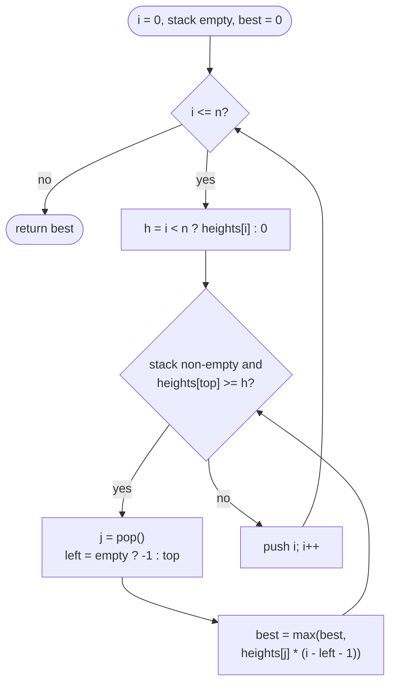

# LC 84 Largest Rectangle in Histogram

> [!abstract] In one sentence
> Every maximal rectangle is as tall as its shortest bar and stretches from the previous strictly shorter bar to the next strictly shorter bar, and a stack whose heights increase from bottom to top delivers exactly those two neighbours for each bar at the moment the bar is popped — one pass, every bar pushed and popped once.

**Map:** [[NeetCode 150 MOC]] → [[DSA Dashboard]] · Pattern: [[Stack & Monotonic Stack]]

> [!question] Predict before you read
> Heights `[2, 1, 5, 6, 2, 3]`. The best rectangle has area 10. Which bar is its shortest bar, and which two bars stop it on the left and on the right? Now say, for a general bar `j`, what "the two bars that stop it" means in terms of heights.

## Problem

You are given `heights`, where `heights[i]` is the height of the `i`-th bar of a histogram; every bar has width 1 and they stand side by side. Return the area of the largest rectangle that fits entirely under the histogram (it may span several bars, and its height is limited by the shortest bar it covers).

- `[2,1,5,6,2,3]` → `10` (height 5 over bars 2–3)
- `[2,4]` → `4` (either the single bar 4, or height 2 over both bars)
- `[1,1,1,1]` → `4`

Constraints that matter: `1 ≤ n ≤ 10⁵`, `0 ≤ heights[i] ≤ 10⁴` — n² is 10¹⁰, so O(n) or O(n log n) is required; a bar of height 0 is legal and acts as a wall; the largest area is at most 10⁹, which fits an `int`.

## Clarifying questions

1. Must the rectangle's bottom sit on the baseline and its top be flat? — Yes: an axis-aligned rectangle under the curve, so its height is the minimum bar it covers.
2. Can heights be 0? — Yes; a zero bar can never be inside a positive-area rectangle, so it separates the problem into independent pieces.
3. Can the answer overflow `int`? — No: 10⁵ · 10⁴ = 10⁹ < 2³¹; in a variant with larger values use `long`.
4. Do I return the area or the rectangle's position? — The area; the position is available at the same moment (height, left bound, right bound).

## Brute force

For every pair `(l, r)` take `min(heights[l..r]) · (r − l + 1)`: O(n²) pairs with a running minimum. A slightly smarter version: for every bar `j` as the *shortest* bar, expand left and right while bars are at least as tall: still O(n²) on a flat or sorted histogram. The waste: the expansion from bar `j` re-walks bars whose "nearest shorter bar" was already discovered when expanding from their own neighbours — the boundaries are shared information, and the brute force recomputes them per bar.

## The key insight

Fix a bar `j` and ask for the widest rectangle of height `heights[j]` that contains bar `j`: it is bounded by `L(j)`, the nearest index to the left with a strictly smaller height, and `R(j)`, the nearest index to the right with a strictly smaller height, giving area `heights[j] · (R(j) − L(j) − 1)`. The largest rectangle overall is the maximum of this over all `j`, because any rectangle has a shortest bar `j` and is contained in that bar's maximal rectangle. Both `L` and `R` are "nearest smaller element" queries — the monotonic stack of [[LC 739 Daily Temperatures]] with the comparison flipped — and one left-to-right pass computes both at once: when bar `i` pops bar `j` from an increasing stack, `i` is `R(j)` and the new top is `L(j)`. Recognition cue: "largest rectangle / area under bars", "for each element, the span over which it is the minimum (or maximum)" → previous-smaller and next-smaller via a monotonic stack.

## Optimal approach

1. Stack of indices whose heights strictly increase from bottom to top; `best = 0`.
2. For `i` from `0` to `n` inclusive, with `h = heights[i]` for `i < n` and `h = 0` for the sentinel `i = n`:
3. While the stack is non-empty and `heights[top] ≥ h`: pop `j`; `left = stack empty ? −1 : new top`; `best = max(best, heights[j] · (i − left − 1))`.
4. Push `i`.
5. The sentinel pops every remaining bar; return `best`.



> [!example]- Excalidraw version — the same diagram as an editable canvas
> ![[LC 84 Largest Rectangle in Histogram — Optimal approach.excalidraw]]
> [[LC 84 Largest Rectangle in Histogram — Optimal approach.excalidraw|Open in Excalidraw]] — needs the Excalidraw plugin (see [[Plugins to Install]]).

## Walkthrough

`heights = [2,1,5,6,2,3]`, `n = 6`; the stack holds indices, shown with heights:

| i | h | pops: j (height) → left → area | best | stack after |
|---|---|---|---|---|
| 0 | 2 | — | 0 | 0(2) |
| 1 | 1 | 0 (2) → −1 → 2 · (1 − (−1) − 1) = 2 | 2 | 1(1) |
| 2 | 5 | — | 2 | 1(1) 2(5) |
| 3 | 6 | — | 2 | 1(1) 2(5) 3(6) |
| 4 | 2 | 3 (6) → 2 → 6 · 1 = 6; 2 (5) → 1 → 5 · (4 − 1 − 1) = 10 | 10 | 1(1) 4(2) |
| 5 | 3 | — | 10 | 1(1) 4(2) 5(3) |
| 6 | 0 (sentinel) | 5 (3) → 4 → 3; 4 (2) → 1 → 2 · 4 = 8; 1 (1) → −1 → 1 · 6 = 6 | 10 | 6 |

Bar 2 (height 5) is popped by bar 4 (height 2, its `R`), and at that moment the top is bar 1 (height 1, its `L`): width `4 − 1 − 1 = 2`, area 10.

> [!example] heights = [2,1,5,6,2,3]: the winning rectangle is height 5 over bars 2..3
> ![[LC 84 Largest Rectangle in Histogram — heights = -2,1,5,6,2,3-- the winning rectangle is height 5 over bars 2..3.excalidraw]]
> [[LC 84 Largest Rectangle in Histogram — heights = -2,1,5,6,2,3-- the winning rectangle is height 5 over bars 2..3.excalidraw|Open in Excalidraw]] — width = R - L - 1 = 2; the rectangle cannot cross a strictly shorter bar on either side

%% excalidraw-spec
{"kind": "array", "title": "heights = [2,1,5,6,2,3]: the winning rectangle is height 5 over bars 2..3", "values": [2, 1, 5, 6, 2, 3], "pointers": {"L": 1, "j": 2, "R": 4}, "highlight": [2, 3], "labels": {"1": "previous smaller than 5", "4": "next smaller than 5"}, "caption": "width = R - L - 1 = 2; the rectangle cannot cross a strictly shorter bar on either side"}
%%

## Java solution

```java
import java.util.*;

class Solution {
    public int largestRectangleArea(int[] heights) {
        int n = heights.length, best = 0;
        Deque<Integer> stack = new ArrayDeque<>();        // indices; heights strictly increasing bottom -> top
        for (int i = 0; i <= n; i++) {
            int h = i == n ? 0 : heights[i];              // sentinel 0 at the end pops every remaining bar
            while (!stack.isEmpty() && heights[stack.peek()] >= h) {
                int height = heights[stack.pop()];        // bar j: i is its next smaller-or-equal bar
                int left = stack.isEmpty() ? -1 : stack.peek();   // previous strictly smaller bar, or none
                best = Math.max(best, height * (i - left - 1));
            }
            stack.push(i);
        }
        return best;
    }
}
```

**Time** O(n) — each index is pushed once and popped once, including by the sentinel · **Space** O(n) for the stack

Divide and conquer is the other textbook answer: the shortest bar of a range either spans the whole range or is excluded, so recurse on the two sides of the minimum:

```java
// snippet
int solve(int[] h, int lo, int hi) {                      // largest rectangle inside h[lo..hi]
    if (lo > hi) return 0;
    int m = lo;                                           // index of the minimum: O(n) scan here, O(log n) with a segment tree / sparse table
    for (int i = lo; i <= hi; i++) if (h[i] < h[m]) m = i;
    int across = h[m] * (hi - lo + 1);                    // the minimum bar is the height of any rectangle spanning the whole range
    return Math.max(across, Math.max(solve(h, lo, m - 1), solve(h, m + 1, hi)));
}
```

With a linear scan for the minimum this is O(n log n) on random input but O(n²) on a sorted histogram (the split is always 0 : n − 1); a range-minimum structure ([[Segment Trees]], or a sparse table) makes each level O(log n) and the whole thing O(n log n) guaranteed, at the cost of O(n) preprocessing and a recursion depth of up to n (so an explicit stack of ranges is safer in Java). It is worth knowing because it generalises to "best rectangle with an extra constraint" questions, but the monotonic stack is simpler and strictly faster.

## Why it works

The invariant: after step `i` (bar `i` pushed), the stack holds exactly the indices `k ≤ i` such that `heights[k] < heights[k']` for every `k < k' ≤ i` — the bars that are strictly shorter than everything after them so far — in increasing index order, hence with strictly increasing heights. Reason: a bar is popped by the first later bar whose height is ≤ its own and by nothing else, so `k` survives to step `i` iff every bar in `(k, i]` is taller. Two facts then carry the proof.

(1) *Every computed area is a real rectangle.* Let `j` be popped at step `i` with `left` directly below it. Right side: every bar in `(j, i)` is taller than `heights[j]`, because `i` is the first bar after `j` with height ≤ `heights[j]` (an earlier one would already have popped `j`). Left side: `left` was directly below `j` from the moment `j` was pushed (nothing can be inserted between two stacked elements), so by the invariant at step `j` no index in `(left, j)` is shorter than everything after it up to `j`. Take the shortest bar `k` in `(left, j)` (the rightmost one on ties): the only bar that can disqualify it is `j` itself, so `heights[j] ≤ heights[k]`, and the whole of `(left, j)` is ≥ `heights[j]`. The rectangle of height `heights[j]` over `(left, i)` therefore fits under the histogram, and `best` never exceeds the true answer.

(2) *The maximal rectangle of every bar is computed at least once.* Take a bar `j` with height `h`, true boundaries `L(j)` and `R(j)` (nearest strictly smaller on each side), and let `j*` be the *rightmost* bar of height exactly `h` in `(L(j), R(j))`. Bars between `j*` and `R(j)` are strictly taller, so they do not pop `j*`; `R(j)` (or the sentinel) does, since `heights[R(j)] < h`. At that moment the element below `j*` is `L(j)`: by the invariant, `L(j)` is still on the stack (every bar in `(L(j), R(j))` is taller than it), and no index in `(L(j), j*)` can be, because each such bar is ≥ `h` and is followed by `j*` with height `h` ≤ itself. So the area computed for `j*` is `h · (R(j) − L(j) − 1)`, the maximal rectangle of height `h` on that span. Since the optimum is the maximal rectangle of its own shortest bar, it is among the computed areas. Equal heights are the subtle case: with `>=` in the pop condition, an earlier equal bar is popped by the next equal bar with a truncated width, but the rightmost equal bar gets the full width — that is why the proof picks `j*`.

What changes if the pop condition is `>` instead of `>=`? The stack becomes non-decreasing; the earlier equal bar now stays and serves as `left` for the later one (truncating *its* width), while the earlier one is popped later by `R(j)` with `left = L(j)` and the full width. Either way one of the equal bars sees the full span, so both conditions are correct; `>=` keeps the stack strictly increasing, which makes fact (1) easier to state.

## Edge cases

- Single bar `[7]`: pushed at `i = 0`, popped by the sentinel with `left = −1`: `7 · (1 − (−1) − 1) = 7`.
- All equal `[1,1,1,1]`: with `>=` each bar pops the previous one, and because the stack is then empty `left = −1` each time (widths 1, 2, 3); the sentinel pops the last bar with width 4 → `4`.
- Strictly increasing `[1,2,3,4]`: nothing pops until the sentinel, which pops 4 (width 1), 3 (width 2), 2 (width 3), 1 (width 4) → `6`.
- Strictly decreasing `[4,3,2,1]`: every bar pops the previous one immediately; `4 · 1, 3 · 2, 2 · 3`, then the sentinel pops 1 with width 4 → `6`.
- A zero inside `[3,0,3]`: the 0 pops the first 3 (area 3) and then stays on the stack as a wall; the second 3 is popped by the sentinel with `left = 1`, width 1; the 0 itself contributes `0 · 3 = 0`. Answer 3.
- `n = 10⁵` with heights 10⁴: `height * width` ≤ 10⁹, no overflow; larger constraints need `long`.

## Common mistakes

> [!warning] What goes wrong
> - Forgetting the sentinel (or a post-loop flush): bars still on the stack after the last index are never measured; `[1,2,3]` returns 0.
> - Width `i − left` instead of `i − left − 1` when `left` is the previous smaller *index*; or using `i − j + 1`, which ignores the bars to the left of `j` that are at least as tall.
> - Pushing heights instead of indices: you need `i − left − 1` and `heights[j]`, both of which require indices.
> - Pop condition `>` with the sentinel `0` and a bar of height 0: a zero bar is never popped by the sentinel (`0 > 0` false) — harmless for the area (it contributes 0) but easy to misreason about; with `>=` everything is flushed.
> - Treating it as a sliding window or two pointers: "minimum over a range" is not monotone in the window size, so neither applies.
> - Computing `L` and `R` with two separate stack passes but mixing strict and non-strict comparisons so that equal bars block each other on *both* sides: then no equal bar ever sees the full span. Use strict on one side and non-strict on the other, or the single pass above.

## Variants & follow-ups

- Maximal rectangle of 1s in a binary matrix (LC 85): treat each row as the base of a histogram where `heights[c]` = consecutive 1s above; run this routine per row, O(rows · cols).
- Sum of subarray minimums (LC 907) and maximum of `min · sum` (LC 1856): the same `L`/`R` spans, but you *count* subarrays `(j − L) · (R − j)` instead of taking a max — the strict/non-strict asymmetry matters there to avoid double counting.
- Maximum score of a good subarray (LC 1793): the span must contain a fixed index; two pointers from that index work because of the constraint.
- Trapping rain water → [[LC 42 Trapping Rain Water]]: the stack version pops bars that get submerged and adds water in horizontal strips — the same previous/next taller idea.
- Largest rectangle with the height restricted to a given set, or the position of the rectangle: record `(height, left + 1, i − 1)` when `best` improves.
- Streaming bars: the stack is online; the sentinel step runs whenever you want the answer so far (on a copy of the stack).

## Interview script

Restate: "bars of width 1; largest axis-aligned rectangle under them; n up to 10⁵, heights up to 10⁴, zeros allowed." Brute force: "every pair of bars with a running minimum, O(n²); or expand from each bar as the shortest, also O(n²) on flat input." Insight: "the best rectangle is bounded by its shortest bar `j` and stops at the nearest strictly shorter bar on each side; so I need previous-smaller and next-smaller for every bar, which a monotonic stack gives in one pass." Approach: "stack of indices with increasing heights; when the current bar is not taller than the top, pop it — the current index is its right bound, the new top is its left bound — and take `height · (i − left − 1)`; a sentinel of height 0 at `i = n` flushes the stack." Complexity: "O(n) time, each index pushed and popped once; O(n) space." Tests: single bar, all equal, increasing, decreasing, a zero in the middle. If they push: "divide and conquer on the minimum bar is O(n log n) with a range-minimum structure; and the same routine per row solves the maximal rectangle in a binary matrix."

## Related

- Pattern: [[Stack & Monotonic Stack]] (previous/next smaller); range minimum for the alternative: [[Segment Trees]]
- Prerequisites: [[LC 739 Daily Temperatures]] (next greater with a stack, same mechanics), [[LC 853 Car Fleet]]
- Siblings: [[LC 42 Trapping Rain Water]] (stack variant), [[LC 239 Sliding Window Maximum]] (monotonic deque)
- Java: [[Java Collections Cheat Sheet]] (`ArrayDeque`, `Math.max`), [[DSA Patterns in Java]] (monotonic stack template with sentinel), [[Java Pitfalls in Interviews]] (`int` overflow in `height * width`), [[Complexity Analysis]] (amortised O(n) of a nested loop)

## Attempt log

| Date | Result | Minutes | What I got wrong |
|---|---|---|---|
| | | | |

### Mastery checklist
- [ ] Solved without hints in under 25 minutes
- [ ] Stated complexity before coding
- [ ] Handled every edge case above
- [ ] Code compiled first time
- [ ] Can do the follow-up variant

## Open questions
- [ ] Write the two-pass version (`L[]` with a left-to-right stack, `R[]` with a right-to-left stack) and check `[2,2,2]` with strict comparisons on both sides: which areas does it compute, and which does it miss?
- [ ] Solve LC 85 (maximal rectangle) by calling this routine once per row; why is building `heights` for row `r` from row `r − 1` O(cols) and not O(rows · cols)?
- [ ] On which input does the divide-and-conquer version with a linear minimum scan take Θ(n²), and how does the segment tree change the recurrence?
