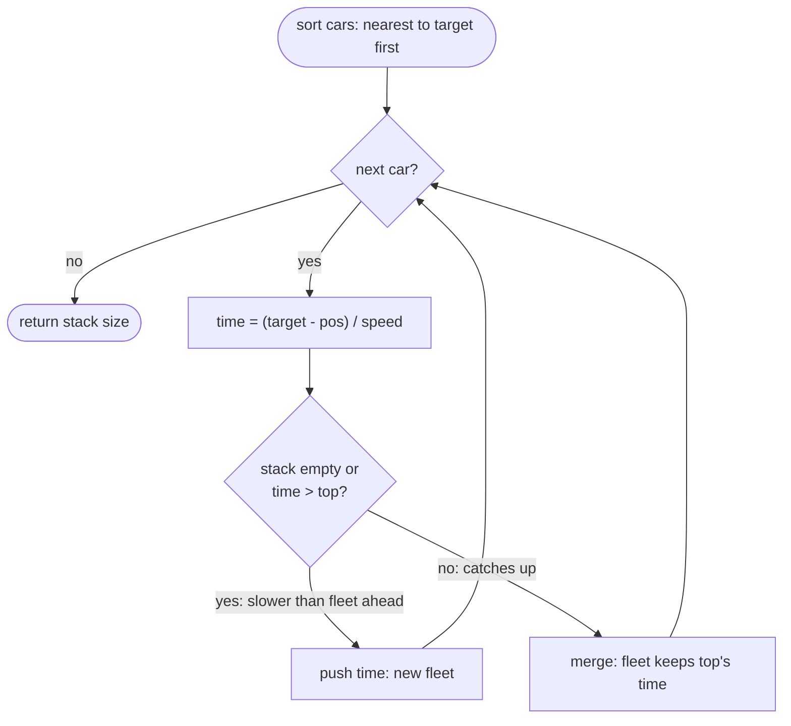

# LC 853 Car Fleet

> [!abstract] In one sentence
> Because no car can overtake, a car's fate depends only on the car directly ahead: if its solo arrival time is at most the fleet ahead's time it catches up and joins (adopting the slower time), otherwise it leads a new fleet — so process cars from the target backwards and keep the times of the fleets formed so far on a stack.

**Map:** [[NeetCode 150 MOC]] → [[DSA Dashboard]] · Pattern: [[Stack & Monotonic Stack]]

> [!question] Predict before you read
> Car A at position 3 with speed 3 and car B at position 5 with speed 1, target 12. A would arrive at `t = 3` alone, B at `t = 7`. Does A arrive at 3, at 7, or somewhere in between — and what does that say about which car's time a fleet keeps?

## Problem

`n` cars drive on a one-lane road towards a `target` mile marker. Car `i` starts at `position[i]` (all distinct, all `< target`) with speed `speed[i]`. A faster car that catches a slower one cannot pass; it slows to that car's speed and they travel together as a *fleet* (a single car is also a fleet). If a car catches another exactly at the target, they still count as one fleet. Return the number of fleets that arrive at the target.

- `target = 12`, `position = [10,8,0,5,3]`, `speed = [2,4,1,1,3]` → `3` (fleets led by the cars at 10, 5 and 0)
- `target = 10`, `position = [3]`, `speed = [3]` → `1`
- `target = 100`, `position = [0,2,4]`, `speed = [4,2,1]` → `1` (everyone catches the car at 4)

Constraints that matter: `1 ≤ n ≤ 10⁵`, positions distinct, `0 ≤ position < target ≤ 10⁶`, `1 ≤ speed ≤ 10⁶` — so a sort is affordable, there is no tie in positions to resolve, and arrival times are at most 10⁶ (exact as a `double`).

## Clarifying questions

1. Can cars overtake? — No; that single rule is what makes the fleet structure a stack.
2. Catching up exactly at the target — one fleet or two? — One; this decides `<=` (merge) versus `<` in the comparison.
3. Are positions distinct? — Yes; if two cars could share a position they would be one fleet from the start.
4. Does the answer need the fleet composition or only the count? — Only the count; the composition falls out of the same pass if asked.

## Brute force

Simulate time: advance every car, detect collisions, merge speeds, repeat until all reach the target. Arrival times are rational, so you simulate in exact steps or small increments — O(n · steps), unbounded by anything useful, and fiddly. The waste: nothing about the trajectory matters except each car's solo arrival time compared with the car ahead; the simulation recomputes positions a car would reach while the only question is "does it catch up before the target or not".

## The key insight

Compute each car's solo arrival time `(target − pos) / speed`. Sort cars by position, nearest to the target first, so that each car's "car directly ahead" is the previous one processed. A car catches the fleet ahead iff its solo time is ≤ that fleet's time: it needs less time for a longer distance, so it would reach the target first if unblocked, which means it bumps into the fleet beforehand and is dragged down to the fleet's time. Otherwise it is slower and leads its own fleet. Since a merged car adopts the leader's time, the fleet's time never changes when cars join from behind — so a stack of fleet times, pushed only when a new fleet starts, counts the answer. Recognition cue: "no overtaking", "merge into the one ahead", "process from the end and compare with the last group" → sort + stack of group representatives (and when only the top is ever consulted, the stack degenerates to one variable).

## Optimal approach

1. Pair each car as `{position, speed}` and sort by position descending (nearest to the target first).
2. For each car compute `time = (target − position) / speed` as a `double`.
3. If the stack is empty or `time > top`, the car cannot catch the fleet ahead: push `time` (new fleet).
4. Otherwise it merges; push nothing (the fleet keeps its leader's time).
5. The stack size is the number of fleets.



> [!example]- Excalidraw version — the same diagram as an editable canvas
> ![[LC 853 Car Fleet — Optimal approach.excalidraw]]
> [[LC 853 Car Fleet — Optimal approach.excalidraw|Open in Excalidraw]] — needs the Excalidraw plugin (see [[Plugins to Install]]).

## Walkthrough

`target = 12`, cars sorted by position descending:

| car (pos, speed) | solo time | top of stack before | decision | stack after |
|---|---|---|---|---|
| (10, 2) | 1.0 | — | new fleet | 1.0 |
| (8, 4) | 1.0 | 1.0 | `1.0 > 1.0` false → merges (meets at the target) | 1.0 |
| (5, 1) | 7.0 | 1.0 | `7.0 > 1.0` → new fleet | 1.0 7.0 |
| (3, 3) | 3.0 | 7.0 | `3.0 > 7.0` false → merges | 1.0 7.0 |
| (0, 1) | 12.0 | 7.0 | `12.0 > 7.0` → new fleet | 1.0 7.0 12.0 |

Three fleets. Note that the car at 3 would have arrived at `t = 3` alone, but it is stuck behind the car at 5 until `t = 7`.

> [!example] Cars on the road (target 12), labelled with solo arrival time
> ![[LC 853 Car Fleet — Cars on the road (target 12), labelled with solo arrival time.excalidraw]]
> [[LC 853 Car Fleet — Cars on the road (target 12), labelled with solo arrival time.excalidraw|Open in Excalidraw]] — scan from the right; amber cells lead a fleet because their time exceeds the fleet ahead

%% excalidraw-spec
{"kind": "array", "title": "Cars on the road (target 12), labelled with solo arrival time", "values": [0, 3, 5, 8, 10], "pointers": {"scan": 4}, "highlight": [0, 2, 4], "labels": {"0": "t = 12: fleet 3", "1": "t = 3: joins 5", "2": "t = 7: fleet 2", "3": "t = 1: joins 10", "4": "t = 1: fleet 1"}, "caption": "scan from the right; amber cells lead a fleet because their time exceeds the fleet ahead"}
%%

## Java solution

```java
import java.util.*;

class Solution {
    public int carFleet(int target, int[] position, int[] speed) {
        int n = position.length;
        int[][] cars = new int[n][];
        for (int i = 0; i < n; i++) cars[i] = new int[]{position[i], speed[i]};
        Arrays.sort(cars, (a, b) -> Integer.compare(b[0], a[0]));   // nearest to the target first
        Deque<Double> fleets = new ArrayDeque<>();                   // arrival time of each fleet; the one just ahead is on top
        for (int[] car : cars) {
            double time = (double) (target - car[0]) / car[1];       // solo arrival time; cast before dividing
            if (fleets.isEmpty() || time > fleets.peek()) fleets.push(time);   // slower than the fleet ahead: leads a new one
            // else: catches the fleet ahead before (or at) the target and adopts its time — nothing to record
        }
        return fleets.size();
    }
}
```

**Time** O(n log n) for the sort, O(n) for the scan · **Space** O(n) for the pairs and the stack

Because a merging car never changes the top and a new fleet only ever compares with the top, the stack is really a single variable — the time of the slowest fleet seen so far:

```java
// snippet
int count = 0; double slowest = 0;                       // every real time is > 0, so 0 is a safe "no fleet yet"
for (int[] car : cars) {                                 // same descending-position order
    double time = (double) (target - car[0]) / car[1];
    if (time > slowest) { count++; slowest = time; }     // new fleet; otherwise merges into the slowest one ahead
}
```

## Why it works

Invariant: after processing the cars nearest to the target, the stack holds the arrival times of the fleets they form, bottom = nearest to target, top = the fleet directly ahead of the next car, and the times are strictly increasing bottom to top. Processing the next car `c` (further from the target than everything so far): if `time(c) ≤ top`, then at time `top` car `c` driving alone would already be at the target, while the fleet ahead is only just arriving — since `c` started behind it and cannot pass, it must have caught the fleet at or before the target and travels at the fleet's speed from then on, arriving at `top`; the fleet's time is unchanged, so the stack is unchanged. If `time(c) > top`, car `c` is at the target strictly later than the fleet ahead; with constant speeds and no passing, a car that arrives later is behind at every moment, so it never catches up and arrives alone at `time(c) > top`, which keeps the stack increasing. Each car is handled once, hence O(n) after the sort.

## Edge cases

- One car: one fleet.
- Equal solo times (`(10,2)` and `(8,4)` above): `time > top` is false, so they merge — they meet exactly at the target, which the problem counts as one fleet.
- All cars catch the leader (`position = [0,2,4]`, `speed = [4,2,1]`, target 100): times 25, 49, 96 in descending-position order 96, 49, 25 → one fleet.
- Strictly slower cars behind (`[0,2,4]` with speeds `[1,2,3]`): times increase as you scan back → n fleets.
- Position 0 and huge target: `(target − 0) / 1 = 10⁶`, exact in a `double`.
- Precision: with `int` inputs ≤ 10⁶ every time is a ratio of small integers; the only risk is comparing times that should be equal but were computed through different roundings — here each time is one division, so equal ratios give identical doubles; to be fully safe compare cross-multiplied `long`s.

## Common mistakes

> [!warning] What goes wrong
> - Sorting by position ascending and scanning forward: a car's fate depends on the car *ahead*, which you have not seen yet. Scan from the target backwards.
> - Integer division `(target − pos) / speed`: `7 / 2 = 3` and the comparison becomes wrong; cast to `double` first.
> - `time >= top` for a new fleet: a car meeting the leader exactly at the target would be counted twice; the problem says that is one fleet.
> - Updating the fleet's time when a car merges (`top = max(top, time)` or `min`): the fleet moves at the leader's speed and its time never changes; a merged car's own time is discarded.
> - Comparator `b[0] - a[0]` is safe here (positions ≤ 10⁶) but `Integer.compare` is the habit that survives larger inputs.
> - Forgetting that the answer is the stack *size*, not its top; or returning `n − merges` with a miscounted merge.

## Variants & follow-ups

- Car Fleet II (LC 1776): return the time each car collides with the car ahead, or −1 — a monotonic stack of candidate cars ahead, popping those that are faster (never caught) or that collide later than the candidate behind them would.
- Report the fleets themselves: push lists; a merging car is added to the top list.
- Report which car leads each fleet: the car that pushed each time.
- Cars with different targets, or starting from both ends: not a single sorted scan any more; reduce to intervals.
- Same "sort, then compare with the last group" shape: [[LC 56 Merge Intervals]] (sort by start, merge into the last interval), and [[LC 739 Daily Temperatures]] for the stack when the comparison is on values rather than times.

## Interview script

Restate: "cars at distinct positions with speeds, one lane, no overtaking; a car that catches up joins a fleet at the slower speed; count fleets at the target; meeting at the target counts as one." Brute force: "time simulation with collision detection — messy and not bounded by n." Insight: "a car's solo arrival time compared with the fleet directly ahead decides everything: smaller-or-equal means it catches up and adopts the fleet's time; larger means it leads a new fleet; so sort by position from the target backwards." Approach: "sort `{position, speed}` descending by position, compute each time as a double, push onto a stack only when the time exceeds the top; answer is the stack size — and since only the top is read, one variable suffices." Complexity: "O(n log n) sort, O(n) scan, O(n) space." Tests: one car, equal times, everyone merges, nobody merges, position 0. If they push: "Car Fleet II needs the actual collision times — a monotonic stack that pops cars that will never be caught."

## Related

- Pattern: [[Stack & Monotonic Stack]] (stack of group representatives); sorting as the preprocessing step: [[Sorting]]
- Prerequisites: [[LC 739 Daily Temperatures]] (monotonic stack mechanics)
- Siblings: [[LC 84 Largest Rectangle in Histogram]], [[LC 56 Merge Intervals]], [[LC 435 Non-overlapping Intervals]]
- Java: [[Java Collections Cheat Sheet]] (`Arrays.sort` on `int[][]` with a comparator, `Integer.compare`, `ArrayDeque`), [[Java Pitfalls in Interviews]] (integer division, comparator subtraction overflow), [[DSA Patterns in Java]]

## Attempt log

| Date | Result | Minutes | What I got wrong |
|---|---|---|---|
| | | | |

### Mastery checklist
- [ ] Solved without hints in under 25 minutes
- [ ] Stated complexity before coding
- [ ] Handled every edge case above
- [ ] Code compiled first time
- [ ] Can do the follow-up variant

## Open questions
- [ ] Replace the `double` comparison by an exact one on `long`s: `time(c) > top` becomes `(target − pc) · st > (target − pt) · sc`. Why must you keep the *leader's* position and speed for `top`, not the last merged car's?
- [ ] What changes if overtaking is allowed? Which part of the invariant breaks first?
