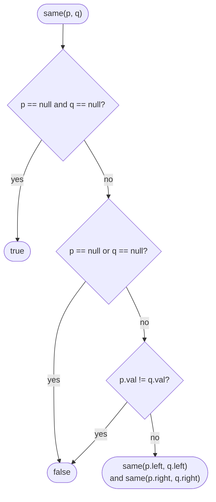

# LC 100 Same Tree

> [!abstract] In one sentence
> Walk two trees in lock-step: both null is a match, one null is a mismatch, otherwise the values must agree and both child pairs must match recursively — the structural-equality recursion that every "compare two trees" problem reduces to.

**Map:** [[NeetCode 150 MOC]] → [[DSA Dashboard]] · Pattern: [[Trees]]

> [!question] Predict before you read
> Three base cases are needed, not one. Name them, and say which one people most often merge incorrectly with another.

## Problem

Given the roots of two binary trees `p` and `q`, return whether the trees are the same: identical in structure and with equal values at every corresponding node.

Examples: `[1, 2, 3]` vs `[1, 2, 3]` → true. `[1, 2]` vs `[1, null, 2]` → false (same values, different shape). `[1, 2, 1]` vs `[1, 1, 2]` → false.

Constraints that matter: up to 100 nodes per tree; values in a small range, so `==` on `int` is fine.

## Clarifying questions

1. Does structure matter, or only the multiset of values? — Structure and values at the same positions.
2. Can both be empty? — Yes; two empty trees are the same.
3. Are node values `int`? — Yes; if they were `Integer` objects you would use `equals`.
4. Recursive or iterative? — Recursive is expected; be able to do it with a queue of pairs.

## Brute force

Serialise both trees (pre-order with explicit `null` markers, as in [[LC 297 Serialize and Deserialize Binary Tree]]) and compare the strings. O(n) time and O(n) space, and it is actually correct — but it builds two strings to answer a question the recursion answers directly with O(h) stack, and it stops nowhere early. The interviewer wants the direct recursion.

## The key insight

Equality of two trees decomposes exactly like the trees do: roots equal, left subtrees equal, right subtrees equal. The recursion carries *two* nodes side by side and the base cases handle null in the three possible ways. Recognition cue: any question that compares two trees position by position — "same", "mirror", "subtree of", "merge".

## Optimal approach

1. If both nodes are `null`, return true.
2. If exactly one is `null`, return false.
3. If the values differ, return false.
4. Return `same(p.left, q.left) && same(p.right, q.right)`; `&&` short-circuits on the first mismatch.



> [!example]- Excalidraw version — the same diagram as an editable canvas
> ![[LC 100 Same Tree — Optimal approach.excalidraw]]
> [[LC 100 Same Tree — Optimal approach.excalidraw|Open in Excalidraw]] — needs the Excalidraw plugin (see [[Plugins to Install]]).

## Walkthrough

Comparing `[1, 2]` with `[1, null, 2]`: the values are equal but the shapes differ.

> [!example] p = [1,2] versus q = [1,null,2]
> ![[LC 100 Same Tree — p = -1,2- versus q = -1,null,2-.excalidraw]]
> [[LC 100 Same Tree — p = -1,2- versus q = -1,null,2-.excalidraw|Open in Excalidraw]] — p has 2 on the left; q has null there, so same(p.left, q.left) hits the 'exactly one null' case

%% excalidraw-spec
{"kind": "tree", "title": "p = [1,2] versus q = [1,null,2]", "levels": [1, 2, null], "highlight": [1], "caption": "p has 2 on the left; q has null there, so same(p.left, q.left) hits the 'exactly one null' case"}
%%

| Call | p | q | Outcome |
|---|---|---|---|
| same(1, 1) | 1 | 1 | values equal, recurse left |
| same(2, null) | 2 | null | exactly one null → false |
| back in same(1, 1) | | | `&&` short-circuits, returns false |

## Java solution

```java
import java.util.*;

class Solution {
    public boolean isSameTree(TreeNode p, TreeNode q) {
        if (p == null && q == null) return true;
        if (p == null || q == null) return false;   // exactly one is null
        if (p.val != q.val) return false;
        return isSameTree(p.left, q.left) && isSameTree(p.right, q.right);
    }

    // Iterative: a queue of pairs; the same three checks per pair.
    public boolean isSameTreeIterative(TreeNode p, TreeNode q) {
        Deque<TreeNode[]> queue = new ArrayDeque<>();
        queue.offer(new TreeNode[] {p, q});
        while (!queue.isEmpty()) {
            TreeNode[] pair = queue.poll();
            TreeNode a = pair[0], b = pair[1];
            if (a == null && b == null) continue;
            if (a == null || b == null || a.val != b.val) return false;
            queue.offer(new TreeNode[] {a.left, b.left});
            queue.offer(new TreeNode[] {a.right, b.right});
        }
        return true;
    }
}

class TreeNode {
    int val;
    TreeNode left, right;
    TreeNode() {}
    TreeNode(int val) { this.val = val; }
    TreeNode(int val, TreeNode left, TreeNode right) { this.val = val; this.left = left; this.right = right; }
}
```

**Time** O(min(n, m)) — stops at the first mismatch · **Space** O(h) recursion stack (O(n) worst case).

## Why it works

Define "same" structurally: two empty trees are the same; a non-empty and an empty tree are not; two non-empty trees are the same iff the roots have equal values and the corresponding subtrees are the same. The code is a transcription of this definition, and each pair of corresponding nodes is compared at most once, so the recursion terminates and is linear in the smaller tree.

## Edge cases

- Both `null` → true.
- One `null` → false (the second check, because the first already excluded both-null).
- Single nodes with different values → false at the value check.
- Equal values, different shapes → false at a null-mismatch deeper down.
- Trees differing only at the deepest right leaf → the recursion visits everything before returning false; still O(n).

## Common mistakes

> [!warning] Pitfalls
> - Writing `if (p == null || q == null) return p == q;` is fine; writing `if (p == null || q == null) return false;` *before* the both-null check is wrong — two empty subtrees would be reported as different, and every leaf comparison would fail.
> - Comparing with `p.val == q.val` is right for `int`; if a variant uses `Integer`, `==` compares boxed references above 127.
> - Comparing in-order traversals without null markers: `[1, 2]` and `[1, null, 2]` have different in-orders here, but `[1, 2]` and `[2, 1]` as "left child" vs "root with left child" can collide — serialisation needs null markers to be sound.

## Variants & follow-ups

- Symmetric tree (LC 101): `same(l.left, r.right) && same(l.right, r.left)` — the mirror pairing.
- [[LC 572 Subtree of Another Tree]]: call this at every node of the big tree.
- Merge two trees (LC 617): the same lock-step walk but building a result.
- Leaf-similar trees (LC 872): the leaf *sequence* must match, so structure may differ — different recursion.
- Compare n-ary trees: compare child-list sizes, then zip the children.

## Interview script

Restate: "Identical shape and identical values at every position." Brute force: "Serialise with null markers and compare strings — linear but pointless memory." Insight: "Equality decomposes like the tree: roots match and both child pairs match." Approach: "Three base cases — both null, one null, value mismatch — then recurse on both pairs with short-circuit and." Complexity: "O(min n, m) time, O(height) space." Tests: "Both empty, one empty, same values different shape, mismatch at the last leaf."

## Related

- Pattern: [[Trees]]
- Uses this directly: [[LC 572 Subtree of Another Tree]]
- Same lock-step idea with a mirror: [[LC 226 Invert Binary Tree]]
- The serialisation alternative: [[LC 297 Serialize and Deserialize Binary Tree]]
- Java refresher: [[Java Collections Cheat Sheet]] (`ArrayDeque`, arrays as pairs)

## Attempt log

| Date | Result | Minutes | What I got wrong |
|---|---|---|---|
| | | | |

### Mastery checklist
- [ ] Solved without hints in under 25 minutes
- [ ] Stated complexity before coding
- [ ] Handled every edge case above
- [ ] Code compiled first time
- [ ] Can do the follow-up variant

## Open questions
- [ ]
