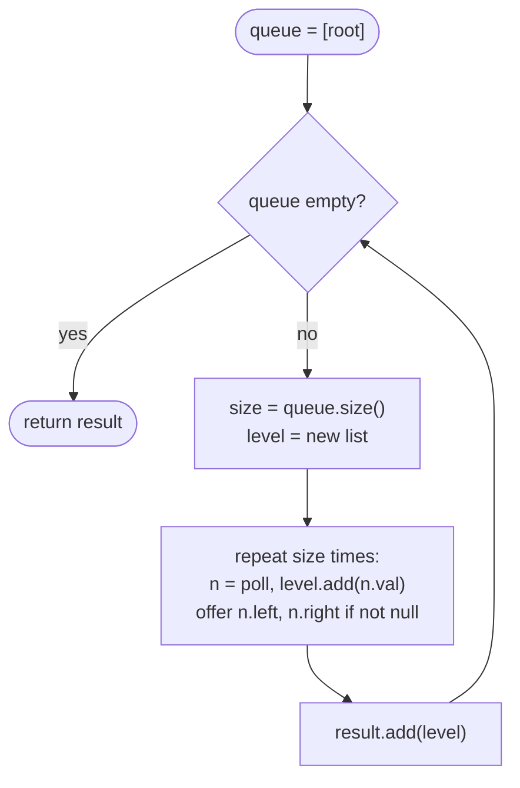

# LC 102 Binary Tree Level Order Traversal

> [!abstract] In one sentence
> A queue visits a tree level by level on its own; freezing `queue.size()` at the start of each round tells you exactly where one level ends and the next begins, which turns a plain BFS into a list of levels.

**Map:** [[NeetCode 150 MOC]] → [[DSA Dashboard]] · Pattern: [[Trees]]

> [!question] Predict before you read
> A plain BFS gives you the nodes in level order already. What single extra line is needed to know where the boundaries between levels are — and what goes wrong if you read `queue.size()` inside the inner loop instead of before it?

## Problem

Given the root of a binary tree, return a list of lists: the values of the nodes at depth 0, then depth 1, and so on, each level left to right.

Example: `[3, 9, 20, null, null, 15, 7]` → `[[3], [9, 20], [15, 7]]`. `[1]` → `[[1]]`. `[]` → `[]`.

Constraints that matter: up to 2000 nodes; the output has as many inner lists as the tree has levels.

## Clarifying questions

1. Left to right within a level? — Yes (zigzag is a variant).
2. Empty tree returns an empty outer list, not a list containing an empty list? — Empty outer list.
3. Output as `List<List<Integer>>`? — Yes.
4. Recursive solution acceptable? — Yes, a DFS with a depth parameter also works; BFS is the expected one.

## Brute force

Compute the depth of the tree, then for each depth d run a traversal that collects the nodes at exactly depth d. That is O(n · h) — O(n²) on a chain — because every pass re-walks the tree from the root. The waste: each level is rediscovered from scratch instead of being produced by the previous one.

## The key insight

A FIFO queue seeded with the root dequeues nodes in non-decreasing depth, and at the instant you begin a round, the queue contains *exactly* one level and nothing else. So `int size = queue.size()` is the level's length; dequeue that many, enqueue their children, and the children form the next level. Recognition cue: anything "per level" — level lists, level averages, largest per level, right-most per level, zigzag.

## Optimal approach

1. If the root is `null`, return the empty list.
2. Queue ← root.
3. While the queue is not empty: `size = queue.size()`; create a new level list.
4. Repeat `size` times: poll a node, append its value to the level list, offer its non-null children.
5. Append the level list to the result.



> [!example]- Excalidraw version — the same diagram as an editable canvas
> ![[LC 102 Binary Tree Level Order Traversal — Optimal approach.excalidraw]]
> [[LC 102 Binary Tree Level Order Traversal — Optimal approach.excalidraw|Open in Excalidraw]] — needs the Excalidraw plugin (see [[Plugins to Install]]).

## Walkthrough

> [!example] Level order of [3,9,20,null,null,15,7]
> ![[LC 102 Binary Tree Level Order Traversal — Level order of -3,9,20,null,null,15,7-.excalidraw]]
> [[LC 102 Binary Tree Level Order Traversal — Level order of -3,9,20,null,null,15,7-.excalidraw|Open in Excalidraw]] — round 2 starts with the queue holding exactly [9, 20]; it adds 15 and 7 for round 3

%% excalidraw-spec
{"kind": "tree", "title": "Level order of [3,9,20,null,null,15,7]", "levels": [3, 9, 20, null, null, 15, 7], "highlight": [1, 2], "caption": "round 2 starts with the queue holding exactly [9, 20]; it adds 15 and 7 for round 3"}
%%

| Round | Queue at start | size | Level emitted | Queue at end |
|---|---|---|---|---|
| 1 | [3] | 1 | [3] | [9, 20] |
| 2 | [9, 20] | 2 | [9, 20] | [15, 7] |
| 3 | [15, 7] | 2 | [15, 7] | [] |

## Java solution

```java
import java.util.*;

class Solution {
    public List<List<Integer>> levelOrder(TreeNode root) {
        List<List<Integer>> result = new ArrayList<>();
        if (root == null) return result;
        Deque<TreeNode> queue = new ArrayDeque<>();
        queue.offer(root);
        while (!queue.isEmpty()) {
            int size = queue.size();              // exactly one level is in the queue right now
            List<Integer> level = new ArrayList<>(size);
            for (int i = 0; i < size; i++) {
                TreeNode node = queue.poll();
                level.add(node.val);
                if (node.left != null) queue.offer(node.left);    // ArrayDeque rejects null, so guard
                if (node.right != null) queue.offer(node.right);
            }
            result.add(level);
        }
        return result;
    }
}

class TreeNode {
    int val;
    TreeNode left, right;
    TreeNode() {}
    TreeNode(int val) { this.val = val; }
    TreeNode(int val, TreeNode left, TreeNode right) { this.val = val; this.left = left; this.right = right; }
}
```

**Time** O(n) · **Space** O(w) for the queue, where w is the widest level (up to n/2 in a full tree); the output itself is O(n).

The DFS alternative carries the depth and appends into `result.get(depth)`, creating the inner list when `depth == result.size()`. It yields the same left-to-right order because the left child is visited first.

```java
// snippet
void dfs(TreeNode node, int depth, List<List<Integer>> result) {
    if (node == null) return;
    if (depth == result.size()) result.add(new ArrayList<>());
    result.get(depth).add(node.val);
    dfs(node.left, depth + 1, result);
    dfs(node.right, depth + 1, result);
}
```

## Why it works

Invariant at the top of each round: the queue holds all nodes of depth d, left to right, and nothing else. It holds at d = 0. During the round the `size` nodes of depth d are removed and their children — all the nodes of depth d + 1, in left-to-right order because parents are processed left to right and each parent offers left before right — are appended. After the round the queue holds exactly depth d + 1. Each node is enqueued and dequeued once.

## Edge cases

- `null` root → `[]` (the early return; without it the queue would be seeded with null and `ArrayDeque.offer(null)` throws).
- Single node → `[[1]]`.
- Chain → n levels of one node each; the queue never holds more than one node.
- Full tree → last level has about n/2 nodes, which is the queue's peak.

## Common mistakes

> [!warning] Pitfalls
> - Writing `for (int i = 0; i < queue.size(); i++)` — the size changes as children are added and the loop runs too long; freeze it in a local first.
> - Offering `null` children into an `ArrayDeque` (it throws `NullPointerException`); `LinkedList` tolerates null but then you poll nulls and dereference them.
> - Using `queue.push` (which is `addFirst`) with `poll` (which is `pollFirst`) — that is a stack. For a queue use `offer` and `poll`.
> - Returning `[[]]` for an empty tree.

## Variants & follow-ups

- [[LC 199 Binary Tree Right Side View]]: keep only the last value of each level.
- Zigzag (LC 103): reverse every other level list, or add at the front with `addFirst` on a `Deque<Integer>`.
- Bottom-up level order (LC 107): `Collections.reverse(result)` at the end.
- Level averages (LC 637), largest per level (LC 515), count of levels = [[LC 104 Maximum Depth of Binary Tree]].
- The same frozen-size loop on a grid is [[LC 994 Rotting Oranges]] (minutes = rounds).

## Interview script

Restate: "Lists of values, one per depth, left to right." Brute force: "Collect depth d nodes with a fresh traversal for every d — O(n · height)." Insight: "A queue already visits in depth order; freezing its size at the start of each round gives the level boundary." Approach: "Seed root; per round, poll size nodes, offer children, emit the list." Complexity: "O(n) time, O(width) queue." Tests: "Empty, single, chain, the three-level example; and I would mention the DFS-with-depth alternative."

## Related

- Pattern: [[Trees]] · the BFS mechanism in depth: [[Graphs]]
- Direct variants: [[LC 199 Binary Tree Right Side View]], [[LC 104 Maximum Depth of Binary Tree]]
- Same level loop on a grid: [[LC 994 Rotting Oranges]]
- Java refresher: [[Java Collections Cheat Sheet]] (`ArrayDeque` queue methods, no nulls)

## Attempt log

| Date | Result | Minutes | What I got wrong |
|---|---|---|---|
| | | | |

### Mastery checklist
- [ ] Solved without hints in under 25 minutes
- [ ] Stated complexity before coding
- [ ] Handled every edge case above
- [ ] Code compiled first time
- [ ] Can do the follow-up variant

## Open questions
- [ ]
