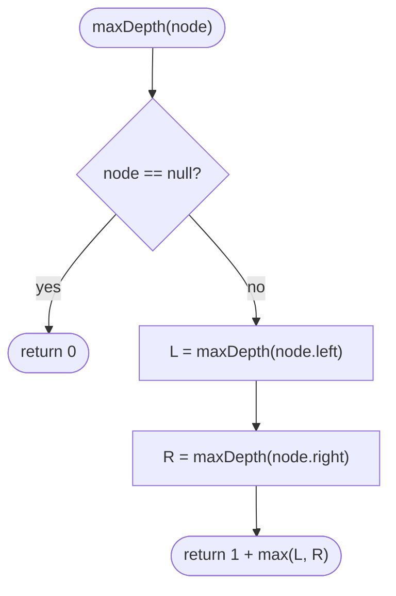

# LC 104 Maximum Depth of Binary Tree

> [!abstract] In one sentence
> The depth of a tree is one more than the deeper of its two subtrees, so a post-order recursion that returns a number solves it in as many lines as it takes to say that — and the same shape (ask the children, combine, return) carries [[LC 543 Diameter of Binary Tree]], [[LC 110 Balanced Binary Tree]] and [[LC 124 Binary Tree Maximum Path Sum]].

**Map:** [[NeetCode 150 MOC]] → [[DSA Dashboard]] · Pattern: [[Trees]]

> [!question] Predict before you read
> Write the recurrence for depth in one line. Then: if the tree has a million nodes in a straight chain, which of the two approaches below crashes, and why?

## Problem

Given the root of a binary tree, return its maximum depth: the number of nodes on the longest path from the root down to a leaf.

Example: `[3, 9, 20, null, null, 15, 7]` → 3 (root 3 → 20 → 15). `[1, null, 2]` → 2. `[]` → 0.

Constraints that matter: up to 10⁴ nodes. A chain of 10⁴ nodes is 10⁴ recursive frames, which the JVM handles; at 10⁵ or more you would switch to BFS.

## Clarifying questions

1. Is depth counted in nodes or in edges? — Nodes here (a single node has depth 1). Edges would give one less; confirm before coding.
2. Empty tree? — Depth 0.
3. Do you want recursive or iterative? — Recursive is expected; know the BFS level-count version for the depth follow-up.
4. Balanced or arbitrary tree? — Arbitrary; it can be a chain.

## Brute force

Enumerate every root-to-leaf path, record its length, take the maximum. That is still O(n) work in total for a tree (each node lies on the paths below it), but it needs explicit path bookkeeping and gains nothing over the recursion. The "waste" is conceptual: you track paths when all you need per subtree is a single number.

## The key insight

A subtree's depth is a property that can be computed from the children's answers alone: `depth(node) = 1 + max(depth(left), depth(right))`, with `depth(null) = 0`. Whenever a tree question can be answered this way — "ask both children, combine, return one value" — it is a post-order recursion and the code is four lines. Recognition cue: "height", "depth", "longest path downward".

## Optimal approach

1. Base case: a `null` node has depth 0.
2. Compute the depth of the left subtree and the right subtree recursively.
3. Return `1 + max(left, right)`.



> [!example]- Excalidraw version — the same diagram as an editable canvas
> ![[LC 104 Maximum Depth of Binary Tree — Optimal approach.excalidraw]]
> [[LC 104 Maximum Depth of Binary Tree — Optimal approach.excalidraw|Open in Excalidraw]] — needs the Excalidraw plugin (see [[Plugins to Install]]).

The BFS alternative counts levels: pop one whole level per round of the loop, increment a counter each round. It uses O(width) memory instead of O(height) stack, which is the answer to the "very deep tree" follow-up.

## Walkthrough

The example tree with the recursion's return values written beside it.

> [!example] maxDepth on [3,9,20,null,null,15,7]
> ![[LC 104 Maximum Depth of Binary Tree — maxDepth on -3,9,20,null,null,15,7-.excalidraw]]
> [[LC 104 Maximum Depth of Binary Tree — maxDepth on -3,9,20,null,null,15,7-.excalidraw|Open in Excalidraw]] — highlighted = the deepest root-to-leaf path; returns bubble up: 15→1, 7→1, 20→2, 9→1, 3→3

%% excalidraw-spec
{"kind": "tree", "title": "maxDepth on [3,9,20,null,null,15,7]", "levels": [3, 9, 20, null, null, 15, 7], "highlight": [0, 2, 5], "caption": "highlighted = the deepest root-to-leaf path; returns bubble up: 15→1, 7→1, 20→2, 9→1, 3→3"}
%%

| Call | left | right | returns |
|---|---|---|---|
| maxDepth(15) | 0 | 0 | 1 |
| maxDepth(7) | 0 | 0 | 1 |
| maxDepth(20) | 1 | 1 | 2 |
| maxDepth(9) | 0 | 0 | 1 |
| maxDepth(3) | 1 | 2 | 3 |

## Java solution

```java
import java.util.*;

class Solution {
    public int maxDepth(TreeNode root) {
        if (root == null) return 0;
        return 1 + Math.max(maxDepth(root.left), maxDepth(root.right));
    }

    // BFS: one loop round per level; memory O(width) rather than O(height).
    public int maxDepthBfs(TreeNode root) {
        if (root == null) return 0;
        Deque<TreeNode> queue = new ArrayDeque<>();
        queue.offer(root);
        int depth = 0;
        while (!queue.isEmpty()) {
            int size = queue.size();            // freeze the level before adding children
            for (int i = 0; i < size; i++) {
                TreeNode node = queue.poll();
                if (node.left != null) queue.offer(node.left);
                if (node.right != null) queue.offer(node.right);
            }
            depth++;
        }
        return depth;
    }
}

class TreeNode {
    int val;
    TreeNode left, right;
    TreeNode() {}
    TreeNode(int val) { this.val = val; }
    TreeNode(int val, TreeNode left, TreeNode right) { this.val = val; this.left = left; this.right = right; }
}
```

**Time** O(n) · **Space** O(h) recursion stack (O(n) for a chain); BFS O(w) where w is the widest level (up to n/2).

## Why it works

Induction on height: the empty tree has depth 0; a node's longest downward path goes through exactly one of its children, so it is one node longer than the longer of the children's longest paths. The recursion computes exactly that and visits every node once, since each node is the argument of one call.

## Edge cases

- `null` root → 0.
- Single node → `1 + max(0, 0)` = 1.
- Chain (every node has only a right child) → depth n; recursion depth n; for n = 10⁴ this is fine.
- Perfectly full tree → depth ⌈log₂(n+1)⌉; BFS queue peaks at about n/2 nodes.

## Common mistakes

> [!warning] Pitfalls
> - Returning `max(L, R)` without the `+ 1`, or starting the base case at 1 for a leaf and then double-counting.
> - Counting edges when the interviewer asked for nodes (or the reverse) — state your convention.
> - In the BFS version, forgetting to freeze `queue.size()` before the inner loop; children added during the round then bleed into the current level and the count is wrong.
> - Passing a running `depth` parameter downward *and* also returning a value — pick one style (top-down with a parameter, or bottom-up returning).

## Variants & follow-ups

- Minimum depth (LC 111): the same recursion but a node with one `null` child must *not* return 1 — take the min only over existing children.
- [[LC 543 Diameter of Binary Tree]]: return the depth, but also update a global with `L + R` at each node.
- [[LC 110 Balanced Binary Tree]]: return the depth, or −1 as a sentinel when `|L − R| > 1`.
- Depth of an n-ary tree: `1 + max over children`, loop instead of two calls.
- "The tree has 10⁶ nodes in a chain" → BFS or an explicit-stack DFS; recursion would overflow.

## Interview script

Restate: "Longest root-to-leaf path, counted in nodes." Brute force: "Enumerate paths — same asymptotics but pointless bookkeeping." Insight: "Depth is 1 plus the deeper child, so a post-order recursion returning an int does it." Approach: "Null returns 0; otherwise 1 + max of the two recursive calls." Complexity: "O(n) time, O(height) stack; BFS trades that for O(width)." Tests: "Empty, single node, left-only chain, the example; and I would mention the deep-chain stack risk before being asked."

## Related

- Pattern: [[Trees]] · prerequisite: [[Recursion]]
- Extends this recursion: [[LC 543 Diameter of Binary Tree]], [[LC 110 Balanced Binary Tree]], [[LC 124 Binary Tree Maximum Path Sum]]
- BFS by levels: [[LC 102 Binary Tree Level Order Traversal]]
- Java refresher: [[DSA Patterns in Java]] (DFS vs BFS templates)

## Attempt log

| Date | Result | Minutes | What I got wrong |
|---|---|---|---|
| | | | |

### Mastery checklist
- [ ] Solved without hints in under 25 minutes
- [ ] Stated complexity before coding
- [ ] Handled every edge case above
- [ ] Code compiled first time
- [ ] Can do the follow-up variant

## Open questions
- [ ]
