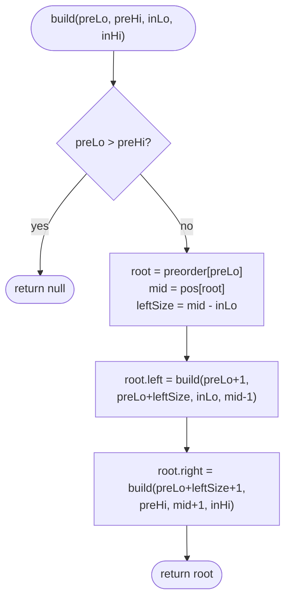

# LC 105 Construct Binary Tree from Preorder and Inorder Traversal

> [!abstract] In one sentence
> Preorder tells you *which* node is the root (the first one); inorder tells you *how many* nodes are to its left (everything before it) — those two facts let you split both arrays and recurse, and a hash map from value to inorder index makes each split O(1).

**Map:** [[NeetCode 150 MOC]] → [[DSA Dashboard]] · Pattern: [[Trees]]

> [!question] Predict before you read
> Why is preorder + inorder enough to rebuild the tree, while preorder + postorder is not? (Think about a node with exactly one child.)

## Problem

Given two integer arrays, `preorder` and `inorder`, which are the preorder and inorder traversals of the same binary tree with distinct values, rebuild and return the tree.

Example: `preorder = [3, 9, 20, 15, 7]`, `inorder = [9, 3, 15, 20, 7]` → the tree `[3, 9, 20, null, null, 15, 7]`. `preorder = [-1]`, `inorder = [-1]` → a single node.

Constraints that matter: up to 3000 nodes, values distinct (the whole method relies on this), both arrays are valid traversals of one tree.

## Clarifying questions

1. Are values distinct? — Yes; otherwise the inorder lookup is ambiguous.
2. Are the two arrays guaranteed consistent? — Yes; no validation needed.
3. Can the arrays be empty? — On LeetCode n ≥ 1; the recursion handles empty ranges anyway.
4. Is O(n) expected, or is O(n²) with `indexOf` acceptable? — Say you will index inorder in a map for O(n).

## Brute force

Take `preorder[0]` as the root, find it in `inorder` with a linear scan, copy the left and right slices of both arrays into new arrays, recurse. Each level copies O(n) elements and the scan is O(n), so O(n²) on a chain-shaped tree, and the array copies allocate O(n²) memory in total. The waste: copying slices when index ranges would do, and scanning when a map would do.

## The key insight

Two facts combine. In preorder the root comes first. In inorder, everything before the root belongs to the left subtree and everything after it to the right. The size of the left subtree, `k = idx(root) − inLo`, then tells you where the left subtree ends *in preorder* too: it is the next `k` elements. So each recursive call is defined entirely by index ranges `[preLo, preHi]` and `[inLo, inHi]`. A `HashMap<Integer, Integer>` from value to inorder index replaces the scan. Recognition cue: "construct a tree from traversals" — the same reasoning with postorder (root is *last*) gives LC 106.

## Optimal approach

1. Build `pos`: value → index in `inorder`.
2. `build(preLo, preHi, inLo, inHi)`: if `preLo > preHi` return `null`.
3. `root = new TreeNode(preorder[preLo])`; `mid = pos.get(root.val)`; `leftSize = mid − inLo`.
4. `root.left = build(preLo + 1, preLo + leftSize, inLo, mid − 1)`.
5. `root.right = build(preLo + leftSize + 1, preHi, mid + 1, inHi)`.
6. Return `root`.



> [!example]- Excalidraw version — the same diagram as an editable canvas
> ![[LC 105 Construct Binary Tree from Preorder and Inorder Traversal — Optimal approach.excalidraw]]
> [[LC 105 Construct Binary Tree from Preorder and Inorder Traversal — Optimal approach.excalidraw|Open in Excalidraw]] — needs the Excalidraw plugin (see [[Plugins to Install]]).

## Walkthrough

> [!example] inorder = [9, 3, 15, 20, 7], root 3 found at index 1
> ![[LC 105 Construct Binary Tree from Preorder and Inorder Traversal — inorder = -9, 3, 15, 20, 7-, root 3 found at index 1.excalidraw]]
> [[LC 105 Construct Binary Tree from Preorder and Inorder Traversal — inorder = -9, 3, 15, 20, 7-, root 3 found at index 1.excalidraw|Open in Excalidraw]] — left subtree = [9] (size 1), right subtree = [15, 20, 7]

%% excalidraw-spec
{"kind": "array", "title": "inorder = [9, 3, 15, 20, 7], root 3 found at index 1", "values": [9, 3, 15, 20, 7], "pointers": {"inLo": 0, "mid": 1, "inHi": 4}, "highlight": [1], "caption": "left subtree = [9] (size 1), right subtree = [15, 20, 7]"}
%%

| Call | pre range | in range | root | leftSize | children ranges |
|---|---|---|---|---|---|
| build | [0, 4] | [0, 4] | 3 | 1 | L: pre [1,1] in [0,0]; R: pre [2,4] in [2,4] |
| left | [1, 1] | [0, 0] | 9 | 0 | both empty |
| right | [2, 4] | [2, 4] | 20 | 1 | L: pre [3,3] in [2,2]; R: pre [4,4] in [4,4] |
| | [3, 3] | [2, 2] | 15 | 0 | leaves |
| | [4, 4] | [4, 4] | 7 | 0 | leaves |

> [!example] Result
> ![[LC 105 Construct Binary Tree from Preorder and Inorder Traversal — Result.excalidraw]]
> [[LC 105 Construct Binary Tree from Preorder and Inorder Traversal — Result.excalidraw|Open in Excalidraw]] — preorder 3 9 20 15 7 and inorder 9 3 15 20 7 both hold

%% excalidraw-spec
{"kind": "tree", "title": "Result", "levels": [3, 9, 20, null, null, 15, 7], "highlight": [0], "caption": "preorder 3 9 20 15 7 and inorder 9 3 15 20 7 both hold"}
%%

## Java solution

```java
import java.util.*;

class Solution {
    private int[] preorder;
    private Map<Integer, Integer> pos = new HashMap<>();   // value -> index in inorder

    public TreeNode buildTree(int[] preorder, int[] inorder) {
        this.preorder = preorder;
        for (int i = 0; i < inorder.length; i++) pos.put(inorder[i], i);
        return build(0, preorder.length - 1, 0, inorder.length - 1);
    }

    private TreeNode build(int preLo, int preHi, int inLo, int inHi) {
        if (preLo > preHi) return null;
        TreeNode root = new TreeNode(preorder[preLo]);
        int mid = pos.get(root.val);                 // root's position in inorder
        int leftSize = mid - inLo;                   // nodes in the left subtree
        root.left = build(preLo + 1, preLo + leftSize, inLo, mid - 1);
        root.right = build(preLo + leftSize + 1, preHi, mid + 1, inHi);
        return root;
    }
}

class TreeNode {
    int val;
    TreeNode left, right;
    TreeNode() {}
    TreeNode(int val) { this.val = val; }
    TreeNode(int val, TreeNode left, TreeNode right) { this.val = val; this.left = left; this.right = right; }
}
```

**Time** O(n) — each node is created once with O(1) work · **Space** O(n) for the map plus O(h) recursion.

## Why it works

Invariant: `preorder[preLo..preHi]` and `inorder[inLo..inHi]` are the preorder and inorder traversals of the same subtree (and have equal length). Preorder is root-left-right, so `preorder[preLo]` is that subtree's root. Inorder is left-root-right, so the `leftSize` values before `mid` are exactly the left subtree, and preorder lists the left subtree immediately after the root as a contiguous block of the same size. Both ranges handed to each recursive call therefore satisfy the invariant, and the two children are built correctly by induction. Distinct values guarantee `pos` is a function.

## Edge cases

- Single node → ranges [0, 0], children get empty ranges.
- Left-only chain: `preorder = [1, 2, 3]`, `inorder = [3, 2, 1]` → each call has `leftSize = preHi − preLo`, the right range is empty; recursion depth n.
- Right-only chain: `preorder = inorder = [1, 2, 3]` → `leftSize = 0` every time.
- Empty arrays → `preLo = 0 > preHi = −1` → `null`.

## Common mistakes

> [!warning] Pitfalls
> - Computing the right subtree's preorder start as `mid + 1` (an inorder index) instead of `preLo + leftSize + 1`. The two arrays have different coordinate systems; only sizes transfer between them.
> - Using `Arrays.copyOfRange` per call — correct but O(n²) memory and time.
> - Searching with a linear `indexOf` — O(n²) on a chain; the map is the expected improvement.
> - Confusing the postorder variant (LC 106): there the root is `postorder[postHi]` and you build the *right* subtree first if you consume the array from the end.

## Variants & follow-ups

- Inorder + postorder (LC 106): root is the last of postorder; same split.
- Preorder + postorder (LC 889): not unique in general; reconstruct one valid tree using the second preorder element as the left child's root.
- Preorder of a BST alone (LC 1008): the inorder is the sorted preorder, or use bounds as in [[LC 98 Validate Binary Search Tree]].
- Avoid the map by consuming preorder with a running index and passing a `stop` value (the "inorder boundary" trick) — same O(n), less memory, harder to explain.
- [[LC 297 Serialize and Deserialize Binary Tree]] shows why a *single* traversal suffices when nulls are recorded.

## Interview script

Restate: "Rebuild the unique tree whose preorder and inorder are these arrays; values are distinct." Brute force: "Root is preorder[0]; find it in inorder; slice both arrays and recurse — O(n²)." Insight: "I never need to copy: the root's inorder index gives the left subtree's size, and that size locates the subtrees in preorder too; a value-to-index map makes the lookup O(1)." Approach: "Recursive build over four indices." Complexity: "O(n) time, O(n) space." Tests: "Single node, left chain, right chain, the example — and I would note the right-preorder-start formula because that is where the off-by-one lives."

## Related

- Pattern: [[Trees]] · prerequisite: [[Recursion]]
- Serialisation (single traversal with nulls): [[LC 297 Serialize and Deserialize Binary Tree]]
- In-order semantics on a BST: [[LC 230 Kth Smallest Element in a BST]]
- Java refresher: [[Java Collections Cheat Sheet]] (`HashMap` index maps)

## Attempt log

| Date | Result | Minutes | What I got wrong |
|---|---|---|---|
| | | | |

### Mastery checklist
- [ ] Solved without hints in under 25 minutes
- [ ] Stated complexity before coding
- [ ] Handled every edge case above
- [ ] Code compiled first time
- [ ] Can do the follow-up variant

## Open questions
- [ ]
