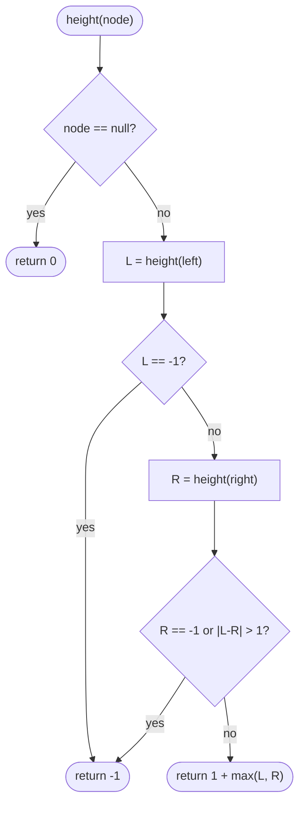

# LC 110 Balanced Binary Tree

> [!abstract] In one sentence
> A tree is height-balanced when, at every node, the left and right heights differ by at most one; compute heights bottom-up and let an impossible height (−1) mean "already broken", so one post-order pass answers the question.

**Map:** [[NeetCode 150 MOC]] → [[DSA Dashboard]] · Pattern: [[Trees]]

> [!question] Predict before you read
> The obvious solution calls `height()` at every node and compares. What is its complexity on a balanced tree, and on a chain? Which case is the bad one?

## Problem

Given the root of a binary tree, decide whether it is height-balanced: for every node, the heights of its left and right subtrees differ by no more than 1.

Example: `[3, 9, 20, null, null, 15, 7]` → true. `[1, 2, 2, 3, 3, null, null, 4, 4]` → false (the root's left subtree has height 3, its right subtree height 1). `[]` → true.

Constraints that matter: up to 5000 nodes.

## Clarifying questions

1. Balanced by *height* (AVL-style), not by node count? — Height.
2. Does the check apply to every node or only the root? — Every node.
3. Empty tree? — Balanced.
4. Is "differ by at most one" inclusive? — Yes, difference 1 is fine.

## Brute force

At every node compute `height(left)` and `height(right)` with a standalone height function, compare, recurse. `height` is O(size of subtree), and it is called once per ancestor of each node, so a chain costs O(n²). On a balanced tree it is O(n log n). The waste: the same subtree heights are recomputed at every level above them.

## The key insight

Height is already computed bottom-up by the [[LC 104 Maximum Depth of Binary Tree]] recursion; the balance check just needs to piggyback on it. The trick is a *sentinel*: heights are never negative, so let the recursion return −1 to mean "a subtree below here is unbalanced". Each node checks its children's values: if either is −1, or they differ by more than 1, return −1; otherwise return the real height. One pass, O(n). Recognition cue: a yes/no property of the tree defined "for every node" in terms of a subtree measurement.

## Optimal approach

1. Define `height(node)`: `null` → 0.
2. `L = height(left)`; if `L == -1` return −1 (short-circuit).
3. `R = height(right)`; if `R == -1` return −1.
4. If `|L − R| > 1` return −1.
5. Return `1 + max(L, R)`.
6. `isBalanced(root)` is `height(root) != -1`.



> [!example]- Excalidraw version — the same diagram as an editable canvas
> ![[LC 110 Balanced Binary Tree — Optimal approach.excalidraw]]
> [[LC 110 Balanced Binary Tree — Optimal approach.excalidraw|Open in Excalidraw]] — needs the Excalidraw plugin (see [[Plugins to Install]]).

## Walkthrough

The unbalanced example: `[1, 2, 2, 3, 3, null, null, 4, 4]`.

> [!example] Unbalanced: [1,2,2,3,3,null,null,4,4]
> ![[LC 110 Balanced Binary Tree — Unbalanced- -1,2,2,3,3,null,null,4,4-.excalidraw]]
> [[LC 110 Balanced Binary Tree — Unbalanced- -1,2,2,3,3,null,null,4,4-.excalidraw|Open in Excalidraw]] — at the root L = 3, R = 1: the sentinel −1 is produced here and bubbles up as the answer

%% excalidraw-spec
{"kind": "tree", "title": "Unbalanced: [1,2,2,3,3,null,null,4,4]", "levels": [1, 2, 2, 3, 3, null, null, 4, 4], "highlight": [0], "caption": "at the root L = 3, R = 1: the sentinel −1 is produced here and bubbles up as the answer"}
%%

| Call | L | R | returns |
|---|---|---|---|
| height(4) ×2 | 0 | 0 | 1 |
| height(3) left | 1 | 1 | 2 |
| height(3) right | 0 | 0 | 1 |
| height(2) left | 2 | 1 | 3 |
| height(2) right | 0 | 0 | 1 |
| height(1) | 3 | 1 | −1 (difference 2) |

## Java solution

```java
import java.util.*;

class Solution {
    public boolean isBalanced(TreeNode root) {
        return height(root) != -1;
    }

    // Returns the height, or -1 if any node in this subtree is unbalanced.
    private int height(TreeNode node) {
        if (node == null) return 0;
        int left = height(node.left);
        if (left == -1) return -1;            // stop early: no need to look at the right side
        int right = height(node.right);
        if (right == -1) return -1;
        if (Math.abs(left - right) > 1) return -1;
        return 1 + Math.max(left, right);
    }
}

class TreeNode {
    int val;
    TreeNode left, right;
    TreeNode() {}
    TreeNode(int val) { this.val = val; }
    TreeNode(int val, TreeNode left, TreeNode right) { this.val = val; this.left = left; this.right = right; }
}
```

**Time** O(n) · **Space** O(h) recursion stack.

## Why it works

Claim: `height(node)` returns −1 iff some node in the subtree is unbalanced, and otherwise returns the true height. Base: `null` is balanced with height 0. Step: if either child's subtree is unbalanced, the recursion already returned −1 and we propagate it; otherwise both children returned true heights, and this node is unbalanced exactly when they differ by more than 1, which is the check performed. Since −1 can never be a real height, there is no ambiguity. Each node is the argument of one call.

## Edge cases

- `null` root → height 0 → balanced.
- Single node → balanced.
- Left chain of 2 (`[1, 2]`) → L = 1, R = 0 → balanced; chain of 3 → L = 2, R = 0 → unbalanced.
- A tree balanced at the root but unbalanced deeper → caught by the deeper call; the −1 propagates past the root's own check.

## Common mistakes

> [!warning] Pitfalls
> - Checking balance only at the root (`|height(left) − height(right)| ≤ 1`) — the definition is for every node.
> - The O(n²) version: calling a separate `height` inside `isBalanced` at every node. Correct, but the interviewer will ask you to improve it.
> - Using a boolean field for "unbalanced" and forgetting it is also fine; the sentinel style simply avoids the field. Either is acceptable — just do not mix both.
> - Forgetting that the difference check needs `Math.abs`.

## Variants & follow-ups

- Return the height of the tree *and* whether it is balanced in one object (a record `Result(int height, boolean balanced)`) — same algorithm without the sentinel.
- Count the number of unbalanced nodes, or find the lowest one.
- Compare with [[LC 98 Validate Binary Search Tree]]: another "for every node" property, but one that needs information from *above* (bounds), not only from below.
- Why AVL trees care: the balance condition guarantees height O(log n), which is why `TreeMap` (a red-black tree, a looser cousin) has logarithmic operations.

## Interview script

Restate: "Every node's subtrees differ in height by at most one." Brute force: "Height at every node from scratch — O(n log n) balanced, O(n²) chain." Insight: "Heights already come from a post-order recursion; use −1 as an impossible height to signal 'broken below'." Approach: "Height recursion with three early returns." Complexity: "O(n), O(height)." Tests: "Empty, single, chain of three, balanced root with an unbalanced grandchild."

## Related

- Pattern: [[Trees]] · prerequisite: [[LC 104 Maximum Depth of Binary Tree]]
- Same recursion shape: [[LC 543 Diameter of Binary Tree]], [[LC 124 Binary Tree Maximum Path Sum]]
- Contrast (top-down bounds): [[LC 98 Validate Binary Search Tree]]
- Java refresher: [[DSA Patterns in Java]]

## Attempt log

| Date | Result | Minutes | What I got wrong |
|---|---|---|---|
| | | | |

### Mastery checklist
- [ ] Solved without hints in under 25 minutes
- [ ] Stated complexity before coding
- [ ] Handled every edge case above
- [ ] Code compiled first time
- [ ] Can do the follow-up variant

## Open questions
- [ ]
