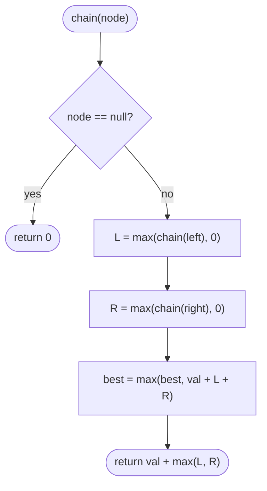

# LC 124 Binary Tree Maximum Path Sum

> [!abstract] In one sentence
> Every path has a unique topmost node where it "turns", and at that node the path is the node plus a downward chain on each side; a post-order recursion that returns the best *chain* (never negative) and records the best *turn* finds the maximum path in O(n) — it is [[LC 543 Diameter of Binary Tree]] with weights and one `max(…, 0)`.

**Map:** [[NeetCode 150 MOC]] → [[DSA Dashboard]] · Pattern: [[Trees]]

> [!question] Predict before you read
> Values can be negative and the path must contain at least one node. Two questions: (1) why does the recursion return `max(chain, 0)` and not `chain`; (2) why must the global answer *not* be initialised to 0?

## Problem

A path is any sequence of nodes where consecutive nodes are connected by an edge, each node appears at most once, and the path does not need to pass through the root or end at a leaf. Its sum is the sum of the node values. Given the root of a binary tree, return the maximum path sum over all non-empty paths.

Examples: `[1, 2, 3]` → 6 (2 → 1 → 3). `[-10, 9, 20, 15, 7]` → 42 (15 → 20 → 7; the −10 is left out). `[-3]` → −3 (a path must have at least one node).

Constraints that matter: up to 3·10⁴ nodes; values from −1000 to 1000, so sums fit an `int`; a chain of 3·10⁴ nodes is a deep but survivable recursion.

## Clarifying questions

1. Can values be negative, and must the path be non-empty? — Yes and yes; so the answer can be negative, and the global maximum starts at −∞, not 0.
2. Does the path have to go through the root or end at a leaf? — Neither.
3. Can a path go down, up, and down again? — No: in a tree that would repeat a node. A path goes up to one turning node then down. That is the structural fact the solution uses.
4. Single node tree? — Its value.

## Brute force

Treat every node as the potential turning point, and for each compute the best downward chain into its left subtree and into its right subtree with a fresh recursion. Each chain computation is O(size of subtree), repeated once per ancestor: O(n²) on a chain, O(n log n) balanced. Even worse, enumerating all O(n²) node pairs and summing the path between them is O(n³). The waste is recomputing chain sums that the post-order recursion gets for free.

## The key insight

Separate the two quantities that look alike but are not:

- **Chain** through a node: starts at the node and goes *down one side only* — the thing a parent can extend. `chain(node) = val + max(chainLeft, chainRight, 0)`. The `0` means "if the best child chain is negative, do not take it".
- **Turn** at a node: the node plus a chain down the left *and* a chain down the right — a complete path that the parent cannot extend because it already uses both of the node's edges. `turn(node) = val + max(chainLeft, 0) + max(chainRight, 0)`.

Every path turns at exactly one node (its highest node), so the answer is the maximum of `turn` over all nodes. The recursion returns `chain` and updates a field with `turn`. Recognition cue: "path sum not necessarily through the root", "any node to any node", "diameter with weights".

## Optimal approach

1. Field `best = Integer.MIN_VALUE`.
2. `chain(node)`: `null` → 0.
3. `L = max(chain(left), 0)`, `R = max(chain(right), 0)` — clamp each side independently.
4. `best = max(best, node.val + L + R)` — the path that turns here.
5. Return `node.val + max(L, R)` — the best chain for the parent.
6. Answer is `best` after `chain(root)`.



> [!example]- Excalidraw version — the same diagram as an editable canvas
> ![[LC 124 Binary Tree Maximum Path Sum — Optimal approach.excalidraw]]
> [[LC 124 Binary Tree Maximum Path Sum — Optimal approach.excalidraw|Open in Excalidraw]] — needs the Excalidraw plugin (see [[Plugins to Install]]).

## Walkthrough

`[-10, 9, 20, 15, 7]`: the best path turns at 20 and ignores the root.

> [!example] Max path sum of [-10,9,20,15,7]
> ![[LC 124 Binary Tree Maximum Path Sum — Max path sum of --10,9,20,15,7-.excalidraw]]
> [[LC 124 Binary Tree Maximum Path Sum — Max path sum of --10,9,20,15,7-.excalidraw|Open in Excalidraw]] — turn at 20: 15 + 20 + 7 = 42; the chain returned to −10 is 20 + 15 = 35, and the root's turn is −10 + 9 + 35 = 34, which loses

%% excalidraw-spec
{"kind": "tree", "title": "Max path sum of [-10,9,20,15,7]", "levels": [-10, 9, 20, 15, 7], "highlight": [3, 2, 4], "caption": "turn at 20: 15 + 20 + 7 = 42; the chain returned to −10 is 20 + 15 = 35, and the root's turn is −10 + 9 + 35 = 34, which loses"}
%%

| Call | L (clamped) | R (clamped) | turn = val + L + R | best after | returns chain |
|---|---|---|---|---|---|
| chain(9) | 0 | 0 | 9 | 9 | 9 |
| chain(15) | 0 | 0 | 15 | 15 | 15 |
| chain(7) | 0 | 0 | 7 | 15 | 7 |
| chain(20) | 15 | 7 | 42 | 42 | 35 |
| chain(−10) | 9 | 35 | 34 | 42 | 25 |

A second trace that matters: `[2, -1]`. `chain(−1)` returns −1 and sets `best = −1`; at 2, `L = max(−1, 0) = 0`, turn = 2, `best = 2`. Without the clamp the answer would be 1.

## Java solution

```java
import java.util.*;

class Solution {
    private int best;

    public int maxPathSum(TreeNode root) {
        best = Integer.MIN_VALUE;              // not 0: the answer may be negative
        chain(root);
        return best;
    }

    // Returns the best path sum that starts at node and goes down one side (a "chain").
    // Records the best path that turns at node (a "turn") in best.
    private int chain(TreeNode node) {
        if (node == null) return 0;
        int left = Math.max(chain(node.left), 0);     // a negative chain is worse than no chain
        int right = Math.max(chain(node.right), 0);
        best = Math.max(best, node.val + left + right); // path through node using both sides
        return node.val + Math.max(left, right);        // parent may extend only one side
    }
}

class TreeNode {
    int val;
    TreeNode left, right;
    TreeNode() {}
    TreeNode(int val) { this.val = val; }
    TreeNode(int val, TreeNode left, TreeNode right) { this.val = val; this.left = left; this.right = right; }
}
```

**Time** O(n) — one post-order visit per node · **Space** O(h) recursion stack, O(n) on a chain.

## Why it works

Three invariants, one per line of the recursion.

1. **Chain correctness.** `chain(node)` returns the maximum sum of a path that starts at `node` and goes only downward (possibly just `node` itself). Proof by induction: such a path is `node` alone, or `node` followed by a downward path starting at one child. The best of those is `val + max(0, chain(left), chain(right))`, which is what is returned. The `0` option is the "node alone" case; it is why a negative child chain is dropped rather than added.

2. **Turn correctness.** The best path whose highest node is `node` consists of `node`, an optional downward path into the left child, and an optional downward path into the right child; the two are independent, so the best is `val + max(0, chain(left)) + max(0, chain(right))`. That is the value compared into `best`.

3. **Coverage.** Every path in a tree has a unique highest node (the LCA of its two endpoints), so every path is counted as a turn at that node, and no path is counted that does not exist (a turn uses at most one edge into each child, so it is a valid simple path). Hence `best` is the maximum over all paths. The initial `Integer.MIN_VALUE` guarantees that the first real turn replaces it even when all values are negative.

## Edge cases

- Single negative node `[-3]` → `chain` returns −3; `best = −3`; the clamp does not touch `best`, only chains.
- All negative → the answer is the largest single value (every chain clamps to 0, every turn is just the node).
- Root negative, children positive (the example) → the path lives below the root.
- Linear chain `[1, 2, 3, …]` → the best turn at the top is the whole chain; chains never clamp.
- Mixed: `[2, -1]` → 2 (chain of −1 is clamped to 0).

## Common mistakes

> [!warning] Pitfalls
> - Returning `val + L + R` (the turn) up to the parent. The parent would then build a path that goes down into both of the child's subtrees *and* up — not a path. Return `val + max(L, R)`.
> - Initialising `best = 0`. On `[-3]` you would return 0, but a path must contain a node.
> - Clamping the *turn* instead of the *chains*: `max(val + L + R, 0)` wrongly reports 0 for all-negative trees. Clamp each child chain, never the node's own value.
> - Clamping after choosing: `max(max(L, R), 0)` for the chain is fine, but `max(L + R, 0)` for the turn is not — the two sides must be clamped independently (`L = −5, R = 10` should give `val + 10`, not `val + 5`).
> - Forgetting to reset `best` when the `Solution` instance is reused.

## Variants & follow-ups

- [[LC 543 Diameter of Binary Tree]] is this problem with every value 1 and the answer counted in edges; no clamping needed because chains are never negative.
- Maximum path sum from root to leaf only: drop the turn, return `val + max(chainLeft, chainRight)` with no clamp (the path must reach a leaf — and then `null` must not return 0 for a node with one child; handle it like minimum depth).
- Maximum path sum between two *leaves* (common GfG variant): the turn requires both chains to exist.
- Return the path itself: store the node where `best` was set, then re-walk the two best chains.
- The 1-D version is [[LC 53 Maximum Subarray]] (Kadane): "extend or restart" is exactly "chain or 0".

## Interview script

Restate: "Maximum sum over all simple paths, any start and end, at least one node, values may be negative." Brute force: "Try every node as the top of the path and recompute the best downward chains on each side — O(n²)." Insight: "Every path has a unique top node. At the top it is the node plus one chain per side. Chains come from a post-order recursion, and a negative chain is replaced by nothing — that is the clamp." Approach: "Recursion returns the best one-sided chain, clamped at 0, and updates a global with node + left chain + right chain." Complexity: "O(n) time, O(height) space." Tests: "Single negative node, all negative, the −10 root example, a two-node tree with a negative leaf. The two invariants I will state are: what the function returns is a chain, what it records is a turn."

## Related

- Pattern: [[Trees]] · prerequisite: [[LC 543 Diameter of Binary Tree]], [[LC 104 Maximum Depth of Binary Tree]]
- Contrast (top-down carry): [[LC 1448 Count Good Nodes in Binary Tree]]
- 1-D analogue: [[LC 53 Maximum Subarray]]
- Java refresher: [[DSA Patterns in Java]] (post-order recursion returning one value, recording another)

## Attempt log

| Date | Result | Minutes | What I got wrong |
|---|---|---|---|
| | | | |

### Mastery checklist
- [ ] Solved without hints in under 25 minutes
- [ ] Stated complexity before coding
- [ ] Handled every edge case above
- [ ] Code compiled first time
- [ ] Can do the follow-up variant

## Open questions
- [ ]
