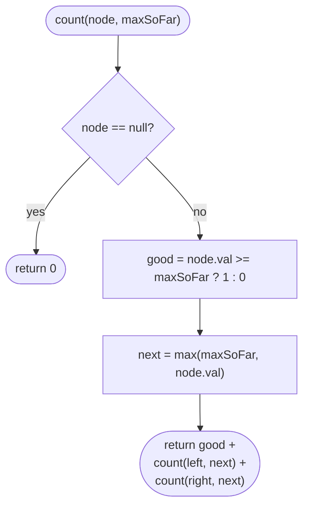

# LC 1448 Count Good Nodes in Binary Tree

> [!abstract] In one sentence
> Whether a node is "good" depends only on the maximum value on its root path, so pass that maximum down as a parameter, compare, update, recurse — the top-down recursion shape, as opposed to the bottom-up shape of depth and diameter.

**Map:** [[NeetCode 150 MOC]] → [[DSA Dashboard]] · Pattern: [[Trees]]

> [!question] Predict before you read
> [[LC 104 Maximum Depth of Binary Tree]] computes something from the children and returns it upward. This problem needs information that flows the other way. What is that information, and what is its initial value at the root?

## Problem

Given the root of a binary tree, a node X is *good* if on the path from the root to X there is no node with a value greater than X's value (X itself counts, so the root is always good). Return the number of good nodes.

Example: `[3, 1, 4, 3, null, 1, 5]` → 4: the root 3; the 4 (path 3 → 4); the left 3 (path 3 → 1 → 3, nothing greater); the 5 (path 3 → 4 → 5). `[3, 3, null, 4, 2]` → 3. `[1]` → 1.

Constraints that matter: up to 10⁵ nodes, values from −10⁴ to 10⁴ (so initialise the running max with `Integer.MIN_VALUE` or `root.val`, not 0). Depth can reach 10⁵ on a chain, which is near the JVM's default stack limit — mention the iterative version.

## Clarifying questions

1. Does "greater" mean strictly greater, so equal values are still good? — Strictly greater; `[3, 3]` has two good nodes.
2. Is the root always good? — Yes, its path is just itself.
3. Can values be negative? — Yes; the running max must start below any possible value.
4. Can the tree be empty? — LeetCode guarantees at least one node; return 0 if null anyway.

## Brute force

For every node, walk up to the root (which needs parent pointers) or recompute the root-to-node path and check whether any ancestor is larger. O(n · h), O(n²) on a chain. The waste: the ancestors of a node are the ancestors of its parent plus the parent — the maximum over them can be maintained incrementally.

## The key insight

The only thing a node needs to know about its ancestors is the largest value among them. That single `int` can be handed down the recursion as a parameter: the child receives `max(maxSoFar, node.val)`. A node is good exactly when `node.val >= maxSoFar`. The count can be returned upward (sum of both subtrees plus 0 or 1) or accumulated in a field. Recognition cue: a per-node property defined in terms of the *path from the root* — this is the shape for [[LC 98 Validate Binary Search Tree]] too, where the carried information is a (min, max) bound.

## Optimal approach

1. `count(node, maxSoFar)`: if `node` is null return 0.
2. `good = node.val >= maxSoFar ? 1 : 0`.
3. `next = max(maxSoFar, node.val)`.
4. Return `good + count(left, next) + count(right, next)`.
5. Call with `count(root, Integer.MIN_VALUE)` (or `root.val`).



> [!example]- Excalidraw version — the same diagram as an editable canvas
> ![[LC 1448 Count Good Nodes in Binary Tree — Optimal approach.excalidraw]]
> [[LC 1448 Count Good Nodes in Binary Tree — Optimal approach.excalidraw|Open in Excalidraw]] — needs the Excalidraw plugin (see [[Plugins to Install]]).

## Walkthrough

> [!example] Good nodes in [3,1,4,3,null,1,5]
> ![[LC 1448 Count Good Nodes in Binary Tree — Good nodes in -3,1,4,3,null,1,5-.excalidraw]]
> [[LC 1448 Count Good Nodes in Binary Tree — Good nodes in -3,1,4,3,null,1,5-.excalidraw|Open in Excalidraw]] — highlighted = good; the 1 under 3 and the 1 under 4 both see a larger ancestor

%% excalidraw-spec
{"kind": "tree", "title": "Good nodes in [3,1,4,3,null,1,5]", "levels": [3, 1, 4, 3, null, 1, 5], "highlight": [0, 2, 3, 6], "caption": "highlighted = good; the 1 under 3 and the 1 under 4 both see a larger ancestor"}
%%

| Call | maxSoFar in | good? | next passed down |
|---|---|---|---|
| count(3, MIN) | MIN | yes | 3 |
| count(1, 3) | 3 | no | 3 |
| count(3, 3) | 3 | yes (3 ≥ 3) | 3 |
| count(4, 3) | 3 | yes | 4 |
| count(1, 4) | 4 | no | 4 |
| count(5, 4) | 4 | yes | 5 |

Total 4.

## Java solution

```java
import java.util.*;

class Solution {
    public int goodNodes(TreeNode root) {
        return count(root, Integer.MIN_VALUE);
    }

    // maxSoFar = largest value on the path from the root to node's parent.
    private int count(TreeNode node, int maxSoFar) {
        if (node == null) return 0;
        int good = node.val >= maxSoFar ? 1 : 0;     // >= : equal ancestors do not disqualify
        int next = Math.max(maxSoFar, node.val);
        return good + count(node.left, next) + count(node.right, next);
    }

    // Iterative version for very deep trees: stack of (node, maxSoFar) pairs.
    public int goodNodesIterative(TreeNode root) {
        if (root == null) return 0;
        Deque<Object[]> stack = new ArrayDeque<>();
        stack.push(new Object[] {root, Integer.MIN_VALUE});
        int total = 0;
        while (!stack.isEmpty()) {
            Object[] top = stack.pop();
            TreeNode node = (TreeNode) top[0];
            int maxSoFar = (Integer) top[1];
            if (node.val >= maxSoFar) total++;
            int next = Math.max(maxSoFar, node.val);
            if (node.left != null) stack.push(new Object[] {node.left, next});
            if (node.right != null) stack.push(new Object[] {node.right, next});
        }
        return total;
    }
}

class TreeNode {
    int val;
    TreeNode left, right;
    TreeNode() {}
    TreeNode(int val) { this.val = val; }
    TreeNode(int val, TreeNode left, TreeNode right) { this.val = val; this.left = left; this.right = right; }
}
```

**Time** O(n) · **Space** O(h) recursion stack (O(n) on a chain; the iterative version uses the same amount on the heap instead).

## Why it works

Invariant: when `count(node, maxSoFar)` is called, `maxSoFar` equals the maximum value among the proper ancestors of `node` (`Integer.MIN_VALUE` for the root, whose ancestor set is empty). The node is good iff no ancestor exceeds it, i.e. iff `node.val >= maxSoFar`. Passing `max(maxSoFar, node.val)` to the children re-establishes the invariant for them, since their proper ancestors are `node` plus `node`'s ancestors. Every node is visited once and contributes 0 or 1.

## Edge cases

- Single node → 1 (root is always good).
- All equal values → every node is good (because of `>=`).
- Strictly decreasing chain → only the root is good.
- Negative values → correct only because the initial max is `Integer.MIN_VALUE`; initialising with 0 would wrongly reject a root of −5.

## Common mistakes

> [!warning] Pitfalls
> - Using `>` instead of `>=`: equal ancestors would wrongly disqualify a node (`[3, 3]` should give 2).
> - Initialising `maxSoFar` to 0 — breaks on negative roots.
> - Computing the maximum bottom-up (returning the max of the subtree) — that is the wrong direction; a node's goodness depends on ancestors, not descendants.
> - Updating a field `maxSoFar` without restoring it on return (if you use a mutable field instead of a parameter, you must undo the change after the two recursive calls).

## Variants & follow-ups

- Count nodes that are *smaller* than every ancestor: carry the running minimum.
- Maximum difference between a node and an ancestor (LC 1026): carry both min and max on the path.
- [[LC 98 Validate Binary Search Tree]]: carry a (low, high) range instead of one max.
- Path-sum problems (LC 112, 113): carry the remaining sum downward — the same top-down shape.

## Interview script

Restate: "Count nodes with no larger value on their root path." Brute force: "Check all ancestors per node — O(n · height)." Insight: "Only the maximum on the path matters, and it can be carried down as a parameter." Approach: "Pre-order recursion with maxSoFar; good if val ≥ maxSoFar; pass max(maxSoFar, val) down; sum the counts." Complexity: "O(n), O(height)." Tests: "Single node, all equal, decreasing chain, negative values — the last one catches the wrong initial max."

## Related

- Pattern: [[Trees]] (top-down vs bottom-up recursion)
- Same carry-down shape: [[LC 98 Validate Binary Search Tree]]
- The opposite (bottom-up) shape: [[LC 104 Maximum Depth of Binary Tree]], [[LC 124 Binary Tree Maximum Path Sum]]
- Java refresher: [[DSA Patterns in Java]] (DFS with parameters)

## Attempt log

| Date | Result | Minutes | What I got wrong |
|---|---|---|---|
| | | | |

### Mastery checklist
- [ ] Solved without hints in under 25 minutes
- [ ] Stated complexity before coding
- [ ] Handled every edge case above
- [ ] Code compiled first time
- [ ] Can do the follow-up variant

## Open questions
- [ ]
