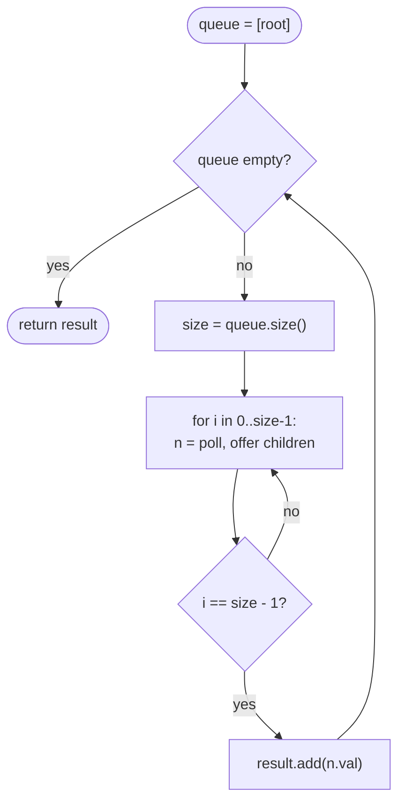

# LC 199 Binary Tree Right Side View

> [!abstract] In one sentence
> Standing to the right of the tree you see exactly one node per level — the rightmost one — so run [[LC 102 Binary Tree Level Order Traversal]] and keep the last value of each round, or visit right before left in a DFS and record the first node you reach at every new depth.

**Map:** [[NeetCode 150 MOC]] → [[DSA Dashboard]] · Pattern: [[Trees]]

> [!question] Predict before you read
> Is the answer simply "walk down the right children until you hit null"? Draw a tree where that gives the wrong result before reading on.

## Problem

Given the root of a binary tree, imagine standing on its right side and return the values of the nodes you can see, ordered from top to bottom.

Example: `[1, 2, 3, null, 5, null, 4]` → `[1, 3, 4]`. `[1, 2, 3, 4, null, null, null, 5]` → `[1, 3, 4, 5]` — node 5 is in the *left* subtree but is the only node at depth 3. `[]` → `[]`.

Constraints that matter: up to 100 nodes.

## Clarifying questions

1. Is it the rightmost node of each level, even if it belongs to the left subtree? — Yes; that is the trap in the second example.
2. Empty tree? — Empty list.
3. Order top to bottom? — Yes.
4. Would a left side view be symmetric? — Yes: first of each level, or left-first DFS.

## Brute force

Compute the full level-order list of lists ([[LC 102 Binary Tree Level Order Traversal]]) and take the last element of every inner list. That is already O(n) and perfectly acceptable; the "waste" is building n values in lists when only h of them are needed. A genuinely worse approach is "follow right pointers only", which is not slow but *wrong* once the right spine ends before the left one.

## The key insight

"Visible from the right" means "last in its level". Any mechanism that knows the level boundaries can pick that node. BFS knows them from the frozen `size`; DFS knows them from a depth parameter, and if it goes right first then the first node encountered at a new depth is the rightmost. Recognition cue: "view", "visible", "per level but only one node".

## Optimal approach

BFS (primary):

1. Seed the queue with the root (return `[]` if null).
2. Per round, freeze `size`; poll `size` nodes, offering children left then right.
3. When `i == size − 1` the polled node is the rightmost of the level: add its value to the result.

DFS (alternative): `dfs(node, depth)`: if `depth == result.size()` add `node.val`; recurse right then left.



> [!example]- Excalidraw version — the same diagram as an editable canvas
> ![[LC 199 Binary Tree Right Side View — Optimal approach.excalidraw]]
> [[LC 199 Binary Tree Right Side View — Optimal approach.excalidraw|Open in Excalidraw]] — needs the Excalidraw plugin (see [[Plugins to Install]]).

## Walkthrough

The second example, where the deepest visible node is on the left.

> [!example] Right side view of [1,2,3,4,null,null,null,5]
> ![[LC 199 Binary Tree Right Side View — Right side view of -1,2,3,4,null,null,null,5-.excalidraw]]
> [[LC 199 Binary Tree Right Side View — Right side view of -1,2,3,4,null,null,null,5-.excalidraw|Open in Excalidraw]] — visible: 1, 3, 4, 5 — the right spine ends at 3, but levels 2 and 3 still have a rightmost node

%% excalidraw-spec
{"kind": "tree", "title": "Right side view of [1,2,3,4,null,null,null,5]", "levels": [1, 2, 3, 4, null, null, null, 5], "highlight": [0, 2, 3, 7], "caption": "visible: 1, 3, 4, 5 — the right spine ends at 3, but levels 2 and 3 still have a rightmost node"}
%%

| Round | Queue at start | Last polled | Result so far |
|---|---|---|---|
| 1 | [1] | 1 | [1] |
| 2 | [2, 3] | 3 | [1, 3] |
| 3 | [4] | 4 | [1, 3, 4] |
| 4 | [5] | 5 | [1, 3, 4, 5] |

## Java solution

```java
import java.util.*;

class Solution {
    public List<Integer> rightSideView(TreeNode root) {
        List<Integer> result = new ArrayList<>();
        if (root == null) return result;
        Deque<TreeNode> queue = new ArrayDeque<>();
        queue.offer(root);
        while (!queue.isEmpty()) {
            int size = queue.size();
            for (int i = 0; i < size; i++) {
                TreeNode node = queue.poll();
                if (i == size - 1) result.add(node.val);     // last node of this level
                if (node.left != null) queue.offer(node.left);
                if (node.right != null) queue.offer(node.right);
            }
        }
        return result;
    }

    // DFS alternative: right child first, record the first node seen at each depth.
    public List<Integer> rightSideViewDfs(TreeNode root) {
        List<Integer> result = new ArrayList<>();
        dfs(root, 0, result);
        return result;
    }

    private void dfs(TreeNode node, int depth, List<Integer> result) {
        if (node == null) return;
        if (depth == result.size()) result.add(node.val);   // first visit at this depth = rightmost
        dfs(node.right, depth + 1, result);
        dfs(node.left, depth + 1, result);
    }
}

class TreeNode {
    int val;
    TreeNode left, right;
    TreeNode() {}
    TreeNode(int val) { this.val = val; }
    TreeNode(int val, TreeNode left, TreeNode right) { this.val = val; this.left = left; this.right = right; }
}
```

**Time** O(n) · **Space** O(w) for the BFS queue, O(h) for the DFS stack; output O(h).

## Why it works

BFS: at the top of each round the queue holds exactly one level in left-to-right order (the invariant from [[LC 102 Binary Tree Level Order Traversal]]), so the node polled at index `size − 1` is the rightmost of that level. DFS: with right-before-left, the recursion reaches depth d for the first time through the rightmost path that exists at that depth — any node to its left at the same depth is visited later. `result.size()` equals the number of depths already recorded, so `depth == result.size()` fires exactly once per depth.

## Edge cases

- `null` root → `[]`.
- Single node → `[1]`.
- Right spine shorter than the left (the second example) → the left nodes become visible from that depth on.
- Left-only chain → every node is visible: `[1, 2, 3, …]`.

## Common mistakes

> [!warning] Pitfalls
> - Following `root.right` until null: wrong whenever a left subtree is deeper than the right one.
> - In the DFS version, recursing left before right: you then record the *leftmost* node of each depth.
> - Comparing `depth == result.size()` after the recursive calls instead of before — the record must happen on the way down.
> - Reading `queue.size()` inside the loop condition; it changes as children are added.

## Variants & follow-ups

- Left side view: `i == 0` in BFS, or left-first DFS.
- Bottom view / top view by horizontal distance (common in Indian interviews): BFS carrying a column index, keep the last (or first) per column in a `TreeMap<Integer, Integer>`.
- Boundary of a binary tree (LC 545): left boundary, leaves, right boundary — three traversals.
- Largest value per level (LC 515) and level averages (LC 637): the same loop with a different aggregate.

## Interview script

Restate: "Rightmost node of every level, top to bottom — not the right spine." Brute force: "Full level order, take the last of each list." Insight: "I only need level boundaries; BFS with frozen size gives them, or a right-first DFS where the first node at a new depth is the answer." Approach: "BFS, add the value when i equals size − 1." Complexity: "O(n), O(width)." Tests: "Empty, single, the left-deeper example, left-only chain."

## Related

- Pattern: [[Trees]] · prerequisite: [[LC 102 Binary Tree Level Order Traversal]]
- Depth-carrying DFS: [[LC 104 Maximum Depth of Binary Tree]], [[LC 1448 Count Good Nodes in Binary Tree]]
- Java refresher: [[Java Collections Cheat Sheet]] (`ArrayDeque`, `TreeMap` for the column variant)

## Attempt log

| Date | Result | Minutes | What I got wrong |
|---|---|---|---|
| | | | |

### Mastery checklist
- [ ] Solved without hints in under 25 minutes
- [ ] Stated complexity before coding
- [ ] Handled every edge case above
- [ ] Code compiled first time
- [ ] Can do the follow-up variant

## Open questions
- [ ]
