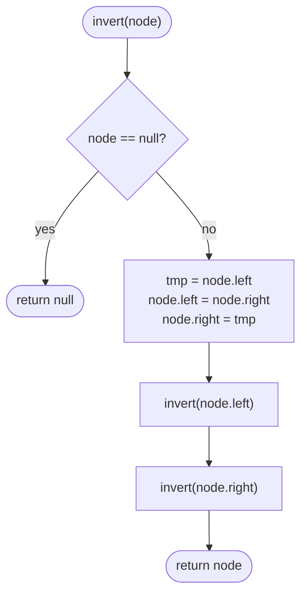

# LC 226 Invert Binary Tree

> [!abstract] In one sentence
> Mirror a binary tree by swapping the two children of every node; because the swap at a node is independent of what happens below it, the whole job is "swap here, recurse on both sides" and nothing else.

**Map:** [[NeetCode 150 MOC]] → [[DSA Dashboard]] · Pattern: [[Trees]]

> [!question] Predict before you read
> Does it matter whether you swap the children *before* or *after* recursing into them? Decide, then check against the "Why it works" section.

## Problem

You are given the root of a binary tree. Return the root of the same tree after mirroring it: at every node the left subtree becomes the right subtree and vice versa.

Example: the tree `[4, 2, 7, 1, 3, 6, 9]` (level order) becomes `[4, 7, 2, 9, 6, 3, 1]`. The tree `[]` stays `[]`.

Constraints that matter: up to 100 nodes, so recursion depth is never an issue here; values are irrelevant to the algorithm.

## Clarifying questions

1. Should I modify the tree in place or build a new one? — In place is expected; returning the same root is fine.
2. Can the tree be empty? — Yes; return `null`.
3. Is it a BST or any binary tree? — Any binary tree; a BST stops being a BST after inversion, which is fine.
4. Is recursion acceptable, or do you want it iterative? — Either; be ready to do the iterative one with a queue.

## Brute force

There is no meaningfully slower approach; the only "brute force" people write is rebuilding a fresh tree node by node, which costs O(n) extra memory for no benefit. The real risk is not slowness but a subtle bug: swapping only at the root, or recursing into `root.left` *after* it has already become the old right child and then recursing into it again.

## The key insight

Inversion is a *local* operation: what happens at a node (swap two pointers) does not depend on the result of the subtrees. So the recursion needs no return value except the node itself, and the order of "swap" and "recurse" does not matter as long as each subtree is visited exactly once. Recognition cue: "mirror", "flip", "reverse the tree" — any transformation that is the same at every node.

## Optimal approach

1. If the node is `null`, return `null` (base case).
2. Swap `node.left` and `node.right` with a temporary variable.
3. Recurse into the (new) left and the (new) right child.
4. Return the node.



> [!example]- Excalidraw version — the same diagram as an editable canvas
> ![[LC 226 Invert Binary Tree — Optimal approach.excalidraw]]
> [[LC 226 Invert Binary Tree — Optimal approach.excalidraw|Open in Excalidraw]] — needs the Excalidraw plugin (see [[Plugins to Install]]).

## Walkthrough

The tree before and after; shaded nodes are the ones whose children were swapped in a non-trivial way.

> [!example] Before: [4,2,7,1,3,6,9]
> ![[LC 226 Invert Binary Tree — Before- -4,2,7,1,3,6,9-.excalidraw]]
> [[LC 226 Invert Binary Tree — Before- -4,2,7,1,3,6,9-.excalidraw|Open in Excalidraw]] — invert(4) swaps 2 and 7, then recurses into both

%% excalidraw-spec
{"kind": "tree", "title": "Before: [4,2,7,1,3,6,9]", "levels": [4, 2, 7, 1, 3, 6, 9], "highlight": [0], "caption": "invert(4) swaps 2 and 7, then recurses into both"}
%%

> [!example] After: [4,7,2,9,6,3,1]
> ![[LC 226 Invert Binary Tree — After- -4,7,2,9,6,3,1-.excalidraw]]
> [[LC 226 Invert Binary Tree — After- -4,7,2,9,6,3,1-.excalidraw|Open in Excalidraw]] — every node's children are mirrored, so leaves read right to left

%% excalidraw-spec
{"kind": "tree", "title": "After: [4,7,2,9,6,3,1]", "levels": [4, 7, 2, 9, 6, 3, 1], "highlight": [1, 2], "caption": "every node's children are mirrored, so leaves read right to left"}
%%

| Call | Action | Subtree after |
|---|---|---|
| invert(4) | swap 2 ↔ 7 | 4 → (7, 2) |
| invert(7) | swap 6 ↔ 9 | 7 → (9, 6) |
| invert(9), invert(6) | leaves, swap nulls | unchanged |
| invert(2) | swap 1 ↔ 3 | 2 → (3, 1) |
| invert(3), invert(1) | leaves | unchanged |

## Java solution

```java
import java.util.*;

class Solution {
    public TreeNode invertTree(TreeNode root) {
        if (root == null) return null;
        TreeNode tmp = root.left;          // swap first, then recurse: each child is visited once
        root.left = root.right;
        root.right = tmp;
        invertTree(root.left);
        invertTree(root.right);
        return root;
    }

    // Iterative version: the same swap, driven by a queue instead of the call stack.
    public TreeNode invertTreeIterative(TreeNode root) {
        Deque<TreeNode> queue = new ArrayDeque<>();
        if (root != null) queue.offer(root);
        while (!queue.isEmpty()) {
            TreeNode node = queue.poll();
            TreeNode tmp = node.left;
            node.left = node.right;
            node.right = tmp;
            if (node.left != null) queue.offer(node.left);
            if (node.right != null) queue.offer(node.right);
        }
        return root;
    }
}

class TreeNode {
    int val;
    TreeNode left, right;
    TreeNode() {}
    TreeNode(int val) { this.val = val; }
    TreeNode(int val, TreeNode left, TreeNode right) { this.val = val; this.left = left; this.right = right; }
}
```

**Time** O(n) — every node is visited once · **Space** O(h) for the recursion stack, O(n) worst case on a degenerate (linked-list shaped) tree; the iterative version uses O(w) for the widest level.

## Why it works

Induction on height. A `null` tree is its own mirror. For a node with subtrees L and R, the mirror is the node with mirrored R on the left and mirrored L on the right. The code swaps the pointers (R is now left, L is now right) and then mirrors each of them in place; by the hypothesis the recursive calls produce mirror(R) and mirror(L). Order does not matter because the swap touches only this node's two fields and the recursive calls touch only nodes strictly below.

## Edge cases

- Empty tree → returns `null` immediately.
- Single node → swaps two nulls, returns the node.
- A node with one child → that child moves to the other side; the `null` moves across too, which is the correct mirror.
- Degenerate chain (every node has one child) → recursion depth equals n; fine at n ≤ 100, worth mentioning for larger inputs.

## Common mistakes

> [!warning] Pitfalls
> - Recursing first into `root.left`, then swapping, then recursing into `root.left` again (which is now the old right) — you invert one subtree twice and the other never. Pick one order and keep the two recursive calls on the two distinct children.
> - Forgetting to `return root` at the end, so the caller gets `null`.
> - Writing `root.left = invertTree(root.right); root.right = invertTree(root.left);` — the second call sees the already-replaced `root.left`. The returned-value style needs a temporary too.

## Variants & follow-ups

- Do it iteratively with a stack or queue (included above) — interviewers ask this to check you understand that the traversal order is irrelevant.
- "Is this tree symmetric?" (LC 101) is "is the left subtree the mirror of the right subtree?" — compare `(l.left, r.right)` and `(l.right, r.left)`; the same pairing logic as [[LC 100 Same Tree]].
- Mirror only below depth k, or only the nodes satisfying a predicate — the recursion gains a depth parameter.

## Interview script

Restate: "Swap every node's children so the tree reads mirrored." Brute force: "There is no slower correct way; the question is really about the recursion shape." Insight: "The swap at a node is independent of the subtrees, so it is swap-then-recurse with no return value needed." Approach: "Base case null; swap the two pointers; recurse into both; return the node." Complexity: "O(n) time, O(height) stack." Tests: "Empty, single node, a node with only a left child, and the 7-node example — I will trace the one-child case because that is where people drop a subtree."

## Related

- Pattern: [[Trees]] · prerequisite: [[Recursion]]
- Same recursion shape: [[LC 104 Maximum Depth of Binary Tree]], [[LC 100 Same Tree]], [[LC 572 Subtree of Another Tree]]
- Java refresher: [[DSA Patterns in Java]] (DFS recursive and iterative), [[Java Collections Cheat Sheet]] (`ArrayDeque` as a queue)

## Attempt log

| Date | Result | Minutes | What I got wrong |
|---|---|---|---|
| | | | |

### Mastery checklist
- [ ] Solved without hints in under 25 minutes
- [ ] Stated complexity before coding
- [ ] Handled every edge case above
- [ ] Code compiled first time
- [ ] Can do the follow-up variant

## Open questions
- [ ]
