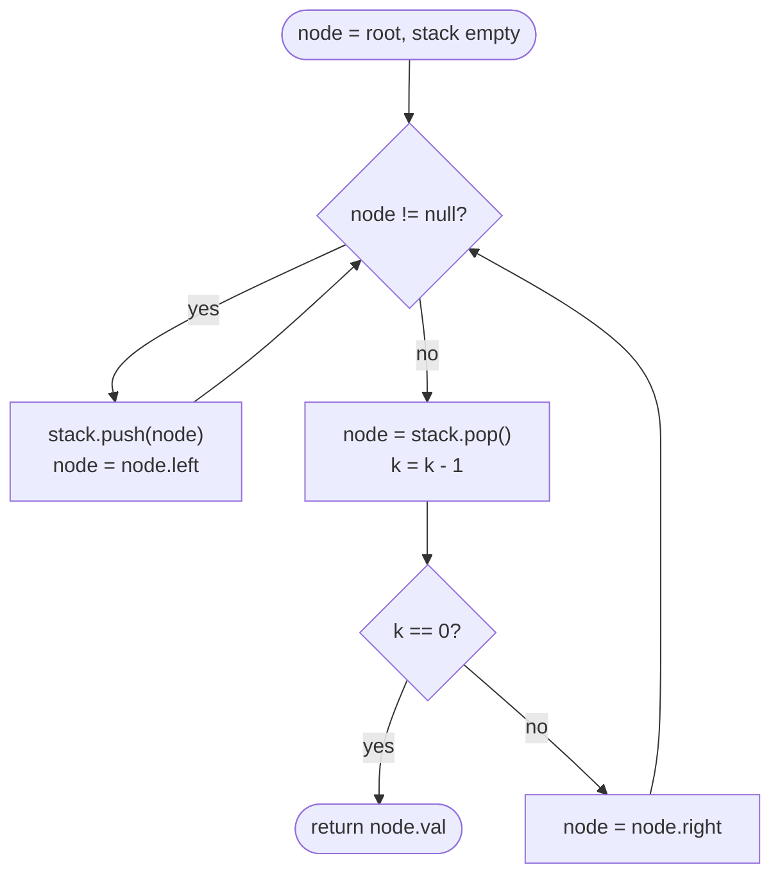

# LC 230 Kth Smallest Element in a BST

> [!abstract] In one sentence
> A BST's in-order traversal is its sorted order, so count nodes as you visit them in-order and stop at the k-th; doing it with an explicit stack lets you stop early without the awkward "abort a recursion" dance.

**Map:** [[NeetCode 150 MOC]] → [[DSA Dashboard]] · Pattern: [[Trees]]

> [!question] Predict before you read
> The iterative in-order traversal pushes nodes onto a stack while going left. At the moment you pop a node, what is true about everything that is still on the stack, and everything already popped?

## Problem

Given the root of a binary search tree and an integer k, return the k-th smallest value (1-indexed) among all node values.

Examples: `[3, 1, 4, null, 2]`, k = 1 → 1. `[5, 3, 6, 2, 4, null, null, 1]`, k = 3 → 3.

Constraints that matter: n up to 10⁴, 1 ≤ k ≤ n, values distinct. Follow-up in the statement: the BST is modified often (insert/delete) and you need the k-th smallest frequently — what would you change?

## Clarifying questions

1. Is k 1-indexed? — Yes (k = 1 is the minimum).
2. Is it guaranteed that k ≤ n? — Yes.
3. Distinct values? — Yes; with duplicates "k-th smallest" would need a convention.
4. Should the solution be optimised for repeated queries with modifications? — That is the follow-up: augment nodes with subtree sizes.

## Brute force

Do a full in-order traversal into an `ArrayList`, return `list.get(k − 1)`. O(n) time and O(n) space. It works and is honestly what most people would write first; the waste is that it visits all n nodes and stores them when only the first k matter, and it does not answer the "frequent modifications" follow-up.

## The key insight

In-order on a BST (left, node, right) produces values in ascending order — that is what the BST invariant means. So the k-th node visited in-order *is* the answer and you can stop as soon as you reach it. The iterative traversal with an explicit stack makes "stop" a `return`; the recursive version needs a counter field and early exits. Recognition cue: "k-th smallest/largest in a BST", "sorted order of a BST", "successor".

## Optimal approach

1. `stack` empty, `node = root`.
2. While `node != null` or the stack is non-empty:
3. Walk left: push `node`, `node = node.left`, until `null`.
4. Pop: this is the next value in sorted order; decrement k; if k is 0 return its value.
5. `node = popped.right` and continue.



> [!example]- Excalidraw version — the same diagram as an editable canvas
> ![[LC 230 Kth Smallest Element in a BST — Optimal approach.excalidraw]]
> [[LC 230 Kth Smallest Element in a BST — Optimal approach.excalidraw|Open in Excalidraw]] — needs the Excalidraw plugin (see [[Plugins to Install]]).

## Walkthrough

k = 3 on `[5, 3, 6, 2, 4, null, null, 1]`.

> [!example] In-order on a BST, stop at k = 3
> ![[LC 230 Kth Smallest Element in a BST — In-order on a BST, stop at k = 3.excalidraw]]
> [[LC 230 Kth Smallest Element in a BST — In-order on a BST, stop at k = 3.excalidraw|Open in Excalidraw]] — visited in order: 1, 2, 3 — the third pop is the answer; 4, 5, 6 are never touched

%% excalidraw-spec
{"kind": "tree", "title": "In-order on a BST, stop at k = 3", "levels": [5, 3, 6, 2, 4, null, null, 1], "highlight": [7, 3, 1], "caption": "visited in order: 1, 2, 3 — the third pop is the answer; 4, 5, 6 are never touched"}
%%

| Step | Stack (top last) | Popped | k after |
|---|---|---|---|
| go left from 5 | [5, 3, 2, 1] | | 3 |
| pop | [5, 3, 2] | 1 | 2 |
| 1.right null, pop | [5, 3] | 2 | 1 |
| 2.right null, pop | [5] | 3 | 0 → return 3 |

## Java solution

```java
import java.util.*;

class Solution {
    public int kthSmallest(TreeNode root, int k) {
        Deque<TreeNode> stack = new ArrayDeque<>();
        TreeNode node = root;
        while (node != null || !stack.isEmpty()) {
            while (node != null) {                // slide to the leftmost unvisited node
                stack.push(node);
                node = node.left;
            }
            node = stack.pop();                   // next value in ascending order
            if (--k == 0) return node.val;
            node = node.right;                    // then its right subtree
        }
        throw new IllegalArgumentException("k larger than tree size");
    }
}

class TreeNode {
    int val;
    TreeNode left, right;
    TreeNode() {}
    TreeNode(int val) { this.val = val; }
    TreeNode(int val, TreeNode left, TreeNode right) { this.val = val; this.left = left; this.right = right; }
}
```

**Time** O(h + k) — h pushes to reach the minimum, then each of the k pops costs amortised O(1) · **Space** O(h) for the stack.

The recursive form is shorter but needs a field to count and to carry the answer out, and it keeps traversing after the answer is found unless every call checks the flag.

```java
// snippet
int count = 0, answer = 0;              // fields
void inorder(TreeNode node, int k) {
    if (node == null || count >= k) return;
    inorder(node.left, k);
    if (++count == k) { answer = node.val; return; }
    inorder(node.right, k);
}
```

## Why it works

Invariant of the iterative in-order: at every pop, all nodes with smaller values have already been popped, and the stack holds the ancestors whose left subtree we are currently inside (each of them is larger than everything popped so far). Pushing while going left reaches the smallest unvisited node; after popping a node, the next smallest is the minimum of its right subtree, which the next inner `while` finds. So pops happen in ascending order and the k-th pop is the k-th smallest. The early return makes the cost h + k rather than n.

## Edge cases

- k = 1 → the leftmost node; cost O(h).
- k = n → the rightmost node; the whole tree is walked, O(n).
- Root only, k = 1 → push root, pop, return.
- Left-only chain → the stack holds all n nodes before the first pop; O(n) space.

## Common mistakes

> [!warning] Pitfalls
> - Using `stack.push` and `stack.poll` together: on `ArrayDeque`, `push` is `addFirst` and `poll` is `pollFirst`, which happens to work as a stack, but `offer` (addLast) with `pop` (removeFirst) is a queue and breaks the order. Use `push`/`pop` consistently.
> - Decrementing k before the left subtree (pre-order) instead of after it — that counts in the wrong order.
> - In the recursive version, forgetting to stop after the answer; it is still correct but O(n).
> - Off-by-one: checking `k == 0` before decrementing, or treating k as 0-indexed.

## Variants & follow-ups

- Frequent insert/delete plus k-th queries (the stated follow-up): store `size` of each subtree in the node; then descend: if `k <= size(left)` go left, if `k == size(left) + 1` return node, else go right with `k − size(left) − 1`. O(h) per query, O(h) to maintain on update.
- k-th *largest*: mirror the traversal (right, node, left).
- In-order successor of a node (LC 285): the same stack walk, return the node after the target.
- BST iterator (LC 173): keep the stack as object state; `next()` is one pop plus a slide-left, amortised O(1).
- [[LC 215 Kth Largest Element in an Array]] is the unordered version (quickselect / heap); here the structure already does the sorting.

## Interview script

Restate: "k-th smallest value in a BST, k is 1-indexed." Brute force: "Full in-order into a list, index k − 1 — O(n) time and space." Insight: "In-order is sorted, so I can stop at the k-th visited node; an explicit stack makes stopping trivial." Approach: "Slide left pushing, pop, count, go right." Complexity: "O(h + k) time, O(h) space." Tests: "k = 1, k = n, single node, a chain. For the follow-up with modifications I would augment nodes with subtree sizes for O(h) queries."

## Related

- Pattern: [[Trees]] (BST invariants, iterative in-order)
- The in-order invariant used for validation: [[LC 98 Validate Binary Search Tree]]
- BST descent: [[LC 235 Lowest Common Ancestor of a Binary Search Tree]]
- Unordered counterpart: [[LC 215 Kth Largest Element in an Array]]
- Java refresher: [[Java Collections Cheat Sheet]] (`ArrayDeque` as a stack: `push`/`pop`/`peek`)

## Attempt log

| Date | Result | Minutes | What I got wrong |
|---|---|---|---|
| | | | |

### Mastery checklist
- [ ] Solved without hints in under 25 minutes
- [ ] Stated complexity before coding
- [ ] Handled every edge case above
- [ ] Code compiled first time
- [ ] Can do the follow-up variant

## Open questions
- [ ]
