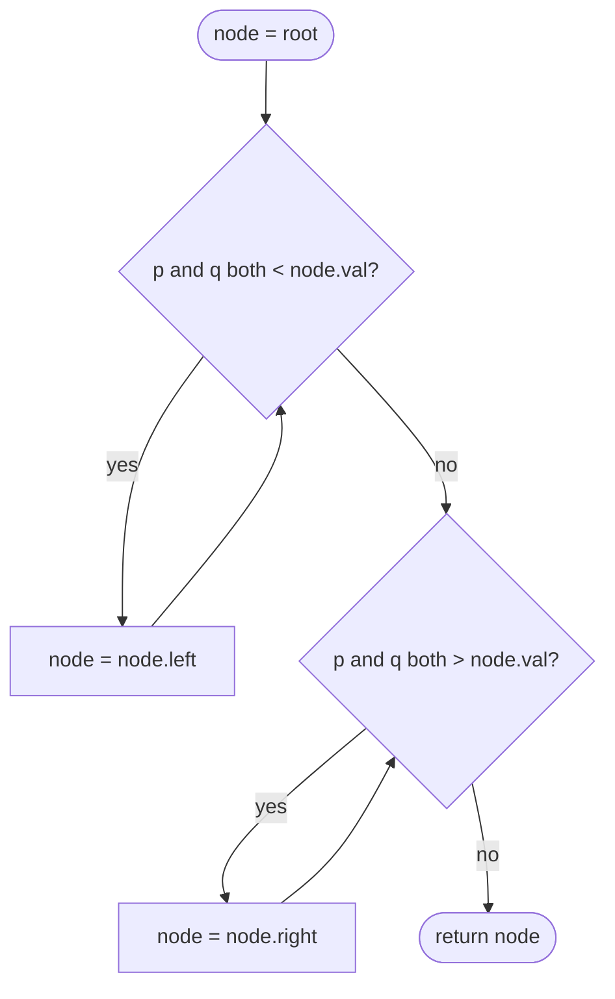

# LC 235 Lowest Common Ancestor of a Binary Search Tree

> [!abstract] In one sentence
> Start at the root and walk down: while both targets are smaller than the current node go left, while both are larger go right, and the first node where they split (or equals one of them) is the lowest common ancestor — the BST ordering replaces any search.

**Map:** [[NeetCode 150 MOC]] → [[DSA Dashboard]] · Pattern: [[Trees]]

> [!question] Predict before you read
> Without the BST property (a plain binary tree), what extra information would you need to find the LCA, and what would the complexity become?

## Problem

Given the root of a binary search tree and two nodes `p` and `q` that exist in it, return their lowest common ancestor: the deepest node that has both `p` and `q` as descendants, where a node counts as its own descendant.

Example: in `[6, 2, 8, 0, 4, 7, 9, null, null, 3, 5]`, LCA(2, 8) = 6; LCA(2, 4) = 2 (because 4 is below 2). `[2, 1]` with p = 2, q = 1 → 2.

Constraints that matter: up to 10⁵ nodes, so a recursive solution on a degenerate BST could be 10⁵ frames deep — the iterative descent avoids that. All values are distinct; `p` and `q` are guaranteed to exist.

## Clarifying questions

1. Is it guaranteed to be a valid BST with distinct values? — Yes.
2. Are `p` and `q` guaranteed to be in the tree? — Yes; otherwise you would need to verify existence first.
3. Can `p` be an ancestor of `q`? — Yes; then `p` is the answer.
4. Are `p` and `q` nodes or values? — Nodes on LeetCode; compare `.val`.

## Brute force

Find the root-to-`p` path and the root-to-`q` path as lists (O(h) each by BST descent, or O(n) by DFS on a general tree), then walk both lists from the front and return the last common element. O(h) time and O(h) extra space in a BST, O(n) in a general tree. Correct, but it materialises two paths to find one node.

## The key insight

In a BST every node's value tells you which side each target lives on. If both `p.val` and `q.val` are less than `node.val`, both are in the left subtree, so the LCA is too; symmetrically for greater. The moment they are on different sides — or one equals `node.val` — this node is the split point, hence the lowest common ancestor. No bookkeeping, no backtracking, one pointer walking down. Recognition cue: "BST" plus "ancestor", "common", "between".

## Optimal approach

1. Set `node = root`.
2. If both targets are smaller than `node.val`, go left.
3. Else if both are larger, go right.
4. Else return `node` — the targets diverge here or one of them is `node`.



> [!example]- Excalidraw version — the same diagram as an editable canvas
> ![[LC 235 Lowest Common Ancestor of a Binary Search Tree — Optimal approach.excalidraw]]
> [[LC 235 Lowest Common Ancestor of a Binary Search Tree — Optimal approach.excalidraw|Open in Excalidraw]] — needs the Excalidraw plugin (see [[Plugins to Install]]).

## Walkthrough

LCA(0, 5) in the example BST: both are below 6 on the left, then at 2 they split (0 < 2 < 5).

> [!example] LCA(0, 5) in a BST
> ![[LC 235 Lowest Common Ancestor of a Binary Search Tree — LCA(0, 5) in a BST.excalidraw]]
> [[LC 235 Lowest Common Ancestor of a Binary Search Tree — LCA(0, 5) in a BST.excalidraw|Open in Excalidraw]] — 6 → both smaller, go left; 2 → 0 is smaller, 5 is larger: split, answer 2

%% excalidraw-spec
{"kind": "tree", "title": "LCA(0, 5) in a BST", "levels": [6, 2, 8, 0, 4, 7, 9, null, null, 3, 5], "highlight": [0, 1], "caption": "6 → both smaller, go left; 2 → 0 is smaller, 5 is larger: split, answer 2"}
%%

| node | p = 0, q = 5 | Move |
|---|---|---|
| 6 | both < 6 | left |
| 2 | 0 < 2 < 5 | return 2 |

For LCA(2, 4): at 6 go left; at 2, `p.val == node.val`, neither "both smaller" nor "both larger" holds, so return 2.

## Java solution

```java
import java.util.*;

class Solution {
    public TreeNode lowestCommonAncestor(TreeNode root, TreeNode p, TreeNode q) {
        TreeNode node = root;
        while (node != null) {
            if (p.val < node.val && q.val < node.val) {
                node = node.left;                 // both targets live in the left subtree
            } else if (p.val > node.val && q.val > node.val) {
                node = node.right;                // both targets live in the right subtree
            } else {
                return node;                      // split point, or node is p or q
            }
        }
        return null;                              // unreachable when p and q exist in the tree
    }
}

class TreeNode {
    int val;
    TreeNode left, right;
    TreeNode() {}
    TreeNode(int val) { this.val = val; }
    TreeNode(int val, TreeNode left, TreeNode right) { this.val = val; this.right = right; this.left = left; }
}
```

**Time** O(h) — one descent; O(log n) balanced, O(n) degenerate · **Space** O(1) (the recursive version uses O(h) stack).

## Why it works

Invariant: `node` is an ancestor of both `p` and `q` (true at the root). If both values are smaller than `node.val`, the BST property puts both in `node.left`'s subtree, so `node.left` is also a common ancestor and is deeper — moving there keeps the invariant and strictly increases depth. Symmetric for larger. When neither condition holds, `p` and `q` are in different subtrees of `node` or one of them *is* `node`; either way no descendant of `node` can be an ancestor of both, so `node` is the lowest. The loop terminates because depth increases every iteration.

## Edge cases

- `p` is an ancestor of `q` → the walk stops at `p` because `p.val == node.val` breaks both strict comparisons.
- `p` and `q` are the root's two children → returns the root in one step.
- Degenerate BST (a chain) → h = n, still correct, and the loop uses no stack.
- Two-node tree `[2, 1]` → at 2, `q.val = 1 < 2` but `p.val = 2` is not, so return 2.

## Common mistakes

> [!warning] Pitfalls
> - Using `<=` instead of `<`: with `p.val == node.val` you would walk past `p` and return a deeper, wrong node (or fall off the tree).
> - Comparing node references (`p == node.left`) instead of values; the descent is value-driven.
> - Solving it as a general-tree LCA (post-order returning found-flags) — correct but O(n) and misses the point of the BST tag.
> - Forgetting that `min(p, q)` and `max(p, q)` are not needed: the two "both" comparisons handle either order of arguments.

## Variants & follow-ups

- LCA in a general binary tree (LC 236): post-order; return the node if it is `p` or `q`, else the non-null of the two child results, or this node if both are non-null. O(n).
- LCA with parent pointers (LC 1650): walk up from both like the intersection of two linked lists.
- LCA of several nodes: track `min` and `max` of all target values and run the same descent.
- Distance between two nodes = depth(p) + depth(q) − 2·depth(LCA).
- Validate that `p` and `q` exist first when the guarantee is dropped.

## Interview script

Restate: "Deepest node that has both p and q below it, in a BST." Brute force: "Build both root-to-node paths and take the last common node." Insight: "The BST tells me which side each target is on; the first node where they are on different sides, or that equals one of them, is the LCA." Approach: "One pointer walking down with two comparisons." Complexity: "O(h) time, O(1) space." Tests: "p ancestor of q, split at the root, chain-shaped tree, two-node tree."

## Related

- Pattern: [[Trees]] (BST invariants)
- Other BST-property problems: [[LC 98 Validate Binary Search Tree]], [[LC 230 Kth Smallest Element in a BST]]
- Top-down tree walks with a carried value: [[LC 1448 Count Good Nodes in Binary Tree]]
- Java refresher: [[DSA Patterns in Java]]

## Attempt log

| Date | Result | Minutes | What I got wrong |
|---|---|---|---|
| | | | |

### Mastery checklist
- [ ] Solved without hints in under 25 minutes
- [ ] Stated complexity before coding
- [ ] Handled every edge case above
- [ ] Code compiled first time
- [ ] Can do the follow-up variant

## Open questions
- [ ]
