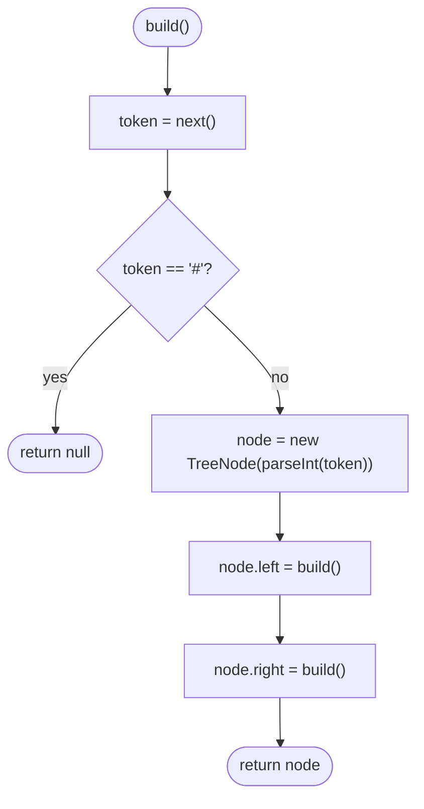

# LC 297 Serialize and Deserialize Binary Tree

> [!abstract] In one sentence
> Preorder alone is ambiguous, but preorder *with a token for every null* is not: the decoder reads tokens left to right, and whenever it reads a value it knows the next tokens describe that node's left subtree, then its right — so serialise and deserialise are the same recursion, one writing and one reading through a shared cursor.

**Map:** [[NeetCode 150 MOC]] → [[DSA Dashboard]] · Pattern: [[Trees]]

> [!question] Predict before you read
> [[LC 105 Construct Binary Tree from Preorder and Inorder Traversal]] needed two traversals. Why does one traversal become enough as soon as nulls are written out? And why does the decoder not need to know where the left subtree ends?

## Problem

Design a class with two methods: `serialize(root)` converts a binary tree into a string, and `deserialize(data)` rebuilds the identical tree from that string. Any format is allowed as long as the round trip is exact. Values are integers (possibly negative), and the tree may be empty.

Example: the tree `[1, 2, 3, null, null, 4, 5]` could serialise to `"1,2,#,#,3,4,#,#,5,#,#"` and must deserialise back to the same shape. `[]` round-trips as well.

Constraints that matter: up to 10⁴ nodes, values −1000 to 1000 (so negatives and multi-digit numbers must be tokenised, not read character by character). The recursion depth is the tree height, fine at 10⁴.

## Clarifying questions

1. Any string format, or must it match LeetCode's level-order format? — Any format is accepted by the judge; mention both.
2. Can values be negative or multi-digit? — Yes; use a separator and parse tokens.
3. Can the tree be empty? — Yes; serialise to something that decodes to `null` (e.g. `"#"`).
4. Is there a size limit on the string? — Not stated; O(n) tokens is expected.
5. Must the deserialised tree be structurally identical, including which side a single child is on? — Yes; that is why nulls are recorded.

## Brute force

Serialise two traversals (preorder and inorder) and rebuild with the [[LC 105 Construct Binary Tree from Preorder and Inorder Traversal]] method. It is O(n) and correct *only if values are distinct* — which the problem does not promise — and it needs a hash map and index arithmetic. The waste is conceptual: two traversals and a reconstruction algorithm, when recording the nulls in one traversal removes all ambiguity.

## The key insight

The reason preorder alone is ambiguous is that you cannot tell where a left subtree ends. Writing a marker for every null fixes exactly that: a subtree is now *self-delimiting*. Reading preorder with null markers, the decoder sees either `#` (an empty subtree, consumed in one token) or a value, after which it recursively consumes the left subtree, then the right. There is nothing to search for and no sizes to compute — the recursion structure and the token stream are the same shape. The only state is a cursor into the tokens, shared across the recursive calls. Recognition cue: "serialise", "encode as a string", "store and recover", and the [[LC 572 Subtree of Another Tree]] trick of comparing trees by their encodings.

## Optimal approach

Serialise (preorder DFS):

1. If the node is `null`, append `#` and a separator; return.
2. Append the value and a separator; recurse left; recurse right.

Deserialise:

1. Split the string into tokens; keep a cursor (an index or an iterator).
2. `build()`: read the next token; if `#` return `null`.
3. Create the node; `node.left = build()`; `node.right = build()`; return the node.



> [!example]- Excalidraw version — the same diagram as an editable canvas
> ![[LC 297 Serialize and Deserialize Binary Tree — Optimal approach.excalidraw]]
> [[LC 297 Serialize and Deserialize Binary Tree — Optimal approach.excalidraw|Open in Excalidraw]] — needs the Excalidraw plugin (see [[Plugins to Install]]).

## Walkthrough

The tree `[1, 2, 3, null, null, 4, 5]` serialises to the 11 tokens `1 2 # # 3 4 # # 5 # #`.

> [!example] Tree to serialise
> ![[LC 297 Serialize and Deserialize Binary Tree — Tree to serialise.excalidraw]]
> [[LC 297 Serialize and Deserialize Binary Tree — Tree to serialise.excalidraw|Open in Excalidraw]] — preorder with nulls: 1 2 # # 3 4 # # 5 # #

%% excalidraw-spec
{"kind": "tree", "title": "Tree to serialise", "levels": [1, 2, 3, null, null, 4, 5], "highlight": [0], "caption": "preorder with nulls: 1 2 # # 3 4 # # 5 # #"}
%%

> [!example] Token stream consumed by build()
> ![[LC 297 Serialize and Deserialize Binary Tree — Token stream consumed by build().excalidraw]]
> [[LC 297 Serialize and Deserialize Binary Tree — Token stream consumed by build().excalidraw|Open in Excalidraw]] — tokens 1-3 are the entire left subtree of 1; when the cursor reaches 3 the decoder is back at the root's right child

%% excalidraw-spec
{"kind": "array", "title": "Token stream consumed by build()", "values": ["1", "2", "#", "#", "3", "4", "#", "#", "5", "#", "#"], "pointers": {"cursor": 4}, "highlight": [1, 2, 3], "caption": "tokens 1-3 are the entire left subtree of 1; when the cursor reaches 3 the decoder is back at the root's right child"}
%%

| build() call | Token read | Action |
|---|---|---|
| root | 1 | node 1; build left |
| 1.left | 2 | node 2; build left |
| 2.left | # | null |
| 2.right | # | null → return 2 |
| 1.right | 3 | node 3; build left |
| 3.left | 4 | node 4; its two children read `#`, `#` |
| 3.right | 5 | node 5; its two children read `#`, `#` → return 3 → return 1 |

## Java solution

```java
import java.util.*;

class Codec {
    private static final String NULL = "#";
    private static final String SEP = ",";

    public String serialize(TreeNode root) {
        StringBuilder sb = new StringBuilder();
        write(root, sb);
        return sb.toString();
    }

    private void write(TreeNode node, StringBuilder sb) {
        if (node == null) { sb.append(NULL).append(SEP); return; }
        sb.append(node.val).append(SEP);          // preorder: node, then left, then right
        write(node.left, sb);
        write(node.right, sb);
    }

    public TreeNode deserialize(String data) {
        Deque<String> tokens = new ArrayDeque<>(Arrays.asList(data.split(SEP)));
        return read(tokens);
    }

    // The queue is the cursor: each call consumes exactly the tokens of one subtree.
    private TreeNode read(Deque<String> tokens) {
        String token = tokens.poll();
        if (NULL.equals(token)) return null;
        TreeNode node = new TreeNode(Integer.parseInt(token));
        node.left = read(tokens);
        node.right = read(tokens);
        return node;
    }
}

class TreeNode {
    int val;
    TreeNode left, right;
    TreeNode() {}
    TreeNode(int val) { this.val = val; }
    TreeNode(int val, TreeNode left, TreeNode right) { this.val = val; this.left = left; this.right = right; }
}
```

**Time** O(n) for both directions — every node and every null is written and read once (2n + 1 tokens) · **Space** O(n) for the string and the token queue, plus O(h) recursion.

The level-order alternative produces LeetCode's own format and avoids recursion, at the cost of more bookkeeping: the decoder keeps a queue of nodes awaiting children and assigns the next two tokens to each.

```java
// snippet
// BFS encode: queue of nodes, write "#" for null children; BFS decode:
TreeNode root = new TreeNode(parse(tokens[0]));
Deque<TreeNode> q = new ArrayDeque<>(List.of(root));
for (int i = 1; i < tokens.length; i += 2) {
    TreeNode parent = q.poll();
    if (!tokens[i].equals("#"))     { parent.left  = new TreeNode(parse(tokens[i]));     q.offer(parent.left); }
    if (!tokens[i + 1].equals("#")) { parent.right = new TreeNode(parse(tokens[i + 1])); q.offer(parent.right); }
}
```

## Why it works

Invariant for the encoder: `write(node)` appends exactly the preorder-with-nulls encoding of the subtree at `node`, which is `#` for an empty subtree and `val · enc(left) · enc(right)` otherwise. Invariant for the decoder: when `read()` is called with the token stream positioned at the start of `enc(T)` for some subtree T, it consumes exactly `enc(T)` and returns a tree equal to T. Proof by induction on the size of T. If T is empty, the next token is `#`, consumed and `null` returned. Otherwise the next token is `val`; by the hypothesis the first recursive call consumes exactly `enc(left)` and returns a copy of the left subtree, leaving the stream at the start of `enc(right)`, which the second call consumes and returns. So the stream never needs to be searched: the left subtree *ends* precisely when its recursion returns. Uniqueness follows: two different trees produce different token strings (the first point of structural difference puts a `#` opposite a value), so the encoding is injective.

## Edge cases

- Empty tree → `"#,"`, decoded as a single `#` token → `null`.
- Single node → `"5,#,#,"`.
- Negative values → `"-7,#,#,"`; `Integer.parseInt` handles the sign because tokens are split on the separator.
- Left-only chain → every value is followed by its subtree and then `#` for the missing right; recursion depth n.
- Trailing separator from `append(SEP)` after the last token → `split` drops trailing empty strings, so no empty token appears; if you build tokens differently, guard against `""`.

## Common mistakes

> [!warning] Pitfalls
> - Omitting null markers and hoping preorder is enough: `[1, 2]` and `[1, null, 2]` would both serialise to `1,2`.
> - Reading values character by character: fails on `10` and `-3`. Always tokenise on a separator.
> - Keeping the cursor as a parameter `int i` and expecting the recursive calls to update it — Java passes `int` by value. Use a field, an array of one `int`, an iterator, or a queue (as above).
> - Using `==` to compare the token to `"#"`; use `equals`.
> - Using in-order for the encoding: in-order with nulls is *not* unique (`[1, 2]` as left child vs `[2, 1]` as right child produce the same in-order sequence). Preorder or postorder is required.

## Variants & follow-ups

- Serialise a BST compactly (LC 449): preorder *without* nulls suffices, because the BST bounds tell the decoder where each subtree ends (the [[LC 98 Validate Binary Search Tree]] range trick).
- Serialise an n-ary tree (LC 428): write the child count after each value, or a closing marker.
- Compare subtrees by their encoding: [[LC 572 Subtree of Another Tree]] (substring search) and duplicate-subtree detection (LC 652, hash of the encoding per subtree).
- Make it compact: binary encoding with varints, or a bitmap of the structure plus a value list.
- Streaming deserialisation: the queue-based decoder consumes tokens from an `Iterator<String>`, so it works on a stream without materialising the array.

## Interview script

Restate: "Design encode and decode for an arbitrary binary tree, exact round trip, any format." Brute force: "Preorder plus inorder and rebuild like LC 105 — but that assumes distinct values and needs two passes." Insight: "Record nulls. Preorder with null markers is self-delimiting: when the decoder reads a value, the following tokens are its left subtree, then its right, and each recursive call stops exactly when that subtree is complete." Approach: "Encoder is a preorder DFS appending `#` for null; decoder is the same recursion pulling tokens from a queue." Complexity: "O(n) both ways, O(n) string, O(height) stack." Tests: "Empty tree, single node, negative and multi-digit values, a left chain. I would also mention the BFS format LeetCode itself uses, and that for a BST the nulls can be dropped."

## Related

- Pattern: [[Trees]] · prerequisite: [[Recursion]]
- Why two traversals are otherwise needed: [[LC 105 Construct Binary Tree from Preorder and Inorder Traversal]]
- Uses the encoding: [[LC 572 Subtree of Another Tree]]
- Level-order format: [[LC 102 Binary Tree Level Order Traversal]]
- String framing with separators: [[LC 271 Encode and Decode Strings]]
- Java refresher: [[Java Collections Cheat Sheet]] (`String.split`, `StringBuilder`, `ArrayDeque` as a token cursor)

## Attempt log

| Date | Result | Minutes | What I got wrong |
|---|---|---|---|
| | | | |

### Mastery checklist
- [ ] Solved without hints in under 25 minutes
- [ ] Stated complexity before coding
- [ ] Handled every edge case above
- [ ] Code compiled first time
- [ ] Can do the follow-up variant

## Open questions
- [ ]
