# LC 543 Diameter of Binary Tree

> [!abstract] In one sentence
> Every path in a tree has a unique highest node where it turns, so the longest path is the maximum over all nodes of (left height + right height); one post-order pass that returns heights and records that sum in a field finds it in O(n).

**Map:** [[NeetCode 150 MOC]] → [[DSA Dashboard]] · Pattern: [[Trees]]

> [!question] Predict before you read
> The answer is *not* always a path through the root. Sketch a tree where the longest path lives entirely inside the left subtree, then say what the recursion must return versus what it must record.

## Problem

Given the root of a binary tree, return the length of the longest path between any two nodes, measured in edges. The path need not pass through the root.

Example: `[1, 2, 3, 4, 5]` → 3 (the path 4 → 2 → 5 or 4 → 2 → 1 → 3). `[1, 2]` → 1.

Constraints that matter: up to 10⁴ nodes; the answer fits an `int`.

## Clarifying questions

1. Length in edges or nodes? — Edges (so a single node has diameter 0). Nodes would be one more.
2. Must the path go through the root? — No; it can be anywhere.
3. Can the tree be empty? — Treat it as diameter 0.
4. Are values relevant? — No; structure only.

## Brute force

For every node, compute the height of its left and right subtrees with a fresh [[LC 104 Maximum Depth of Binary Tree]] call and take `L + R`; keep the maximum. Each height call is O(size of subtree), so the total is O(n²) on a chain, O(n log n) on a balanced tree. The waste: the height of the same subtree is recomputed once per ancestor.

## The key insight

Think about where a path *turns*. Any path between two nodes goes up from one, reaches a highest node, and comes down to the other. That highest node sees the path as "a downward chain into my left subtree plus a downward chain into my right subtree", whose longest version is `height(left) + height(right)`. So the diameter is the maximum of that quantity over all nodes — and heights are exactly what a post-order recursion returns. Return the height; record the diameter on the side. Recognition cue: "longest path", "any two nodes", "not necessarily through the root".

## Optimal approach

1. Keep a field `best = 0`.
2. Define `height(node)`: if `null`, return 0.
3. Compute `L = height(node.left)`, `R = height(node.right)`.
4. Update `best = max(best, L + R)` — the longest path that turns at this node.
5. Return `1 + max(L, R)` — the longest downward chain starting here, for the parent to use.
6. After `height(root)`, `best` is the answer.

```mermaid
flowchart TD
    s(["height(node)"]) --> d1{"node == null?"}
    d1 -->|"yes"| z(["return 0"])
    d1 -->|"no"| l["L = height(left)"]
    l --> r["R = height(right)"]
    r --> u["best = max(best, L + R)"]
    u --> ret(["return 1 + max(L, R)"])
```



> [!example]- Excalidraw version — the same diagram as an editable canvas
> ![[LC 543 Diameter of Binary Tree — Optimal approach.excalidraw]]
> [[LC 543 Diameter of Binary Tree — Optimal approach.excalidraw|Open in Excalidraw]] — needs the Excalidraw plugin (see [[Plugins to Install]]).

## Walkthrough

On `[1, 2, 3, 4, 5]` the longest path turns at node 2 (4 → 2 → 5, length 2) or at node 1 (4 → 2 → 1 → 3, length 3); the latter wins.

> [!example] Diameter of [1,2,3,4,5]
> ![[LC 543 Diameter of Binary Tree — Diameter of -1,2,3,4,5-.excalidraw]]
> [[LC 543 Diameter of Binary Tree — Diameter of -1,2,3,4,5-.excalidraw|Open in Excalidraw]] — the highlighted path 4-2-1-3 has 3 edges; at node 1, L = 2 and R = 1

%% excalidraw-spec
{"kind": "tree", "title": "Diameter of [1,2,3,4,5]", "levels": [1, 2, 3, 4, 5], "highlight": [3, 1, 0, 2], "caption": "the highlighted path 4-2-1-3 has 3 edges; at node 1, L = 2 and R = 1"}
%%

| Call | L | R | best after | returns |
|---|---|---|---|---|
| height(4) | 0 | 0 | 0 | 1 |
| height(5) | 0 | 0 | 0 | 1 |
| height(2) | 1 | 1 | 2 | 2 |
| height(3) | 0 | 0 | 2 | 1 |
| height(1) | 2 | 1 | 3 | 3 |

## Java solution

```java
import java.util.*;

class Solution {
    private int best = 0;

    public int diameterOfBinaryTree(TreeNode root) {
        best = 0;
        height(root);
        return best;
    }

    // Returns the height in edges-below-this-node + 1 (i.e. node count of the longest downward chain);
    // records the longest path that turns at this node as a side effect.
    private int height(TreeNode node) {
        if (node == null) return 0;
        int left = height(node.left);
        int right = height(node.right);
        best = Math.max(best, left + right);   // path through node: left chain + right chain, in edges
        return 1 + Math.max(left, right);
    }
}

class TreeNode {
    int val;
    TreeNode left, right;
    TreeNode() {}
    TreeNode(int val) { this.val = val; }
    TreeNode(int val, TreeNode left, TreeNode right) { this.val = val; this.left = left; this.right = right; }
}
```

**Time** O(n) · **Space** O(h) recursion stack.

## Why it works

`height(node)` returns the number of nodes on the longest downward chain from `node`, which equals the number of *edges* on the longest chain that starts at `node`'s parent and goes through `node`. So at a node, `left + right` counts the edges of the longest path that turns there: `left` edges down into the left subtree (including the edge node → left child) plus `right` edges on the other side. Every path turns at exactly one node, so taking the maximum over all nodes covers every path, and every node is visited once.

## Edge cases

- `null` root → `height` returns 0, `best` stays 0.
- Single node → L = R = 0, diameter 0.
- Chain of k nodes → the diameter is k − 1, found at the top node where L = k − 1, R = 0.
- Longest path entirely in one subtree → recorded when the recursion is inside that subtree; the root's `L + R` is smaller and does not overwrite it because of the `max`.

## Common mistakes

> [!warning] Pitfalls
> - Returning `L + R` from the recursion instead of `1 + max(L, R)`. The parent needs a *chain*, not a *path*; a path cannot be extended upward.
> - Returning `best` instead of the height, or computing the diameter only at the root.
> - Counting in nodes and forgetting that LeetCode wants edges; with the height convention above `L + R` is already in edges.
> - Not resetting the field when the `Solution` object is reused across tests (LeetCode creates a new instance per test, but a reset costs nothing).

## Variants & follow-ups

- [[LC 124 Binary Tree Maximum Path Sum]] is the weighted version: replace "chain length" with "chain sum", and clamp negative chains to 0.
- Diameter of an n-ary tree: keep the two largest child heights instead of left and right.
- Return the path itself, not just its length: record the node where `best` was set, then reconstruct the two chains.
- [[LC 110 Balanced Binary Tree]] uses the identical recursion with a different side effect (a sentinel for imbalance).

## Interview script

Restate: "Longest path in edges between any two nodes, not necessarily through the root." Brute force: "Height of left plus right at every node with a fresh height call — O(n²) on a chain." Insight: "Every path turns at one node, and at that node the path is left height plus right height; heights come out of a post-order recursion for free." Approach: "Recursion returns the height, updates a field with L + R." Complexity: "O(n), O(height) stack." Tests: "Single node, chain, the example where the path passes through the root, and one where it does not."

## Related

- Pattern: [[Trees]] · prerequisite: [[LC 104 Maximum Depth of Binary Tree]]
- Same shape: [[LC 110 Balanced Binary Tree]], [[LC 124 Binary Tree Maximum Path Sum]]
- Java refresher: [[DSA Patterns in Java]] (recursion with a side-effect field)

## Attempt log

| Date | Result | Minutes | What I got wrong |
|---|---|---|---|
| | | | |

### Mastery checklist
- [ ] Solved without hints in under 25 minutes
- [ ] Stated complexity before coding
- [ ] Handled every edge case above
- [ ] Code compiled first time
- [ ] Can do the follow-up variant

## Open questions
- [ ]
