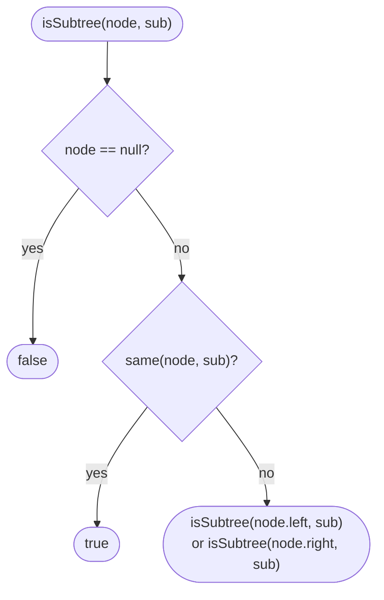

# LC 572 Subtree of Another Tree

> [!abstract] In one sentence
> A subtree match must start at some node of the big tree and then be an exact [[LC 100 Same Tree]] match from there, so the solution is "for every node of `root`, is `same(node, subRoot)`?" — two recursions nested, O(n·m), with a linear-time follow-up via serialisation.

**Map:** [[NeetCode 150 MOC]] → [[DSA Dashboard]] · Pattern: [[Trees]]

> [!question] Predict before you read
> If `subRoot` is `[1, 2]` and `root` contains a node `1` whose left child is `2` *and* that `2` has children of its own, is that a match? Decide what "subtree" means before reading on.

## Problem

Given the roots of two binary trees `root` and `subRoot`, return whether `root` contains a subtree with the same structure and values as `subRoot`. A subtree of `root` is a node of `root` together with *all* of its descendants; the tree itself counts as its own subtree.

Examples: `root = [3, 4, 5, 1, 2]`, `subRoot = [4, 1, 2]` → true (the subtree rooted at 4). `root = [3, 4, 5, 1, 2, null, null, null, null, 0]`, `subRoot = [4, 1, 2]` → false (the node 2 in `root` has an extra child 0).

Constraints that matter: `root` up to 2000 nodes, `subRoot` up to 1000, so O(n·m) = 2·10⁶ comparisons is comfortably fast.

## Clarifying questions

1. Must the whole subtree match, including everything below it, or is a partial top match enough? — The whole subtree: a node of `root` plus all of its descendants.
2. Can `subRoot` be `null`? — On LeetCode it has at least one node; conventionally an empty tree is a subtree of anything.
3. Can `root` be smaller than `subRoot`? — Yes; the answer is then false.
4. Are duplicate values possible? — Yes, so you cannot stop at the first node whose value matches `subRoot.val`.

## Brute force

This *is* the straightforward solution: at every node of `root`, run `same(node, subRoot)`. Each `same` call costs O(m) at worst, there are n nodes, so O(n·m). The wasted work is that a mismatch deep inside one `same` call tells you nothing about the neighbouring start nodes, so overlapping comparisons are repeated.

## The key insight

Two recursions, each one a thing you already have. The outer recursion walks `root` and asks at each node "does a match start here?"; the inner recursion is [[LC 100 Same Tree]]. Keep them separate functions — merging them is the classic bug. For linear time, serialise both trees in pre-order with null markers and sentinels around each value, then ask whether the small string occurs in the big string (KMP or Java's `indexOf`). Recognition cue: "contains a subtree", "appears inside", "pattern tree".

## Optimal approach

1. If `root` is `null`, return false (a non-empty `subRoot` cannot fit).
2. If `same(root, subRoot)`, return true.
3. Otherwise return `isSubtree(root.left, subRoot) || isSubtree(root.right, subRoot)`.
4. `same` is the three-base-case recursion from [[LC 100 Same Tree]].



> [!example]- Excalidraw version — the same diagram as an editable canvas
> ![[LC 572 Subtree of Another Tree — Optimal approach.excalidraw]]
> [[LC 572 Subtree of Another Tree — Optimal approach.excalidraw|Open in Excalidraw]] — needs the Excalidraw plugin (see [[Plugins to Install]]).

## Walkthrough

The false example: the candidate at node 4 fails only because of the extra leaf 0 under node 2.

> [!example] root = [3,4,5,1,2,null,null,null,null,0]
> ![[LC 572 Subtree of Another Tree — root = -3,4,5,1,2,null,null,null,null,0-.excalidraw]]
> [[LC 572 Subtree of Another Tree — root = -3,4,5,1,2,null,null,null,null,0-.excalidraw|Open in Excalidraw]] — same(4, subRoot) matches 4, 1, 2 and then compares 2.left = 0 against null: mismatch

%% excalidraw-spec
{"kind": "tree", "title": "root = [3,4,5,1,2,null,null,null,null,0]", "levels": [3, 4, 5, 1, 2, null, null, null, null, 0], "highlight": [1, 3, 4, 9], "caption": "same(4, subRoot) matches 4, 1, 2 and then compares 2.left = 0 against null: mismatch"}
%%

| Outer node | same(node, [4,1,2]) | Result |
|---|---|---|
| 3 | 3 ≠ 4 | false, recurse |
| 4 | 4 = 4, 1 = 1, 2 = 2, then 0 vs null | false |
| 1 | 1 ≠ 4 | false |
| 2 | 2 ≠ 4 | false |
| 0, 5 | ≠ 4 | false → overall false |

## Java solution

```java
import java.util.*;

class Solution {
    public boolean isSubtree(TreeNode root, TreeNode subRoot) {
        if (subRoot == null) return true;              // empty tree is a subtree of anything
        if (root == null) return false;
        if (isSameTree(root, subRoot)) return true;
        return isSubtree(root.left, subRoot) || isSubtree(root.right, subRoot);
    }

    private boolean isSameTree(TreeNode p, TreeNode q) {
        if (p == null && q == null) return true;
        if (p == null || q == null) return false;
        return p.val == q.val && isSameTree(p.left, q.left) && isSameTree(p.right, q.right);
    }
}

class TreeNode {
    int val;
    TreeNode left, right;
    TreeNode() {}
    TreeNode(int val) { this.val = val; }
    TreeNode(int val, TreeNode left, TreeNode right) { this.val = val; this.left = left; this.right = right; }
}
```

**Time** O(n · m) · **Space** O(h) recursion stack (outer and inner recursion depths add up to at most the height of `root` plus the height of `subRoot`).

The linear alternative serialises both trees and does string containment. The sentinels matter: `^` before each value stops `2` matching inside `12`, and `#` marks null so shapes are encoded.

```java
// snippet
String big = serialize(root), small = serialize(subRoot);   // pre-order, "^val" per node, "#" per null
return big.contains(small);                                 // KMP for guaranteed O(n + m); indexOf is fine in practice

void serialize(TreeNode n, StringBuilder sb) {
    if (n == null) { sb.append("#"); return; }
    sb.append('^').append(n.val);
    serialize(n.left, sb);
    serialize(n.right, sb);
}
```

A pre-order with null markers determines the tree uniquely (see [[LC 297 Serialize and Deserialize Binary Tree]]), so the serialisation of a subtree is a contiguous substring of the serialisation of the tree, and conversely a substring that starts at a `^` boundary and parses as a complete tree corresponds to a subtree. That is O(n + m) with KMP.

## Why it works

A subtree rooted at node x equals `subRoot` iff `same(x, subRoot)`. The outer recursion visits every node x of `root` exactly once (pre-order) and returns true as soon as one matches, so it returns true iff some subtree matches. Termination: both recursions move strictly down a finite tree.

## Edge cases

- `root` null, `subRoot` non-null → false.
- `subRoot` null → true by convention (first line).
- `root` identical to `subRoot` → the first `same` call succeeds.
- `subRoot` matches a leaf of `root` → found at the deepest outer call.
- Many nodes with the same value as `subRoot.val` → `same` is attempted at each; still O(n·m).

## Common mistakes

> [!warning] Pitfalls
> - Merging the two recursions: once `root.val == subRoot.val` you keep walking *both* trees together, and a failed partial match is never retried from the next start node. Keep `isSubtree` (chooses the start) and `isSameTree` (checks the match) separate.
> - Treating "subtree" as "the small tree appears as a top portion" — the match must include all descendants, which is why the extra `0` breaks the second example.
> - In the serialisation trick, omitting the value sentinel: `[12]` would contain `[2]`. Also omitting null markers: `[1, 2]` and `[1, null, 2]` would serialise identically.
> - Returning `isSubtree(root.left, ...) && isSubtree(root.right, ...)` — it is `||`.

## Variants & follow-ups

- Make it O(n + m): serialisation plus KMP (snippet above), or Merkle-style subtree hashing (hash of value + child hashes, compare hashes then verify).
- "Is `subRoot` a *top-part* of `root` at some node" (LeetCode's "subtree" in some judges means that) — change `same` so that a null in `subRoot` matches anything.
- Count how many times `subRoot` occurs.
- Find the largest duplicate subtree (LC 652): serialise every subtree, count with a `HashMap`.

## Interview script

Restate: "Does the big tree have a node whose entire subtree equals the small tree?" Brute force: "Try Same Tree from every node — that is the expected solution, O(n·m)." Insight: "Two independent recursions: choose a start, then verify; and if asked for linear, pre-order serialisation with null markers turns it into substring search." Approach: "isSubtree: null → false; same here → true; else left or right." Complexity: "O(n·m) time, O(h) space; O(n + m) with serialisation and KMP." Tests: "Empty root, exact match at the root, match at a leaf, near-match with an extra child."

## Related

- Pattern: [[Trees]] · prerequisite: [[LC 100 Same Tree]]
- The serialisation it leans on: [[LC 297 Serialize and Deserialize Binary Tree]]
- Same two-level recursion idea: [[LC 226 Invert Binary Tree]] (single-level, for contrast)
- Java refresher: [[Java Collections Cheat Sheet]] (`StringBuilder`, `String.contains`)

## Attempt log

| Date | Result | Minutes | What I got wrong |
|---|---|---|---|
| | | | |

### Mastery checklist
- [ ] Solved without hints in under 25 minutes
- [ ] Stated complexity before coding
- [ ] Handled every edge case above
- [ ] Code compiled first time
- [ ] Can do the follow-up variant

## Open questions
- [ ]
