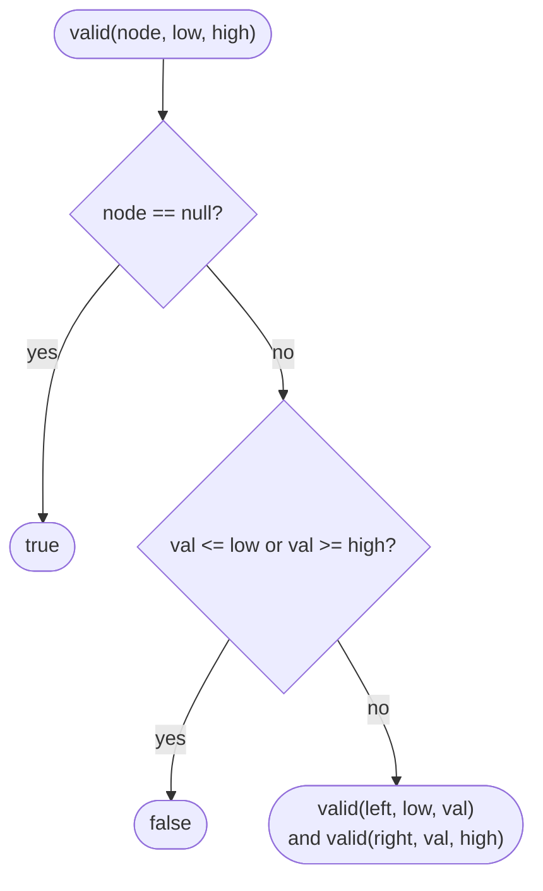

# LC 98 Validate Binary Search Tree

> [!abstract] In one sentence
> A BST requires every node in the left subtree to be smaller than the node — not just the left child — so each node must lie strictly inside a (low, high) range inherited from all its ancestors; pass the range down and shrink it at every step.

**Map:** [[NeetCode 150 MOC]] → [[DSA Dashboard]] · Pattern: [[Trees]]

> [!question] Predict before you read
> The tree `[5, 1, 4, null, null, 3, 6]` is not a BST. The tree `[5, 4, 6, null, null, 3, 7]` is also not a BST, but the check "left child < node < right child" passes at every node. Find the violating pair before reading.

## Problem

Given the root of a binary tree, decide whether it is a valid binary search tree: for every node, all values in its left subtree are strictly less than the node's value, all values in its right subtree are strictly greater, and both subtrees are themselves BSTs.

Examples: `[2, 1, 3]` → true. `[5, 1, 4, null, null, 3, 6]` → false (4 is in the right subtree of 5 but is smaller). `[5, 4, 6, null, null, 3, 7]` → false (3 is in the right subtree of 5).

Constraints that matter: up to 10⁴ nodes; values span the full `int` range (−2³¹ to 2³¹ − 1), so the initial bounds cannot be `Integer.MIN_VALUE` / `MAX_VALUE` — use `long` or `null` for "unbounded".

## Clarifying questions

1. Strict inequalities, so duplicates make the tree invalid? — Yes on LeetCode; confirm, because some definitions allow equal values on one side.
2. Can node values be `Integer.MIN_VALUE` or `MAX_VALUE`? — Yes; this decides how you represent "no bound".
3. Empty tree valid? — Yes.
4. Is the subtree condition global (all descendants) or local (children only)? — Global; that is the whole difficulty.

## Brute force

At every node, walk its entire left subtree checking all values are smaller and its entire right subtree checking all are larger. Each node is examined once per ancestor: O(n · h), O(n²) on a chain. The waste: the "all smaller than 5" constraint is re-verified at every level instead of being carried as a single bound.

## The key insight

Every ancestor imposes one inequality on a node: going left from an ancestor a means "< a.val", going right means "> a.val". The intersection of those inequalities is an open interval (low, high), and it can be maintained in two parameters: going left replaces `high` with the node's value, going right replaces `low`. A node is valid iff `low < val < high`. Equivalent view: the in-order traversal of a BST is strictly increasing, so an in-order walk that compares each value with the previous one also decides it. Recognition cue: "valid BST", "is this a BST", and more generally any property defined over all descendants, which calls for carried-down bounds.

## Optimal approach

1. `valid(node, low, high)` where `low`/`high` are `Long` (or `null` = unbounded).
2. `null` node → true.
3. If `node.val <= low` or `node.val >= high` → false.
4. Return `valid(left, low, node.val) && valid(right, node.val, high)`.
5. Start with `valid(root, −∞, +∞)`.



> [!example]- Excalidraw version — the same diagram as an editable canvas
> ![[LC 98 Validate Binary Search Tree — Optimal approach.excalidraw]]
> [[LC 98 Validate Binary Search Tree — Optimal approach.excalidraw|Open in Excalidraw]] — needs the Excalidraw plugin (see [[Plugins to Install]]).

## Walkthrough

`[5, 4, 6, null, null, 3, 7]`: the 3 is a right-descendant of 5, so its range is (5, 6), and 3 fails `3 > 5`.

> [!example] Why [5,4,6,null,null,3,7] is not a BST
> ![[LC 98 Validate Binary Search Tree — Why -5,4,6,null,null,3,7- is not a BST.excalidraw]]
> [[LC 98 Validate Binary Search Tree — Why -5,4,6,null,null,3,7- is not a BST.excalidraw|Open in Excalidraw]] — node 3 inherits low = 5 from the root and high = 6 from its parent; 3 is outside (5, 6)

%% excalidraw-spec
{"kind": "tree", "title": "Why [5,4,6,null,null,3,7] is not a BST", "levels": [5, 4, 6, null, null, 3, 7], "highlight": [0, 5], "caption": "node 3 inherits low = 5 from the root and high = 6 from its parent; 3 is outside (5, 6)"}
%%

| Call | (low, high) | Check | Result |
|---|---|---|---|
| valid(5, −∞, +∞) | (−∞, +∞) | ok | recurse |
| valid(4, −∞, 5) | (−∞, 5) | 4 < 5 ok | true (leaf) |
| valid(6, 5, +∞) | (5, +∞) | 6 > 5 ok | recurse |
| valid(3, 5, 6) | (5, 6) | 3 ≤ 5 | **false** |

## Java solution

```java
import java.util.*;

class Solution {
    public boolean isValidBST(TreeNode root) {
        return valid(root, Long.MIN_VALUE, Long.MAX_VALUE);   // long: node values may be Integer.MIN/MAX
    }

    // Every value in this subtree must satisfy low < val < high.
    private boolean valid(TreeNode node, long low, long high) {
        if (node == null) return true;
        if (node.val <= low || node.val >= high) return false;
        return valid(node.left, low, node.val) && valid(node.right, node.val, high);
    }
}

class TreeNode {
    int val;
    TreeNode left, right;
    TreeNode() {}
    TreeNode(int val) { this.val = val; }
    TreeNode(int val, TreeNode left, TreeNode right) { this.val = val; this.left = left; this.right = right; }
}
```

**Time** O(n) · **Space** O(h) recursion stack.

The in-order alternative keeps the previously visited value and demands strict increase. Use a `Long` (or `TreeNode prev`) rather than an `int` sentinel for the same overflow reason.

```java
// snippet
TreeNode prev = null;                       // field
boolean inorder(TreeNode node) {
    if (node == null) return true;
    if (!inorder(node.left)) return false;
    if (prev != null && node.val <= prev.val) return false;   // must be strictly increasing
    prev = node;
    return inorder(node.right);
}
```

## Why it works

Claim: the subtree at `node` satisfies the BST property *and* all its values lie in (low, high) iff `valid(node, low, high)` is true. Base: empty subtree, trivially. Step: the node itself must be in (low, high); the left subtree must be a BST with values in (low, val) — the upper bound `val` is exactly "everything in the left subtree is smaller than the node", and the inherited `low` keeps the ancestors' constraints; symmetrically for the right. Since the root is called with (−∞, +∞), the result is exactly "is a BST". Each node is visited once.

## Edge cases

- `null` root → true.
- Single node with value `Integer.MIN_VALUE` or `MAX_VALUE` → true, because bounds are `long`.
- Duplicates, e.g. `[2, 2]` → false: the left child 2 is called with high = 2 and fails `val >= high`.
- Deep right-only chain of increasing values → true; recursion depth n.

## Common mistakes

> [!warning] Pitfalls
> - Checking only `left.val < node.val && node.val < right.val` — passes the second example, which is wrong.
> - Using `int` bounds `Integer.MIN_VALUE`/`MAX_VALUE`: a single-node tree with value `Integer.MIN_VALUE` is reported invalid because `val <= low`. Use `long` or `Integer` with `null` as "unbounded".
> - Non-strict comparisons (`<`/`>` swapped with `<=`/`>=`) letting duplicates through.
> - In the in-order version, initialising `prev` to `Integer.MIN_VALUE` as an `int` — the same overflow trap.

## Variants & follow-ups

- Allow duplicates on the right: change the right call's bound to `>=` semantics (pass `low = val` but test `val < low` instead of `<=`).
- [[LC 230 Kth Smallest Element in a BST]] — the in-order walk, stopped at the k-th node.
- Recover a BST where two nodes were swapped (LC 99): in-order, find the two descents.
- Largest BST subtree (LC 333): bottom-up, return (min, max, size, isBST) per subtree.
- Count the number of BST-violating nodes, or find the first violation.

## Interview script

Restate: "Every node must be greater than everything in its left subtree and smaller than everything in its right subtree — all descendants, not just children." Brute force: "Scan each subtree per node, O(n · height)." Insight: "The ancestors' constraints collapse to one open interval, which I can pass down and narrow." Approach: "valid(node, low, high) with long bounds; narrow high going left, low going right." Complexity: "O(n), O(height)." Tests: "Empty, single node at Integer.MIN_VALUE, the grandchild-violation example, duplicates. I would also mention the in-order strictly-increasing check."

## Related

- Pattern: [[Trees]] (BST invariant, top-down bounds)
- Same carried-parameter shape: [[LC 1448 Count Good Nodes in Binary Tree]]
- In-order on a BST: [[LC 230 Kth Smallest Element in a BST]]
- BST descent: [[LC 235 Lowest Common Ancestor of a Binary Search Tree]]
- Java refresher: [[Java Pitfalls in Interviews]] (sentinel overflow)

## Attempt log

| Date | Result | Minutes | What I got wrong |
|---|---|---|---|
| | | | |

### Mastery checklist
- [ ] Solved without hints in under 25 minutes
- [ ] Stated complexity before coding
- [ ] Handled every edge case above
- [ ] Code compiled first time
- [ ] Can do the follow-up variant

## Open questions
- [ ]
