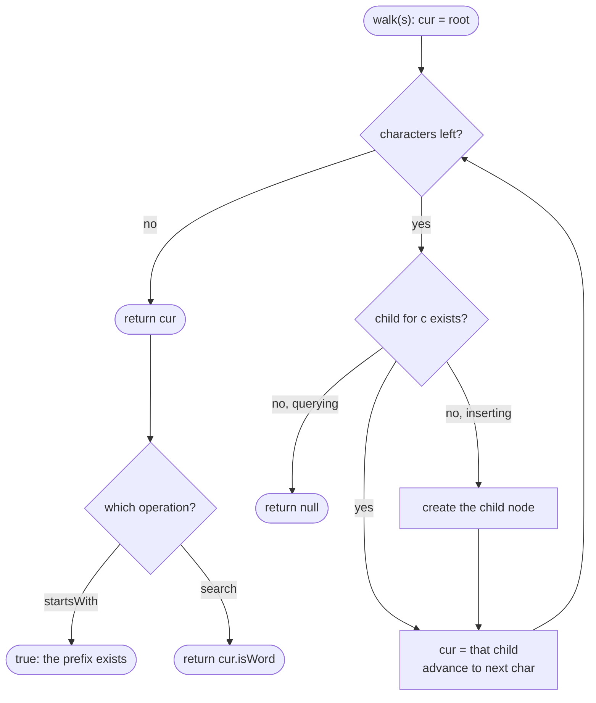

# LC 208 Implement Trie Prefix Tree

> [!abstract] In one sentence
> A hash set answers "is this exact word stored" but cannot answer "does any stored word start with this" without scanning everything; a trie turns each word into a path of one-character nodes so that words sharing a prefix share the path, and then every operation is a single walk from the root of at most `word.length()` steps — `insert` creates the missing nodes on the way, `startsWith` checks the walk survives, `search` additionally checks the end-of-word flag on the last node.

**Map:** [[NeetCode 150 MOC]] → [[DSA Dashboard]] · Pattern: [[Tries]]

> [!question] Predict before you read
> After `insert("apple")` and then `insert("app")`, how many nodes does the trie hold, and what single bit distinguishes `search("app")` from `startsWith("app")` when both walks stop at the same node?

## Problem

Design a class `Trie` with three operations: `insert(word)` stores a word; `search(word)` returns true only if that exact word was inserted; `startsWith(prefix)` returns true if any inserted word begins with `prefix`. All strings are lowercase `a`–`z`.

Example: `insert("apple")`, `search("apple")` → true, `search("app")` → false, `startsWith("app")` → true, `insert("app")`, `search("app")` → true.

Constraints that matter: strings have length 1..2000, at most 3·10⁴ calls in total, lowercase letters only — so a fixed 26-slot child array per node is the right representation, and the per-call cost must depend on the string length, not on the number of stored words.

## Clarifying questions

1. Alphabet? — Lowercase `a`–`z` only, so a node can hold a `Node[26]` indexed by `c - 'a'`; for Unicode you would switch to a `HashMap<Character, Node>`.
2. Can the same word be inserted twice? — Yes; the second insert walks existing nodes and sets a flag that is already set.
3. Can `search` or `startsWith` be called before any insert? — Yes; the root has no children, so both return false.
4. Is `delete` required? — Not here; say that it would need child counts so that dead branches can be pruned (see the follow-ups).
5. Is the empty string ever passed? — No (length ≥ 1); note what the code would do anyway (see edge cases).

## Brute force

Keep a `HashSet<String>`. `insert` and `search` are O(L) thanks to hashing, but `startsWith` has no shortcut: it must call `startsWith` on every stored word, O(N·L) per query. A sorted `ArrayList` plus binary search makes prefix queries O(L log N) but inserts O(N) because of the shift. Either way the shared beginnings of words ("app", "apple", "apply") are re-read on every prefix query — that repeated work is what the trie removes.

## The key insight

Share the prefixes. Make each character a node and let words that start the same way share the same nodes; then any query is one walk from the root, and the walk's length is bounded by the query string, never by the number of words. The only difference between "a stored word" and "a prefix of a stored word" is a boolean on the node where the walk ends. Recognition cue: "prefix", "starts with", "autocomplete", "many lookups against a fixed dictionary of words", and any grid or wildcard search that would otherwise re-check the same prefixes ([[LC 211 Design Add and Search Words Data Structure]], [[LC 212 Word Search II]]).

## Optimal approach

1. `Node { Node[] children = new Node[26]; boolean isWord; }`; the root is an empty node that represents the empty prefix.
2. `insert(word)`: `cur = root`; for each char `c`, index `i = c - 'a'`; create `children[i]` if null; step into it. After the loop set `cur.isWord = true`.
3. `walk(s)`: `cur = root`; for each char step into `children[i]`; return null the moment a link is missing, else the final node.
4. `search(word)` = `walk(word) != null && node.isWord`. `startsWith(prefix)` = `walk(prefix) != null`.



> [!example]- Excalidraw version — the same diagram as an editable canvas
> ![[LC 208 Implement Trie Prefix Tree — Optimal approach.excalidraw]]
> [[LC 208 Implement Trie Prefix Tree — Optimal approach.excalidraw|Open in Excalidraw]] — needs the Excalidraw plugin (see [[Plugins to Install]]).

## Walkthrough

The LeetCode sequence. `walk` is written as the characters it consumes.

| Call | Walk | Node reached | Returns |
|---|---|---|---|
| insert("apple") | a → p → p → l → e, all five created | `e`, `isWord` set to true | — |
| search("apple") | a → p → p → l → e | `e`, `isWord` true | true |
| search("app") | a → p → p | second `p`, `isWord` false | false |
| startsWith("app") | a → p → p | second `p` exists | true |
| insert("app") | a → p → p, nothing created | second `p`, `isWord` set to true | — |
| search("app") | a → p → p | second `p`, `isWord` true | true |

The structure after both inserts — five nodes, two of them marked as word ends:

> [!example] Trie after insert(apple), insert(app)
> ![[LC 208 Implement Trie Prefix Tree — Trie after insert(apple), insert(app).excalidraw]]
> [[LC 208 Implement Trie Prefix Tree — Trie after insert(apple), insert(app).excalidraw|Open in Excalidraw]] — app and apple share the nodes a, p, p; the second p is an end-of-word node and still has a child l, so a word end is a flag, not a leaf

%% excalidraw-spec
{"kind": "trie", "title": "Trie after insert(apple), insert(app)", "words": ["apple", "app"], "highlight_word": "app", "caption": "app and apple share the nodes a, p, p; the second p is an end-of-word node and still has a child l, so a word end is a flag, not a leaf"}
%%

## Java solution

```java
import java.util.*;

class Trie {
    private static class Node {
        Node[] children = new Node[26];   // one slot per lowercase letter, null = no such branch
        boolean isWord;                   // true if an inserted word ends exactly here
    }

    private final Node root = new Node(); // represents the empty prefix

    public Trie() {}

    public void insert(String word) {
        Node cur = root;
        for (char c : word.toCharArray()) {
            int i = c - 'a';
            if (cur.children[i] == null) cur.children[i] = new Node();
            cur = cur.children[i];
        }
        cur.isWord = true;                // mark only the last node
    }

    public boolean search(String word) {
        Node n = walk(word);
        return n != null && n.isWord;     // path exists AND a word ends here
    }

    public boolean startsWith(String prefix) {
        return walk(prefix) != null;      // path exists is enough
    }

    private Node walk(String s) {         // follow the path for s; null as soon as a link is missing
        Node cur = root;
        for (char c : s.toCharArray()) {
            cur = cur.children[c - 'a'];
            if (cur == null) return null;
        }
        return cur;
    }
}
```

**Time** O(L) per operation, where L is the length of the argument · **Space** O(total characters inserted × 26 references) in the worst case; shared prefixes reduce it.

When the alphabet is not fixed, the same class with a map per node:

```java
// snippet
private static class Node {
    Map<Character, Node> children = new HashMap<>();   // any alphabet; slower, smaller when sparse
    boolean isWord;
}
// insert: cur = cur.children.computeIfAbsent(c, k -> new Node());
// walk:   cur = cur.children.get(c); if (cur == null) return null;
```

## Why it works

Invariant: for every inserted word `w`, the path root → `w[0]` → … → `w[L-1]` exists and its last node has `isWord = true`; and every node in the trie lies on the path of at least one inserted word. `insert` establishes the first half by creating exactly the missing nodes and setting the flag; nothing is ever removed, so both halves persist. Therefore `walk(s) != null` holds exactly when `s` is a prefix of some inserted word (that is `startsWith`), and the final node's flag is true exactly when `s` itself was inserted (that is `search`). Each operation touches one node per character, hence O(L).

## Edge cases

- `search("app")` before `insert("app")` but after `insert("apple")` → the node exists, the flag is false → false; the flag is what separates prefix from word.
- `search("apples")` → the walk from `e` finds no `s` child → null → false.
- Inserting the same word twice → every node exists already; the flag is set again; no duplicate nodes.
- Queries before any insert → root has 26 nulls → `walk` returns null on the first character.
- Empty string (outside the constraints) → the loop body never runs; `startsWith("")` would be true and `search("")` false because the root's flag is never set.

## Common mistakes

> [!warning] Pitfalls
> - Forgetting `isWord` altogether, which makes `search` behave like `startsWith` ("app" reported as a word after inserting "apple").
> - Setting `isWord` on every node along the path instead of only the last one — every prefix becomes a word.
> - Indexing `children[c]` with the raw char (value 97..122) instead of `c - 'a'` → `ArrayIndexOutOfBoundsException`.
> - Reading `cur.isWord` before checking `cur == null` → `NullPointerException` on a missing path.
> - Giving the root a character; the root is the empty prefix and holds no letter.
> - Reaching for `HashMap<Character, Node>` when the alphabet is 26 letters: correct, but an array is faster and the index arithmetic is what interviewers expect to see.

## Variants & follow-ups

- `delete(word)`: walk down, clear the flag, then walk back up removing nodes that have no children and no flag; keep a child count per node so "no children" is O(1).
- Count words with a given prefix: add `int prefixCount` to each node, incremented on insert; the answer is `walk(prefix).prefixCount` — this is LC 1804.
- Wildcard search with `.`: a `.` branches into every child, a DFS over the trie — [[LC 211 Design Add and Search Words Data Structure]].
- Find many words on a letter grid: move a trie pointer alongside the grid DFS and stop when the trie has no child — [[LC 212 Word Search II]].
- Autocomplete: DFS from the prefix node to collect completions; for top-k store the k best completions on each node at insert time.
- Memory pressure: compress single-child chains (radix tree) or store the children in a sorted array with binary search.

## Interview script

Restate: "Three operations on a growing set of lowercase words — insert, exact search, and prefix check." Brute force: "A `HashSet` makes insert and search O(L), but a prefix query has to scan every word, O(N·L)." Insight: "Store the words as paths in a tree of characters so shared prefixes share nodes; then every operation is a walk of at most L steps, and a word end is a boolean on the last node." Approach: "Node with a 26-slot child array and an `isWord` flag; one private `walk` helper that returns the node for a string or null; `startsWith` is walk-not-null, `search` is walk-not-null-and-flag." Complexity: "O(L) per operation, memory proportional to the total characters inserted times 26 references." Tests: "The LeetCode sequence with apple/app, a query before any insert, a word that extends a stored word, and the same word inserted twice. If asked, I would extend the node with a child count for delete or a prefix count for counting queries."

## Related

- Pattern: [[Tries]] · why a 26-array beats a map here: [[Hashing]]
- Next in the trio: [[LC 211 Design Add and Search Words Data Structure]], [[LC 212 Word Search II]]
- A trie as an accelerator for a DP: [[LC 139 Word Break]]
- Java refresher: [[DSA Patterns in Java]] (Trie class template), [[Java Collections Cheat Sheet]] (`toCharArray`, `c - 'a'` arithmetic, `computeIfAbsent`)

## Attempt log

| Date | Result | Minutes | What I got wrong |
|---|---|---|---|
| | | | |

### Mastery checklist
- [ ] Solved without hints in under 25 minutes
- [ ] Stated complexity before coding
- [ ] Handled every edge case above
- [ ] Code compiled first time
- [ ] Can do the follow-up variant

## Open questions
- [ ]
