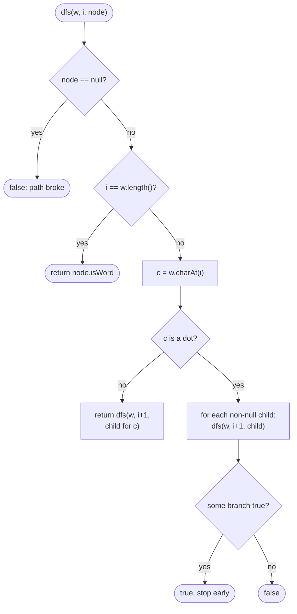

# LC 211 Design Add and Search Words Data Structure

> [!abstract] In one sentence
> Store the words in a trie exactly as in [[LC 208 Implement Trie Prefix Tree]]; a literal character in the query follows one child as before, and a `.` tries every non-null child and succeeds if any of them leads to a match — so `search` is a recursive DFS over the trie with the pattern index as the second coordinate, and a match means the pattern is consumed on a node whose end-of-word flag is set.

**Map:** [[NeetCode 150 MOC]] → [[DSA Dashboard]] · Pattern: [[Tries]]

> [!question] Predict before you read
> With the words `bad`, `dad`, `mad` stored, how many trie nodes does `search(".ad")` visit before it can return true, and why does `search("b..")` never look at the `d` and `m` subtrees?

## Problem

Design `WordDictionary` with `addWord(word)` and `search(word)`, where the search argument may contain `.` characters, each matching any single lowercase letter. `search` returns true if some added word matches the whole pattern.

Example: `addWord("bad")`, `addWord("dad")`, `addWord("mad")`; `search("pad")` → false, `search("bad")` → true, `search(".ad")` → true, `search("b..")` → true.

Constraints that matter: words have length 1..25, at most 10⁴ calls, lowercase letters only, and a search pattern contains at most 2 dots — so the branching a wildcard introduces is bounded (26² paths at worst) and a trie DFS is comfortably fast.

## Clarifying questions

1. Does `.` match exactly one character? — Yes; it never matches zero or several, so the pattern length equals the word length.
2. Can a search pattern contain only dots? — Yes; it then matches any stored word of that length.
3. Is `.` ever passed to `addWord`? — No; only lowercase letters are stored.
4. How many dots per query? — At most 2 on LeetCode; worth asking because it bounds the fan-out and rules out regex-style blowups.
5. Should `search("ba")` match the stored word `bad`? — No; the whole pattern must consume the whole word, so the end-of-word flag matters.

## Brute force

Keep every word in a `List<String>` (or group them by length in a `Map<Integer, List<String>>`). `search` scans the candidates of the right length and compares character by character, treating `.` as a match: O(N·L) per search. Correct and tolerable at 10⁴ calls, but words that share a prefix are compared against the same pattern prefix again and again — exactly the repetition a trie collapses.

## The key insight

A trie search is a walk; a wildcard makes the walk branch. For a literal character there is one possible next node, for `.` there are up to 26, and the pattern matches if *any* branch reaches a word end as the pattern runs out. That is a depth-first search over the trie whose state is (current node, index into the pattern). Because literal characters still follow exactly one child, the search stays O(L) until a dot appears, and the dots are capped. Recognition cue: "search with wildcards / regex-lite over a dictionary", "pattern where some positions are unknown" → trie plus DFS; compare [[LC 212 Word Search II]], which branches on the grid instead of the pattern.

## Optimal approach

1. Same node as LC 208: `Node[26] children`, `boolean isWord`. `addWord` is the LC 208 insert.
2. `search(pattern)` calls `dfs(pattern, 0, root)`.
3. `dfs(w, i, node)`: if `node == null` return false (the path broke); if `i == w.length()` return `node.isWord` (pattern consumed: is this a word end?).
4. Let `c = w.charAt(i)`. If `c != '.'`, return `dfs(w, i + 1, node.children[c - 'a'])` — one branch, null handled by step 3.
5. If `c == '.'`, loop over the 26 children; for each non-null child, if `dfs(w, i + 1, child)` is true, return true immediately. After the loop return false.



> [!example]- Excalidraw version — the same diagram as an editable canvas
> ![[LC 211 Design Add and Search Words Data Structure — Optimal approach.excalidraw]]
> [[LC 211 Design Add and Search Words Data Structure — Optimal approach.excalidraw|Open in Excalidraw]] — needs the Excalidraw plugin (see [[Plugins to Install]]).

## Walkthrough

Words stored: `bad`, `dad`, `mad`. The trie has a root with three children `b`, `d`, `m`, each followed by `a` then `d` (word end).

> [!example] Trie of bad, dad, mad
> ![[LC 211 Design Add and Search Words Data Structure — Trie of bad, dad, mad.excalidraw]]
> [[LC 211 Design Add and Search Words Data Structure — Trie of bad, dad, mad.excalidraw|Open in Excalidraw]] — three branches from the root; search(.ad) enters all three in order, search(b..) enters only the first

%% excalidraw-spec
{"kind": "trie", "title": "Trie of bad, dad, mad", "words": ["bad", "dad", "mad"], "highlight_word": "bad", "caption": "three branches from the root; search(.ad) enters all three in order, search(b..) enters only the first"}
%%

`search(".ad")`, calls in the order they happen:

| Call | i | Pattern char | What happens |
|---|---|---|---|
| dfs(".ad", 0, root) | 0 | `.` | loop over children: `b` first |
| dfs(".ad", 1, b) | 1 | `a` | literal: step to `b→a` |
| dfs(".ad", 2, b→a) | 2 | `d` | literal: step to `b→a→d` |
| dfs(".ad", 3, b→a→d) | 3 | — | pattern consumed; `isWord` true → true |
| back in the root loop | 0 | `.` | first branch returned true → return true; `d` and `m` subtrees never visited |

`search("b..")`: root → `b` (literal); `.` at `b` has one non-null child `a`; `.` at `b→a` has one non-null child `d`; `i == 3` and `isWord` → true. The dots only fan out over children that exist, so with one child per level the search is still a single walk.

`search("pad")`: root has no child `p` → `dfs` receives null → false without touching anything else.

## Java solution

```java
import java.util.*;

class WordDictionary {
    private static class Node {
        Node[] children = new Node[26];
        boolean isWord;
    }

    private final Node root = new Node();

    public WordDictionary() {}

    public void addWord(String word) {             // identical to Trie.insert
        Node cur = root;
        for (char c : word.toCharArray()) {
            int i = c - 'a';
            if (cur.children[i] == null) cur.children[i] = new Node();
            cur = cur.children[i];
        }
        cur.isWord = true;
    }

    public boolean search(String word) {
        return dfs(word, 0, root);
    }

    private boolean dfs(String w, int i, Node node) {
        if (node == null) return false;            // the path broke one step earlier
        if (i == w.length()) return node.isWord;   // pattern consumed: only a word end counts
        char c = w.charAt(i);
        if (c != '.') return dfs(w, i + 1, node.children[c - 'a']);   // one branch
        for (Node child : node.children) {         // '.' = try every existing branch
            if (child != null && dfs(w, i + 1, child)) return true;   // first success wins
        }
        return false;
    }
}
```

**Time** `addWord` O(L); `search` O(L) without dots, O(26^d · L) in the worst case with d dots (at most 26² · 25 here) · **Space** O(total characters stored × 26 references) for the trie plus O(L) recursion depth.

## Why it works

Invariant of the trie: the path for every added word exists and ends on a node with `isWord = true`, and every node lies on some added word's path (as in LC 208). `dfs(w, i, node)` returns true exactly when some stored word whose first `i` characters correspond to the path root → `node` matches `w[i..]`: at `i == w.length()` that is precisely `node.isWord`; for a literal character the only candidate continuation is the one child; for a dot every child is a candidate and the pattern matches if any does. Returning on the first successful branch is sound because the answer is existence, not a count. Induction on the remaining pattern length gives correctness of `search`.

## Edge cases

- `search` before any `addWord` → root has no children; a literal first character yields null → false; an all-dot pattern loops over 26 nulls → false.
- Pattern longer than every stored word → the walk runs off the end of a path (null) → false.
- Pattern shorter than the stored words (`"ba"` with `bad` stored) → `i == 2` on node `b→a`, `isWord` false → false.
- All dots, e.g. `"..."` → explores every stored word of length 3 (and prunes shorter and longer ones by the null and flag checks).
- The same word added twice → the flag is set twice; no duplicate nodes, no change to search.

## Common mistakes

> [!warning] Pitfalls
> - Returning true when `i == w.length()` without reading `isWord` — a stored `bad` then matches the pattern `"ba"`.
> - Looping over all 26 children for literal characters too: correct but 26× slower on the common path; a literal has exactly one candidate child.
> - Dereferencing `node.children[c - 'a']` when the child is null before recursing — the null check must come first (here it is the first line of `dfs`, which also covers the literal branch).
> - Writing `c - 'a'` for a dot: `'.' - 'a'` is negative → `ArrayIndexOutOfBoundsException`. Test for the dot before indexing.
> - Building a regex from the pattern and running `String.matches` over every word — O(N·L) with regex compilation on every call, and it hides the data-structure idea the interviewer is testing.
> - Forgetting to stop after the first successful branch; the answer is still right but the search degrades to exploring every matching word.

## Variants & follow-ups

- Count the matching words instead of answering yes/no: sum the branch results instead of short-circuiting.
- Return the matching words: carry a `StringBuilder` down the recursion and append its contents at every word end that is reached with the pattern consumed.
- `*` matching zero or more characters: the length alignment breaks and the problem becomes LC 44-style DP, not a trie walk; say so out loud.
- Iterative version: an explicit stack of `(node, i)` pairs replaces the recursion if the interviewer worries about depth (L ≤ 25, so recursion is fine here).
- Many wildcard queries over a fixed dictionary of equal-length words: precompute, for each pattern position, the set of words by letter and intersect bitsets.
- Prefix wildcard queries ("does any word match `b..` as a prefix"): drop the `isWord` requirement at the end of the pattern.

## Interview script

Restate: "Add words to a dictionary; search with a pattern where a dot matches any one letter; the pattern must match a whole word." Brute force: "Keep a list of words and compare each one against the pattern, O(N·L) per search." Insight: "Put the words in a trie. A literal character follows one child as in a plain trie search; a dot branches into every existing child. That makes search a DFS over the trie with the pattern index as the state, and the end-of-word flag decides when the pattern runs out." Approach: "`addWord` is the trie insert; `search` is a recursive `dfs(pattern, i, node)` with a null check first, the flag check when `i` hits the end, one recursive call for a literal, a loop with early return for a dot." Complexity: "O(L) for `addWord` and for dot-free searches; each dot multiplies the work by at most 26, and queries have at most two dots." Tests: "The LeetCode example, a pattern that is a prefix of a stored word, a pattern longer than every word, an all-dot pattern, and a search before any add."

## Related

- Pattern: [[Tries]] · the branching is the same choose/explore shape as [[Backtracking]]
- The plain trie this extends: [[LC 208 Implement Trie Prefix Tree]]
- Branching on the grid instead of the pattern: [[LC 212 Word Search II]], [[LC 79 Word Search]]
- Java refresher: [[DSA Patterns in Java]] (Trie class, recursive DFS template), [[Java Collections Cheat Sheet]] (`charAt`, `toCharArray`, enhanced for over an array)

## Attempt log

| Date | Result | Minutes | What I got wrong |
|---|---|---|---|
| | | | |

### Mastery checklist
- [ ] Solved without hints in under 25 minutes
- [ ] Stated complexity before coding
- [ ] Handled every edge case above
- [ ] Code compiled first time
- [ ] Can do the follow-up variant

## Open questions
- [ ]
