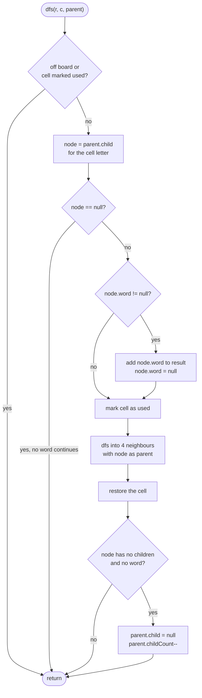

# LC 212 Word Search II

> [!abstract] In one sentence
> [[LC 79 Word Search]] once per word is `W` blind grid searches that redo every shared prefix; building one trie from the words and moving a trie pointer alongside the grid DFS makes every step conditional on "does some unfound word continue with this letter", so a single DFS from each cell finds every word at once — and deleting trie nodes that have nothing left below them makes the dictionary shrink as words are found, which is what keeps the large test cases fast.

**Map:** [[NeetCode 150 MOC]] → [[DSA Dashboard]] · Pattern: [[Tries]]

> [!question] Predict before you read
> After the word `oath` is found from the top-left cell, which trie nodes can be deleted on the way back up the recursion, and why is it safe to delete them even though the DFS from the other 15 cells has not run yet?

## Problem

Given an `m × n` board of lowercase letters and a list of distinct words, return every word that can be spelled by a path of horizontally or vertically adjacent cells where no cell is used more than once within one word. Each word appears at most once in the answer, in any order.

Example: board `o a a n / e t a e / i h k r / i f l v`, words `["oath", "pea", "eat", "rain"]` → `["eat", "oath"]` (`pea` needs a `p`, `rain` needs `r` next to `a` next to `i` next to `n`, which the board does not offer).

Constraints that matter: `m, n ≤ 12`, up to 3·10⁴ words of length ≤ 10, all distinct, lowercase — so `W` separate searches are too slow, the trie has at most 3·10⁵ nodes, and the recursion depth is at most 10.

## Clarifying questions

1. Can one cell be reused within a word? — No. Across different words? — Yes; the visited marks are per path.
2. If a word can be formed along several paths, how many times do I report it? — Once; the output is a set.
3. Are the words distinct? — Yes (constraint); if not, deduplicate first or the trie handles it (the same terminal node).
4. Output order? — Any.
5. Can a word be longer than `m·n`? — Then it cannot be formed; the DFS simply never reaches its terminal node.

## Brute force

For each word run the [[LC 79 Word Search]] backtracking from every cell: O(W · m·n · 4·3^(L-1)) — with W = 3·10⁴, 144 cells and L = 10 that is far beyond 10⁹ steps. The waste is twofold: words that share a prefix (`oat`, `oath`, `oats`) repeat the same board walk, and each walk is blind — it extends a path as long as the single word it is looking for matches, with no idea whether any other word could use the path.

## The key insight

Flip the loop: search the board once, not once per word. Put all words into a trie; the trie is then a map from "letters walked so far" to "which words are still possible". Run a DFS from every cell carrying the current trie node; moving to a neighbour means looking up its letter among the node's children, and a missing child ends the path immediately — every step taken is justified by at least one word. Two refinements make it fast in practice: store the word itself on its terminal node (so there is no path reconstruction and no `Set` needed for deduplication — null the word when found), and cut a trie node from its parent when it has no children and no word left, so that DFS paths from later cells stop one step earlier. Recognition cue: "find all words from a dictionary in a grid/stream/text" → trie-guided search; "find one word" → plain backtracking.

## Optimal approach

1. Build the trie: `Node { Node[26] children; int childCount; String word; }`. For each word walk/create nodes, incrementing `childCount` when a child is created, and set `word` on the last node.
2. For every cell `(r, c)` call `dfs(board, r, c, root, out)`.
3. In `dfs`: stop if out of bounds or the cell is marked `#`. Look up `node = parent.children[letter]`; stop if null.
4. If `node.word != null`: add it to the output and set `node.word = null` (found exactly once).
5. Mark the cell `#`, recurse into the four neighbours with `node` as the parent, restore the cell.
6. After the recursion: if `node.childCount == 0 && node.word == null`, unlink it from `parent` and decrement `parent.childCount`.



> [!example]- Excalidraw version — the same diagram as an editable canvas
> ![[LC 212 Word Search II — Optimal approach.excalidraw]]
> [[LC 212 Word Search II — Optimal approach.excalidraw|Open in Excalidraw]] — needs the Excalidraw plugin (see [[Plugins to Install]]).

## Walkthrough

The LeetCode board and the trie of `oath`, `pea`, `eat`, `rain`.

> [!example] Board with the path of oath shaded
> ![[LC 212 Word Search II — Board with the path of oath shaded.excalidraw]]
> [[LC 212 Word Search II — Board with the path of oath shaded.excalidraw|Open in Excalidraw]] — the DFS from (0,0) follows o, a, t, h while the trie pointer follows root, o, oa, oat, oath

%% excalidraw-spec
{"kind": "grid", "title": "Board with the path of oath shaded", "col_labels": ["0", "1", "2", "3"], "row_labels": ["0", "1", "2", "3"], "rows": [ ["o", "a", "a", "n"], ["e", "t", "a", "e"], ["i", "h", "k", "r"], ["i", "f", "l", "v"] ], "highlight": [ [0, 0], [0, 1], [1, 1], [2, 1] ], "arrows": [ [ [0, 0], [0, 1] ], [ [0, 1], [1, 1] ], [ [1, 1], [2, 1] ] ], "caption": "the DFS from (0,0) follows o, a, t, h while the trie pointer follows root, o, oa, oat, oath"}
%%

> [!example] Trie of oath, pea, eat, rain
> ![[LC 212 Word Search II — Trie of oath, pea, eat, rain.excalidraw]]
> [[LC 212 Word Search II — Trie of oath, pea, eat, rain.excalidraw|Open in Excalidraw]] — after oath is reported, the nodes h, t, a, o are cut one by one on the way back up: each has no children and no word left

%% excalidraw-spec
{"kind": "trie", "title": "Trie of oath, pea, eat, rain", "words": ["oath", "pea", "eat", "rain"], "highlight_word": "oath", "caption": "after oath is reported, the nodes h, t, a, o are cut one by one on the way back up: each has no children and no word left"}
%%

DFS from `(0,0)` = `o`, events in order:

| Cell | Letter | Trie node | Event |
|---|---|---|---|
| (0,0) | o | root → o | child exists, mark cell |
| (1,0) | e | o → e? | null → return |
| (0,1) | a | o → a | child exists, mark |
| (0,2) | a | oa → a? | null → return |
| (1,1) | t | oa → t | child exists, mark |
| (2,1) | h | oat → h | `word = "oath"` → emit, null it, mark |
| (3,1) f, (2,0) i, (2,2) k | — | oath → ? | all null → return |
| back at (2,1) | h | oath | no children, no word → cut from `oat` |
| back at (1,1), (0,1), (0,0) | t, a, o | oat, oa, o | each now childless and wordless → cut; the root loses `o` |

The DFS from `(1,3)` = `e` later finds `eat` via `(1,2)` = `a` and `(1,1)` = `t`, and cuts the `e` branch the same way. The `p` and `r` branches are never entered because no cell next to the right letters matches, so by the end the trie is `root → r → a → i → n` plus `root → p → e → a` — the unfound words.

## Java solution

```java
import java.util.*;

class Solution {
    private static class Node {
        Node[] children = new Node[26];
        int childCount;          // live children, so "is this node dead?" is O(1)
        String word;             // non-null only on the last letter of an unfound word
    }

    public List<String> findWords(char[][] board, String[] words) {
        Node root = new Node();
        for (String w : words) {                     // build the trie once
            Node cur = root;
            for (char c : w.toCharArray()) {
                int i = c - 'a';
                if (cur.children[i] == null) { cur.children[i] = new Node(); cur.childCount++; }
                cur = cur.children[i];
            }
            cur.word = w;
        }
        List<String> out = new ArrayList<>();
        for (int r = 0; r < board.length; r++)
            for (int c = 0; c < board[0].length; c++)
                dfs(board, r, c, root, out);
        return out;
    }

    private void dfs(char[][] b, int r, int c, Node parent, List<String> out) {
        if (r < 0 || c < 0 || r >= b.length || c >= b[0].length || b[r][c] == '#') return;
        char ch = b[r][c];
        Node node = parent.children[ch - 'a'];
        if (node == null) return;                    // no unfound word continues with this letter
        if (node.word != null) {                     // a word ends here: report it exactly once
            out.add(node.word);
            node.word = null;
        }
        b[r][c] = '#';                               // used on the current path
        dfs(b, r + 1, c, node, out);
        dfs(b, r - 1, c, node, out);
        dfs(b, r, c + 1, node, out);
        dfs(b, r, c - 1, node, out);
        b[r][c] = ch;                                // restore for other paths
        if (node.childCount == 0 && node.word == null) {   // nothing left below: cut the branch
            parent.children[ch - 'a'] = null;
            parent.childCount--;
        }
    }
}
```

**Time** O(Σ|words|) to build the trie plus O(m·n · 4·3^(L-1)) worst case for the search with L = longest word; in practice the trie bounds every path by the dictionary and the pruning makes repeated prefixes cheap · **Space** O(Σ|words| × 26 references) for the trie, O(L) recursion depth, O(1) extra on the board.

## Why it works

Three invariants carry the proof.

1. **Trie invariant.** At every moment the trie contains, for each not-yet-found word, its full path with `word` set on the last node — and nothing else that matters. A node is removed only when it has no children and no word, so no remaining word's path ever loses a node; the `childCount` bookkeeping keeps that test O(1) and exact because it changes only where links are created or cut.
2. **Path invariant.** In `dfs(r, c, parent)` the letters on the current path from the starting cell to `(r, c)` spell exactly the path from the root to `node`, and every cell on that path is marked `#`, so no cell repeats within a word. Restoring the cell after the recursion keeps marks local to the path.
3. **Completeness and uniqueness.** Any word that can be spelled on the board corresponds to a path that the DFS from its first cell explores, because the DFS only abandons a path when the trie says no unfound word continues — a decision justified by invariant 1. A word is emitted when its terminal node is reached and immediately nulled, so a second path to it reports nothing.

Pruning cannot cause a miss: when a node is cut, it has no word and no children, so no word's path passes through it; later searches skip it one step earlier than they would have stopped anyway.

## Edge cases

- A word longer than `m·n` → the path cannot grow that long; never reported.
- Words that are prefixes of one another (`oat`, `oath`) → `oat`'s node has a word and a child; emitting `oat` nulls the word but the node stays because `childCount > 0`.
- The same word reachable along two paths → the second arrival finds `word == null` and reports nothing.
- A single-cell board → the four neighbours are all out of bounds; only one-letter words can match.
- A word with repeated letters (`aaa`) on a board with two `a`s → the `#` mark stops the third step; not reported.
- Every word found early → the trie shrinks to the root and the remaining DFS calls return at the `node == null` check after one step each.

## Common mistakes

> [!warning] Pitfalls
> - Running [[LC 79 Word Search]] once per word — the shape that passes the small tests and times out on the large ones.
> - Indexing `ch - 'a'` before checking for the `#` mark: `'#' - 'a'` is negative and throws. The bounds-and-mark check must come first.
> - Collecting results in a `HashSet<String>` to deduplicate instead of nulling the stored word — correct, but it leaves the found word in the trie, so the pruning never fires and the search keeps re-walking found words.
> - Cutting the node *before* the recursive calls, or cutting a node that still has a word — both remove paths that are still needed.
> - Using a separate `boolean[][] visited` and forgetting to reset it between starting cells; overwriting the board with `#` and restoring it is simpler.
> - Rebuilding the word from the path with a `StringBuilder` at every step — slow and easy to get off by one; the terminal node already knows its word.
> - Forgetting to restore `b[r][c]` after the recursion, which silently blocks cells for every later path.

## Variants & follow-ups

- Count how many dictionary words appear instead of listing them — same search, return `out.size()`.
- Allow 8-directional adjacency (Boggle) — change the four recursive calls to a loop over eight directions; the trie logic is untouched.
- The board changes but the dictionary is fixed across many calls — build the trie once and do *not* prune (or prune a per-call copy); mention that pruning is a one-shot optimisation.
- Find the longest word on the board — same DFS, keep the longest emitted word.
- Report the paths, not just the words — carry a list of coordinates down the recursion and copy it at emission.
- Streams of text instead of a grid (find all dictionary words in a document) — Aho–Corasick is the linear-time tool; the trie-plus-DFS here is the grid-shaped relative.

## Interview script

Restate: "Letters on a grid, a dictionary of up to 30k words, return every word that can be traced along adjacent cells without reusing a cell; each word once." Brute force: "Word Search per word is W full grid searches and repeats every shared prefix." Insight: "Search the grid once and let the dictionary guide the search: put the words into a trie, carry the trie node through the DFS, and stop the moment the trie has no child for the next letter. Store the word on its terminal node to report without reconstruction, and cut exhausted trie nodes after the recursion so later starts stop earlier." Approach: "Build the trie with a child count per node; DFS from every cell with bounds-and-mark check, child lookup, emit-and-null, mark, four recursive calls, restore, and prune if the node is empty." Complexity: "Trie build is linear in the total characters; the search is bounded by the grid DFS, O(m·n·4·3^(L-1)) in theory, far less with the trie pruning." Tests: "The LeetCode board, words that are prefixes of each other, a word reachable twice, a word with repeated letters, and a one-cell board."

## Related

- Pattern: [[Tries]] · the search shape: [[Backtracking]] · grid DFS mechanics: [[Graphs]], [[LC 200 Number of Islands]]
- Prerequisites: [[LC 79 Word Search]] (the per-word DFS), [[LC 208 Implement Trie Prefix Tree]], [[LC 211 Design Add and Search Words Data Structure]]
- Java refresher: [[DSA Patterns in Java]] (Trie class, grid DFS with direction arrays), [[Java Collections Cheat Sheet]] (`char[][]` handling, `ArrayList` as the result)

## Attempt log

| Date | Result | Minutes | What I got wrong |
|---|---|---|---|
| | | | |

### Mastery checklist
- [ ] Solved without hints in under 25 minutes
- [ ] Stated complexity before coding
- [ ] Handled every edge case above
- [ ] Code compiled first time
- [ ] Can do the follow-up variant

## Open questions
- [ ]
