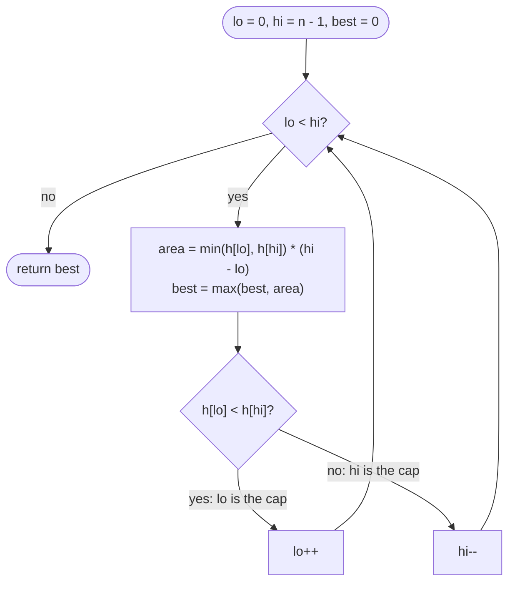

# LC 11 Container With Most Water

> [!abstract] In one sentence
> Area is `min(h[lo], h[hi]) × (hi − lo)`; from the widest pair, the shorter line is already the best it will ever be (any narrower container using it is capped by its height), so discard it and move inward until the pointers meet.

**Map:** [[NeetCode 150 MOC]] → [[DSA Dashboard]] · Pattern: [[Two Pointers]]

> [!question] Predict before you read
> Suppose `h[lo] < h[hi]`. Name every container that involves index `lo` and has not been evaluated yet, and bound its area by the current one.

## Problem

You get `n` non-negative integers `height[i]`, each a vertical line at `x = i`. Choose two lines so that, together with the x-axis, they form a container holding the most water: the area is `(j − i) × min(height[i], height[j])`. Return that maximum area. The container may not be tilted.

- `[1, 8, 6, 2, 5, 4, 8, 3, 7]` → `49` (lines at 1 and 8: `min(8, 7) × 7`)
- `[1, 1]` → `1`

Constraints that matter: `2 ≤ n ≤ 10⁵`, heights up to 10⁴ — so area fits `int` (10⁴ × 10⁵ = 10⁹) and O(n²) is too slow.

## Clarifying questions

1. Is the area limited by the shorter line? — Yes, water would spill over it.
2. Can heights be zero? — Yes; a zero line gives area 0 for any pair.
3. Return the area or the indices? — The area.
4. Can the answer overflow `int`? — No under the bounds; say you checked.

## Brute force

Every pair `(i, j)`: O(n²) areas. The waste: once you know `h[i]` is the shorter of the widest pair involving `i`, every narrower pair with `i` has strictly less width and no more height, so they are all dominated — the brute force evaluates them anyway.

## The key insight

Start from maximum width and trade width for height only when it can pay off. The pair `(lo, hi)` is the widest remaining; its area is limited by the shorter line. Moving the taller line can never increase the limiting height while losing width; moving the shorter line *might* find a taller one. Recognition cue: an objective of the form `min(a, b) × distance` or "widest span bounded by the weaker end" → opposite-end pointers, move the weaker end.

## Optimal approach

1. `lo = 0`, `hi = n − 1`, `best = 0`.
2. While `lo < hi`: `best = max(best, min(h[lo], h[hi]) × (hi − lo))`.
3. If `h[lo] < h[hi]` → `lo++`, else `hi--`.
4. Return `best`.



> [!example]- Excalidraw version — the same diagram as an editable canvas
> ![[LC 11 Container With Most Water — Optimal approach.excalidraw]]
> [[LC 11 Container With Most Water — Optimal approach.excalidraw|Open in Excalidraw]] — needs the Excalidraw plugin (see [[Plugins to Install]]).

## Walkthrough

`h = [1, 8, 6, 2, 5, 4, 8, 3, 7]`

| lo | hi | min × width | best | move |
|---|---|---|---|---|
| 0 | 8 | 1 × 8 = 8 | 8 | h[0] = 1 shorter → lo++ |
| 1 | 8 | 7 × 7 = 49 | 49 | h[8] = 7 shorter → hi-- |
| 1 | 7 | 3 × 6 = 18 | 49 | hi-- |
| 1 | 6 | 8 × 5 = 40 | 49 | equal → hi-- |
| 1 | 5 | 4 × 4 = 16 | 49 | hi-- |
| 1 | 4 | 5 × 3 = 15 | 49 | hi-- |
| 1 | 3 | 2 × 2 = 4 | 49 | hi-- |
| 1 | 2 | 6 × 1 = 6 | 49 | hi-- → meet |

> [!example] Best container at lo = 1, hi = 8
> ![[LC 11 Container With Most Water — Best container at lo = 1, hi = 8.excalidraw]]
> [[LC 11 Container With Most Water — Best container at lo = 1, hi = 8.excalidraw|Open in Excalidraw]] — min(8, 7) * 7 = 49; eight evaluations instead of 36 pairs

%% excalidraw-spec
{"kind": "array", "title": "Best container at lo = 1, hi = 8", "values": [1, 8, 6, 2, 5, 4, 8, 3, 7], "pointers": {"lo": 1, "hi": 8}, "highlight": [1, 8], "caption": "min(8, 7) * 7 = 49; eight evaluations instead of 36 pairs"}
%%

## Java solution

```java
import java.util.*;

class Solution {
    public int maxArea(int[] height) {
        int lo = 0, hi = height.length - 1, best = 0;
        while (lo < hi) {
            int h = Math.min(height[lo], height[hi]);
            best = Math.max(best, h * (hi - lo));                 // 10^4 * 10^5 fits int
            if (height[lo] < height[hi]) lo++;                    // the shorter line can never do better
            else hi--;                                            // ties: either side; hi-- is conventional
        }
        return best;
    }
}
```

**Time** O(n) · **Space** O(1)

## Why it works

Claim: when `h[lo] ≤ h[hi]`, no container `(lo, j)` with `lo < j < hi` beats `(lo, hi)`. Its width `j − lo` is smaller, and its height `min(h[lo], h[j]) ≤ h[lo] = min(h[lo], h[hi])`, so its area is at most the current one. Containers `(i, lo)` with `i < lo` were already discarded by the same argument earlier. Therefore index `lo` can be retired: every pair containing it has either been evaluated or is dominated. Each step retires one index, so after at most n − 1 steps every pair is either evaluated or dominated, and `best` is the maximum. The tie case is covered because the bound holds with `≤`.

## Edge cases

- `n = 2`: one evaluation.
- All equal heights: the first (widest) pair is optimal; later steps only shrink.
- Zeros at the ends (`[0, 5, 5, 0]`): area 0 first, then the zero sides are retired and `5 × 1` is found.
- Strictly increasing heights: `hi` stays, `lo` sweeps; the best is usually the first or second pair.
- Max area at adjacent lines (`[1, 100, 100, 1]`): reached when the pointers get there.

## Common mistakes

> [!warning] What goes wrong
> - Moving the **taller** line, or moving both — the retirement argument no longer holds and the optimum is skipped: on `[1, 2, 4, 3]` the correct answer is 4 (lines 1 and 3), while "move the taller" evaluates (0,3), (0,2), (0,1) and returns 3.
> - Using `<=` in the loop condition: at `lo == hi` width is 0, harmless here but wrong in spirit.
> - Confusing this with [[LC 42 Trapping Rain Water]]: that sums water above *every* bar; this picks one pair of walls.
> - Multiplying before taking the min, or using `long` unnecessarily and then forgetting to cast back.

## Variants & follow-ups

- Water trapped across the whole skyline → [[LC 42 Trapping Rain Water]] (two pointers with running maxima).
- Largest rectangle under a histogram → [[LC 84 Largest Rectangle in Histogram]] (monotonic stack — the area is bounded by *all* bars in between, not just the two ends).
- Return the indices of the best pair: store them when `best` improves.
- Weighted width (`cost[j] − cost[i]` instead of `j − i`): the argument still holds if the weights are monotone in index.

## Interview script

Restate: "two lines, area = min height × distance, maximise." Brute force: "all pairs, n²." Insight: "start widest; the shorter line is the cap and can only lose width if kept, so retire it." Approach: "two pointers from the ends, evaluate, move the shorter." Complexity: "O(n), O(1)." Proof in one sentence: "every pair containing the retired index is dominated by the pair just evaluated." Tests: `n = 2`, all equal, zeros at ends, best pair adjacent.

## Related

- Pattern: [[Two Pointers]] (opposite ends, greedy retirement)
- Prerequisite: [[LC 167 Two Sum II Input Array Is Sorted]] (the same walk with a sum rule)
- Continuations: [[LC 42 Trapping Rain Water]], [[LC 84 Largest Rectangle in Histogram]]
- Java: [[DSA Patterns in Java]], [[Java Pitfalls in Interviews]] (overflow bounds)

## Attempt log

| Date | Result | Minutes | What I got wrong |
|---|---|---|---|
| | | | |

### Mastery checklist
- [ ] Solved without hints in under 25 minutes
- [ ] Stated complexity before coding
- [ ] Handled every edge case above
- [ ] Code compiled first time
- [ ] Can do the follow-up variant

## Open questions
- [ ] Find a concrete input where moving the taller line first gives a wrong answer, and trace both versions on it.
