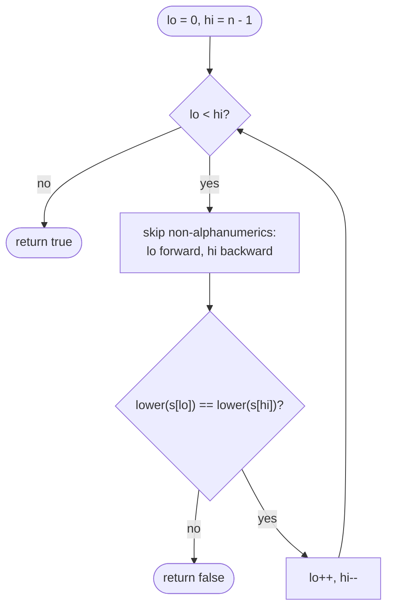

# LC 125 Valid Palindrome

> [!abstract] In one sentence
> Put `lo` at the front and `hi` at the back, move each inward past characters that are not letters or digits, compare the two lowercased characters, and step both inward; the first mismatch is a `false`, meeting in the middle is a `true`.

**Map:** [[NeetCode 150 MOC]] → [[DSA Dashboard]] · Pattern: [[Two Pointers]]

> [!question] Predict before you read
> The inner "skip junk" loops need a bound. Is it `lo < hi` or `lo < n`, and what breaks if you pick the wrong one on `",,,"`?

## Problem

A phrase is a palindrome if, after converting letters to lowercase and removing every character that is not a letter or digit, it reads the same forwards and backwards. Given a string `s`, return whether it is a palindrome.

- `"A man, a plan, a canal: Panama"` → `true` (`amanaplanacanalpanama`)
- `"race a car"` → `false` (`raceacar`)
- `" "` → `true` (nothing left; the empty string is a palindrome)

Constraints that matter: length up to 2 × 10⁵, printable ASCII only — so `Character.isLetterOrDigit` and `toLowerCase` are safe and the O(1)-space requirement is realistic.

## Clarifying questions

1. Are digits alphanumeric here (does `"0P"` count)? — Yes, digits are kept; `"0P"` → `false`.
2. Case-insensitive? — Yes, `A` equals `a`.
3. Is an empty or all-punctuation string a palindrome? — Yes.
4. Can I allocate a cleaned copy? — Allowed, but the point is to avoid it.

## Brute force

Build a filtered lowercase string with a `StringBuilder`, then compare it with its reverse (or compare `i` and `n − 1 − i`). O(n) time, O(n) space. The waste is only memory — a full copy to answer a yes/no — but interviewers ask for the in-place version precisely to see the pointer bookkeeping.

## The key insight

A palindrome check is a pairwise comparison of mirror positions; mirror positions can be found on the fly with two pointers that skip ignored characters as they go. Recognition cue: "reads the same backwards", "mirror", "symmetric" → opposite-end pointers, with any filtering done inside the loop rather than up front.

## Optimal approach

1. `lo = 0`, `hi = n − 1`.
2. While `lo < hi`: advance `lo` while `s[lo]` is not alphanumeric and `lo < hi`; retreat `hi` similarly.
3. Compare `toLowerCase(s[lo])` with `toLowerCase(s[hi])`; mismatch → `false`.
4. `lo++`, `hi--`; when the loop ends → `true`.



> [!example]- Excalidraw version — the same diagram as an editable canvas
> ![[LC 125 Valid Palindrome — Optimal approach.excalidraw]]
> [[LC 125 Valid Palindrome — Optimal approach.excalidraw|Open in Excalidraw]] — needs the Excalidraw plugin (see [[Plugins to Install]]).

## Walkthrough

`s = "A man, a plan"` is not a palindrome; `"Ab, ba"` is. Trace the second (indices 0–5: `A b , space b a`):

| lo | hi | after skipping | compare | result |
|---|---|---|---|---|
| 0 | 5 | 0 (`A`), 5 (`a`) | a = a | continue |
| 1 | 4 | 1 (`b`), 4 (`b`) | b = b | continue |
| 2 | 3 | lo skips `,` to 3; hi skips space to 2 — now lo ≥ hi | | loop ends → true |

> [!example] Pointers skip the comma and the space
> ![[LC 125 Valid Palindrome — Pointers skip the comma and the space.excalidraw]]
> [[LC 125 Valid Palindrome — Pointers skip the comma and the space.excalidraw|Open in Excalidraw]] — after the second comparison both pointers move into the junk and cross; nothing left to compare

%% excalidraw-spec
{"kind": "array", "title": "Pointers skip the comma and the space", "values": ["A", "b", ",", " ", "b", "a"], "pointers": {"lo": 1, "hi": 4}, "highlight": [2, 3], "caption": "after the second comparison both pointers move into the junk and cross; nothing left to compare"}
%%

## Java solution

```java
import java.util.*;

class Solution {
    public boolean isPalindrome(String s) {
        int lo = 0, hi = s.length() - 1;
        while (lo < hi) {
            while (lo < hi && !Character.isLetterOrDigit(s.charAt(lo))) lo++;   // bound by hi, not n
            while (lo < hi && !Character.isLetterOrDigit(s.charAt(hi))) hi--;
            if (Character.toLowerCase(s.charAt(lo)) != Character.toLowerCase(s.charAt(hi))) return false;
            lo++;
            hi--;
        }
        return true;
    }
}
```

**Time** O(n) · **Space** O(1)

## Why it works

Invariant: all alphanumeric characters outside `[lo, hi]` have been matched with their mirror. The skip loops move each pointer to the next character that participates, so the comparison always concerns the next unmatched pair from each end. If they are equal the invariant extends inward; if not, the cleaned string differs at a mirrored position, so it is not a palindrome. When `lo ≥ hi` every participating character has been matched (or is the single middle character), hence a palindrome. Each pointer moves monotonically, so the total work is at most n steps.

## Edge cases

- Empty string or `" "`: `lo = 0, hi = -1` (or 0), loop skipped → `true`.
- Only punctuation (`",,,"`): skip loops stop at `lo == hi` because of the bound; no out-of-range access → `true`.
- Single character → `true`.
- Mixed digits and letters (`"0P"`): `'0' != 'p'` → `false`; the classic trick case for people who lowercase via `| 32`.
- Odd length: the middle character is never compared, which is correct.

## Common mistakes

> [!warning] What goes wrong
> - Skip loops bounded by `lo < n` / `hi >= 0` instead of `lo < hi`: on all-punctuation input `lo` overshoots and `charAt` throws, or the pointers cross and compare the wrong pair.
> - Lowercasing with `c | 32` or `c + 32` — turns `'0'` into `'P'`'s lowercase-ish neighbour and breaks on digits; use `Character.toLowerCase`.
> - Comparing with `==` on `String` objects when a cleaned copy is built (`cleaned == reversed`); use `equals`.
> - Treating `_` or spaces as alphanumeric by hand-rolling the test; `isLetterOrDigit` is the correct predicate here.

## Variants & follow-ups

- Valid Palindrome II (LC 680): allowed to delete at most one character — on the first mismatch, check `isPal(lo + 1, hi)` or `isPal(lo, hi − 1)`.
- Longest palindromic substring → [[LC 5 Longest Palindromic Substring]] (expand around centre, the pointers move *outward*).
- Partition into palindromes → [[LC 131 Palindrome Partitioning]] (backtracking with this check as the predicate).
- Palindrome linked list (LC 234): find the middle with fast/slow, reverse the second half, compare with two pointers — see [[Linked Lists]].
- Case- and accent-insensitive Unicode: normalise with `java.text.Normalizer` first, and iterate code points.

## Interview script

Restate: "ignore non-alphanumerics and case; empty counts as palindrome." Brute force: "filter into a new string, compare with reverse, O(n) space." Insight: "compare mirror positions directly, skipping junk inside the loop." Approach: "two pointers from both ends, inner skip loops bounded by `lo < hi`, compare lowercase, step inward." Complexity: "O(n) time, O(1) space." Tests: `" "`, `",,,"`, `"0P"`, odd length, mixed case. Follow-up to offer: the delete-one-character variant.

## Related

- Pattern: [[Two Pointers]] (opposite ends); string APIs: [[Strings]]
- Next: [[LC 167 Two Sum II Input Array Is Sorted]] (same loop shape, different move rule)
- Palindrome family: [[LC 5 Longest Palindromic Substring]], [[LC 647 Palindromic Substrings]], [[LC 131 Palindrome Partitioning]]
- Java: [[Java Collections Cheat Sheet]] (`Character.isLetterOrDigit`, `toLowerCase`, `charAt`)

## Attempt log

| Date | Result | Minutes | What I got wrong |
|---|---|---|---|
| | | | |

### Mastery checklist
- [ ] Solved without hints in under 25 minutes
- [ ] Stated complexity before coding
- [ ] Handled every edge case above
- [ ] Code compiled first time
- [ ] Can do the follow-up variant

## Open questions
- [ ] Write Valid Palindrome II from memory and argue why trying both deletions at the *first* mismatch is sufficient.
