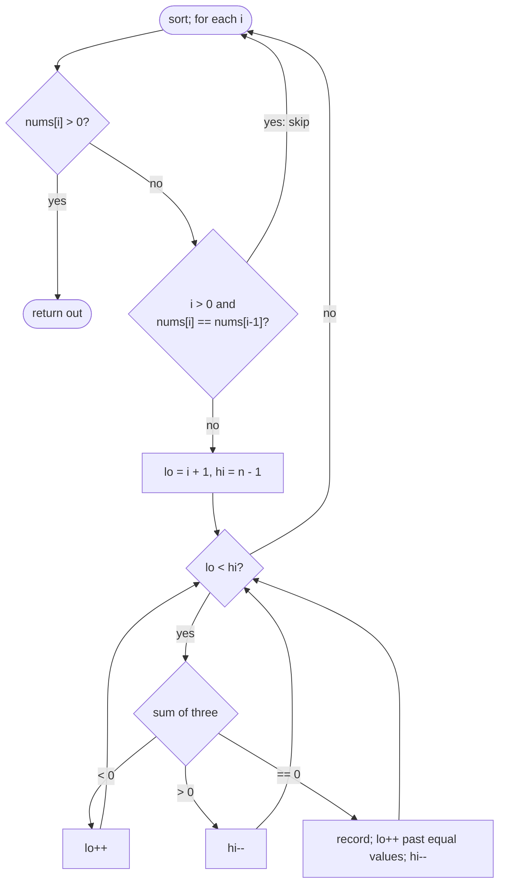

# LC 15 3Sum

> [!abstract] In one sentence
> Sort, then for each index `i` solve "two numbers in `nums[i+1..]` summing to `−nums[i]`" with opposite-end pointers, skipping repeated values of `nums[i]` and of `nums[lo]` after each hit so every triple is emitted exactly once.

**Map:** [[NeetCode 150 MOC]] → [[DSA Dashboard]] · Pattern: [[Two Pointers]]

> [!question] Predict before you read
> You skip `i` when `nums[i] == nums[i − 1]`. Why compare with the *previous* index and not the next one — which valid triple would the other choice lose on `[-1, -1, 2]`?

## Problem

Given an integer array `nums`, return all triplets `[a, b, c]` of elements at distinct indices with `a + b + c = 0`. The result must not contain duplicate triplets (as value multisets); the order of triplets and of values within one is free.

- `[-1, 0, 1, 2, -1, -4]` → `[[-1, -1, 2], [-1, 0, 1]]`
- `[0, 1, 1]` → `[]`
- `[0, 0, 0]` → `[[0, 0, 0]]`

Constraints that matter: `3 ≤ n ≤ 3000`, values in ±10⁵ (sums fit `int`), duplicates present — so O(n²) is the target and dedupe is mandatory.

## Clarifying questions

1. Distinct *indices* or distinct *values*? — Distinct indices; `[0, 0, 0]` is valid when three zeros exist.
2. Duplicate triplets: by value, regardless of which indices produced them? — Yes.
3. May I sort the input (mutate)? — Yes, the output is value-based.
4. Expected size of the output — could it be huge? — Up to O(n²) triplets; that is inherent.

## Brute force

Three nested loops and a `HashSet<List<Integer>>` of sorted triples to dedupe: O(n³) time, O(n²) space for the set. A middle option: fix `i`, then [[LC 1 Two Sum]] with a map on the rest — O(n²) time but still needs the set to dedupe, and the set costs hashing per candidate. The waste: dedupe by set does work per *candidate* instead of per *position*.

## The key insight

Sorting does two jobs at once: it enables the O(n) opposite-end walk for the inner two-sum, and it places equal values next to each other so duplicates can be skipped by index comparison without any set. Recognition cue: "all unique k-tuples summing to target" → sort, fix k − 2 elements, two-pointer the rest, skip equal neighbours at every level.

## Optimal approach

1. Sort `nums`.
2. For `i` from 0 while `i + 2 < n`: if `nums[i] > 0`, break (every later value is positive). If `i > 0 && nums[i] == nums[i−1]`, continue.
3. `lo = i + 1`, `hi = n − 1`. While `lo < hi`: `sum = nums[i] + nums[lo] + nums[hi]`; `< 0` → `lo++`; `> 0` → `hi--`; `== 0` → record, then `lo++` while `nums[lo] == nums[lo−1]`, and `hi--`.
4. Return the list.



> [!example]- Excalidraw version — the same diagram as an editable canvas
> ![[LC 15 3Sum — Optimal approach.excalidraw]]
> [[LC 15 3Sum — Optimal approach.excalidraw|Open in Excalidraw]] — needs the Excalidraw plugin (see [[Plugins to Install]]).

## Walkthrough

`[-1, 0, 1, 2, -1, -4]` sorted → `[-4, -1, -1, 0, 1, 2]`

| i | nums[i] | lo, hi | sum | action |
|---|---|---|---|---|
| 0 | −4 | 1, 5 | −4−1+2 = −3 | lo++ |
| 0 | −4 | 2, 5 | −3 | lo++ |
| 0 | −4 | 3, 5 | −2 | lo++ |
| 0 | −4 | 4, 5 | −1 | lo++ → lo = hi, exit |
| 1 | −1 | 2, 5 | −1−1+2 = 0 | record `[-1,-1,2]`; lo→3, hi→4 |
| 1 | −1 | 3, 4 | −1+0+1 = 0 | record `[-1,0,1]`; lo→4, hi→3, exit |
| 2 | −1 | | | skip: equals nums[1] |
| 3 | 0 | 4, 5 | 3 | hi-- → exit |
| 4 | 1 | | | `nums[i] > 0` → break |

> [!example] i = 1 fixed; the inner walk finds two triples
> ![[LC 15 3Sum — i = 1 fixed; the inner walk finds two triples.excalidraw]]
> [[LC 15 3Sum — i = 1 fixed; the inner walk finds two triples.excalidraw|Open in Excalidraw]] — the duplicate -1 at index 2 is used here as nums[lo]; at i = 2 it is skipped as a repeated first element

%% excalidraw-spec
{"kind": "array", "title": "i = 1 fixed; the inner walk finds two triples", "values": [-4, -1, -1, 0, 1, 2], "pointers": {"i": 1, "lo": 2, "hi": 5}, "highlight": [1, 2, 5], "caption": "the duplicate -1 at index 2 is used here as nums[lo]; at i = 2 it is skipped as a repeated first element"}
%%

## Java solution

```java
import java.util.*;

class Solution {
    public List<List<Integer>> threeSum(int[] nums) {
        Arrays.sort(nums);
        List<List<Integer>> out = new ArrayList<>();
        int n = nums.length;
        for (int i = 0; i + 2 < n; i++) {
            if (nums[i] > 0) break;                                   // sorted: no zero-sum triple remains
            if (i > 0 && nums[i] == nums[i - 1]) continue;            // dedupe the first element
            int lo = i + 1, hi = n - 1;
            while (lo < hi) {
                int sum = nums[i] + nums[lo] + nums[hi];
                if (sum < 0) lo++;
                else if (sum > 0) hi--;
                else {
                    out.add(List.of(nums[i], nums[lo], nums[hi]));
                    lo++;
                    while (lo < hi && nums[lo] == nums[lo - 1]) lo++; // dedupe the second element
                    hi--;                                             // third is then forced, no extra skip needed
                }
            }
        }
        return out;
    }
}
```

**Time** O(n²) after an O(n log n) sort · **Space** O(1) extra beyond the output (sort may use O(log n))

## Why it works

For a fixed `i`, the inner loop is exactly [[LC 167 Two Sum II Input Array Is Sorted]] on the sorted suffix with target `−nums[i]`, and it finds *every* pair because after a hit both pointers move and the row/column argument continues. Dedupe: triples are generated in non-decreasing order `(nums[i] ≤ nums[lo] ≤ nums[hi])`, so two equal triples would need equal `nums[i]` and equal `nums[lo]`; skipping repeated `nums[i]` values (keeping the first) and repeated `nums[lo]` values after a hit removes exactly those, and a given `(nums[i], nums[lo])` determines `nums[hi]`. Restricting `lo > i` guarantees distinct indices.

## Edge cases

- `[0, 0, 0]` and `[0, 0, 0, 0]`: one triple; the `lo` skip prevents a second.
- No solution (`[0, 1, 1]`, `[1, 2, 3]`): the `nums[i] > 0` break exits at `i = 0` for all-positive input.
- All negative: inner loop always has `sum < 0`, lo runs to hi, nothing recorded.
- `n = 3`: a single check.
- Large magnitudes: `3 × 10⁵` fits `int` easily.

## Common mistakes

> [!warning] What goes wrong
> - Skipping `i` against `nums[i + 1]` instead of `nums[i − 1]` — throws away the first copy and loses `[-1, -1, 2]`.
> - Skipping `lo` duplicates *before* checking the sum — the same loss on the second element.
> - Forgetting to move both pointers after a hit, or moving only `lo`: the loop still works but does redundant comparisons; moving neither spins forever.
> - Using a `Set<List<Integer>>` to dedupe on top of the sorted walk — correct but signals you did not understand why sorting suffices.
> - `List.of(a, b, c)` then trying to mutate it later (immutable).

## Variants & follow-ups

- 3Sum Closest (LC 16): same walk, track the minimum `|sum − target|`, no dedupe needed.
- 3Sum Smaller (LC 259): on `sum < target`, count `hi − lo` pairs at once and `lo++`.
- 4Sum (LC 18): one more outer loop with the same dedupe rule; general k-sum is recursive with two-pointer at the base.
- Unsorted output order required to match input order: not required here; if it were, map values back to indices.
- Hash-map inner loop instead of two pointers: O(n²) too, but O(n) extra space and awkward dedupe.

## Interview script

Restate: "all unique zero-sum triples of distinct indices; I may sort." Brute force: "n³ with a set, or n² with a map per `i` plus a set." Insight: "sort — it gives me the two-pointer inner loop *and* adjacency of duplicates, so no set." Approach: "fix `i`, skip repeats of `nums[i]`, two pointers on the suffix for `−nums[i]`, after a hit skip repeats of `nums[lo]`, early break when `nums[i] > 0`." Complexity: "O(n²) time, O(1) extra." Tests: `[0,0,0]`, `[-1,-1,2]` style duplicates, all positive, `n = 3`.

## Related

- Pattern: [[Two Pointers]]; cost of the sort: [[Sorting]]
- Prerequisites: [[LC 1 Two Sum]], [[LC 167 Two Sum II Input Array Is Sorted]]
- Siblings: [[LC 11 Container With Most Water]], [[LC 42 Trapping Rain Water]]
- Java: [[Java Collections Cheat Sheet]] (`List.of`, `Arrays.sort`), [[Java Pitfalls in Interviews]] (immutable `List.of`)

## Attempt log

| Date | Result | Minutes | What I got wrong |
|---|---|---|---|
| | | | |

### Mastery checklist
- [ ] Solved without hints in under 25 minutes
- [ ] Stated complexity before coding
- [ ] Handled every edge case above
- [ ] Code compiled first time
- [ ] Can do the follow-up variant

## Open questions
- [ ] Write 4Sum as a recursive k-sum in under 30 lines, with the dedupe rule stated once and applied at every level.
