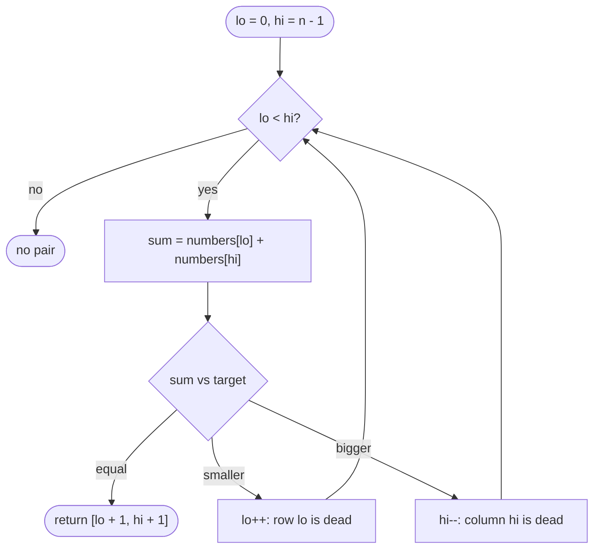

# LC 167 Two Sum II Input Array Is Sorted

> [!abstract] In one sentence
> On sorted input the sum of the extreme pair tells you which end is useless: too small means the smallest element can never work with anything left, too large means the largest cannot — so move that pointer and repeat, O(n) with no map.

**Map:** [[NeetCode 150 MOC]] → [[DSA Dashboard]] · Pattern: [[Two Pointers]]

> [!question] Predict before you read
> If `numbers[lo] + numbers[hi] < target`, exactly which pairs are you giving up on by doing `lo++`, and why is none of them the answer?

## Problem

Given a 1-indexed array `numbers` sorted in non-decreasing order and a `target`, return the 1-based indices `[i, j]` with `i < j` of the two elements whose sum is `target`. Exactly one solution exists, the same element may not be used twice, and you must use only constant extra space.

- `numbers = [2, 7, 11, 15]`, `target = 9` → `[1, 2]`
- `numbers = [2, 3, 4]`, `target = 6` → `[1, 3]`
- `numbers = [-1, 0]`, `target = -1` → `[1, 2]`

Constraints that matter: length up to 3 × 10⁴, values and target in ±1000 (no overflow), sorted — which is the licence for two pointers and the reason the hash map of [[LC 1 Two Sum]] would be wasteful.

## Clarifying questions

1. 1-based or 0-based output? — 1-based here (unusual; say it).
2. Exactly one answer guaranteed? — Yes; still decide a fallback return.
3. Can the array contain duplicates? — Yes; irrelevant for finding one pair.
4. Is the O(1) space requirement strict? — Yes, that is what rules out the map.

## Brute force

All pairs, O(n²). Better brute force that uses sortedness: for each `i`, binary search `target − numbers[i]` in `(i, n)` — O(n log n), O(1) space. The waste in both: the search for a partner restarts from scratch for every `i` although consecutive `i` values need consecutive-ish partners.

## The key insight

Think of the n × n table of pair sums. Sorted rows increase left to right, sorted columns increase top to bottom. Standing at the top-right corner (`lo = 0, hi = n − 1`), a too-small sum rules out the entire row (nothing in it is bigger), a too-big sum rules out the entire column. Recognition cue: "sorted" + "pair with a sum / difference / product constraint" + "constant space" → opposite-end pointers.

## Optimal approach

1. `lo = 0`, `hi = n − 1`.
2. While `lo < hi`: `sum = numbers[lo] + numbers[hi]`.
3. `sum == target` → return `[lo + 1, hi + 1]`; `sum < target` → `lo++`; `sum > target` → `hi--`.



> [!example]- Excalidraw version — the same diagram as an editable canvas
> ![[LC 167 Two Sum II Input Array Is Sorted — Optimal approach.excalidraw]]
> [[LC 167 Two Sum II Input Array Is Sorted — Optimal approach.excalidraw|Open in Excalidraw]] — needs the Excalidraw plugin (see [[Plugins to Install]]).

## Walkthrough

`numbers = [1, 3, 4, 6, 8, 11]`, `target = 10`

| lo | hi | sum | move |
|---|---|---|---|
| 0 (1) | 5 (11) | 12 | too big, hi-- |
| 0 (1) | 4 (8) | 9 | too small, lo++ |
| 1 (3) | 4 (8) | 11 | hi-- |
| 1 (3) | 3 (6) | 9 | lo++ |
| 2 (4) | 3 (6) | 10 | found → `[3, 4]` |

> [!example] Pair-sum table; each step kills a row or column
> ![[LC 167 Two Sum II Input Array Is Sorted — Pair-sum table; each step kills a row or column.excalidraw]]
> [[LC 167 Two Sum II Input Array Is Sorted — Pair-sum table; each step kills a row or column.excalidraw|Open in Excalidraw]] — the walk starts top-right; five steps instead of fifteen pairs

%% excalidraw-spec
{"kind": "grid", "title": "Pair-sum table; each step kills a row or column", "col_labels": ["", "1", "3", "4", "6", "8", "11"], "row_labels": ["1", "3", "4", "6", "8", "11"], "rows": [ ["", "4", "5", "7", "9", "12"], ["", "", "7", "9", "11", "14"], ["", "", "", "10", "12", "15"], ["", "", "", "", "14", "19"], ["", "", "", "", "", "19"], ["", "", "", "", "", ""] ], "highlight": [ [0, 5], [0, 4], [1, 4], [1, 3], [2, 3] ], "arrows": [ [ [0, 5], [0, 4] ], [ [0, 4], [1, 4] ], [ [1, 4], [1, 3] ], [ [1, 3], [2, 3] ] ], "caption": "the walk starts top-right; five steps instead of fifteen pairs"}
%%

## Java solution

```java
import java.util.*;

class Solution {
    public int[] twoSum(int[] numbers, int target) {
        int lo = 0, hi = numbers.length - 1;
        while (lo < hi) {
            int sum = numbers[lo] + numbers[hi];
            if (sum == target) return new int[]{lo + 1, hi + 1};   // 1-based as the problem asks
            if (sum < target) lo++;                                // every pair (lo, j<hi) is even smaller
            else hi--;                                             // every pair (i>lo, hi) is even bigger
        }
        return new int[]{-1, -1};                                  // unreachable under the guarantee
    }
}
```

**Time** O(n) · **Space** O(1)

The binary-search alternative is what you write if the interviewer wants log-factor reasoning:

```java
// snippet
for (int i = 0; i < n - 1; i++) {
    int idx = Arrays.binarySearch(numbers, i + 1, n, target - numbers[i]);
    if (idx >= 0) return new int[]{i + 1, idx + 1};          // O(n log n), O(1) space
}
```

## Why it works

Invariant: the answer pair `(a, b)` with `a < b` satisfies `lo ≤ a` and `b ≤ hi`. Initially true. Suppose `sum < target`. For every `j ≤ hi`, `numbers[lo] + numbers[j] ≤ numbers[lo] + numbers[hi] < target`, so `lo` cannot be `a` (its partner would have to be beyond `hi`, which is excluded by the invariant). Hence `a > lo` and `lo++` preserves the invariant. The symmetric argument handles `sum > target`. The pointers move strictly inward, so the loop makes at most n − 1 iterations and must reach `sum == target` before `lo == hi`.

## Edge cases

- Two elements only: one comparison.
- Negative numbers and negative target (`[-1, 0]`, −1): the ordering argument needs only sortedness, not sign.
- Duplicates (`[1, 1, 2]`, 2): returns `[1, 2]`; the two equal values are distinct positions.
- Answer at the extremes (`lo = 0, hi = n − 1`): found on the first iteration.

## Common mistakes

> [!warning] What goes wrong
> - Returning 0-based indices — the only NeetCode problem in this group with 1-based output.
> - Using `lo <= hi`: at `lo == hi` you would pair an element with itself.
> - Moving the wrong pointer (`hi--` on a small sum) — the loop still terminates but can skip the answer.
> - Reaching for a `HashMap` out of habit: correct, but it violates the space constraint and ignores the hint in the title.

## Variants & follow-ups

- Unsorted input → [[LC 1 Two Sum]] (hash map, indices preserved).
- Triplets summing to zero → [[LC 15 3Sum]] (this loop is its inner part, plus dedupe).
- Count pairs with sum ≤ target: on a small sum, all `hi − lo` pairs `(lo, lo+1..hi)` are valid at once — add `hi − lo` and `lo++`.
- Closest pair sum: track `|sum − target|` and keep moving until the pointers meet.
- Pair with a given *difference* in a sorted array: same-direction pointers instead (both move right).

## Interview script

Restate: "sorted, exactly one pair, 1-based indices, constant space." Brute force: "all pairs n²; or binary search per element, n log n." Insight: "the extreme pair's sum tells me which end is dead — too small kills the whole row of `lo`, too big the whole column of `hi`." Approach: "two pointers, move the one the comparison implicates, until they meet." Complexity: "O(n), O(1)." Tests: two elements, negatives, duplicates, answer at the ends. Mention that the same loop with dedupe is 3Sum's inner loop.

## Related

- Pattern: [[Two Pointers]]; the other way to exploit sortedness: [[Binary Search]]
- Prerequisite: [[LC 1 Two Sum]]; predecessor in this folder: [[LC 125 Valid Palindrome]]
- Builds on it: [[LC 15 3Sum]], [[LC 11 Container With Most Water]]
- Java: [[DSA Patterns in Java]] (opposite-end template), [[Java Collections Cheat Sheet]] (`Arrays.binarySearch` with range)

## Attempt log

| Date | Result | Minutes | What I got wrong |
|---|---|---|---|
| | | | |

### Mastery checklist
- [ ] Solved without hints in under 25 minutes
- [ ] Stated complexity before coding
- [ ] Handled every edge case above
- [ ] Code compiled first time
- [ ] Can do the follow-up variant

## Open questions
- [ ] Draw the pair-sum grid for a 5-element array and shade the cells each step eliminates; count how many cells are never examined.
