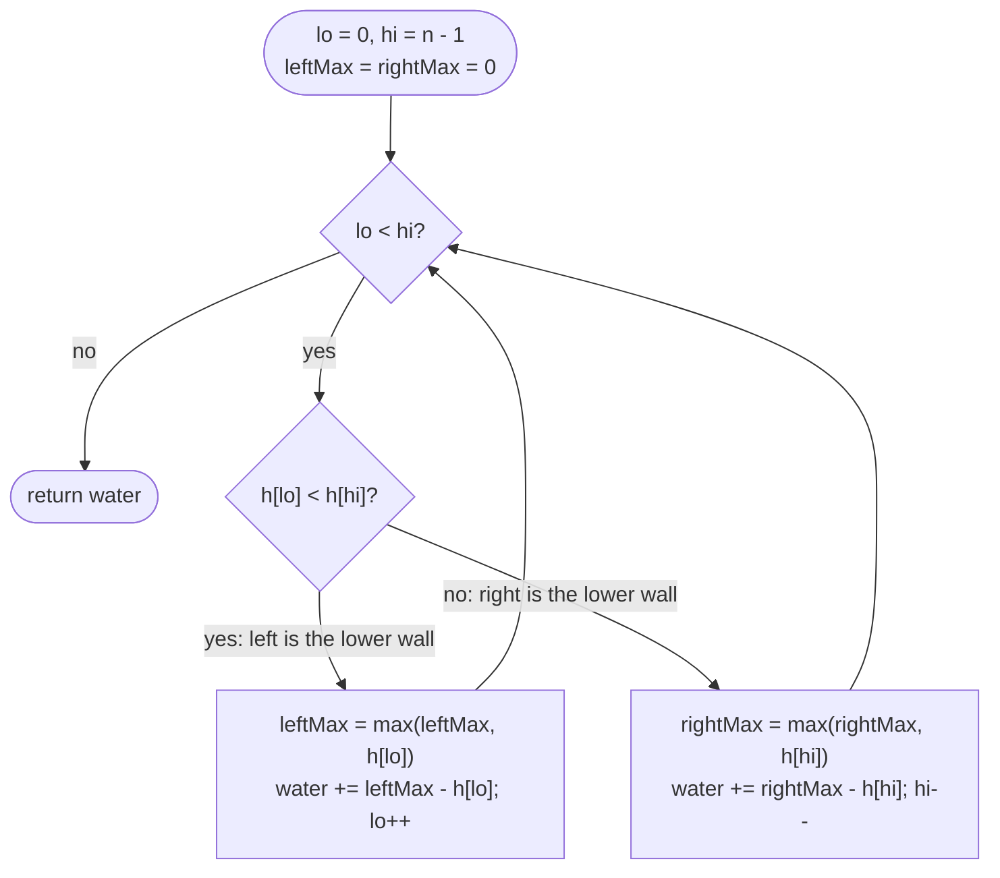

# LC 42 Trapping Rain Water

> [!abstract] In one sentence
> The water column over bar `i` is `min(leftMax(i), rightMax(i)) − h[i]`; with pointers at both ends and running maxima, the side whose max is smaller can be charged immediately because the other side's max is already at least that high — so you never need the full prefix/suffix arrays.

**Map:** [[NeetCode 150 MOC]] → [[DSA Dashboard]] · Pattern: [[Two Pointers]]

> [!question] Predict before you read
> At some moment `leftMax = 5` and `rightMax = 9`, `lo` sits on a bar of height 2. Why is it safe to add `5 − 2 = 3` now, before you have seen the bars between `lo` and `hi`?

## Problem

Given `n` non-negative integers representing an elevation map where each bar has width 1, compute how much water it can trap after raining.

- `[0, 1, 0, 2, 1, 0, 1, 3, 2, 1, 2, 1]` → `6`
- `[4, 2, 0, 3, 2, 5]` → `9`

Constraints that matter: `n` up to 2 × 10⁴, heights up to 10⁵ — total water up to ~2 × 10⁹, which fits `int` but barely; say so, and reach for `long` if the bounds grow. Water needs a wall on *both* sides, so the ends never hold water.

## Clarifying questions

1. Do the end bars ever hold water? — No, there is nothing beyond them.
2. Can the answer overflow `int`? — Not under these bounds; `long` if the bounds grow.
3. Empty or single-bar input? — Return 0.
4. Do I need to say where the water is, or only how much? — Only the total.

## Brute force

For each `i`, scan left for the max and right for the max, add `min − h[i]` if positive. O(n²), O(1). The waste: `leftMax` of `i + 1` is `max(leftMax(i), h[i])` — one operation — yet the brute force recomputes it from the start.

## The key insight

Two levels of insight. First, the per-bar formula `min(leftMax, rightMax) − h[i]` turns the problem into prefix-max and suffix-max arrays (O(n) time, O(n) space — the [[LC 238 Product of Array Except Self]] shape). Second, you do not need both arrays at once: whichever side has the smaller running max is *bounded* by that max regardless of what lies between the pointers, so that side's bar can be charged and retired. Recognition cue: "bounded by the lower of two walls" → prefix/suffix maxima, then collapse to two pointers; "fill between bars" → monotonic stack.

## Optimal approach

1. `lo = 0`, `hi = n − 1`, `leftMax = 0`, `rightMax = 0`, `water = 0`.
2. While `lo < hi`: if `h[lo] < h[hi]`: `leftMax = max(leftMax, h[lo])`, `water += leftMax − h[lo]`, `lo++`.
3. Else: `rightMax = max(rightMax, h[hi])`, `water += rightMax − h[hi]`, `hi--`.
4. Return `water`.



> [!example]- Excalidraw version — the same diagram as an editable canvas
> ![[LC 42 Trapping Rain Water — Optimal approach.excalidraw]]
> [[LC 42 Trapping Rain Water — Optimal approach.excalidraw|Open in Excalidraw]] — needs the Excalidraw plugin (see [[Plugins to Install]]).

## Walkthrough

`h = [4, 2, 0, 3, 2, 5]`

| lo | hi | h[lo] vs h[hi] | side | max after | add | water |
|---|---|---|---|---|---|---|
| 0 | 5 | 4 < 5 | left | leftMax 4 | 0 | 0 |
| 1 | 5 | 2 < 5 | left | 4 | 2 | 2 |
| 2 | 5 | 0 < 5 | left | 4 | 4 | 6 |
| 3 | 5 | 3 < 5 | left | 4 | 1 | 7 |
| 4 | 5 | 2 < 5 | left | 4 | 2 | 9 |
| 5 | 5 | | | | | loop ends → 9 |

> [!example] Water (W) above each bar; the right wall 5 is never lowered
> ![[LC 42 Trapping Rain Water — Water (W) above each bar; the right wall 5 is never lowered.excalidraw]]
> [[LC 42 Trapping Rain Water — Water (W) above each bar; the right wall 5 is never lowered.excalidraw|Open in Excalidraw]] — nine W cells = 9 units; every column's water is min(leftMax, rightMax) - height

%% excalidraw-spec
{"kind": "grid", "title": "Water (W) above each bar; the right wall 5 is never lowered", "col_labels": ["", "0", "1", "2", "3", "4", "5"], "row_labels": ["5", "4", "3", "2", "1"], "rows": [ ["", "", "", "", "", "#"], ["#", "W", "W", "W", "W", "#"], ["#", "W", "W", "#", "W", "#"], ["#", "#", "W", "#", "#", "#"], ["#", "#", "W", "#", "#", "#"] ], "highlight": [ [1, 1], [1, 2], [1, 3], [1, 4], [2, 1], [2, 2], [2, 4], [3, 2], [4, 2] ], "caption": "nine W cells = 9 units; every column's water is min(leftMax, rightMax) - height"}
%%

## Java solution

```java
import java.util.*;

class Solution {
    public int trap(int[] height) {
        int lo = 0, hi = height.length - 1;
        int leftMax = 0, rightMax = 0, water = 0;
        while (lo < hi) {
            if (height[lo] < height[hi]) {
                leftMax = Math.max(leftMax, height[lo]);
                water += leftMax - height[lo];        // rightMax >= height[hi] > height[lo], so leftMax is the cap
                lo++;
            } else {
                rightMax = Math.max(rightMax, height[hi]);
                water += rightMax - height[hi];
                hi--;
            }
        }
        return water;
    }
}
```

**Time** O(n) · **Space** O(1)

The monotonic-stack alternative fills water horizontally: keep indices of a decreasing run; when a taller bar arrives, pop the valley and add a horizontal strip bounded by the new bar and the new stack top:

```java
// snippet
Deque<Integer> st = new ArrayDeque<>();                 // indices with non-increasing heights
for (int i = 0; i < h.length; i++) {
    while (!st.isEmpty() && h[i] > h[st.peek()]) {
        int bottom = st.pop();
        if (st.isEmpty()) break;                        // no left wall
        int width = i - st.peek() - 1;
        int depth = Math.min(h[i], h[st.peek()]) - h[bottom];
        water += width * depth;                         // one horizontal layer
    }
    st.push(i);
}                                                       // O(n) time, O(n) space; same shape as LC 84
```

## Why it works

Let `L(i)` = max of `h[0..i]` and `R(i)` = max of `h[i..n−1]`. Water over `i` is `min(L(i), R(i)) − h[i]`: it rises until it spills over the lower of the two highest walls. After the update in the left branch, `leftMax = L(lo)` (every bar left of `lo` has passed through it). The claim that makes the charge exact is **`R(lo) ≥ L(lo)` whenever the left branch is taken**, so that `min(L(lo), R(lo)) = leftMax`. Two facts give it: (a) `R(lo) ≥ h[hi] > h[lo]`, by the branch condition; (b) the bar `lo'` that set the current `leftMax` was itself processed in a left branch against some `hi' ≥ hi` with `h[hi'] > h[lo'] = leftMax`, and `h[hi']` lies inside `R(lo)`'s range, so `R(lo) > leftMax`. Together `R(lo) ≥ max(leftMax, h[lo]) = L(lo)`. The right branch is the mirror image. Each bar is charged exactly once, on the step that retires it, so the sum is the total water.

## Edge cases

- Fewer than 3 bars: no bar has walls on both sides; the loop adds 0 (each bar's running max equals itself).
- Monotonic increasing or decreasing: every charge is `max − h = 0`.
- Flat (`[3, 3, 3]`): 0.
- Zeros inside (`[2, 0, 2]`): 2 — the zero bar is charged `2 − 0`.
- Tallest bar at an end: the other pointer sweeps everything, which is fine.

## Common mistakes

> [!warning] What goes wrong
> - Charging `min(leftMax, rightMax) − h[i]` with *both* maxima from the pointer side only (i.e. before the maxima are correct) — the proof needs the branch condition, not a global min.
> - Updating the running max *after* charging: `leftMax` must include `h[lo]` first, else a new tallest bar gets negative water.
> - Confusing with [[LC 11 Container With Most Water]]: that is one pair of walls; this sums every column.
> - In the stack version, forgetting the `isEmpty` check after the pop (no left wall) or computing width as `i − bottom` instead of `i − st.peek() − 1`.
> - `int` overflow when heights and n are both large: say `long` for safety.

## Variants & follow-ups

- Trapping Rain Water II (LC 407, 2-D): a min-heap of boundary cells, BFS inward (Dijkstra-like) — see [[Advanced Graphs]].
- Largest rectangle instead of water → [[LC 84 Largest Rectangle in Histogram]] (same stack, different accounting).
- Return water per column: the prefix/suffix-max version produces it directly.
- Streaming bars from the left only: the stack version works online; the two-pointer version needs both ends.

## Interview script

Restate: "elevation map, total trapped water, ends hold nothing." Brute force: "per bar, scan for left and right max, n²." Step 1: "prefix-max and suffix-max arrays, O(n) time and space." Step 2: "two pointers with running maxima; the lower bar's side is capped by its own max because the far side's max is at least the far bar, which is higher." Approach and complexity: "O(n), O(1)." Mention: "there is also a monotonic-stack version that fills horizontally, O(n) time and space, useful if the input streams." Tests: `[2, 0, 2]`, monotonic, flat, fewer than 3 bars.

## Related

- Pattern: [[Two Pointers]]; alternative: [[Stack & Monotonic Stack]]
- Prerequisites: [[LC 11 Container With Most Water]], [[LC 238 Product of Array Except Self]] (prefix/suffix arrays)
- Siblings: [[LC 84 Largest Rectangle in Histogram]], [[LC 739 Daily Temperatures]]
- Java: [[DSA Patterns in Java]] (two-pointer and monotonic-stack templates), [[Java Collections Cheat Sheet]] (`ArrayDeque` as stack)

## Attempt log

| Date | Result | Minutes | What I got wrong |
|---|---|---|---|
| | | | |

### Mastery checklist
- [ ] Solved without hints in under 25 minutes
- [ ] Stated complexity before coding
- [ ] Handled every edge case above
- [ ] Code compiled first time
- [ ] Can do the follow-up variant

## Open questions
- [ ] Prove in three lines that comparing `h[lo]` with `h[hi]` is equivalent to comparing `leftMax` with `rightMax` for the purpose of choosing the side (hint: the pointer on the lower bar is on the side with the lower running max unless that max is already settled).
