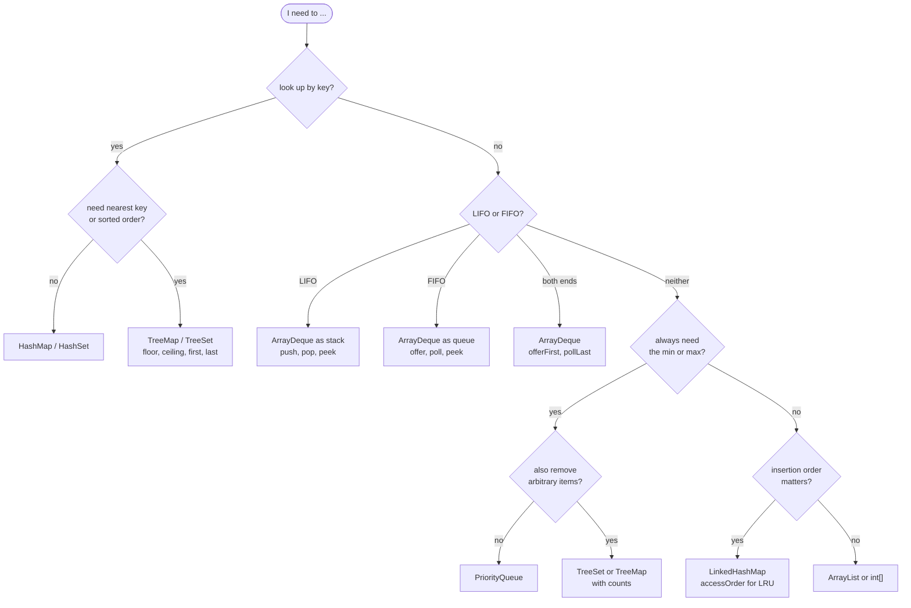

# Java Collections Cheat Sheet

> [!abstract] In one sentence
> The interview subset of `java.util` on one page — what each method takes, what it gives back, and the one way each of them bites — so that the API never costs you a minute of a 45-minute round.

**Map:** [[Java Refresher MOC]] → [[DSA Dashboard]]

> [!question] Predict before you read
> `map.get(k)` on a missing key, `list.remove(2)` on a `List<Integer>`, `set.add(x)` on an element already present, and `pq.iterator()` on a `PriorityQueue` — what does each one actually do? Two of the four are the classic interview-day surprises.

> [!info] How to use this note
> Read it once end to end now, then open it *during* practice whenever you stop to think "what was that method called". Each stop is a row you should memorise. The one-liners block at the bottom compiles; copy it into a scratch file and run it when you doubt a detail. Everything here is Java 21.

## Map — `HashMap`, `TreeMap`, `LinkedHashMap`

`HashMap` for O(1) lookups with no ordering promise; `TreeMap` when you need "nearest key" or sorted iteration (O(log n)); `LinkedHashMap` when insertion order matters (and `accessOrder=true` turns it into an LRU skeleton, see [[LC 146 LRU Cache]]).

| Method | Signature | Returns | Gotcha | Example |
|---|---|---|---|---|
| `get` | `V get(Object key)` | value or `null` | `null` also for a key mapped to `null`; unboxing a `null` into `int` throws NPE | `Integer v = m.get(k);` |
| `getOrDefault` | `V getOrDefault(Object key, V def)` | value or `def` | does **not** insert `def` | `int c = m.getOrDefault(k, 0);` |
| `put` | `V put(K key, V value)` | previous value or `null` | overwrites silently | `m.put(k, c + 1);` |
| `putIfAbsent` | `V putIfAbsent(K key, V value)` | existing value or `null` | the value is constructed even when not used | `m.putIfAbsent(k, new ArrayList<>());` |
| `computeIfAbsent` | `V computeIfAbsent(K key, Function<K,V> f)` | the (new or existing) value | `f` runs only on a miss — the adjacency-list idiom | `m.computeIfAbsent(u, x -> new ArrayList<>()).add(v);` |
| `computeIfPresent` | `V computeIfPresent(K key, BiFunction<K,V,V> f)` | new value or `null` | returning `null` from `f` **removes** the key | `m.computeIfPresent(k, (x, v) -> v - 1);` |
| `merge` | `V merge(K key, V value, BiFunction<V,V,V> f)` | new value | on a miss stores `value` without calling `f`; `f` returning `null` removes the key | `m.merge(k, 1, Integer::sum);` |
| `containsKey` | `boolean containsKey(Object key)` | boolean | O(1) in `HashMap`, O(log n) in `TreeMap` | `if (m.containsKey(k))` |
| `containsValue` | `boolean containsValue(Object v)` | boolean | O(n) — a linear scan, never in a loop | avoid |
| `remove` | `V remove(Object key)` | removed value or `null` | fine during a plain loop over *another* collection, illegal while iterating `m` itself | `m.remove(k);` |
| `size`, `isEmpty` | `int size()` | — | O(1) | `m.isEmpty()` |
| `entrySet` | `Set<Map.Entry<K,V>> entrySet()` | live view | the way to iterate key and value together | `for (Map.Entry<K,V> e : m.entrySet())` |
| `keySet`, `values` | `Set<K> keySet()`, `Collection<V> values()` | live views | removing from the view removes from the map | `new ArrayList<>(m.values())` |
| `Map.Entry` | `K getKey()`, `V getValue()`, `V setValue(V)` | — | `setValue` writes through on `HashMap` entries | `e.getKey() + e.getValue()` |
| `Map.entry` | `static Map.Entry<K,V> entry(K k, V v)` | immutable entry | `setValue` throws; `null` keys/values rejected | `pq.offer(Map.entry(word, count));` |
| `Map.of` | `static Map<K,V> of(k1, v1, ...)` | immutable map | up to 10 pairs; `put` throws; duplicate keys throw at creation | `Map.of('(', ')', '[', ']')` |
| `forEach` | `void forEach(BiConsumer<K,V>)` | — | cannot mutate the map inside | `m.forEach((k, v) -> total[0] += v);` |

`TreeMap` extras (all O(log n), all return `null` when nothing qualifies — check before unboxing):

| Method | Signature | Returns | Gotcha | Example |
|---|---|---|---|---|
| `floorKey` / `floorEntry` | `K floorKey(K key)` | greatest key ≤ `key` | `null` if everything is larger | `Integer t = tm.floorKey(ts);` — [[LC 981 Time Based Key-Value Store]] |
| `ceilingKey` / `ceilingEntry` | `K ceilingKey(K key)` | smallest key ≥ `key` | `null` if everything is smaller | `tm.ceilingKey(x)` |
| `lowerKey` / `higherKey` | `K lowerKey(K key)` | strictly < / > | strict versions of floor / ceiling | `tm.higherKey(x)` |
| `firstKey` / `lastKey` | `K firstKey()` | min / max key | throw `NoSuchElementException` on an empty map — use `firstEntry()` which returns `null` | `tm.firstKey()` |
| `firstEntry` / `lastEntry` | `Map.Entry<K,V> lastEntry()` | entry or `null` | safe on empty | `tm.lastEntry().getValue()` |
| `pollFirstEntry` / `pollLastEntry` | `Map.Entry<K,V> pollFirstEntry()` | removes and returns | O(log n) — a sorted "queue" | `tm.pollFirstEntry()` |
| `headMap` / `tailMap` | `SortedMap<K,V> headMap(K to)`, `tailMap(K from)` | live view, `[min, to)` / `[from, max]` | the view is backed by the map; `headMap(to, true)` makes it inclusive | `tm.tailMap(x).size()` is O(n) |
| `subMap` | `SortedMap<K,V> subMap(K from, K to)` | `[from, to)` | `from > to` throws | `tm.subMap(1, 5)` |
| constructor | `new TreeMap<>(Comparator)` | — | keys must be mutually comparable, no `null` keys | `new TreeMap<>(Comparator.reverseOrder())` |

## Set — `HashSet`, `TreeSet`, `LinkedHashSet`

| Method | Signature | Returns | Gotcha | Example |
|---|---|---|---|---|
| `add` | `boolean add(E e)` | **true if it was not there** | the return value is the "seen before?" test, no `contains` needed — [[LC 217 Contains Duplicate]] | `if (!seen.add(x)) return true;` |
| `contains` | `boolean contains(Object o)` | boolean | O(1) hash / O(log n) tree; relies on `equals`+`hashCode` — `int[]` keys never match | `set.contains(x)` |
| `remove` | `boolean remove(Object o)` | true if removed | — | `set.remove(x)` |
| `size`, `isEmpty`, `clear` | — | — | — | — |
| `addAll`, `retainAll`, `removeAll` | `boolean addAll(Collection)` | changed? | union / intersection / difference, in place | `a.retainAll(b)` |
| `Set.of` | `static Set<E> of(e1, ...)` | immutable | duplicates throw at creation | `Set.of('a', 'e', 'i', 'o', 'u')` |
| `new HashSet<>(coll)` | copy constructor | — | the quick "dedupe a list" | `new HashSet<>(list).size()` |

`TreeSet` extras (O(log n); `null` when nothing qualifies, except `first`/`last` which throw on empty):

| Method | Signature | Returns | Gotcha | Example |
|---|---|---|---|---|
| `floor` / `ceiling` | `E floor(E e)` | greatest ≤ / smallest ≥ | `null` on no match | `ts.ceiling(x)` |
| `lower` / `higher` | `E lower(E e)` | strictly < / > | — | `ts.higher(x)` |
| `first` / `last` | `E first()` | min / max | throw on empty — guard with `isEmpty()` | `ts.first()` |
| `pollFirst` / `pollLast` | `E pollFirst()` | removes min / max, `null` on empty | a sorted set used as a heap that also supports `remove(x)` in O(log n) — the trick for sliding-window medians | `ts.pollLast()` |
| `headSet` / `tailSet` / `subSet` | `SortedSet<E> headSet(E to)` | live views | `headSet(to, inclusive)` overloads exist | `ts.tailSet(x).first()` |
| `descendingSet` | `NavigableSet<E> descendingSet()` | reversed view | — | `ts.descendingSet()` |

## List — `ArrayList`, `LinkedList`, `List.of`

Use `ArrayList` for everything; `LinkedList` only when you need O(1) removal through a `ListIterator`, which in interviews is never.

| Method | Signature | Returns | Gotcha | Example |
|---|---|---|---|---|
| `add` | `boolean add(E e)` | always true | amortised O(1) | `list.add(x)` |
| `add` at index | `void add(int i, E e)` | — | O(n) shift; `i == size()` is allowed | `list.add(0, x)` |
| `get` | `E get(int i)` | element | O(1) on `ArrayList`, O(n) on `LinkedList` | `list.get(i)` |
| `set` | `E set(int i, E e)` | **old** element | does not grow the list; `set(size(), x)` throws | `list.set(i, x)` |
| `remove(int)` | `E remove(int index)` | removed element | on `List<Integer>`, `remove(2)` removes **index 2** | `list.remove(list.size() - 1)` |
| `remove(Object)` | `boolean remove(Object o)` | removed? | to remove the *value* 2, write `remove(Integer.valueOf(2))` | `list.remove(Integer.valueOf(2))` |
| `indexOf` / `lastIndexOf` | `int indexOf(Object o)` | index or `-1` | O(n) | `list.indexOf(x)` |
| `contains` | `boolean contains(Object o)` | — | O(n) — use a `Set` if it is in a loop | — |
| `subList` | `List<E> subList(int from, int to)` | **view**, `[from, to)` | structural changes to the parent invalidate it; copy with `new ArrayList<>(list.subList(..))` | `path.subList(0, k)` |
| `size`, `isEmpty`, `clear` | — | — | — | — |
| `sort` | `void sort(Comparator<E> c)` | — | `null` means natural order; stable (TimSort) | `list.sort(null)` |
| `toArray` | `int[]` is **not** possible directly | — | `list.stream().mapToInt(Integer::intValue).toArray()` | see one-liners |
| `List.of` | `static List<E> of(e1, ...)` | immutable | `add`, `set`, `remove` throw `UnsupportedOperationException`; no `null` elements | `new ArrayList<>(List.of(1, 2))` to get a mutable one |
| `Arrays.asList` | `List<T> asList(T... a)` | fixed-size view | `set` works, `add`/`remove` throw; on an `int[]` you get `List<int[]>` of size 1 | `Arrays.asList(1, 2, 3)` |
| `new ArrayList<>(n)` | capacity constructor | — | capacity, not size — `get(0)` still throws | `new ArrayList<>(n)` |
| `Collections.nCopies` | `List<T> nCopies(int n, T x)` | immutable list of n copies | wrap in `new ArrayList<>(...)` to mutate | `new ArrayList<>(Collections.nCopies(n, 0))` |

## ArrayDeque — the stack and the queue

`ArrayDeque` is the right class for both; `Stack` is legacy and synchronised, `LinkedList` is slower. It rejects `null` elements, so never push `null` as a sentinel — push `-1` or a dummy node.

| Role | Method | Signature | Returns | Gotcha | Example |
|---|---|---|---|---|---|
| stack | `push` | `void push(E e)` | — | adds at the **head** (`addFirst`) | `st.push(x)` |
| stack | `pop` | `E pop()` | head | throws `NoSuchElementException` on empty — check `isEmpty()` | `st.pop()` |
| stack | `peek` | `E peek()` | head or `null` | `null`, not an exception | `st.peek()` |
| queue | `offer` / `add` | `boolean offer(E e)` | true | adds at the **tail** (`addLast`) | `q.offer(x)` |
| queue | `poll` | `E poll()` | head or `null` | removes from the head — the same end `pop` uses | `q.poll()` |
| queue | `peek` | `E peek()` | head or `null` | same method as the stack's `peek` | `q.peek()` |
| deque | `offerFirst` / `offerLast` | `boolean offerFirst(E e)` | true | `push == offerFirst`, `offer == offerLast` | `dq.offerFirst(x)` |
| deque | `pollFirst` / `pollLast` | `E pollLast()` | element or `null` | monotonic deque evicts from the **back** with `pollLast` and expires from the **front** with `pollFirst` | `dq.pollLast()` |
| deque | `peekFirst` / `peekLast` | `E peekLast()` | element or `null` | — | `dq.peekLast()` |
| deque | `removeFirst` / `removeLast` | `E removeLast()` | element | throw on empty | — |
| both | `isEmpty`, `size` | — | — | O(1) | `while (!q.isEmpty())` |
| both | iteration | `for (E e : dq)` | head → tail | for a stack that means top → bottom | — |

Declare as `Deque<Integer> st = new ArrayDeque<>();` — the interface name tells the reader which end you intend to use.

## PriorityQueue

A binary min-heap. `offer`, `poll` are O(log n); `peek` O(1); `remove(Object)` and `contains` are O(n). There is **no decrease-key** — push a new entry and skip stale ones when they come out (the Dijkstra idiom in [[DSA Patterns in Java]]).

| Form | Code | Note |
|---|---|---|
| min-heap of `Integer` | `new PriorityQueue<>()` | natural order |
| max-heap of `Integer` | `new PriorityQueue<>(Collections.reverseOrder())` | or `(a, b) -> b - a` only when values are small |
| by one field of `int[]` | `new PriorityQueue<>((a, b) -> Integer.compare(a[1], b[1]))` | never `a[1] - b[1]` with large values — overflow |
| composed | `new PriorityQueue<>(Comparator.comparingInt((int[] a) -> a[0]).thenComparingInt(a -> a[1]))` | the cast on the first lambda is what makes inference work |
| by map value | `new PriorityQueue<>((a, b) -> freq.get(a) - freq.get(b))` | counts are small, subtraction is safe here |
| with capacity | `new PriorityQueue<>(k, cmp)` | capacity is a hint, not a cap — a "size-k heap" needs an explicit `if (pq.size() > k) pq.poll()` |

| Method | Signature | Returns | Gotcha | Example |
|---|---|---|---|---|
| `offer` / `add` | `boolean offer(E e)` | true | `null` rejected | `pq.offer(x)` |
| `poll` | `E poll()` | smallest or `null` | removes | `int best = pq.poll();` |
| `peek` | `E peek()` | smallest or `null` | does not remove | `pq.peek()` |
| `size`, `isEmpty` | — | — | — | — |
| `remove(Object)` | `boolean remove(Object o)` | — | O(n); for "lazy deletion" prefer a stale-check on `poll` | avoid |
| iteration / `toString` | — | — | **heap order, not sorted order** — never print a PQ to see the sorted result, `poll` in a loop instead | — |
| `new PriorityQueue<>(collection)` | — | — | O(n) heapify, cheaper than n offers | `new PriorityQueue<>(list)` |

## String

Immutable; every `substring`, `+`, `replace`, `toLowerCase` allocates a new string. Index with `charAt`, never `split("")`.

| Method | Signature | Returns | Gotcha | Example |
|---|---|---|---|---|
| `length` | `int length()` | — | a method, unlike `arr.length` | `s.length()` |
| `charAt` | `char charAt(int i)` | char | `StringIndexOutOfBoundsException` past the end | `s.charAt(i)` |
| `substring` | `String substring(int from, int to)` | `[from, to)` | O(n) copy since Java 7u6 — don't build substrings in an O(n) loop | `s.substring(i, j + 1)` |
| `indexOf` | `int indexOf(String/char x)`, `indexOf(x, from)` | index or `-1` | O(n·m) naive scan | `s.indexOf("ab", i)` |
| `contains`, `startsWith`, `endsWith` | `boolean contains(CharSequence)` | — | `startsWith(prefix, offset)` exists | `s.startsWith("ab", 2)` |
| `equals` / `equalsIgnoreCase` | `boolean equals(Object)` | — | **never `==`** — it compares references; literals are interned, computed strings are not | `a.equals(b)` |
| `compareTo` | `int compareTo(String o)` | negative / 0 / positive | lexicographic by `char` value; shorter prefix is smaller | `a.compareTo(b) < 0` |
| `split` | `String[] split(String regex)` | parts | the argument is a **regex** — `split("\\.")` for a dot, `split("\\+")` for a plus, `Pattern.quote(sep)` for anything; trailing empty strings are dropped; `split(" ")` on double spaces yields empties, use `"\\s+"` after `strip()` | `s.strip().split("\\s+")` |
| `toCharArray` | `char[] toCharArray()` | copy | the mutable form; rebuild with `new String(arr)` | `char[] a = s.toCharArray();` |
| `chars` | `IntStream chars()` | stream of `int` code units | cast back with `(char)` | `s.chars().filter(Character::isDigit).count()` |
| `String.valueOf` | `static String valueOf(char[] / int / char ...)` | — | `valueOf(char[])` builds from the array; `"" + c` also works | `String.valueOf(arr)` |
| `new String(char[], from, count)` | — | — | the fast window-to-string | `new String(a, i, len)` |
| `join` | `static String join(CharSequence sep, Iterable / String...)` | — | elements must be `CharSequence` — `List<Integer>` needs a map step | `String.join(",", parts)` |
| `repeat` | `String repeat(int n)` | — | Java 11 | `"ab".repeat(3)` |
| `strip` / `trim` | `String strip()` | — | `strip` is Unicode-aware (Java 11); `trim` is ASCII ≤ ' ' | `s.strip()` |
| `isEmpty` / `isBlank` | — | — | `isBlank` ignores whitespace (Java 11) | — |
| `toLowerCase` / `toUpperCase` | — | new string | O(n) — do it once, not per comparison | — |
| `replace` | `String replace(CharSequence a, CharSequence b)` | new string | all occurrences, literal (not regex); `replaceAll` is regex | — |
| `format` / `formatted` | `"%d-%d".formatted(a, b)` | — | the cheap string key for a memo, see [[DSA Patterns in Java]] | `i + "," + j` is faster |
| `intern`, `hashCode` | — | — | `hashCode` is cached after first call | — |

## StringBuilder

Mutable, not synchronised (`StringBuffer` is the synchronised twin, never needed). Building a string of n parts with `+` in a loop is O(n²); with a builder it is O(n).

| Method | Signature | Returns | Gotcha | Example |
|---|---|---|---|---|
| `append` | `StringBuilder append(anything)` | `this` (chainable) | `append(char)` vs `append(int)` — `sb.append('a' + 1)` appends `98` | `sb.append((char) (c + 1))` |
| `insert` | `StringBuilder insert(int i, x)` | `this` | O(n) shift — building reversed output is better done with `append` then `reverse` | `sb.insert(0, c)` |
| `deleteCharAt` | `StringBuilder deleteCharAt(int i)` | `this` | O(n); the backtracking "unchoose" for the last char | `sb.deleteCharAt(sb.length() - 1)` |
| `setLength` | `void setLength(int n)` | — | truncates in O(1) — the faster unchoose, and `setLength(0)` clears | `sb.setLength(sb.length() - 1)` |
| `reverse` | `StringBuilder reverse()` | `this` | in place | `sb.reverse().toString()` |
| `setCharAt` | `void setCharAt(int i, char c)` | — | — | `sb.setCharAt(i, 'x')` |
| `charAt`, `length`, `indexOf` | — | — | same semantics as `String` | — |
| `toString` | `String toString()` | copy | O(n) | `sb.toString()` |
| `delete` | `StringBuilder delete(int from, int to)` | `this` | `[from, to)` | — |
| `new StringBuilder(s)` | — | — | `new StringBuilder(26)` is a *capacity*, `new StringBuilder('a')` is capacity 97 — a classic bug | — |

## Character

| Method | Signature | Returns | Gotcha | Example |
|---|---|---|---|---|
| `isDigit` | `static boolean isDigit(char c)` | — | Unicode digits too; for ASCII use `c >= '0' && c <= '9'` | `Character.isDigit(c)` |
| `isLetter`, `isLetterOrDigit` | — | — | the [[LC 125 Valid Palindrome]] filter | `Character.isLetterOrDigit(c)` |
| `isUpperCase`, `isLowerCase`, `isWhitespace` | — | — | — | — |
| `toLowerCase` / `toUpperCase` | `static char toLowerCase(char c)` | char | there is also an `int` overload — assign to `char` | `Character.toLowerCase(c)` |
| `getNumericValue` | `static int getNumericValue(char c)` | digit value | `'a'`..`'z'` return 10..35, not −1 | `c - '0'` is the fast way for digits |
| arithmetic | `c - 'a'` | `int` 0..25 | `char + int` is an `int` — cast back: `(char) ('a' + i)` | `count[c - 'a']++` |
| compare | `c == 'x'` | — | `char` is a number; `Character.compare(a, b)` for comparators | — |

## Arrays

| Method | Signature | Returns | Gotcha | Example |
|---|---|---|---|---|
| `sort` primitive | `void sort(int[] a)` | — | dual-pivot quicksort, O(n log n) average, O(n²) worst on adversarial input; no comparator for primitives | `Arrays.sort(nums)` |
| `sort` objects | `void sort(T[] a, Comparator<T> c)` | — | TimSort, stable | `Arrays.sort(words, (a, b) -> a.length() - b.length())` |
| `sort` `int[][]` | — | — | rows are objects, so a comparator works | `Arrays.sort(iv, (a, b) -> Integer.compare(a[0], b[0]))` |
| `sort` descending | `Integer[]` only | — | `Arrays.sort(boxed, Collections.reverseOrder())`; for `int[]` sort ascending and index from the end, or reverse in place | see one-liners |
| `sort` range | `void sort(int[] a, int from, int to)` | — | `[from, to)` | `Arrays.sort(a, 1, n)` |
| `fill` | `void fill(int[] a, int v)` | — | one row at a time for 2-D | `for (int[] r : dp) Arrays.fill(r, -1);` |
| `copyOf` | `int[] copyOf(int[] a, int newLen)` | copy | pads with zeros / truncates | `Arrays.copyOf(a, a.length)` |
| `copyOfRange` | `int[] copyOfRange(int[] a, int from, int to)` | `[from, to)` | — | `Arrays.copyOfRange(a, k, n)` |
| `asList` | `List<T> asList(T...)` | fixed-size view | `int[]` becomes one element — box first | `Arrays.asList(1, 2, 3)` |
| `equals` | `boolean equals(int[] a, int[] b)` | — | `a.equals(b)` on arrays is identity — use the static method | `Arrays.equals(a, b)` |
| `deepEquals` | `boolean deepEquals(Object[] a, Object[] b)` | — | for `int[][]` | `Arrays.deepEquals(g1, g2)` |
| `hashCode` | `int hashCode(int[] a)` | — | the way to make `int[]` a usable map key *via a wrapper*, or just use `Arrays.toString(a)` as the key | `Arrays.hashCode(a)` |
| `toString` / `deepToString` | `String toString(int[] a)` | `"[1, 2]"` | a correct, if slow, hash key for small arrays (counts of 26 letters in [[LC 49 Group Anagrams]]) | `Arrays.toString(cnt)` |
| `stream` | `IntStream stream(int[] a)` | — | `.sum()`, `.max().getAsInt()`, `.boxed()` | `Arrays.stream(a).max().getAsInt()` |
| `binarySearch` | `int binarySearch(int[] a, int key)` | index, or `-(insertion point) - 1` | array must be sorted; duplicates return an unspecified match | `int i = Arrays.binarySearch(a, x); if (i < 0) i = -i - 1;` |
| `a.length` | field | — | no parentheses; `grid[0].length` for columns | — |
| `a.clone()` | `int[] clone()` | shallow copy | 2-D clone copies the row *references* — rows are shared | `for (int i = 0; i < n; i++) copy[i] = g[i].clone();` |

## Collections

| Method | Signature | Returns | Gotcha | Example |
|---|---|---|---|---|
| `sort` | `void sort(List<T> l)`, `sort(l, cmp)` | — | same as `list.sort(cmp)` | `Collections.sort(list)` |
| `reverse` | `void reverse(List<?> l)` | — | in place, O(n) | `Collections.reverse(path)` |
| `reverseOrder` | `Comparator<T> reverseOrder()`, `reverseOrder(cmp)` | — | the max-heap / descending sort comparator | `new PriorityQueue<>(Collections.reverseOrder())` |
| `max` / `min` | `T max(Collection<T> c)`, `max(c, cmp)` | — | O(n); throws on empty | `Collections.max(map.values())` |
| `frequency` | `int frequency(Collection<?> c, Object o)` | count | O(n) | `Collections.frequency(list, x)` |
| `nCopies` | `List<T> nCopies(int n, T x)` | immutable | wrap to mutate | — |
| `swap` | `void swap(List<?> l, int i, int j)` | — | the permutations-in-place helper | `Collections.swap(list, i, j)` |
| `unmodifiableList` | `List<T> unmodifiableList(List<T> l)` | read-only **view** | the backing list can still change | — |
| `emptyList` / `singletonList` | — | immutable | `List.of()` is the modern spelling | — |
| `shuffle` | `void shuffle(List<?> l)` | — | — | — |

## Math

| Method | Signature | Returns | Gotcha | Example |
|---|---|---|---|---|
| `max` / `min` | `int max(int a, int b)` (also `long`, `double`) | — | two arguments only — chain for three | `Math.max(a, Math.max(b, c))` |
| `abs` | `int abs(int a)` | — | `Math.abs(Integer.MIN_VALUE)` is **negative** — use `long` | `Math.abs((long) x)` |
| `floorMod` | `int floorMod(int x, int m)` | always in `[0, m)` | `%` keeps the sign of the dividend: `-1 % 3 == -1` | `Math.floorMod(i - 1, n)` for circular indexing |
| `floorDiv` | `int floorDiv(int x, int y)` | rounds toward −∞ | `/` truncates toward 0: `-7 / 2 == -3` | `Math.floorDiv(-7, 2) == -4` |
| `pow` | `double pow(double a, double b)` | `double` | precision loss above 2⁵³ — write fast power with `long` | see [[LC 50 Pow(x, n)]] |
| `sqrt` | `double sqrt(double a)` | — | `(int) Math.sqrt(n)` can be off by one near perfect squares — check `r * r <= n` | — |
| `addExact` / `multiplyExact` | `int addExact(int a, int b)` | — | throw `ArithmeticException` on overflow — a quick overflow guard | — |
| `ceil` / `floor` / `round` | `double ceil(double)` | `double` (`round` returns `long`) | for integer ceiling use `(a + b - 1) / b` | — |
| `log` / `log10` | — | `double` | no `log2` — `31 - Integer.numberOfLeadingZeros(n)` for ints | — |
| overflow | — | — | `int` wraps silently; `Integer.MAX_VALUE + 1 == Integer.MIN_VALUE` | `long mid = lo + (hi - lo) / 2` |

## Integer and Long

| Method | Signature | Returns | Gotcha | Example |
|---|---|---|---|---|
| `MAX_VALUE` / `MIN_VALUE` | constants | ±2.1 × 10⁹ for `int`, ±9.2 × 10¹⁸ for `long` | `Integer.MAX_VALUE` as "infinity" overflows when you add to it — use `Integer.MAX_VALUE / 2` or a `long` | `int INF = Integer.MAX_VALUE / 2;` |
| `parseInt` | `static int parseInt(String s)` | int | `NumberFormatException` on `"+"`, `""`, spaces; `parseInt(s, 2)` for binary | `Integer.parseInt(tok)` |
| `valueOf` | `static Integer valueOf(int i)` | boxed | caches −128..127 — `==` works only in that range | use `.equals` or unbox |
| `toBinaryString` | `static String toBinaryString(int i)` | no leading zeros, two's complement for negatives | `toBinaryString(-1)` is 32 ones | — |
| `bitCount` | `static int bitCount(int i)` | popcount | — | `Integer.bitCount(mask)` — [[LC 191 Number of 1 Bits]] |
| `highestOneBit` / `lowestOneBit` | `static int highestOneBit(int i)` | the bit as a power of two | `lowestOneBit(x) == x & -x` | — |
| `numberOfLeadingZeros` / `numberOfTrailingZeros` | — | — | floor(log2 n) = `31 - numberOfLeadingZeros(n)` | — |
| `compare` | `static int compare(int a, int b)` | −1 / 0 / 1 | overflow-safe comparator; `Long.compare` likewise | `(a, b) -> Integer.compare(a[0], b[0])` |
| `reverse` | `static int reverse(int i)` | reversed bits | [[LC 190 Reverse Bits]] in one call — know the loop too | — |
| `toString` | `static String toString(int i, int radix)` | — | — | `Integer.toString(n, 2)` |
| `intValue` / `longValue` | — | — | `Long` and `Integer` are never `equals` to each other: `Long.valueOf(1).equals(1)` is false | — |
| `Long.MAX_VALUE` | — | — | products of two `int` fit in `long`; products of two `long` do not | `(long) a * b` |
| `Integer.MAX_VALUE` as sentinel | — | — | when the answer may itself be `MAX_VALUE`, use `long` or a flag | — |

## Iteration idioms

| Need | Idiom | Note |
|---|---|---|
| index and value of an array | `for (int i = 0; i < a.length; i++)` | `a.length`, no parentheses |
| values only | `for (int x : a)` | cannot modify `a[i]` through `x` |
| map entries | `for (Map.Entry<K, V> e : m.entrySet())` | `var e` is fine in Java 21 |
| map keys sorted | `for (K k : new TreeMap<>(m).keySet())` | O(n log n) |
| remove while iterating | `Iterator<E> it = c.iterator(); while (it.hasNext()) if (bad(it.next())) it.remove();` | or `c.removeIf(pred)` |
| remove by condition | `list.removeIf(x -> x < 0)` | O(n), safe |
| index in a `List` from the back | `for (int i = list.size() - 1; i >= 0; i--)` | `size()`, with parentheses |
| string characters | `for (char c : s.toCharArray())` | one O(n) copy, then fast; `charAt` in a loop avoids the copy |
| two collections in lock-step | plain index loop | there is no `zip` |
| labelled break | `outer: for (...) { for (...) { if (..) break outer; } }` | legal, rarely needed |
| descending array iteration | `Arrays.sort(a); for (int i = n - 1; i >= 0; i--)` | the way to "sort descending" an `int[]` without boxing |

## Streams that are safe in interviews

Use streams only for one-line conversions; the moment you need an index or early exit, write the loop.

| Need | Idiom |
|---|---|
| 0..n−1 as a stream | `IntStream.range(0, n)` (exclusive end); `rangeClosed(0, n)` |
| sum / max / min of `int[]` | `Arrays.stream(a).sum()`, `.max().getAsInt()` |
| `int[]` → `List<Integer>` | `Arrays.stream(a).boxed().collect(Collectors.toList())` or `.toList()` (immutable, Java 16) |
| `List<Integer>` → `int[]` | `list.stream().mapToInt(Integer::intValue).toArray()` |
| count by key | `words.stream().collect(Collectors.groupingBy(w -> w.length(), Collectors.counting()))` → `Map<Integer, Long>` |
| group into lists | `Collectors.groupingBy(w -> sortedKey(w))` → `Map<String, List<String>>` — [[LC 49 Group Anagrams]] |
| `List<int[]>` → `int[][]` | `list.toArray(new int[0][])` — [[LC 56 Merge Intervals]] |
| `List<List<Integer>>` result | build with `new ArrayList<>(path)` copies, not `List.of(path)` |
| string of chars | `s.chars().mapToObj(c -> (char) c)` — usually a `toCharArray` loop is clearer |
| sorted copy | `list.stream().sorted(cmp).toList()` |

## Pairs, records and comparators

| Need | Idiom | Note |
|---|---|---|
| pair in a heap or queue | `int[]{node, dist}` | zero ceremony; `a[0]`, `a[1]` — comment which is which |
| pair as a **map key** or in a **set** | `record Pos(int r, int c) {}` | `int[]` keys never match (identity `equals`); records give value `equals`/`hashCode` for free |
| encode `(r, c)` as one int | `r * cols + c` | the flattened key for `visited` sets and DSU |
| encode two ints as a `long` | `((long) a << 32) \| (b & 0xffffffffL)` | memo keys for two 32-bit states (the `\|` is a plain bitwise OR) |
| sort by one int field | `Comparator.comparingInt(p -> p[0])` | `comparingInt` avoids boxing |
| then by another, descending | `Comparator.comparingInt((int[] p) -> p[0]).thenComparing(p -> p[1], Comparator.reverseOrder())` | the explicit `(int[] p)` type is required on the first lambda |
| reverse a comparator | `cmp.reversed()` | — |
| natural order of a key | `Comparator.comparing(Entry::getKey)` | `Map.Entry.comparingByValue()` for values |
| record with a comparator | `Comparator.comparingInt(Pos::r).thenComparingInt(Pos::c)` | method references on record components |
| mutable "box" for lambdas | `int[] best = {0};` | lambdas capture only effectively-final variables |

## The 25 one-liners I keep forgetting

Compiles as-is; every `check` passes. Run it when a detail is in doubt.

```java
import java.util.*;
import java.util.stream.*;

class OneLiners {
    static void check(boolean ok) { if (!ok) throw new AssertionError(); }

    public static void main(String[] args) {
        Map<Character, Integer> freq = new HashMap<>();                       // 1  count frequencies
        for (char c : "banana".toCharArray()) freq.merge(c, 1, Integer::sum);
        check(freq.get('a') == 3);
        check(freq.getOrDefault('z', 0) == 0 && !freq.containsKey('z'));      // 2  read without inserting
        Map<Integer, List<Integer>> adj = new HashMap<>();                     // 3  adjacency list
        adj.computeIfAbsent(1, k -> new ArrayList<>()).add(2);
        int total = 0;                                                         // 4  iterate entries
        for (Map.Entry<Character, Integer> e : freq.entrySet()) total += e.getValue();
        check(total == 6);
        freq.merge('b', -1, Integer::sum);                                     // 5  decrement, drop zero
        if (freq.get('b') == 0) freq.remove('b');
        check(!freq.containsKey('b'));
        Set<Integer> seen = new HashSet<>();                                   // 6  add returns "was new"
        check(seen.add(5) && !seen.add(5));
        TreeMap<Integer, String> tm = new TreeMap<>(Map.of(10, "a", 20, "b", 30, "c"));
        check(tm.floorKey(25) == 20 && tm.ceilingKey(25) == 30 && tm.floorKey(5) == null);  // 7
        TreeSet<Integer> ts = new TreeSet<>(List.of(3, 1, 2));                 // 8  sorted set ends
        check(ts.first() == 1 && ts.last() == 3 && ts.pollFirst() == 1);
        Deque<Integer> st = new ArrayDeque<>();                                // 9  stack
        st.push(1); st.push(2);
        check(st.peek() == 2 && st.pop() == 2);
        Deque<Integer> q = new ArrayDeque<>();                                 // 10 queue
        q.offer(1); q.offer(2);
        check(q.poll() == 1 && q.peek() == 2);
        PriorityQueue<int[]> pq = new PriorityQueue<>((a, b) -> Integer.compare(a[1], b[1]));  // 11
        pq.offer(new int[]{0, 9}); pq.offer(new int[]{1, 4});
        check(pq.poll()[0] == 1);
        PriorityQueue<Integer> max = new PriorityQueue<>(Collections.reverseOrder());          // 12
        max.offer(1); max.offer(7);
        check(max.peek() == 7);
        int[][] iv = {{3, 4}, {1, 2}};                                         // 13 sort rows by column 0
        Arrays.sort(iv, (a, b) -> Integer.compare(a[0], b[0]));
        check(iv[0][0] == 1);
        Integer[] boxed = {1, 3, 2};                                           // 14 Integer[] descending
        Arrays.sort(boxed, Collections.reverseOrder());
        check(boxed[0] == 3);
        int[] prim = {1, 3, 2};                                                // 15 int[] descending
        Arrays.sort(prim);
        for (int i = 0, j = prim.length - 1; i < j; i++, j--) { int t = prim[i]; prim[i] = prim[j]; prim[j] = t; }
        check(prim[0] == 3);
        int[] cnt = new int[26];                                               // 16 char arithmetic
        for (char c : "abc".toCharArray()) cnt[c - 'a']++;
        check(cnt[2] == 1 && (char) ('a' + 2) == 'c');
        StringBuilder sb = new StringBuilder("abc");                           // 17 reverse, truncate
        sb.reverse();
        sb.setLength(sb.length() - 1);
        check(sb.toString().equals("cb"));
        check(String.join(",", List.of("a", "b")).equals("a,b"));             // 18 join, valueOf(char[])
        check(String.valueOf(new char[]{'o', 'k'}).equals("ok"));
        long vowels = "banana".chars().filter(c -> c == 'a').count();          // 19 chars() stream
        check(vowels == 3);
        check(IntStream.range(0, 5).sum() == 10 && Arrays.stream(new int[]{1, 2, 3}).sum() == 6);  // 20
        Map<Integer, Long> byLen = Stream.of("a", "bb", "cc")                  // 21 groupingBy + counting
                .collect(Collectors.groupingBy(String::length, Collectors.counting()));
        check(byLen.get(2) == 2L);
        record Pair(int a, int b) {}                                           // 22 record = value pair
        check(new Pair(1, 2).equals(new Pair(1, 2)));
        check(new HashSet<>(List.of(new Pair(1, 2))).contains(new Pair(1, 2)));
        List<int[]> items = new ArrayList<>(List.of(new int[]{2, 1}, new int[]{1, 5}, new int[]{1, 3}));
        items.sort(Comparator.<int[]>comparingInt(p -> p[0]).thenComparingInt(p -> p[1]));   // 23
        check(items.get(0)[1] == 3);
        PriorityQueue<Map.Entry<String, Integer>> byCount =                    // 24 Map.entry in a heap
                new PriorityQueue<>(Map.Entry.<String, Integer>comparingByValue());
        byCount.offer(Map.entry("x", 3)); byCount.offer(Map.entry("y", 1));
        check(byCount.poll().getKey().equals("y"));
        int[][] grid = new int[3][4];                                          // 25 fill 2-D, copy a range
        for (int[] row : grid) Arrays.fill(row, -1);
        int[] tail = Arrays.copyOfRange(new int[]{1, 2, 3, 4}, 2, 4);
        check(tail.length == 2 && grid[2][3] == -1);
        List<Integer> asList = Arrays.stream(prim).boxed().collect(Collectors.toList());
        int[] back = asList.stream().mapToInt(Integer::intValue).toArray();    // bonus: both directions
        check(back.length == 3 && new HashSet<>(asList).size() == 3);
    }
}
```

> [!question] Spot the bug
> `List<Integer> list = new ArrayList<>(List.of(5, 2, 9)); list.remove(2);` — what is in the list afterwards, and what did the author probably want? (Answer: `[5, 2]`; index 2 was removed. To remove the value 2: `list.remove(Integer.valueOf(2))`.)

## Which collection for which job



> [!example]- Excalidraw version — the same diagram as an editable canvas
> ![[Java Collections Cheat Sheet — Which collection for which job.excalidraw]]
> [[Java Collections Cheat Sheet — Which collection for which job.excalidraw|Open in Excalidraw]] — needs the Excalidraw plugin (see [[Plugins to Install]]).

Two rules of thumb the chart cannot show. First, a `boolean[]`/`int[]` beats a `HashSet<Integer>` whenever keys are small dense integers (characters, node ids, flattened grid cells) — constant factors are five to ten times better and there is no boxing. Second, when the key is a pair, decide the encoding before you write the first line: `record` for clarity, `r * cols + c` for speed.

## Complexity of each operation

| Structure | get / contains | insert | remove | min / max | ordered iteration | notes |
|---|---|---|---|---|---|---|
| `int[]`, `ArrayList` | O(1) by index, O(n) by value | O(1) amortised at the end, O(n) in the middle | O(n) (O(1) at the end) | O(n) | needs a sort, O(n log n) | `ArrayList` resizes by 1.5× |
| `HashMap`, `HashSet` | O(1) average, O(log n) worst per bucket since Java 8 (treeified) | O(1) average | O(1) average | O(n) | none | resize at load 0.75; bad `hashCode` degrades to O(log n) |
| `LinkedHashMap` | O(1) | O(1) | O(1) | — | insertion / access order O(n) | `removeEldestEntry` hook |
| `TreeMap`, `TreeSet` | O(log n) | O(log n) | O(log n) | O(log n), `first()` | O(n) in key order | red-black tree; floor / ceiling O(log n) |
| `ArrayDeque` | O(1) at either end, O(n) by value | O(1) amortised either end | O(1) either end | — | head to tail | circular array; `null` rejected |
| `PriorityQueue` | O(n) by value | O(log n) | O(log n) poll, O(n) `remove(Object)` | O(1) `peek` | **not sorted** | `new PriorityQueue<>(coll)` heapifies in O(n) |
| `String` | O(1) `charAt` | — (immutable) | — | — | — | `substring`, `+`, `toLowerCase` are O(n) each |
| `StringBuilder` | O(1) `charAt` | O(1) amortised `append`, O(n) `insert` | O(n) `deleteCharAt`, O(1) `setLength` | — | — | `toString` is O(n) |
| `Arrays.sort(int[])` | — | — | — | — | O(n log n) | dual-pivot quicksort, not stable, no comparator |
| `Arrays.sort(T[])`, `List.sort` | — | — | — | — | O(n log n) | TimSort, stable, O(n) on sorted input |

## Related

### Siblings in this folder
- [[DSA Patterns in Java]] — the templates that use these APIs
- [[Java Pitfalls in Interviews]] — every gotcha column above, with a failing snippet and the fix

### Topic notes that explain the structures
- [[Hashing]] — how `HashMap` works and why `hashCode`/`equals` matter
- [[Heaps & Priority Queues]] — what `PriorityQueue` is doing underneath
- [[Sorting]] — TimSort vs dual-pivot quicksort and comparator pitfalls
- [[Strings]] — immutability, `StringBuilder`, char arithmetic
- [[Stack & Monotonic Stack]] and [[Sliding Window]] — `ArrayDeque` in both roles
- [[Complexity Analysis]] — where the table above comes from

### Problems that lean on a single API row
- [[LC 981 Time Based Key-Value Store]] — `TreeMap.floorKey`
- [[LC 146 LRU Cache]] — `LinkedHashMap` with `accessOrder`
- [[LC 347 Top K Frequent Elements]] — `merge` + heap of entries
- [[LC 49 Group Anagrams]] — `computeIfAbsent` + `Arrays.toString` key
- [[LC 56 Merge Intervals]] — `Arrays.sort(int[][])` + `toArray(new int[0][])`

## Personal understanding

> [!question] The rows I actually forget
> After each practice session, list here the methods you had to look up. When a method appears three times, write its row out by hand and it stops appearing.

## Open questions
- [ ] Which three rows of this note did I look up in the last week, and can I now write them without the note?
