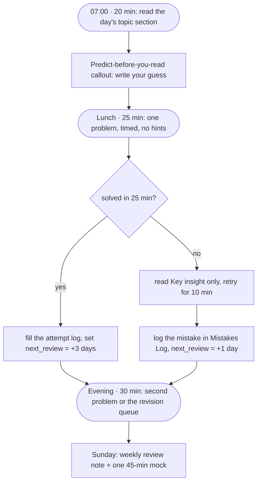

# 8-Week DSA Plan

> [!abstract] In one sentence
> Eight weeks, 150 problems, 29 topic notes, one mock a week: read the week's topic notes first (they are written to be read, not skimmed), then solve that week's problems in the listed order, logging every attempt in the note's attempt log so the dashboard can schedule the revisions.

**Map:** [[Plans MOC]] → [[DSA Dashboard]]

> [!tip] Before week 1
> Spend one evening on [[Java Collections Cheat Sheet]] and [[Java Pitfalls in Interviews]]. Half of the time lost in the first week is to forgotten APIs, not to algorithms. Keep [[DSA Patterns in Java]] open in a split pane while solving.

## The order at a glance

Weeks are assigned by the `week` property on every problem note, so the Bases on the dashboard can show "this week's problems" automatically.

| Week | Read (topic notes, in order) | Solve (problems by category) | Milestone |
|---|---|---|---|
| 1 | [[Complexity Analysis]] · [[Recursion]] · [[Problem-Solving Framework]] · [[Arrays & Hashing]] · [[Hashing]] · [[Two Pointers]] · [[Sliding Window]] · [[Stack & Monotonic Stack]] | **Arrays & Hashing** (9); **Two Pointers** (5); **Sliding Window** (6); **Stack** (7) | 27 problems solved; every Easy in under 15 minutes; one timed mock (45 min, two Mediums). |
| 2 | [[Binary Search]] · [[Searching]] · [[Sorting]] · [[Strings]] · [[Linked Lists]] · [[Heaps & Priority Queues]] | **Binary Search** (7); **Linked List** (11); **Heap / Priority Queue** (7) | 25 more problems; [[LC 4 Median of Two Sorted Arrays]] understood even if not solved alone; one mock. |
| 3 | [[Trees]] · [[Tries]] · [[Backtracking]] | **Trees** (15); **Tries** (3); **Backtracking** (9) | 27 more problems; tree recursion written without hints; one mock with a Hard. |
| 4 | [[Graphs]] · [[Advanced Graphs]] · [[Union-Find]] | **Graphs** (13); **Advanced Graphs** (6) | 19 more problems; BFS, DFS, Kahn, Dijkstra and union-find typed from memory; one mock. |
| 5 | [[Dynamic Programming]] · [[Greedy]] | **1-D DP** (12); **Greedy** (8) | 20 more problems; the five 1-D shapes recognised on sight; one mock. |
| 6 | [[2-D Dynamic Programming]] · [[DP Pattern Catalogue]] · [[Intervals]] | **2-D DP** (11); **Intervals** (6) | 17 more problems; LCS/edit-distance table filled by hand; one mock. |
| 7 | [[Math & Geometry]] · [[Bit Manipulation]] · [[Segment Trees]] · [[Fenwick Trees]] | **Math & Geometry** (8); **Bit Manipulation** (7) | 15 more problems; segment and Fenwick trees coded once each; one mock. |
| 8 | revision of the scared six: [[Tries]] · [[Graphs]] · [[Advanced Graphs]] · [[Union-Find]] · [[Dynamic Programming]] · [[2-D Dynamic Programming]] · [[DP Pattern Catalogue]] · [[Segment Trees]] · [[Fenwick Trees]] | redo the problems you got wrong (see [[Mistakes Log]]) | Two full mocks (45 min each) scoring 4+ on communication; revision queue empty. |

Six of the topics are the ones you said you have never done (`scared: true`): [[Tries]], [[Graphs]], [[Advanced Graphs]], [[Union-Find]], [[Dynamic Programming]], [[2-D Dynamic Programming]] (plus [[DP Pattern Catalogue]], [[Segment Trees]], [[Fenwick Trees]]). Weeks 3–7 are built around them: each gets two reading sessions before the first problem, and every one of their problems is redone in week 8.

## Week by week

### Week 1

*Rebuild the reflexes: counting with arrays and maps, moving two indices, growing and shrinking a window, using a stack for 'next greater'.*

Read, in order: [[Complexity Analysis]] → [[Recursion]] → [[Problem-Solving Framework]] → [[Arrays & Hashing]] → [[Hashing]] → [[Two Pointers]] → [[Sliding Window]] → [[Stack & Monotonic Stack]].

- **Arrays & Hashing** — [[LC 217 Contains Duplicate]] · [[LC 242 Valid Anagram]] · [[LC 1 Two Sum]] · [[LC 49 Group Anagrams]] · [[LC 347 Top K Frequent Elements]] · [[LC 271 Encode and Decode Strings]] · [[LC 238 Product of Array Except Self]] · [[LC 36 Valid Sudoku]] · [[LC 128 Longest Consecutive Sequence]]
- **Two Pointers** — [[LC 125 Valid Palindrome]] · [[LC 167 Two Sum II Input Array Is Sorted]] · [[LC 15 3Sum]] · [[LC 11 Container With Most Water]] · [[LC 42 Trapping Rain Water]]
- **Sliding Window** — [[LC 121 Best Time to Buy and Sell Stock]] · [[LC 3 Longest Substring Without Repeating Characters]] · [[LC 424 Longest Repeating Character Replacement]] · [[LC 567 Permutation in String]] · [[LC 76 Minimum Window Substring]] · [[LC 239 Sliding Window Maximum]]
- **Stack** — [[LC 20 Valid Parentheses]] · [[LC 155 Min Stack]] · [[LC 150 Evaluate Reverse Polish Notation]] · [[LC 22 Generate Parentheses]] · [[LC 739 Daily Temperatures]] · [[LC 853 Car Fleet]] · [[LC 84 Largest Rectangle in Histogram]]

### Week 2

*The sorted-and-searchable world: binary search as a predicate search, sorting as a pre-processing move, list surgery with a dummy head, heaps for top-k.*

Read, in order: [[Binary Search]] → [[Searching]] → [[Sorting]] → [[Strings]] → [[Linked Lists]] → [[Heaps & Priority Queues]].

- **Binary Search** — [[LC 704 Binary Search]] · [[LC 74 Search a 2D Matrix]] · [[LC 875 Koko Eating Bananas]] · [[LC 33 Search in Rotated Sorted Array]] · [[LC 153 Find Minimum in Rotated Sorted Array]] · [[LC 981 Time Based Key-Value Store]] · [[LC 4 Median of Two Sorted Arrays]]
- **Linked List** — [[LC 206 Reverse Linked List]] · [[LC 21 Merge Two Sorted Lists]] · [[LC 141 Linked List Cycle]] · [[LC 143 Reorder List]] · [[LC 19 Remove Nth Node From End of List]] · [[LC 138 Copy List with Random Pointer]] · [[LC 2 Add Two Numbers]] · [[LC 287 Find the Duplicate Number]] · [[LC 146 LRU Cache]] · [[LC 23 Merge k Sorted Lists]] · [[LC 25 Reverse Nodes in k-Group]]
- **Heap / Priority Queue** — [[LC 703 Kth Largest Element in a Stream]] · [[LC 1046 Last Stone Weight]] · [[LC 973 K Closest Points to Origin]] · [[LC 215 Kth Largest Element in an Array]] · [[LC 621 Task Scheduler]] · [[LC 355 Design Twitter]] · [[LC 295 Find Median from Data Stream]]

### Week 3

*Recursion on structures: trees top-down and bottom-up, tries for prefixes, backtracking as a search tree with pruning.*

Read, in order: [[Trees]] → [[Tries]] → [[Backtracking]].

- **Trees** — [[LC 226 Invert Binary Tree]] · [[LC 104 Maximum Depth of Binary Tree]] · [[LC 543 Diameter of Binary Tree]] · [[LC 110 Balanced Binary Tree]] · [[LC 100 Same Tree]] · [[LC 572 Subtree of Another Tree]] · [[LC 235 Lowest Common Ancestor of a Binary Search Tree]] · [[LC 102 Binary Tree Level Order Traversal]] · [[LC 199 Binary Tree Right Side View]] · [[LC 1448 Count Good Nodes in Binary Tree]] · [[LC 98 Validate Binary Search Tree]] · [[LC 230 Kth Smallest Element in a BST]] · [[LC 105 Construct Binary Tree from Preorder and Inorder Traversal]] · [[LC 124 Binary Tree Maximum Path Sum]] · [[LC 297 Serialize and Deserialize Binary Tree]]
- **Tries** — [[LC 208 Implement Trie Prefix Tree]] · [[LC 211 Design Add and Search Words Data Structure]] · [[LC 212 Word Search II]]
- **Backtracking** — [[LC 78 Subsets]] · [[LC 39 Combination Sum]] · [[LC 46 Permutations]] · [[LC 90 Subsets II]] · [[LC 40 Combination Sum II]] · [[LC 79 Word Search]] · [[LC 131 Palindrome Partitioning]] · [[LC 17 Letter Combinations of a Phone Number]] · [[LC 51 N-Queens]]

### Week 4

*The first scary block: graphs as adjacency lists and grids, BFS/DFS/topological sort, Dijkstra and MST, union-find from zero.*

Read, in order: [[Graphs]] → [[Advanced Graphs]] → [[Union-Find]].

- **Graphs** — [[LC 200 Number of Islands]] · [[LC 695 Max Area of Island]] · [[LC 133 Clone Graph]] · [[LC 286 Walls and Gates]] · [[LC 994 Rotting Oranges]] · [[LC 417 Pacific Atlantic Water Flow]] · [[LC 130 Surrounded Regions]] · [[LC 207 Course Schedule]] · [[LC 210 Course Schedule II]] · [[LC 684 Redundant Connection]] · [[LC 323 Number of Connected Components in an Undirected Graph]] · [[LC 261 Graph Valid Tree]] · [[LC 127 Word Ladder]]
- **Advanced Graphs** — [[LC 332 Reconstruct Itinerary]] · [[LC 1584 Min Cost to Connect All Points]] · [[LC 743 Network Delay Time]] · [[LC 778 Swim in Rising Water]] · [[LC 269 Alien Dictionary]] · [[LC 787 Cheapest Flights Within K Stops]]

### Week 5

*DP from recursion to tables on one dimension, and the exchange argument for greedy choices.*

Read, in order: [[Dynamic Programming]] → [[Greedy]].

- **1-D DP** — [[LC 70 Climbing Stairs]] · [[LC 746 Min Cost Climbing Stairs]] · [[LC 198 House Robber]] · [[LC 213 House Robber II]] · [[LC 5 Longest Palindromic Substring]] · [[LC 647 Palindromic Substrings]] · [[LC 91 Decode Ways]] · [[LC 322 Coin Change]] · [[LC 152 Maximum Product Subarray]] · [[LC 139 Word Break]] · [[LC 300 Longest Increasing Subsequence]] · [[LC 416 Partition Equal Subset Sum]]
- **Greedy** — [[LC 53 Maximum Subarray]] · [[LC 55 Jump Game]] · [[LC 45 Jump Game II]] · [[LC 134 Gas Station]] · [[LC 846 Hand of Straights]] · [[LC 1899 Merge Triplets to Form Target Triplet]] · [[LC 763 Partition Labels]] · [[LC 678 Valid Parenthesis String]]

### Week 6

*Two-dimensional DP (strings, grids, knapsack, intervals), the DP catalogue as a recognition map, and interval sweeps.*

Read, in order: [[2-D Dynamic Programming]] → [[DP Pattern Catalogue]] → [[Intervals]].

- **2-D DP** — [[LC 62 Unique Paths]] · [[LC 1143 Longest Common Subsequence]] · [[LC 309 Best Time to Buy and Sell Stock with Cooldown]] · [[LC 518 Coin Change II]] · [[LC 494 Target Sum]] · [[LC 97 Interleaving String]] · [[LC 329 Longest Increasing Path in a Matrix]] · [[LC 115 Distinct Subsequences]] · [[LC 72 Edit Distance]] · [[LC 312 Burst Balloons]] · [[LC 10 Regular Expression Matching]]
- **Intervals** — [[LC 57 Insert Interval]] · [[LC 56 Merge Intervals]] · [[LC 435 Non-overlapping Intervals]] · [[LC 252 Meeting Rooms]] · [[LC 253 Meeting Rooms II]] · [[LC 1851 Minimum Interval to Include Each Query]]

### Week 7

*The rest of the toolkit: matrix and number tricks, bits, and the two stretch structures (segment and Fenwick trees).*

Read, in order: [[Math & Geometry]] → [[Bit Manipulation]] → [[Segment Trees]] → [[Fenwick Trees]].

- **Math & Geometry** — [[LC 48 Rotate Image]] · [[LC 54 Spiral Matrix]] · [[LC 73 Set Matrix Zeroes]] · [[LC 202 Happy Number]] · [[LC 66 Plus One]] · [[LC 50 Pow(x, n)]] · [[LC 43 Multiply Strings]] · [[LC 2013 Detect Squares]]
- **Bit Manipulation** — [[LC 136 Single Number]] · [[LC 191 Number of 1 Bits]] · [[LC 338 Counting Bits]] · [[LC 190 Reverse Bits]] · [[LC 268 Missing Number]] · [[LC 371 Sum of Two Integers]] · [[LC 7 Reverse Integer]]

### Week 8

*Mocks and revision: redo every scared-topic problem from a blank editor, then the hard problems of weeks 1–3.*

- **Scared-six redo, from a blank editor** — [[LC 208 Implement Trie Prefix Tree]] · [[LC 211 Design Add and Search Words Data Structure]] · [[LC 212 Word Search II]] · [[LC 200 Number of Islands]] · [[LC 695 Max Area of Island]] · [[LC 133 Clone Graph]] · [[LC 286 Walls and Gates]] · [[LC 994 Rotting Oranges]] · [[LC 417 Pacific Atlantic Water Flow]] · [[LC 130 Surrounded Regions]] · [[LC 207 Course Schedule]] · [[LC 210 Course Schedule II]] · [[LC 684 Redundant Connection]] · [[LC 323 Number of Connected Components in an Undirected Graph]] · [[LC 261 Graph Valid Tree]] · [[LC 127 Word Ladder]] · [[LC 332 Reconstruct Itinerary]] · [[LC 1584 Min Cost to Connect All Points]] · [[LC 743 Network Delay Time]] · [[LC 778 Swim in Rising Water]] · [[LC 269 Alien Dictionary]] · [[LC 787 Cheapest Flights Within K Stops]] · [[LC 70 Climbing Stairs]] · [[LC 746 Min Cost Climbing Stairs]] · [[LC 198 House Robber]] · [[LC 213 House Robber II]] · [[LC 5 Longest Palindromic Substring]] · [[LC 647 Palindromic Substrings]] · [[LC 91 Decode Ways]] · [[LC 322 Coin Change]] · [[LC 152 Maximum Product Subarray]] · [[LC 139 Word Break]] · [[LC 300 Longest Increasing Subsequence]] · [[LC 416 Partition Equal Subset Sum]] · [[LC 62 Unique Paths]] · [[LC 1143 Longest Common Subsequence]] · [[LC 309 Best Time to Buy and Sell Stock with Cooldown]] · [[LC 518 Coin Change II]] · [[LC 494 Target Sum]] · [[LC 97 Interleaving String]] · [[LC 329 Longest Increasing Path in a Matrix]] · [[LC 115 Distinct Subsequences]] · [[LC 72 Edit Distance]] · [[LC 312 Burst Balloons]] · [[LC 10 Regular Expression Matching]]
- **Hards of weeks 1–3** — [[LC 42 Trapping Rain Water]] · [[LC 76 Minimum Window Substring]] · [[LC 239 Sliding Window Maximum]] · [[LC 84 Largest Rectangle in Histogram]] · [[LC 4 Median of Two Sorted Arrays]] · [[LC 23 Merge k Sorted Lists]] · [[LC 25 Reverse Nodes in k-Group]] · [[LC 124 Binary Tree Maximum Path Sum]] · [[LC 297 Serialize and Deserialize Binary Tree]] · [[LC 212 Word Search II]] · [[LC 295 Find Median from Data Stream]] · [[LC 51 N-Queens]]

## A study day that fits around a job

> [!example]- Excalidraw version — the same diagram as an editable canvas
> ![[8-Week DSA Plan — A study day that fits around a job.excalidraw]]
> [[8-Week DSA Plan — A study day that fits around a job.excalidraw|Open in Excalidraw]] — needs the Excalidraw plugin (see [[Plugins to Install]]).

- **Morning (20 min):** one section of the week's topic note. Write the answer to the *Predict before you read* callout before reading on; that is the active-recall step that makes the note stick.
- **Lunch (25 min):** one problem, timed, no hints. If it falls, that is fine — the attempt log and the revision queue exist for exactly this.
- **Evening (30 min):** a second problem, or clear the *Due now* view of the Revision Queue on the dashboard. Revisions come before new problems.
- **Sunday (90 min):** create a weekly review from `Templates/Weekly Review Template.md`, run one 45-minute mock from [[Interview Day Protocol]], and read the [[Mistakes Log]] for patterns.

That is roughly 7–8 hours a week — enough for the plan as written. On a week with less time, drop the evening slot and keep the lunch one; never drop the Sunday mock.

## How the properties drive the dashboard

| You do | Set in the note | Dashboard effect |
|---|---|---|
| First attempt, failed | `status: attempted`, `attempts: 1`, `next_review` = tomorrow | appears in *Revision Queue → Due now* tomorrow |
| Solved without hints | `status: solved`, `last_solved` = today, `next_review` = +3 days | leaves the week's "not started" list; scheduled for the +3/+7/+21 cycle ([[Spaced Repetition Protocol]]) |
| Solved again on a review day | bump `confidence`, `next_review` = +7 then +21 days | progress bars move; after the +21 pass set `status: mastered` |
| Got it wrong at a review | `status: needs-revision`, lower `confidence` | flagged at the top of the queue |
| Finished reading a topic | `status: reading` → `understood`, `confidence: 2–3`, `last_reviewed` | topic progress on the dashboard |

## Rules that keep the plan alive

1. **Revision before new work.** If the *Due now* view is not empty, that is the day's lunch slot.
2. **Timed, always.** Untimed practice does not transfer to a 45-minute round. Use a visible timer.
3. **No hints before 25 minutes.** Then read only *The key insight*, not the solution; retry for 10 minutes; only then read the code.
4. **Log every attempt.** An unlogged attempt is a wasted one — the schedule cannot see it.
5. **One Hard per week is enough.** Hards teach the Mediums' edges; they are not the goal at SDE-2.
6. **The scared topics get two reading passes** before their first problem: once in the morning slots, once as a 20-minute "explain it without the note" session (the *Personal understanding* block).
7. **Missing a day costs nothing; missing a week costs the plan.** If a week slips, shift every later week by one; do not compress.
8. **Week 8 is sacred.** It is the only week whose whole purpose is retrieval; do not spend it learning new topics.

## Related

- [[Spaced Repetition Protocol]] — how `next_review` is set and read
- [[Mistakes Log]] — the error categories and the weekly read
- [[Interview Day Protocol]] — the 45-minute round, minute by minute
- [[Pattern Recognition Table]] — statement cue → pattern → first problem
- [[Topics MOC]] · [[NeetCode 150 MOC]] · [[Java Refresher MOC]]
