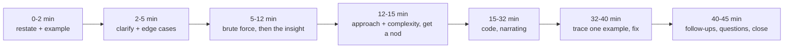

# Interview Day Protocol

> [!abstract] In one sentence
> A coding round is graded on four things — did you understand the problem, did you find a reasonable approach and say why, did you write correct code, and did you test it — and a fixed minute-by-minute protocol guarantees you visibly do all four even when the problem is hard.

**Map:** [[Plans MOC]] → [[DSA Dashboard]]

> [!question] Predict before you read
> You have 45 minutes and the problem looks like [[LC 76 Minimum Window Substring]]. How many minutes do you spend before writing the first line of code, and what has to have happened in those minutes?

## The timeline

> [!example]- Excalidraw version — the same diagram as an editable canvas
> ![[Interview Day Protocol — The timeline.excalidraw]]
> [[Interview Day Protocol — The timeline.excalidraw|Open in Excalidraw]] — needs the Excalidraw plugin (see [[Plugins to Install]]).

| Minutes | Do | Say |
|---|---|---|
| 0–2 | Restate the problem in your words; write one input/output example on the shared editor. | "So I'm given … and I need to return …; for example …" |
| 2–5 | Ask the three or four clarifying questions from the problem's note shape (sizes, duplicates, empty input, value ranges, in-place allowed?). List five edge cases in a comment. | "Can the array be empty? Are values distinct? Do I need the indices or the values?" |
| 5–12 | State the brute force and its complexity, then look for the insight: what work does the brute force repeat? Use the [[Pattern Recognition Table]] cues silently. | "Brute force is O(n²) because …; the waste is …; that suggests a window / a heap / DP." |
| 12–15 | Describe the approach in numbered steps with the complexity. Wait for agreement before coding. | "Plan: 1 … 2 … 3 …; O(n log n) time, O(n) space. Shall I code it?" |
| 15–32 | Code top-down: signature, helper names, the main loop, then helpers. Narrate decisions, not syntax. Leave a `// TODO` rather than stalling. | "I'll use a `Deque` here because I need both ends … this invariant holds because …" |
| 32–40 | Trace the example through the code line by line, out loud. Then the edge cases from minute 3. Fix bugs calmly; a found bug is a point for you. | "Let me run `[3,1,2]` through … `lo = 0`, `hi = 2`, `mid = 1` …" |
| 40–45 | Answer follow-ups (the *Variants & follow-ups* section of every note is the rehearsal); ask one question about the team. | "If the input were a stream, I would …" |

## When you are stuck

1. **Go back to the example.** Solve the example by hand and watch your own hands: the manual procedure *is* the algorithm, usually a brute force you can then optimise.
2. **Name the repeated work.** "I keep rescanning the same range" → prefix sums or a window; "I keep recomputing the same `(i, j)`" → memo; "I keep asking for the minimum" → heap; "I keep asking 'is `x` present'" → set.
3. **Change the question.** Smaller `n`, sorted input, one fewer constraint — solve that, then add the constraint back. Say what you are doing: interviewers reward visible method.

Never go silent for more than a minute. "I'm considering two approaches: … and …; let me think about which one handles duplicates" keeps the interviewer with you.

## Testing out loud

Pick the smallest example that exercises the main loop, then the edge cases: empty, one element, two elements, duplicates, the maximum size (ask about it rather than running it), negatives or zeros if relevant. For each, say the expected output *before* tracing. Point at off-by-one spots deliberately: "the loop runs to `n − 1` inclusive because …".

## Questions worth asking at the end

- "What does the team optimise for in code review — readability, performance, test coverage?"
- "Which part of the system would a new engineer own in the first three months?"
- "What is the on-call like?"
Avoid questions answerable from the job description.

## The close

Summarise in two sentences: the approach, its complexity, and the follow-up you would do with more time. Thank them. Do not apologise for bugs you fixed.

## Running the Sunday mock

Pick a problem you have not solved (use the *not started* list on the dashboard for this week), start a 45-minute timer, follow the table above talking to an empty room (or record yourself), and score 1–5 on: understanding, approach and trade-offs, code correctness, testing, communication. Log the scores in the weekly review note; two consecutive weeks of 4+ on every line is the readiness signal.

## Related

- [[8-Week DSA Plan]] — the Sunday slot
- [[Pattern Recognition Table]] — the cues used in minutes 5–12
- [[Problem-Solving Framework]] — the longer treatment of the same protocol
- [[Mistakes Log]] — where a mock's failures go
