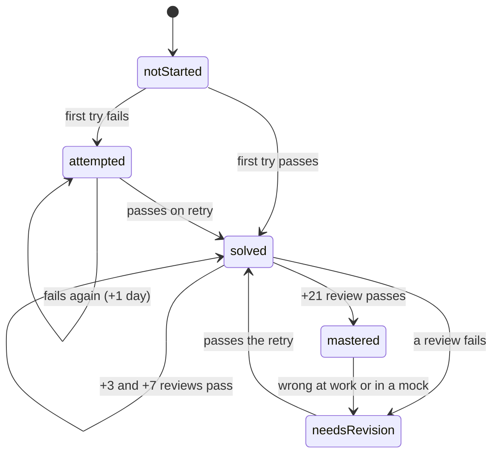

# Spaced Repetition Protocol

> [!abstract] In one sentence
> A problem is not learned when it is solved once; it is learned when it is solved again after three days, after seven, and after twenty-one — each pass widening the gap and each failure resetting it — and the whole schedule lives in two properties, `next_review` and `status`, that the dashboard reads.

**Map:** [[Plans MOC]] → [[DSA Dashboard]]

> [!question] Predict before you read
> You solved [[LC 207 Course Schedule]] today with no hints in 22 minutes. Which three dates should it reappear on, and what happens to that schedule if the day-7 attempt fails?

## The ladder

| Attempt | If it passes | If it fails |
|---|---|---|
| First solve (any day) | `next_review` = today + 3, `confidence: 2` | `status: attempted`, `next_review` = tomorrow, log in [[Mistakes Log]] |
| +3 day review | `next_review` = today + 7, `confidence: 3` | `status: needs-revision`, `next_review` = today + 2, `confidence: 2` |
| +7 day review | `next_review` = today + 21, `confidence: 4` | `status: needs-revision`, `next_review` = today + 3, `confidence: 3` |
| +21 day review | `status: mastered`, `confidence: 5`, `next_review` empty | `status: needs-revision`, `next_review` = today + 7 |

A **pass** means: solved from a blank editor, without opening the note, within 25 minutes (Easy: 15), stating the complexity before coding, and the code ran on the edge cases you listed in the note. Anything less is a fail — a fail is information, not a verdict.

Topic notes use the same ladder with a different test: a pass is writing the *Personal understanding* block from memory and ticking at least four mastery boxes honestly.



(State names map to the `status` property: `not-started`, `attempted`, `solved`, `needs-revision`, `mastered`.)

## What to type after an attempt

Open the problem note, add a row to the attempt log and set the properties — thirty seconds:

```yaml
status: solved          # or attempted / needs-revision / mastered
attempts: 2             # increment every time
last_solved: 2026-11-18 # the date of the last PASS
next_review: 2026-11-21 # today + 3 / + 7 / + 21, or tomorrow after a fail
confidence: 3           # 1–5, honest
time_minutes: 22        # of the last attempt
```

## How the dashboard reads it

The *Revision Queue* base shows, in order: `needs-revision` problems first, then anything with `next_review <= today`, then low-confidence (≤ 2) started problems, then anything not touched for 30 days. The *Due now* view is the day's work list; *Scheduled* shows what is coming. Problems and topics are mixed on purpose: a topic due for review is a 20-minute explain-back, not a problem.

## The Sunday ritual (45 minutes + the mock)

1. Create the weekly review note from the template; the automatic sections list what you solved and reviewed this week.
2. Read the [[Mistakes Log]] rows from this week; if the same category appears three times, that category is next week's morning reading.
3. Look at *Revision Queue → Scheduled* for the coming week and move overloaded days (more than three reviews) by one day.
4. Run the mock ([[Interview Day Protocol]]), then log it in the review note.

## Why these gaps

Three, seven and twenty-one days are the shortest gaps at which a forgotten solution reappears often enough to be relearned cheaply; longer initial gaps feel efficient but produce more full relearns. The ladder resets on a fail because a fail means the memory was not stable at that gap. Mastered problems still come back when a related problem fails or a mock exposes them — mastery is a state, not a retirement.

## Related

- [[8-Week DSA Plan]] — where the first solves are scheduled
- [[Mistakes Log]] — what to record on a fail
- [[Interview Day Protocol]] — the mock that stresses the schedule
- [[Pattern Recognition Table]] — a cheaper first step when a review fails on recognition rather than on coding
