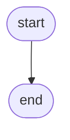

# {{title}}

> [!abstract] In one sentence
>

**Map:** [[NeetCode 150 MOC]] → [[DSA Dashboard]] · Pattern: [[ ]]

> [!question] Predict before you read
>

## Problem

## Clarifying questions

1.

## Brute force

## The key insight

## Optimal approach

1.



## Walkthrough

| step | state | note |
|---|---|---|
| | | |

## Java solution

```java
import java.util.*;

class Solution {
}
```

**Time** O(?) · **Space** O(?)

## Why it works

## Edge cases

-

## Common mistakes

> [!warning] What goes wrong
> -

## Variants & follow-ups

-

## Interview script

## Related

- Pattern:
- Similar:

## Attempt log

| Date | Result | Minutes | What I got wrong |
|---|---|---|---|
| | | | |

### Mastery checklist
- [ ] Solved without hints in under 25 minutes
- [ ] Stated complexity before coding
- [ ] Handled every edge case above
- [ ] Code compiled first time
- [ ] Can do the follow-up variant

## Open questions
- [ ]
