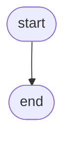

# {{title}}

> [!abstract] In one sentence
>

**Map:** [[Topics MOC]] → [[DSA Dashboard]]

> [!question] Predict before you read
>

## Why this exists

## The idea from zero

## The mechanism



## Java template

```java
import java.util.*;

class Template {
}
```

## Complexity

| Operation | Cost | Why |
|---|---|---|
| | | |

## The canonical shapes

| Shape | Recognition cue | Tool | First problem |
|---|---|---|---|
| | | | |

## Worked example

## Pitfalls

> [!warning] What goes wrong
> -

## Variations & follow-ups

## Interview script

## Spot the bug

```java
// snippet
```

> [!example]- The fix
>

## Related

### Prerequisites
-

### Builds on this
-

### Problems that use it
-

## Personal understanding

> [!question] Explain it without the note
> Write your own explanation here, from memory, then compare with the sections above and note what you missed.

### Mastery checklist
- [ ] I can state the idea in one sentence
- [ ] I can re-derive the mechanism on a whiteboard
- [ ] I can name when NOT to use it
- [ ] I have solved three problems with it without hints
- [ ] I can explain it to a colleague in two minutes

## Open questions
- [ ]
