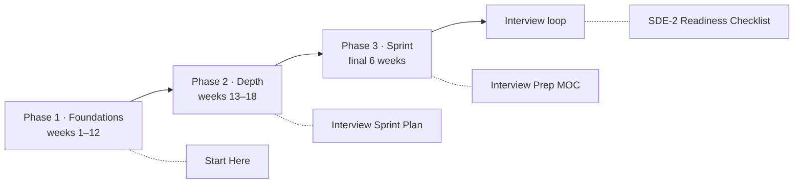

# Engineering Dashboard

> [!abstract] What this page answers
> **What should I learn next? What needs revision? What am I building, and what is blocking it?** Every table below is a live view over note properties (native Bases — no plugin). Update `status`, `confidence`, `last_reviewed` and `next_review` inside a note and the dashboard follows. New here? Read [[Start Here]].

> [!info] Quick navigation
> **Learn** [[Start Here]] · [[HLD MOC]] · [[Knowledge Graph]] — **Design** [[Problem Bank MOC]] — **Build** [[Projects MOC]] — **Interview** [[Interview Prep MOC]] · [[SDE-2 Interview Framework]] · [[Interview Sprint Plan]] — **Read** [[Resources MOC]] — **Review** [[Reviews MOC]] · [[Workspace Guide]] · [[HLD Vault Status]]

**On this page:** [[#1. Current learning priorities|Learning priorities]] · [[#2. System design practice|Design practice]] · [[#3. Practical engineering|Projects]] · [[#4. Knowledge gaps|Gaps]] · [[#5. Weekly progress|Weekly]] · [[#6. Progress overview|Progress]] · [[#7. Interview readiness|Interview readiness]]

> [!todo] Today's three moves *(edit by hand, keep it to three)*
> 1. 
> 2. 
> 3. 

## Where you are in the plan

*Phase 1 is the twelve-week order in Start Here; the sprint is the last six weeks before the loop. Click a box to open the plan for that phase.*



---

## 1. Current learning priorities

### Concepts currently being studied
*Status `reading` or `understood` — finish the first pass, then explain it without the note.*

![[Concepts.base#Studying]]

### High-priority topics not yet explored
*Pick the next one from the top; the order in [[Start Here]] is the recommended sequence.*

![[Concepts.base#High priority not started]]

### Concepts requiring revision
*Flagged `needs-revision`, or `next_review` has passed. Re-explain from memory, then set a new `next_review` (×2 the previous gap if it went well, 3 days if it did not).*

![[Revision Queue.base#Due now]]

### Topics where my confidence is low
*Started but still at confidence 1–2. These are the ones to talk through with someone.*

![[Concepts.base#Low confidence]]

---

## 2. System design practice

### Problems not yet explored

![[Problems.base#Not started]]

### Problems currently being designed

![[Problems.base#In progress]]

### Problems completed

![[Problems.base#Completed]]

### Designs that need another iteration

![[Problems.base#Needs revision]]

---

## 3. Practical engineering

### Active projects — current milestone, next task, blocker

![[Projects.base#Active]]

### Backlog

![[Projects.base#Backlog]]

### Next implementation tasks and technical challenges
*Rolled up from the `## Current tasks` and `## Technical challenges` sections of every project note (requires the Dataview plugin; the tables above work without it).*

> [!example]- Open tasks across projects (Dataview)
> ```dataview
> TASK FROM "04 Projects"
> WHERE !completed AND meta(section).subpath = "Current tasks"
> GROUP BY file.link
> ```

> [!example]- Technical challenges to resolve by experiment (Dataview)
> ```dataview
> TASK FROM "04 Projects"
> WHERE !completed AND meta(section).subpath = "Technical challenges"
> GROUP BY file.link
> ```

### Completed projects

![[Projects.base#Shipped]]

---

## 4. Knowledge gaps

Tag a note's `tags` property with one of these and it appears below: `gap/explain` (studied but cannot explain clearly) · `gap/decision` (a design decision I do not fully understand) · `gap/internals` (a technology I use without understanding its internals) · `gap/hands-on` (needs an experiment). Remove the tag when the gap closes.

![[Concepts.base#Gaps]]

> [!question]- Gaps that are not a single note *(edit by hand)*
> - **Design decisions I do not fully understand:** 
> - **Technologies I have used without understanding their internals:** 
> - **Topics requiring hands-on experimentation:** 

---

## 5. Weekly progress

### Latest weekly review

![[Reviews.base#Latest]]

### Concepts reviewed in the last 7 days

![[Concepts.base#Reviewed this week]]

### Design problems worked in the last 7 days

![[Problems.base#Worked this week]]

### Projects advanced in the last 7 days

![[Projects.base#Updated this week]]

> [!tip] Key technical insights and next week's priorities live in the weekly review note — create one from `Templates/Weekly Review Template.md` every Sunday. [[Reviews MOC]] explains the routine.

---

## 6. Progress overview

### By category — count and average confidence (summary row at the bottom of each group)

![[Concepts.base#By category]]

### Confidence distribution and completion (Dataview)

> [!example]- Confidence distribution across the curriculum
> ```dataviewjs
> const pages = dv.pages('"01 HLD & System Design"').where(p => p.type == "concept");
> const total = pages.length;
> const bar = n => "█".repeat(Math.round(30 * n / Math.max(total, 1))) + " " + n;
> dv.header(4, `${total} concept notes`);
> dv.table(["Status", "Count", ""],
>   ["not-started", "reading", "understood", "applied", "needs-revision"].map(s => {
>     const n = pages.where(p => p.status == s).length; return [s, n, bar(n)]; }));
> dv.table(["Confidence", "Count", ""],
>   [1, 2, 3, 4, 5].map(c => { const n = pages.where(p => (p.confidence ?? 1) == c).length; return [c, n, bar(n)]; }));
> const atLeast3 = pages.where(p => (p.confidence ?? 1) >= 3).length;
> dv.paragraph(`**Can explain the mechanics (confidence ≥ 3):** ${atLeast3} / ${total} (${Math.round(100 * atLeast3 / Math.max(total, 1))}%)`);
> ```

> [!example]- Per-category confidence
> ```dataviewjs
> const pages = dv.pages('"01 HLD & System Design"').where(p => p.type == "concept");
> const cats = [...new Set(pages.map(p => p.category))].sort();
> dv.table(["Category", "Notes", "Started", "Avg confidence", "≥ 3"], cats.map(c => {
>   const ps = pages.where(p => p.category == c);
>   const started = ps.where(p => p.status != "not-started").length;
>   const avg = (ps.map(p => p.confidence ?? 1).array().reduce((a, b) => a + b, 0) / Math.max(ps.length, 1)).toFixed(1);
>   const ge3 = ps.where(p => (p.confidence ?? 1) >= 3).length;
>   return [c, ps.length, started, avg, ge3]; }));
> ```

> [!example]- Design problems and projects
> ```dataviewjs
> const probs = dv.pages('"02 System Design Problems"').where(p => p.type == "problem");
> const projs = dv.pages('"04 Projects"').where(p => p.type == "project");
> const decisions = dv.pages('"04 Projects/Decisions"').where(p => p.type == "decision");
> dv.paragraph(`**Problems:** ${probs.length} total · ${probs.where(p => p.status == "reviewed").length} completed · ${probs.where(p => ["exploring","designing","implementing"].includes(p.status)).length} in progress · ${probs.where(p => p.status == "needs-revision").length} need revision`);
> dv.paragraph(`**Projects:** ${projs.length} total · ${projs.where(p => p.status == "active").length} active · ${projs.where(p => p.status == "shipped").length} shipped`);
> dv.paragraph(`**Architecture decisions documented:** ${decisions.length}`);
> ```

---

## 7. Interview readiness

*The sprint's burndown. Tiers come from each problem's `interview_tier` property; readiness is `reviewed` + confidence 4. Everything here is explained in [[Interview Prep MOC]]; the framework, probes, cheat sheets and sprint plan live in `06 Interview Prep/`.*

### Core problems not yet reviewed
*Design it timed, compare with the reference, then set `status: reviewed` and `confidence`.*

![[Interview Readiness.base#Core not yet reviewed]]

### Core problems — readiness

![[Interview Readiness.base#Core problems]]

### Must-know concepts still below confidence 3
*High-priority concepts the sprint cannot start with. Re-explain one a day.*

![[Interview Readiness.base#Must-know concepts below 3]]

### Latest mock interviews
*Create one from `Templates/Mock Interview Template.md` in `06 Interview Prep/Mocks` after every mock.*

![[Mock Interviews.base#Latest]]

> [!example]- Readiness summary (Dataview)
> ```dataviewjs
> const probs = dv.pages('"02 System Design Problems"').where(p => p.type == "problem");
> const tier = t => probs.where(p => p.interview_tier == t);
> const ready = ps => ps.where(p => p.status == "reviewed" && (p.confidence ?? 1) >= 4).length;
> dv.table(["Tier", "Problems", "Reviewed", "Ready (reviewed + confidence ≥ 4)", "Avg confidence"],
>   ["core", "likely", "stretch"].map(t => { const ps = tier(t); const avg = (ps.map(p => p.confidence ?? 1).array().reduce((a, b) => a + b, 0) / Math.max(ps.length, 1)).toFixed(1);
>     return [t, ps.length, ps.where(p => p.status == "reviewed").length, ready(ps), avg]; }));
> const concepts = dv.pages('"01 HLD & System Design"').where(p => p.type == "concept" && p.priority == "high");
> const below = concepts.where(p => (p.confidence ?? 1) < 3).length;
> dv.paragraph(`**High-priority concepts below confidence 3:** ${below} / ${concepts.length}`);
> const mocks = dv.pages('"06 Interview Prep/Mocks"').where(p => p.type == "mock");
> const last = mocks.sort(p => p.date, "desc").array().slice(0, 2);
> const ok = last.length == 2 && last.every(m => (m.score_tradeoffs ?? 0) >= 4 && (m.score_communication ?? 0) >= 4);
> dv.paragraph(`**Mocks logged:** ${mocks.length} · **last two scored 4+ on trade-offs and communication:** ${ok ? "yes" : "not yet"}`);
> ```
