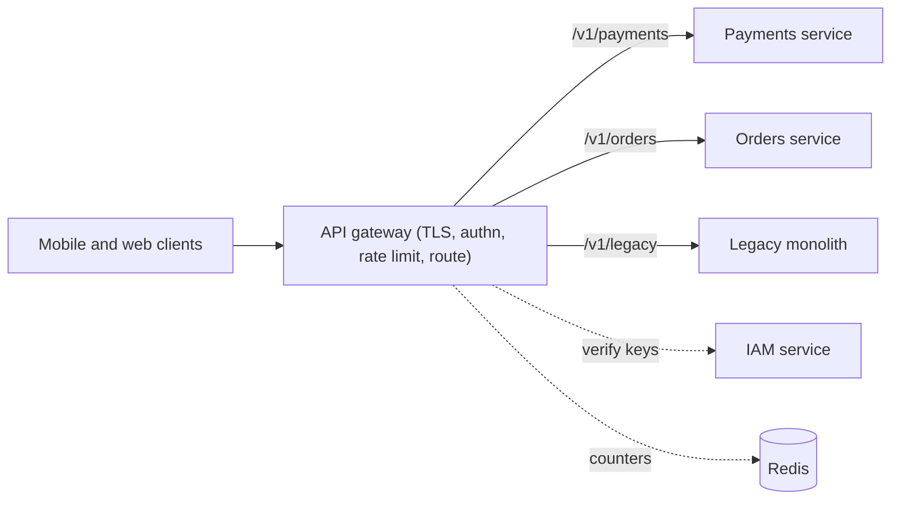

# API Gateways

> [!abstract] In one sentence
> An API gateway is the one door into a service landscape: it routes each request to the right backend and applies authentication, rate limits, transformations and telemetry at the edge, so individual services do not reimplement them — provided you keep business logic out of it.

> [!tip] Deeper treatment in your system-design vault
> `system-design/03 Traffic Management/API Gateway.md` — read it *after* you have written your own explanation below.

**Map:** [[Architecture Patterns MOC]] → [[HLD MOC]]

## Definition

An **API gateway** is a [[Reverse Proxies|reverse proxy]] specialised for APIs. It terminates client connections, matches each request to a route, applies a chain of policies (authn/authz, [[Rate Limiting|rate limiting]], validation, header rewriting, caching, logging) and forwards the request to a backend service discovered at runtime. Unlike a plain [[Load Balancers|load balancer]], which distributes identical requests across identical replicas, a gateway understands the API and makes decisions per route and per caller.

## Problem solved

With many services behind one product, every service would otherwise validate tokens, enforce quotas, emit edge metrics and handle TLS — in several languages, inconsistently, with each team's bugs. Clients would need every service's address, and topology changes would leak to mobile apps that cannot be redeployed. The gateway gives clients one stable address and the platform one place to enforce policy and observe the edge; in a [[Strangler Pattern|strangler]] migration it is the facade that moves routes without clients noticing.

## How it works

1. **Ingress and TLS.** The gateway terminates [[TLS]] and keeps pooled connections to backends ([[Connection Pooling]]).
2. **Routing.** A route table maps `(host, path prefix, method)` to an upstream — `/v1/payments/*` → `payments-service` — resolved through [[Service Discovery]].
3. **Policy chain per route.** Request validation → [[Authentication|authentication]] (verify the [[JWT]] against the IAM service's keys, or an [[API Keys|API key]]) → coarse [[Authorization|authorization]] (scope matches route) → rate limiting keyed on caller → header injection (user id, request id) → forward.
4. **Response path.** Correlation headers added, internal headers stripped, GET responses optionally cached, latency and status recorded per route.
5. **Resilience.** Per-upstream timeouts, [[Circuit Breakers|circuit breakers]] and retries for idempotent methods only ([[Timeouts and Retries]]).

Scope matters. A **load balancer** distributes identical requests with no API awareness; an **API gateway** applies policy and routing per API; a **BFF** (backend-for-frontend) is an aggregation layer owned by a client team that composes several service calls into one response. Aggregation belongs in a BFF or the services; a gateway that joins data from three services and applies business rules has become a monolith everyone must deploy through.

```yaml
# Kong-style declarative route (illustrative)
routes:
  - name: payments
    paths: ["/v1/payments"]
    service: payments-svc
    plugins:
      - name: jwt
      - name: rate-limiting
        config: { minute: 600, policy: redis }
```

## Architecture



## Use cases

- More than a handful of services exposed to external or mobile clients that need one stable hostname and one auth story.
- Cross-cutting requirements phrased as "every API must…" (authenticate, be rate limited, be logged with a request id).
- Incremental migration where routes move between old and new backends, or a public API product needing per-key quotas and metering.

## Limitations

- It is on every request path: a gateway outage is a total outage, and gateway latency is added to every call.
- Logic accumulates: transformations, composition and "small" business rules turn it into a shared monolith with a central release process.
- Internal service-to-service traffic should usually not traverse it, and managed gateways impose their own limits (payload size, timeout caps, per-request pricing) that leak into API design.

## Trade-offs

| You gain | You sacrifice |
|---|---|
| One place to enforce auth, quotas and telemetry across all APIs | A single point of failure that must be highly available and fast |
| Clients decoupled from service topology | An extra hop of latency on every request |
| Policy changes without redeploying services | Clean ownership — the gateway's config becomes contested ground between teams |

## Failure modes

- **Gateway saturation** (CPU on TLS or JWT verification, connection limits) → every API's p99 rises together → noticed as gateway-level latency with healthy backends; fix with horizontal scaling and key caching.
- **Misrouted or over-broad route** after a config change → requests hit the wrong service or bypass auth → security incident; needs config review, tests and canary rollout.
- **Retries at the gateway on non-idempotent routes** → duplicate payments during a backend blip → noticed in reconciliation; restrict retries to idempotent methods ([[Idempotency]]).
- **Key-set or IAM outage** → the gateway cannot verify tokens → total auth failure; cache signing keys with a grace period and fail closed deliberately.

## Performance

A well-tuned gateway adds on the order of a millisecond per request (TLS, route match, signature check, counter increment). JWT verification is CPU-bound and benefits from cached keys; distributed rate-limit counters add a Redis round trip unless done locally with periodic sync. Connection reuse to backends is the main lever for tail latency.

## Scalability

Gateways are stateless when counters live in Redis, so they scale horizontally. At 10x the pressure points are TLS handshakes (push to a CDN or L4 balancer), rate-limit counter hot keys ([[Hot Keys]]) and route-table size. Organisationally, let teams own their routes' config in version control rather than a central team editing one file.

## Operational impact

Moderate: one more highly available component with its own dashboards (per-route latency, errors, 429s, auth failures), config management with review and canary, and an upgrade cadence. It centralises debugging — a request id minted at the gateway starts every [[Distributed Tracing|trace]] — and its config changes are among the highest-risk deploys in the system.

## Alternatives

- **Plain [[Load Balancers|load balancer]] or ingress** plus per-service middleware — wins for a few services with one language and a shared library for auth.
- **Service mesh sidecars** — win for internal traffic policy (mTLS, retries, telemetry), not for the external edge.
- **BFF per client type** — wins when clients need aggregation and tailored responses; often sits behind a gateway rather than replacing it.

## Real-world examples

- Netflix's Zuul was the early open-source programmable edge gateway; Kong, Envoy-based gateways and AWS API Gateway are the common production choices, and Uber's edge gateway is described in [[Uber - Domain-Oriented Microservice Architecture]].
- Stripe and GitHub expose rate limits, versioning and auth uniformly at their API edge — the behaviour a gateway makes consistent.
- In a stack like yours: an ingress-backed gateway on EKS verifying JWTs issued by the IAM service, rate limiting per client in Redis, routing `/v1/*` to Spring Boot and NestJS services, and acting as the switch when a legacy route moves to a new service.

## Practical exercise

1. Run Kong (or Envoy Gateway) with two NestJS or Spring Boot services in Docker Compose; add routes for `/orders` and `/payments`.
2. Enable JWT verification using a key you generate; measure p99 with and without the gateway using k6.
3. Add a Redis-backed limit of 100 requests per minute per client and verify 429 plus `Retry-After` under a k6 burst.
4. Inject 2 s latency into `payments` with [[Toxiproxy]]; configure an upstream timeout and observe which requests fail fast.
5. Move `/orders` to a second "new" service by changing only gateway config, 10% of traffic first — a strangler in miniature.

## Related concepts

### Prerequisites
- [[HTTP and HTTPS]] — the protocol the gateway speaks
- [[Reverse Proxies]] — the gateway is a specialised one
- [[Load Balancers]] — what sits in front of and behind it
- [[Microservices]] — the landscape it fronts

### Related
- [[Authentication]] and [[JWT]] — token verification at the edge
- [[Service Discovery]] — how upstreams are resolved
- [[Circuit Breakers]] — per-upstream protection
- [[Distributed Tracing]] — the trace starts here
- [[Rate Limiting]] — enforced per caller at the edge

### Builds on this
- [[Strangler Pattern]] — the gateway as migration facade
- [[Monitoring User-Facing Performance]] — edge metrics are the closest proxy for user experience

### Design problems where it applies
- [[Design an API Gateway]]
- [[Design a Rate Limiter]]
- [[Design an IAM Service]]

### Projects where it can be implemented
- [[LLM Gateway]]
- [[Rate Limiter Library]]

### Resources
- [[Uber - Domain-Oriented Microservice Architecture]] — the edge in a large service landscape
- [[Building Microservices]] — gateways, BFFs and what not to put in them
- [[System Design Interview (Alex Xu)]] — the rate-limiter and edge chapters

## Personal understanding

> [!question] Explain it without the source
> Write your own explanation here, from memory. Then compare it with the sections above and note what you missed.

### Mastery checklist
- [ ] I can explain it without the original resource
- [ ] I can describe the problem it solves
- [ ] I can compare it with its alternatives
- [ ] I can name its limitations and failure modes
- [ ] I can recognise when it is appropriate in a real system
- [ ] I have applied it in a system design
- [ ] I have validated my assumptions with an experiment or implementation

## Open questions

- [ ] Should the gateway do fine-grained authorization (resource ownership) or only coarse scope checks, and what does the IAM service expose to make that call?
- [ ] How do you canary a gateway config change safely when every route shares one process?
- [ ] At what point does a BFF per client (web, mobile) pay for itself versus one gateway with response shaping?
