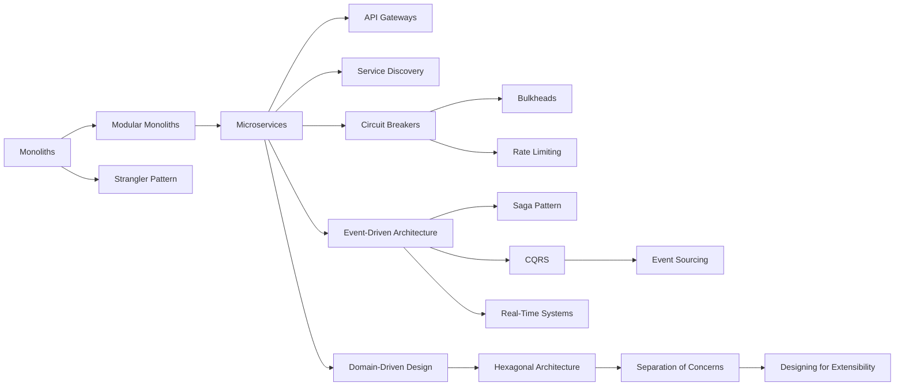

# Architecture Patterns

> [!abstract] How services are shaped, split and protected.
> The monolith-to-microservices spectrum without religion, the edge (gateways, discovery), the resilience trio (circuit breakers, bulkheads, rate limiting), and the data patterns (sagas, CQRS, event sourcing). Real-Time Systems is the hub note for anything that pushes updates to clients.

**Map:** [[HLD MOC]] → this · [[Start Here]] for the reading plan · [[Engineering Dashboard]] for progress

## Start with these

[[Monoliths]] → [[Modular Monoliths]] → [[Microservices]] → [[API Gateways]] → [[Circuit Breakers]] → [[Rate Limiting]] → [[Saga Pattern]] → [[Event-Driven Architecture]]

## How the ideas connect

*Every node is a link — click to open the note. Arrows mean "read this first".*



## Concepts

### Core — know these cold for SDE-2

- [[Monoliths]] — One deployable, one process, one database: the cheapest architecture to build, test and operate
- [[Modular Monoliths]] — A single deployable whose internal modules have explicit public interfaces, enforced dependency rules and private data, giving you service-like boundaries without…
- [[Microservices]] — Independently deployable services that each own their data and talk over the network, trading in-process simplicity for team autonomy, independent scaling and a…
- [[Event-Driven Architecture]] — Services publish immutable facts about what happened and other services react to them, removing call-time coupling between producer and consumer at the price of eventual…
- [[API Gateways]] — A single entry point that routes client requests to backend services and handles cross-cutting edge concerns once
- [[Circuit Breakers]] — A per-dependency switch that stops calling a dependency once it is failing beyond a threshold, fails fast for a cooling period, then probes before resuming
- [[Rate Limiting]] — Bound how many requests a caller or a system accepts per unit of time, using token bucket, leaky bucket or window counters, to protect capacity, enforce fairness…
- [[Saga Pattern]] — A long-running business transaction spanning services is executed as a sequence of local transactions, each with a compensating action that semantically undoes it
- [[Real-Time Systems]] — Systems that push updates to connected clients are a chain — persistent connections, an event stream, fan-out, backpressure, client state, ordering, reconnection…

### Important — read once, revisit when a design needs it

- [[CQRS]] — Separate the model that handles writes from the models that serve reads
- [[Event Sourcing]] — Store every state change as an immutable event in an append-only log and derive current state by replay
- [[Service Discovery]] — A registry of healthy service instances and their current addresses, consulted by clients or by a proxy
- [[Bulkheads]] — Partition capacity — threads, connections, queues, instances or whole cells — so that a failure or overload in one partition cannot consume the resources of the others…
- [[Strangler Pattern]] — Replace a legacy system incrementally by putting a facade in front of it and routing one slice of functionality at a time to a new implementation, until the old system…
- [[Hexagonal Architecture]] — Keep domain logic in the centre with no knowledge of HTTP, databases or brokers
- [[Domain-Driven Design]] — Model software around the business domain using a shared language, split it into bounded contexts with their own models
- [[Separation of Concerns]] — Give each part of a system one responsibility and one reason to change, keep related things together and unrelated things apart
- [[Designing for Extensibility]] — Make the changes you can reasonably predict cheap — through stable contracts, explicit extension points, configuration and versioned interfaces — while refusing to build…

## Where it shows up

**Design problems that lean on this category:** [[Design a Payment System]], [[Design an API Gateway]], [[Design a Notification System]], [[Design a Digital Wallet and Ledger]], [[Design an Inventory Management System]], [[Design a Ride-Sharing Service]], [[Design a Webhook Delivery System]], [[Design a Ticket Booking System]]

**Projects that exercise it:** [[Double-Entry Ledger Service]], [[LLM Gateway]], [[Webhook Relay]], [[Durable Job Scheduler]], [[Presence and Chat Service]], [[Rate Limiter Library]]

## Progress in this category

Status and confidence come from each note's properties — update them in the note, the table updates itself (native Bases, no plugin).

```base
filters:
  and:
    - file.hasTag("concept")
    - category == "Architecture Patterns"
formulas:
  rank: 'if(priority == "high", 1, if(priority == "medium", 2, 3))'
properties:
  file.name:
    displayName: Concept
  formula.rank:
    displayName: "#"
views:
  - type: table
    name: Tracker
    order:
      - file.name
      - priority
      - status
      - confidence
      - last_reviewed
      - next_review
    sort:
      - property: formula.rank
        direction: ASC
      - property: file.name
        direction: ASC
    summaries:
      confidence: Average
```
