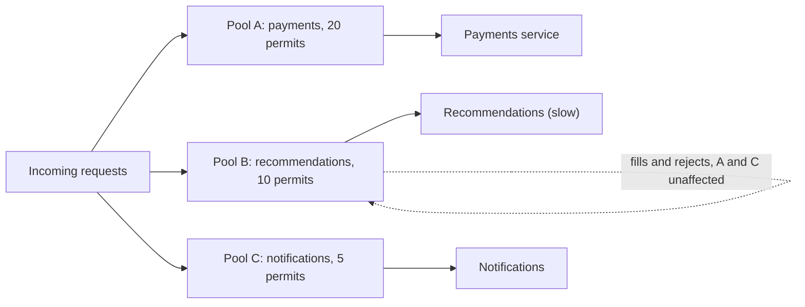

# Bulkheads

> [!abstract] In one sentence
> A bulkhead gives each dependency, tenant or workload its own bounded pool of resources, so when one of them floods — a slow downstream, a noisy customer — the water stays in its compartment and the rest of the ship keeps sailing.

> [!tip] Deeper treatment in your system-design vault
> `system-design/12 Resilience/Bulkheads and Isolation.md` — read it *after* you have written your own explanation below.

**Map:** [[Architecture Patterns MOC]] → [[HLD MOC]]

## Definition

The **bulkhead pattern** isolates parts of a system into compartments with separate, capped resources so failures cannot spread by resource exhaustion. The compartment can be a thread pool or semaphore per dependency inside a process, a connection pool per downstream, a queue per tenant, a set of instances per customer tier, or an entire **cell** (a full stack serving a slice of customers). The name is from ship design: watertight bulkheads keep one breached compartment from sinking the vessel.

## Problem solved

Shared pools make failures contagious. A service calling five dependencies through one thread pool is healthy until one slows down: its calls hold threads until timeout, the pool fills with doomed work, and the four healthy dependencies become unreachable. The same happens with one connection pool, one queue or one fleet shared by all tenants — a single hot tenant ([[Hot Keys]]) starves everyone. [[Circuit Breakers]] stop calling a sick dependency; bulkheads bound how much of you it can take down first, and they are the only answer when the neighbour is legitimate but heavy rather than failing.

## How it works

1. **Per-dependency pools inside a process.** Each downstream gets its own executor or semaphore: `payments` 20 permits, `recommendations` 10. When `recommendations` hangs, at most 10 threads are lost. Semaphore bulkheads are cheap (no extra threads); thread-pool bulkheads isolate the caller's thread too but cost context switches and memory. Resilience4j supports both.
2. **Per-dependency connection pools.** Separate [[Connection Pooling|connection pools]] per downstream or workload class, so the report generator cannot drain the pool checkout needs.
3. **Per-tenant or per-priority queues.** Bounded queues per tenant or priority with a fair scheduler, so one tenant's million-message backlog does not delay the others ([[Message Queues]]).
4. **Instance-level isolation.** Dedicated replicas or node pools per traffic class (interactive vs batch, premium vs free); separate Kubernetes Deployments with resource limits make this cheap.
5. **Cells and shuffle sharding.** Divide the fleet into N independent cells and assign each customer to one; an outage affects 1/N of customers. **Shuffle sharding** gives each customer a random subset of nodes, so a poison customer takes down only those who overlap heavily — 8 nodes in subsets of 2 give 28 distinct combinations ([[AWS Builders Library - Shuffle Sharding]]).

Every bulkhead must be **bounded** and **observable**: an unbounded queue is a delayed outage, and a pool that rejects silently is an invisible one. Rejections are fast failures that should feed a fallback ([[Graceful Degradation]]).

```java
Bulkhead payments = Bulkhead.of("payments", BulkheadConfig.custom()
    .maxConcurrentCalls(20).maxWaitDuration(Duration.ofMillis(50)).build());
Supplier<Receipt> guarded = Bulkhead.decorateSupplier(payments, () -> client.capture(req));
```

## Architecture



> [!example]- Excalidraw version — the same diagram as an editable canvas
> ![[Bulkheads.excalidraw]]
> [[Bulkheads.excalidraw|Open in Excalidraw]] — needs the Excalidraw plugin (see [[Plugins to Install]]).


## Use cases

- A service with several dependencies of unequal importance; the requirement says "checkout must not depend on recommendations being up".
- Multi-tenant platforms where one tenant's load or failure must not affect others' SLOs ([[SLI SLO and SLA]]).
- Mixed workloads on shared infrastructure: interactive traffic beside batch jobs, or a dedicated cell for a customer segment or region.

## Limitations

- Partitioned capacity is wasted capacity: ten pools of 10 cannot absorb a burst that one pool of 100 would; sizing each pool is guesswork that must be revisited.
- Too many small compartments starve legitimate traffic and complicate tuning; too few give no isolation.
- Cells multiply infrastructure, deployment and data-placement complexity; a bulkhead also protects only *your* resources and does nothing for the overloaded dependency.

## Trade-offs

| You gain | You sacrifice |
|---|---|
| Bounded blast radius: one dependency or tenant cannot exhaust everything | Pooled efficiency: capacity reserved for one compartment is unavailable to others |
| Predictable degradation that can be prioritised (payments before recommendations) | Simplicity: more pools, queues and cells to size, monitor and tune |
| Fairness between tenants and workloads | Some rejections of work that a shared pool would have served |

## Failure modes

- **Undersized compartment**: a legitimate traffic increase fills `payments`' 20 permits → bulkhead rejections on the most important path → noticed as a rejection-rate spike with a healthy dependency; size from measured concurrency (Little's law: concurrency = rate x latency).
- **Unbounded queue bulkhead** → memory grows until the process dies → the isolation just delayed the outage; always bound depth and wait time.
- **Silent rejection**: bulkhead-full errors mapped to a generic 500 with no metric → on-call cannot tell overload from a bug; emit distinct metrics and error codes.
- **Cell hot spot**: customer placement skews so one cell carries far more load → that cell degrades while others idle → rebalancing needs tooling built in advance.

## Performance

Semaphore bulkheads cost a few atomic operations per call; thread-pool bulkheads add a hand-off and a context switch (microseconds) plus memory per thread. Separate connection pools raise total open connections against finite database limits (PostgreSQL's `max_connections`). The main effect is positive under partial failure: healthy paths stay flat while the sick path rejects fast.

## Scalability

Per-dependency bulkheads scale with replicas automatically. Cells scale almost linearly — add a cell, place new customers in it — at the cost of a control plane for placement, routing and migration. At 10x tenants, shuffle sharding keeps the probability of two tenants sharing a full node set small without 10x cells.

## Operational impact

Moderate inside a process (permits in use, rejections and wait time per bulkhead; sizing reviews when traffic changes) and high for cells (per-cell deployments, dashboards and a placement service). Debugging improves: a rejection names its compartment, so "which dependency or tenant is the problem?" answers itself.

## Alternatives

- **[[Circuit Breakers]]** — win when the dependency is failing rather than merely heavy; usually combined with a bulkhead.
- **[[Rate Limiting]]** per tenant — wins when fairness can be enforced at admission instead of in resource pools.
- **Priority-based load shedding** ([[Backpressure]]) — wins when you prefer to drop low-value work under overload rather than reserve capacity per class.

## Real-world examples

- Netflix Hystrix isolated every dependency in its own thread pool, with dashboards showing saturation per dependency ([[Netflix - Fault Tolerance in a High Volume Distributed System]]).
- Amazon Route 53 uses shuffle sharding so an abusive customer affects only the nodes it shares with few others ([[AWS Builders Library - Shuffle Sharding]]); cell-based architectures at AWS and Slack cap the blast radius of any deployment or failure.
- In a stack like yours: separate Resilience4j bulkheads and HTTP client pools for the payment provider, the IAM service and notification channels; a dedicated SQS queue or Kafka consumer group for a heavy tenant's webhooks; separate Kubernetes Deployments for interactive and batch workloads.

## Practical exercise

1. Build a NestJS or Spring Boot service calling two downstreams (`payments`, `recommendations`) through a shared pool; add [[Toxiproxy]] in front of each.
2. Load both endpoints with k6; inject 5 s latency into `recommendations` and watch `payments` latency climb as the shared pool starves.
3. Add a semaphore bulkhead per downstream (Resilience4j, or a `p-limit`-style limiter in Node) sized from measured concurrency; repeat and confirm `payments` stays flat while counting rejections.
4. Stretch: simulate 8 nodes and 2-node shuffle shards for 20 tenants in a script, poison one tenant and compute how many others are affected versus simple sharding.

## Related concepts

### Prerequisites
- [[Fault Tolerance]] — the goal: survive partial failure
- [[Connection Pooling]] — the most common resource being partitioned
- [[Timeouts and Retries]] — without timeouts, compartments fill and never drain

### Related
- [[Circuit Breakers]] — fail fast on a sick dependency; the bulkhead bounds the damage before it trips
- [[Rate Limiting]] — isolation at admission rather than in pools
- [[Graceful Degradation]] — what to do with bulkhead rejections
- [[Backpressure]] — shedding load inside a compartment
- [[Hot Keys]] — the tenant-skew problem cells and shuffle sharding address
- [[Retry Storms]] — a full compartment must not trigger retries into it

### Builds on this
- [[API Gateways]] — per-route and per-upstream pools at the edge
- [[Real-Time Systems]] — isolating the connection tier per tenant or region

### Design problems where it applies
- [[Design a Webhook Delivery System]]
- [[Design a Notification System]]
- [[Design an API Gateway]]
- [[Design a Payment System]]

### Projects where it can be implemented
- [[Chaos Lab]]
- [[Webhook Relay]]

### Resources
- [[Release It!]] — the bulkhead stability pattern
- [[AWS Builders Library - Shuffle Sharding]] — cells and shuffle sharding with the combinatorics
- [[Netflix - Fault Tolerance in a High Volume Distributed System]] — thread-pool isolation in production
- [[Resilience4j]] — semaphore and thread-pool bulkhead implementations

## Personal understanding

> [!question] Explain it without the source
> Write your own explanation here, from memory. Then compare it with the sections above and note what you missed.

### Mastery checklist
- [ ] I can explain it without the original resource
- [ ] I can describe the problem it solves
- [ ] I can compare it with its alternatives
- [ ] I can name its limitations and failure modes
- [ ] I can recognise when it is appropriate in a real system
- [ ] I have applied it in a system design
- [ ] I have validated my assumptions with an experiment or implementation

## Open questions

- [ ] How do you size per-dependency pools from traces (rate x latency per dependency) and keep the sizes current as traffic grows?
- [ ] In Node's single-threaded model, what is the right bulkhead — a concurrency limiter per dependency, or separate worker processes?
- [ ] At what customer count does a cell-based architecture pay for its placement and migration tooling?
