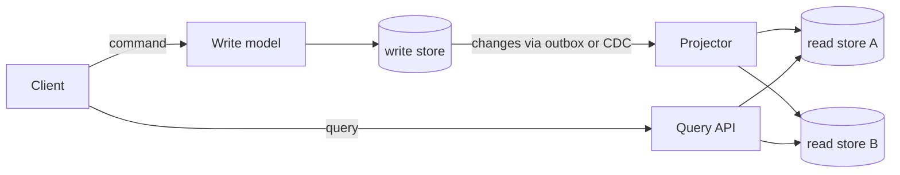

# CQRS

> [!abstract] In one sentence
> CQRS splits a system into a write model that enforces business rules and one or more read models shaped exactly for their queries, kept in sync by events — buying query performance and freedom of shape in exchange for eventual consistency between the two sides.

> [!tip] Deeper treatment in your system-design vault
> `system-design/09 Messaging and Event-Driven/CQRS.md` — read it *after* you have written your own explanation below.

**Map:** [[Architecture Patterns MOC]] → [[HLD MOC]]

## Definition

**Command Query Responsibility Segregation** separates the code and often the storage that process **commands** (requests to change state, validated against invariants) from those that serve **queries** (requests to read state, with no side effects). The write side owns the normalised, rule-enforcing model; each read side is a **projection** — a denormalised view built from the write side's changes and optimised for one access pattern. CQRS does not require [[Event Sourcing]]; it only requires a way to propagate changes.

## Problem solved

One model rarely serves both sides well. Writes want normalised tables, constraints and transactions; reads want pre-joined, pre-aggregated, differently indexed data — a search index, a leaderboard, a customer timeline. Forcing both through one schema produces slow join-heavy reads or a write model distorted by reporting needs. CQRS lets the read side be whatever the query needs ([[Data Modeling]] per use case) and lets each side scale on its own axis, which matters because read and write volumes are usually wildly different.

## How it works

1. **Command path.** `POST /transfers` hits a handler that loads the aggregate, checks invariants (sufficient balance, no duplicate idempotency key), writes to the write store in one transaction and records the change — in an [[Outbox Pattern|outbox]] or via [[Change Data Capture]].
2. **Propagation.** The change reaches projection builders ([[Event-Driven Architecture]]), each an idempotent consumer keyed on the event id.
3. **Projections.** Each builder updates its read store: a denormalised `account_summary` table, an Elasticsearch document, a Redis sorted set. One change may update several projections.
4. **Query path.** `GET /accounts/42/summary` reads the projection directly: no joins, no business logic, no write-store load.
5. **Consistency.** Reads lag writes by the propagation delay. Handle it explicitly: return the new state from the command response, route the next read to the write store, wait for the projection's version, or show "pending".
6. **Rebuild.** Projections are derived, so a bug or a new query shape is fixed by replaying history into a fresh projection — the main superpower, available only if you keep the change history.

```sql
-- write model: normalised, constrained
INSERT INTO ledger_entries (txn_id, account_id, amount, ...) VALUES (...);
-- read model: one row per account, maintained by the projector
UPDATE account_summary SET balance = balance + 1999, last_txn_at = now() WHERE account_id = 42;
```

## Architecture



## Use cases

- Read and write shapes differ sharply: an order is written as header plus lines but read as a customer timeline, a merchant dashboard and a search result.
- Read volume dwarfs write volume and reads must not load the transactional store.
- The same data must live in several specialised stores (relational, search, cache), or new query shapes must be added without touching the write model.

## Limitations

- Eventual consistency between sides must be designed for in the UI and API; "I just saved it and the list does not show it" is the default experience unless handled.
- Two models and a projector mean more code and more infrastructure; for CRUD screens it is pure overhead.
- Projections need rebuild tooling, version tracking and lag monitoring; without a durable change history a projection bug is permanent until manually repaired.

## Trade-offs

| You gain | You sacrifice |
|---|---|
| Read models shaped and stored for each query, with independent scaling | Immediate consistency between what was written and what is read |
| A write model free of reporting concerns | One model: you now maintain two plus the glue |
| Rebuildable views, so a new query is a new projection | Simplicity of debugging — a wrong read may be lag, a projector bug or a replay gap |

## Failure modes

- **Projector lag or stall**: consumer falls behind → users see stale balances → found by lag metrics and a read-store version compared with the write store.
- **Non-idempotent projector** replays an event → double-counted totals → noticed by reconciliation between read and write stores.
- **Partial projection update** across two read stores → search shows an order the summary does not → confusing support tickets; mitigate with per-store idempotency and periodic reconciliation.
- **Lost rebuild path**: change history truncated → a projection bug cannot be fixed by replay → manual data repair.

## Performance

Reads become point lookups on a store designed for them — sub-millisecond from Redis, single-digit milliseconds from a denormalised table — and the write store serves writes only. Writes pay a small extra cost (the outbox insert). The new latency is propagation delay: tens of milliseconds with CDC, longer under backlog. Storage grows because data is duplicated per projection.

## Scalability

Each side scales independently: read stores replicate and shard by their own keys, projectors scale as consumer groups, and the write store sees only writes. At 10x read load you add read replicas or caches without touching the write path; at 10x write load the projectors must keep up, which is where partitioning by aggregate id and projector parallelism matter.

## Operational impact

Moderate to high: more stores, a propagation pipeline to monitor (lag, DLQ depth, projector errors), rebuild runbooks and a way to compare read against write stores. Debugging starts with "which side is wrong, and is it lag?". The payoff is that fixing a read model is a redeploy and a replay rather than a migration.

## Alternatives

- **[[Read Replicas]]** — wins when the read shape is the same as the write shape and you only need to offload load.
- **[[Cache-Aside]] on top of one model** — wins for hot, simple lookups without a second model.
- **Materialised views in the database** — win for a single store when refresh lag is acceptable and no cross-store projections are needed.

## Real-world examples

- Martin Fowler's [[Martin Fowler - CQRS]] describes the pattern and warns against applying it system-wide rather than per bounded context; Kleppmann's [[Turning the Database Inside Out]] frames projections as materialised views maintained from a log.
- Any system keeping a PostgreSQL write model and an Elasticsearch index fed by CDC ([[Debezium]]) is running CQRS, whether or not it uses the name.
- In a stack like yours: a ledger service writing double-entry rows to PostgreSQL, an `account_balance` projection in Redis for the hot read path and a search index for support tooling, both fed from an outbox on Kafka or Redis Streams, with a nightly reconciliation comparing projection against ledger.

## Practical exercise

1. In a NestJS or Spring Boot app, model `ledger_entries` (write) and `account_summary` (read) in PostgreSQL via Docker Compose.
2. Implement the command handler with an outbox and a projector that updates `account_summary` idempotently.
3. Add a Redis projection for `GET /accounts/{id}/balance`; measure its latency against a `SUM()` over `ledger_entries` with 1M rows.
4. Stop the projector, post transfers, and build the read-your-own-writes path (return the new balance from the command, or poll until the projection's version catches up).
5. Introduce a projector bug, then fix it by truncating `account_summary` and replaying the outbox; time the rebuild.

## Related concepts

### Prerequisites
- [[Event-Driven Architecture]] — projections are event consumers
- [[Data Modeling]] — the write shape and the read shapes
- [[Eventual Consistency]] — what the gap between sides means

### Related
- [[Read Replicas]] — the simpler form of read scaling
- [[Outbox Pattern]] and [[Change Data Capture]] — how changes reach projectors
- [[Cache Invalidation]] — a projection is a cache with a defined update path
- [[Search Indexing Pipelines]] — a search index is a projection
- [[Ordering Guarantees]] — projectors need per-aggregate order

### Builds on this
- [[Event Sourcing]] — CQRS with the event log as the write model
- [[Real-Time Systems]] — live views are projections pushed to clients

### Design problems where it applies
- [[Design a Social Feed]]
- [[Design a Digital Wallet and Ledger]]
- [[Design Search Autocomplete]]
- [[Design a Metrics and Monitoring System]]

### Projects where it can be implemented
- [[Double-Entry Ledger Service]]
- [[Live Ops Dashboard]]

### Resources
- [[Martin Fowler - CQRS]] — the definition and the warning
- [[Turning the Database Inside Out]] — projections as materialised views
- [[Designing Data-Intensive Applications]] — derived data in chapter 11

## Personal understanding

> [!question] Explain it without the source
> Write your own explanation here, from memory. Then compare it with the sections above and note what you missed.

### Mastery checklist
- [ ] I can explain it without the original resource
- [ ] I can describe the problem it solves
- [ ] I can compare it with its alternatives
- [ ] I can name its limitations and failure modes
- [ ] I can recognise when it is appropriate in a real system
- [ ] I have applied it in a system design
- [ ] I have validated my assumptions with an experiment or implementation

## Open questions

- [ ] What is the cleanest API contract for read-your-own-writes — a version token the client echoes, or routing the next read to the write store?
- [ ] How long must change history be retained to keep projections rebuildable, and what does that cost on Kafka versus Redis Streams?
- [ ] Where is the line between "a cache" and "a projection" in practice — is it only the presence of a defined update path?
