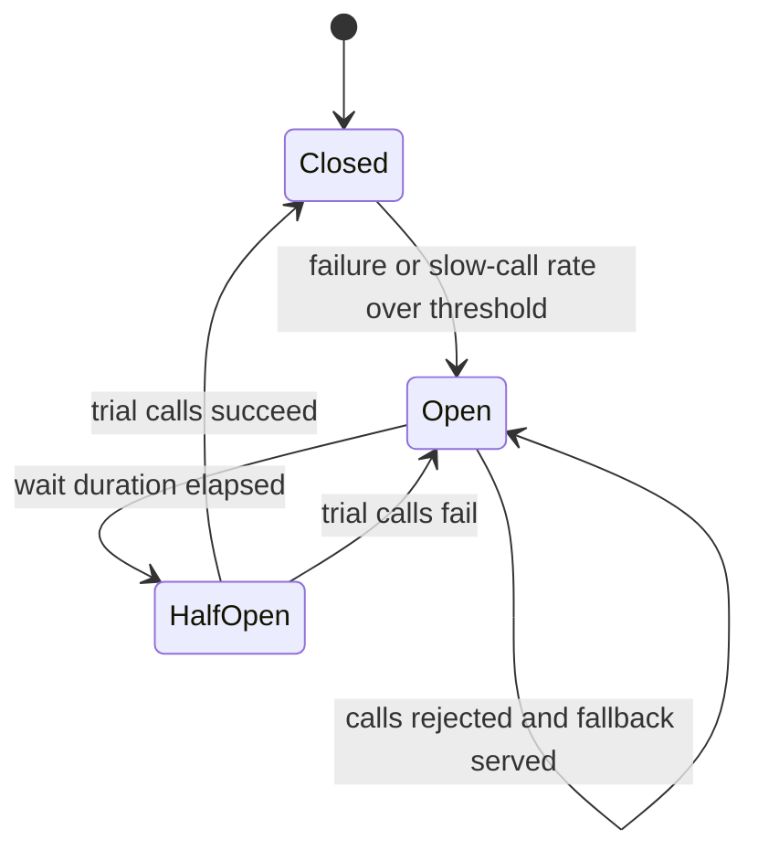

# Circuit Breakers

> [!abstract] In one sentence
> A circuit breaker watches the outcomes of calls to one dependency and, when failures cross a threshold, opens: callers fail immediately instead of waiting on timeouts, the dependency gets room to recover, and a half-open probe decides when to resume.

> [!tip] Deeper treatment in your system-design vault
> `system-design/12 Resilience/Circuit Breakers.md` — read it *after* you have written your own explanation below.

**Map:** [[Architecture Patterns MOC]] → [[HLD MOC]]

## Definition

A **circuit breaker** is a stateful wrapper around calls to a remote dependency with three states. **Closed**: calls pass through and outcomes are recorded. **Open**: calls are rejected immediately with a breaker exception for a wait period. **Half-open**: a limited number of trial calls are allowed; success closes the breaker, failure re-opens it. The failure signal is a rate (or count) of errors and slow calls over a sliding window. It is a client-side pattern: the breaker lives in the caller, one instance per dependency (and often per endpoint or per instance).

## Problem solved

When a dependency becomes slow or unhealthy, naive callers keep calling it. Each call holds a thread and a connection until its [[Timeouts and Retries|timeout]] expires, the caller's pools fill with doomed requests, its latency explodes and it becomes unhealthy to *its* callers — a cascading failure spreading one hop per timeout. Meanwhile the struggling dependency is hammered by retries ([[Retry Storms]]) and cannot recover. The breaker converts "wait, then fail" into "fail now", preserves the caller's capacity for work that can succeed, and gives the dependency quiet.

## How it works

1. **Record outcomes.** Every call records success, failure (exception types you classify as failures — a 404 is not one) or slow call (above a duration threshold), into a sliding window that is count-based (last N calls) or time-based (last N seconds).
2. **Trip.** Once the window holds `minimumNumberOfCalls` samples and the failure or slow-call rate exceeds the threshold (Resilience4j defaults: 50% over 100 calls), the breaker goes **open** and starts `waitDurationInOpenState` (default 60 s).
3. **Fail fast.** While open, calls are rejected without touching the network and the caller runs a **fallback**: cached data, a default, a degraded response or a clean error ([[Graceful Degradation]]). The fallback must be cheaper than the call and must not depend on the sick dependency.
4. **Probe.** After the wait the breaker goes **half-open** and permits a few trial calls (default 10). Success closes it and clears the window; failure re-opens it, optionally with a longer wait.
5. **Expose state.** State and transitions are metrics and log lines; an open breaker is an alert, because it means a dependency is down from this caller's point of view.

Breakers do not replace timeouts: without a timeout a hung call never produces a failure and the breaker never trips. The usual stack is timeout → bounded retry (idempotent only) → breaker → bulkhead, each handling a different failure shape.

```java
CircuitBreakerConfig cfg = CircuitBreakerConfig.custom()
    .slidingWindowSize(50).minimumNumberOfCalls(20)
    .failureRateThreshold(50).slowCallDurationThreshold(Duration.ofMillis(800))
    .waitDurationInOpenState(Duration.ofSeconds(30)).permittedNumberOfCallsInHalfOpenState(5)
    .build();
```

## Architecture



> [!example]- Excalidraw version — the same diagram as an editable canvas
> ![[Circuit Breakers.excalidraw]]
> [[Circuit Breakers.excalidraw|Open in Excalidraw]] — needs the Excalidraw plugin (see [[Plugins to Install]]).


## Use cases

- Any synchronous call to a dependency that can be slow or down: payment providers, partner APIs, another team's service, a database you can live without briefly.
- The requirement says "checkout must keep working if recommendations are down" — a breaker with a fallback is how.
- Fan-out calls ([[Fan-Out]]) where one slow leg should not sink the whole response.

## Limitations

- It needs a meaningful fallback; for a payment capture there may be none, and the breaker only converts slow failure into fast failure (still valuable).
- Thresholds are per breaker instance, so low-traffic callers may never reach the minimum sample size, and per-pod breakers see different pictures.
- A breaker shared across endpoints trips on the worst one and blocks the healthy ones; too fine-grained and no breaker ever has enough samples.

## Trade-offs

| You gain | You sacrifice |
|---|---|
| Callers stay responsive and keep capacity while a dependency is sick | Some requests fail that would have succeeded (half-open probes are a sample, not proof) |
| The dependency gets a recovery window instead of a retry storm | Configuration that must be tuned per dependency and revisited as traffic changes |
| An explicit, observable signal that a dependency is unhealthy | Code complexity: fallbacks, error classification, state exposure |

## Failure modes

- **Breaker never trips** because calls hang without a timeout → threads exhaust anyway → noticed as pool saturation with a "closed" breaker; always pair with timeouts.
- **Flapping**: open → half-open → open every minute while the dependency is partially healthy → bursty error rates downstream; lengthen the wait, add exponential wait, or require more probes.
- **Dangerous fallback**: the fallback reads a cache that is empty during the outage or calls another dependency that is also down → fallback latency equals the original failure; see [[AWS Builders Library - Avoiding Fallback]].
- **Tripped on your own bug**: a deploy that sends invalid requests gets 400s classified as failures → breaker opens, all traffic to the dependency stops → looks like a dependency outage; classify errors carefully.

## Performance

Closed, the overhead is a counter update and a ring-buffer write — negligible. Open, the breaker *improves* latency dramatically: a rejected call returns in microseconds instead of a multi-second timeout, which is the whole point. Memory per breaker is a small window, so thousands of breakers remain cheap.

## Scalability

Breakers are local state, so they scale with callers without coordination; each pod has its own view and trips at a different moment, which is usually fine. At 10x callers the dependency's recovery depends on *all* of them tripping, so consistent configuration through a shared library or sidecar matters more than any single threshold.

## Operational impact

Low to run, moderate to operate well: breaker state in metrics (state, transitions, rejected calls) with an alert on "open for more than N minutes", and fallback metrics so a silently degraded mode is visible. Include the breaker name in errors and traces so a rejection is attributable. Tuning is ongoing as traffic and dependency SLOs change.

## Alternatives

- **Timeouts plus bounded retries alone** — win for rare, short blips where fail-fast adds little.
- **[[Bulkheads]]** — win when you need to cap the resources a dependency can consume rather than stop calling it; usually combined.
- **Async decoupling** ([[Message Queues]]) — wins when the call does not need an immediate answer at all.

## Real-world examples

- Netflix Hystrix popularised breakers with fallbacks and dashboards across hundreds of services ([[Netflix - Fault Tolerance in a High Volume Distributed System]]); [[Resilience4j]] is its lightweight successor, and Michael Nygard's [[Release It!]] introduced the pattern.
- Envoy and Istio implement outlier detection, which ejects failing upstream hosts — a per-instance breaker in the proxy.
- In a stack like yours: Resilience4j in Spring Boot or opossum in NestJS around calls to the payment provider, the IAM service and partner APIs, per-dependency breakers, timeouts shorter than the caller's own budget, and breaker state on the service dashboard.

## Practical exercise

1. Run two services in Docker Compose with [[Toxiproxy]] between `orders` and `payments`.
2. Add a 500 ms timeout and a Resilience4j (Java) or opossum (TypeScript) breaker around the `payments` call with a 50% threshold over 20 calls and a 10 s open wait.
3. Drive 50 requests per second with k6; inject 2 s latency in Toxiproxy and compare `orders` p99 and thread-pool usage with and without the breaker.
4. Remove the latency and observe the half-open probe and close; make the latency intermittent and watch flapping.
5. Add a fallback returning a cached last-known price; measure how many requests succeed during the outage.

## Related concepts

### Prerequisites
- [[Timeouts and Retries]] — without a timeout there is no failure to count
- [[Fault Tolerance]] — the goal: keep working while parts fail
- [[Synchronous vs Asynchronous Communication]] — breakers protect synchronous calls

### Related
- [[Retry Storms]] — what breakers prevent on the dependency side
- [[Graceful Degradation]] — what the fallback implements
- [[Backpressure]] — the server-side counterpart
- [[Failure Detection]] — breakers are a local, outcome-based detector
- [[Connection Pooling]] — the resource breakers protect in the caller
- [[Health Checks]] — a dependency's own view versus the caller's

### Builds on this
- [[API Gateways]] — per-upstream breakers at the edge
- [[Bulkheads]] — pairing fail-fast with resource caps
- [[Saga Pattern]] — orchestrators call participants through breakers

### Design problems where it applies
- [[Design a Payment System]]
- [[Design an API Gateway]]
- [[Design a Webhook Delivery System]]
- [[Design a Notification System]]

### Projects where it can be implemented
- [[Chaos Lab]]
- [[Webhook Relay]]
- [[LLM Gateway]]

### Resources
- [[Release It!]] — the original treatment and the stability patterns around it
- [[Resilience4j]] — the reference implementation and its documented defaults
- [[Netflix - Fault Tolerance in a High Volume Distributed System]] — breakers at scale with dashboards
- [[AWS Builders Library - Avoiding Fallback]] — why fallbacks are dangerous

## Personal understanding

> [!question] Explain it without the source
> Write your own explanation here, from memory. Then compare it with the sections above and note what you missed.

### Mastery checklist
- [ ] I can explain it without the original resource
- [ ] I can describe the problem it solves
- [ ] I can compare it with its alternatives
- [ ] I can name its limitations and failure modes
- [ ] I can recognise when it is appropriate in a real system
- [ ] I have applied it in a system design
- [ ] I have validated my assumptions with an experiment or implementation

## Open questions

- [ ] Should a breaker be scoped per dependency, per endpoint or per instance in a service with 20 pods and a dependency with 5 — and how do you get enough samples at low traffic?
- [ ] What is a safe fallback for a payment-capture call: none, queue for later, or reject with a retryable error to the client?
- [ ] How should breaker state feed deployment decisions — should a rollout pause if breakers to a new version's dependencies open?
