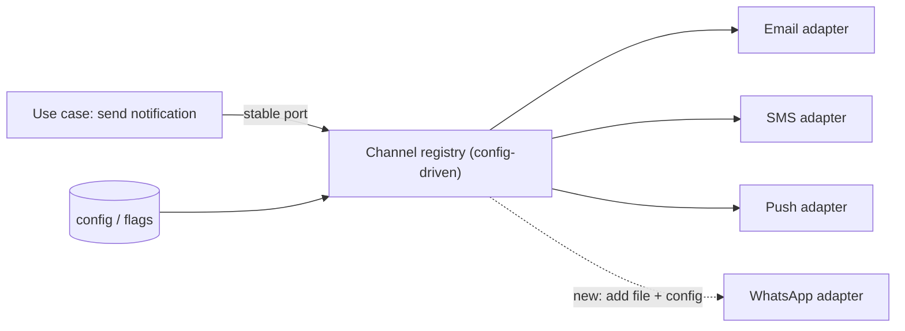

# Designing for Extensibility

> [!abstract] In one sentence
> Extensibility is the property that tomorrow's likely change — a new payment provider, a new notification channel, a new rule — is an addition behind a stable contract rather than a modification of working code, and the skill is knowing which changes are likely enough to pay for the seam.

> [!tip] Deeper treatment in your system-design vault
> `system-design/10 Architecture Styles/API Design and Versioning.md` — read it *after* you have written your own explanation below.

**Map:** [[Architecture Patterns MOC]] → [[HLD MOC]]

## Definition

**Designing for extensibility** means structuring a system so new behaviour can be added without changing — and so without re-testing and re-deploying — existing behaviour: the **open–closed principle**. Mechanisms include **stable contracts** (interfaces and schemas that do not change when implementations do), **plug-in points** (a registry of implementations selected at runtime), **configuration over code** for values that change often, and **versioned interfaces** so old callers keep working. Its counterweight is **YAGNI**: every extension point built for a change that never comes is pure cost.

## Problem solved

Systems die of accumulated modification. Adding a third notification channel to code written for two means editing the `if email … else sms` branch, re-testing both, and risking SMS to ship push; a fifth payment provider the same way means five providers' bugs in one class. Teams respond either by never touching the code or by building a "generic framework" for every conceivable future. Extensibility done well puts seams exactly where change is probable — the roadmap, the last six months of diffs and the business model are the evidence — and leaves everything else simple.

## How it works

1. **Find the axis of change.** What changed in this area last year, and what is on the roadmap? "Another provider", "another channel", "another rule" are axes; "a different database" usually is not. One or two real axes beat ten speculative ones.
2. **Put a contract on the axis.** An interface in the domain's terms: `PaymentProvider { authorize, capture, refund }`, `NotificationChannel { send(message, recipient) }`. Small, stable and free of any one implementation's quirks — otherwise every new implementation changes it.
3. **Make implementations plug in.** A registry maps a key (`provider = "stripe"`) to an implementation, selected by configuration rather than a growing `switch`; Spring bean collections and NestJS providers by token do this natively. A new implementation is a new file and a registry entry.
4. **Configuration for policy, code for behaviour.** Thresholds, limits and enablement belong in config or [[Feature Flags]] so they change without a deploy; algorithms belong in code where they can be tested. Configuration growing a mini-language means the boundary is wrong.
5. **Version what crosses a boundary.** Public APIs and [[Event Schemas|event schemas]] are extended by adding optional fields, never by changing meaning; breaking changes get a new version supported alongside the old during a migration window ([[Backward Compatibility]], [[Versioning and Migrations]]).
6. **Apply YAGNI to everything else.** No interface with one implementation unless a second is on the roadmap; no abstraction over the database "in case". When the second case arrives, refactor to the seam then — adding it later is usually cheaper than carrying it unused.

```ts
// a plug-in point: new channels are additions, not edits
interface NotificationChannel { readonly key: string; send(n: Notification): Promise<void>; }
const registry = new Map(channels.map(c => [c.key, c]));   // channels injected: email, sms, push
await registry.get(prefs.channel)!.send(notification);
```

## Architecture



> [!example]- Excalidraw version — the same diagram as an editable canvas
> ![[Designing for Extensibility.excalidraw]]
> [[Designing for Extensibility.excalidraw|Open in Excalidraw]] — needs the Excalidraw plugin (see [[Plugins to Install]]).


## Use cases

- Integration surfaces with a known axis of growth: payment providers, notification channels, KYC vendors, storage backends, LLM providers.
- Rules that business users add frequently (fraud rules, pricing, eligibility) — the requirement says "ops should be able to add X without a release".
- Public APIs and event streams consumed by parties you do not control, where compatibility is a product promise.

## Limitations

- Every seam has a cost — indirection, a registry to understand, tests per implementation — and speculative seams are negative value.
- Contracts over genuinely different things (providers with different capabilities) end up as the lowest common denominator or leak provider-specific flags.
- Configuration-driven behaviour moves logic out of the type system and the test suite; versioned interfaces must be maintained in parallel, forever without a deprecation policy.

## Trade-offs

| You gain | You sacrifice |
|---|---|
| Additions that do not touch or re-test existing behaviour | Simplicity and directness where a seam was added |
| Runtime changes through configuration and flags | Testability and reviewability of behaviour that now lives in config |
| Compatibility promises that let consumers upgrade on their schedule | Maintenance of parallel versions and the discipline of a deprecation policy |

## Failure modes

- **Speculative generality**: a plug-in framework with one plug-in → bugs in machinery nobody needs → noticed when new engineers cannot find where the work happens; delete it.
- **Leaky contract**: `PaymentProvider.capture(opts: { stripeOnly?: … })` → every provider change ripples through the interface → the seam isolates nothing; redesign around capabilities.
- **Config explosion**: rules as nested YAML grow into an untyped, untested language → a config change causes an outage → logic back into code, only parameters in config.
- **Unbounded version support**: v1 through v6 live at once → every bug fixed six times → deprecation windows and usage metrics per version.

## Performance

Registry lookup and interface dispatch are nanoseconds; configuration should be cached in memory and refreshed on change, not fetched per request. The real risk is that abstraction hides per-implementation costs (one provider's SDK opening a connection per call), so instrument each implementation separately.

## Scalability

Extension points scale with integrations and teams: a new channel is an adapter a separate team can own, and versioned contracts let hundreds of consumers upgrade independently. At 10x integrations the registry becomes a catalogue with health, capabilities and ownership, and the contract's stability becomes the most valuable property in the system.

## Operational impact

Configuration and flags move change from deploys to runtime, which is faster and riskier: you need audit trails, validation on write, staged rollout and a record of which configuration was active during an incident. Versioned APIs need per-version usage metrics and a deprecation process.

## Alternatives

- **Modify and redeploy** — wins for low-frequency changes in code with good tests; the simplest option and often the right one.
- **Refactor when the second case arrives** — the YAGNI default; wins when the second case is genuinely uncertain.
- **Rule engines and DSLs** — win when non-engineers must author logic at high frequency, at the cost of a language to maintain.

## Real-world examples

- Stripe's API versioning (date-based versions, per-account pinning, transformation layers between versions) is the published model for extending a public API without breaking callers ([[Stripe - API Versioning]]).
- Kong's plugin system, Kubernetes' CRDs and operators, and Protobuf's field-numbering rules (add fields, never reuse numbers) are extensibility designed in from the start.
- In a stack like yours: a `PaymentProvider` port with one adapter per PSP, notification channels as registered adapters, fraud thresholds in audited configuration, and Kafka events extended only by optional fields with a schema registry enforcing compatibility.

## Practical exercise

1. Take a notification sender with an `if/else` over email and SMS; extract a `NotificationChannel` interface and a registry; add push as a new file only.
2. Write a test that enumerates the registry and runs a contract test against every channel implementation.
3. Move per-channel rate limits to configuration with validation on load and a log line stating the active config version.
4. Add an optional `priority` field to `POST /notifications` and prove replayed k6 requests from old clients still work; then introduce a breaking change behind `v2` and run both.
5. Delete one speculative abstraction (an interface with one implementation and no roadmap) and note what became simpler.

## Related concepts

### Prerequisites
- [[Separation of Concerns]] — extension points only work on cohesive, loosely coupled parts
- [[Hexagonal Architecture]] — ports are the natural seams
- [[Designing APIs and Contracts]] — the contract is what stays stable

### Related
- [[Backward Compatibility]] — how versioned interfaces keep old callers working
- [[Versioning and Migrations]] — moving consumers between versions
- [[Event Schema Evolution]] — extending events without breaking consumers
- [[Evaluating Architectural Complexity]] — the cost side of every seam
- [[Technical Debt]] — what missing or speculative seams become

### Builds on this
- [[Designing Systems for Changing Requirements]] — the system-level strategy for change
- [[Feature Flags]] — runtime extension and enablement points

### Design problems where it applies
- [[Design a Feature Flag Service]]
- [[Design a Notification System]]
- [[Design a Workflow Orchestrator]]
- [[Design an API Gateway]]

### Projects where it can be implemented
- [[Feature Flag Service and SDK]]
- [[LLM Gateway]]
- [[Personal Notification Hub]]

### Resources
- [[Stripe - API Versioning]] — extending a public API for years without breaking callers
- [[A Philosophy of Software Design (Talk)]] — deep modules and designing for the common case
- [[Fundamentals of Software Architecture]] — architecture characteristics including extensibility and their trade-offs

## Personal understanding

> [!question] Explain it without the source
> Write your own explanation here, from memory. Then compare it with the sections above and note what you missed.

### Mastery checklist
- [ ] I can explain it without the original resource
- [ ] I can describe the problem it solves
- [ ] I can compare it with its alternatives
- [ ] I can name its limitations and failure modes
- [ ] I can recognise when it is appropriate in a real system
- [ ] I have applied it in a system design
- [ ] I have validated my assumptions with an experiment or implementation

## Open questions

- [ ] What evidence threshold justifies a seam — a second case on the roadmap, two historical changes on the axis, or a business model that implies growth?
- [ ] How do you design a provider contract when providers differ in capabilities (partial refunds, 3-D Secure) without a capability-flag explosion?
- [ ] Where is the line between parameters in config and logic in config, and how do you test the former without the latter creeping in?
