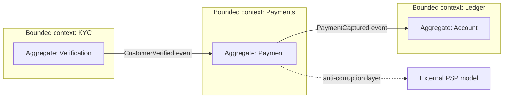

# Domain-Driven Design

> [!abstract] In one sentence
> Domain-driven design gives you a method for drawing boundaries: find where the business's language changes meaning (bounded contexts), model each context on its own terms, and inside each, cluster the data that must change together into aggregates — which is exactly the information a service split or a transaction design needs.

> [!tip] Deeper treatment in your system-design vault
> `system-design/10 Architecture Styles/Service Boundaries and Domain-Driven Design.md` — read it *after* you have written your own explanation below.

**Map:** [[Architecture Patterns MOC]] → [[HLD MOC]]

## Definition

**Domain-driven design** (Eric Evans, 2003) is an approach to software design centred on the business domain. Its **strategic** patterns organise a large system: a **ubiquitous language** shared by engineers and domain experts; **bounded contexts**, each with its own model and language in which a term has exactly one meaning; and a **context map** describing how contexts relate (customer/supplier, conformist, anti-corruption layer). Its **tactical** patterns organise a model inside a context: **entities**, **value objects**, **aggregates** (a cluster of objects with one root that enforces invariants and is the unit of transactional consistency), **repositories** and **domain events**.

## Problem solved

Most architectural mistakes are boundary mistakes: services split along layers or tables, one "Customer" class serving billing, support and marketing with forty fields and contradictory rules, and transactions spanning half the system because nobody decided what must be consistent together. The word "account" means different things in ledger, KYC and marketing; forcing one model couples teams that should be independent. Bounded contexts make that explicit, aggregates define what one transaction may touch, and domain events define what crosses the boundary. For [[Microservices]] and [[Modular Monoliths]], DDD is where the lines come from; without it, boundaries are guesses.

## How it works

1. **Learn the language.** Sit with domain experts, write down terms, and notice where one word is used differently ("a *transaction* in ledger versus in fraud"). Those seams are candidate context boundaries.
2. **Draw bounded contexts.** Each context owns a model, a vocabulary, ideally a team, and its data. `Payments` has `Payment`, `Capture`, `Refund`; `Ledger` has `Entry`, `Posting`, `Balance`; neither imports the other's classes. A context is the natural unit for a service or module.
3. **Map the contexts.** For each interacting pair decide the relationship: upstream/downstream, a (rare) shared kernel, or an **anti-corruption layer** that translates the other context's model into yours so its changes do not leak in. Integration is through published contracts — APIs and [[Event Schemas|events]] — never shared tables.
4. **Design aggregates.** Group entities so each invariant is enforced inside one aggregate and one transaction: `Order` with its `OrderLines` is one aggregate (total equals the sum of lines); `Order` and `Customer` are separate, referenced by id. Keep aggregates small, modify one per transaction, and accept [[Eventual Consistency|eventual consistency]] between them via domain events.
5. **Emit domain events.** `PaymentCaptured`, `OrderShipped` — named in the ubiquitous language, published when an aggregate commits ([[Outbox Pattern]]) — are how other contexts learn what happened ([[Event-Driven Architecture]]).

```text
Context: Ledger
  Aggregate Account (root)        invariant: balance = sum(postings), never below holds
    Posting (entity)              created only through Account.post(entry)
    Money (value object)          amount + currency, immutable
  Repository AccountRepository    load(id) / save(account)
  Events: EntryPosted, HoldPlaced
```

## Architecture



> [!example]- Excalidraw version — the same diagram as an editable canvas
> ![[Domain-Driven Design.excalidraw]]
> [[Domain-Driven Design.excalidraw|Open in Excalidraw]] — needs the Excalidraw plugin (see [[Plugins to Install]]).


## Use cases

- Complex business domains with many rules and specialised vocabulary: payments, lending, insurance, logistics — where the requirement talks about invariants and who may do what when.
- Deciding service boundaries before a monolith split, or module boundaries for a modular monolith.
- Designing transaction scope — "what must be consistent immediately versus eventually?" is an aggregate question — and integrating external systems whose model must not pollute yours (an anti-corruption layer around a PSP).

## Limitations

- Heavy for simple CRUD or data-pipeline systems; the tactical patterns add ceremony with little benefit when there are few invariants.
- Needs access to domain experts and time for modelling; in a feature-factory environment the language never stabilises.
- Aggregates that are too large serialise all writes through one lock; too small and invariants span aggregates and become eventual.

## Trade-offs

| You gain | You sacrifice |
|---|---|
| Boundaries derived from the business rather than from tables or layers | Upfront modelling time and ongoing conversation with domain experts |
| A clear rule for transaction scope (one aggregate per transaction) | Immediate consistency across aggregates; cross-aggregate rules become sagas or eventual |
| Models that can evolve per context without breaking others | One shared data model; translation layers between contexts become permanent code |

## Failure modes

- **Shared "god" entity across contexts** → every team's change breaks another's → noticed as cross-team migration coordination; split by context with an anti-corruption layer.
- **Aggregate too large** (`Customer` containing all orders) → every order write locks the customer → contention and p99 spikes on hot customers; shrink the aggregate, reference by id.
- **Invariant across aggregates assumed transactional** (inventory and order in different aggregates) → oversell under concurrency → found by reconciliation; make it one aggregate or an explicit saga with conditional updates.
- **Context boundaries ignored by events** (publishing internal entity snapshots as events) → consumers couple to your schema → every refactor is a breaking change; publish domain events in the ubiquitous language with [[Event Schema Evolution|versioned schemas]].

## Performance

Aggregate size is the performance lever: it determines lock scope, rows per transaction and data loaded per write. Small aggregates mean short transactions and high concurrency but more cross-aggregate eventual consistency. Translation at context boundaries costs a little CPU per call, negligible against the network hop it accompanies.

## Scalability

Bounded contexts scale teams: one owner, one language, one deployable or module each. Aggregates scale data: they are the natural [[Sharding|shard]] key (ledger by account id) because a transaction never crosses one. At 10x, a context that was one service may split further — a modelling decision rather than a rewrite.

## Operational impact

Mostly design-time cost; at runtime DDD shows up as explicit boundaries, which simplify ownership, on-call and incident attribution. The burden is keeping the language and context map current — a stale map is as misleading as none. Domain events as the integration contract add the usual event-driven operations (schemas, lag, idempotency).

## Alternatives

- **Data-first modelling** (normalise the schema, derive services from tables) — wins for reporting-heavy or simple systems, fails for rich behaviour.
- **Conway-driven boundaries** (one service per existing team) — pragmatic, but boundaries follow the org chart rather than the domain, and both change.
- **Event storming** workshops — a lighter way to find contexts and aggregates; usually the entry point to DDD rather than an alternative.

## Real-world examples

- Eric Evans's *Domain-Driven Design* (2003) and Vaughn Vernon's *Implementing Domain-Driven Design* define the patterns; Sam Newman's [[Building Microservices]] uses bounded contexts as the service-boundary tool.
- Uber grouped hundreds of services into domains with explicit gateways between them ([[Uber - Domain-Oriented Microservice Architecture]]).
- In a stack like yours: ledger, payments, KYC and notifications as contexts, each a Spring Boot or NestJS service or module with its own schema; `Account` as the ledger aggregate and shard key; an anti-corruption layer around the PSP; domain events on Kafka named in the business's words.

## Practical exercise

1. Pick a flow you know (a wallet top-up). List every noun and verb from the spec; group where the meaning is identical, split where it changes — those are candidate contexts.
2. Define the ledger's `Account` aggregate with its invariants as plain TypeScript or Java classes; write unit tests that violate each invariant.
3. Persist `Account` with optimistic locking ([[Optimistic and Pessimistic Locking]]); run two concurrent postings and observe one retry.
4. Model the top-up as `Payments` → `PaymentCaptured` → `Ledger` posting, with the event schema in the ubiquitous language rather than the payment table's columns.
5. Put an anti-corruption layer around a fake PSP; change the PSP's response format and confirm the ledger context is untouched.

## Related concepts

### Prerequisites
- [[Separation of Concerns]] — contexts and aggregates are cohesion applied to the business
- [[Data Modeling]] — the modelling craft DDD directs
- [[Transactions]] — an aggregate is a transactional boundary

### Related
- [[Event Schemas]] — domain events as cross-context contracts
- [[Data Ownership and Lifecycle]] — one context owns each dataset
- [[Hexagonal Architecture]] — the shape of a context's internals
- [[Translating Product Requirements into Technical Requirements]] — where the ubiquitous language comes from
- [[Saga Pattern]] — cross-aggregate and cross-context consistency
- [[Designing APIs and Contracts]] — published language at the boundary

### Builds on this
- [[Modular Monoliths]] — modules are bounded contexts in one process
- [[Microservices]] — services are bounded contexts with a network between them
- [[Event-Driven Architecture]] — domain events as the integration primitive
- [[Event Sourcing]] — aggregates as event streams

### Design problems where it applies
- [[Design a Payment System]]
- [[Design a Ride-Sharing Service]]
- [[Design an Inventory Management System]]
- [[Design a Digital Wallet and Ledger]]

### Projects where it can be implemented
- [[Double-Entry Ledger Service]]
- [[Presence and Chat Service]]

### Resources
- [[Building Microservices]] — bounded contexts as the boundary tool
- [[Uber - Domain-Oriented Microservice Architecture]] — domains at scale
- [[Designing Data-Intensive Applications]] — data models and the consequences of modelling choices

## Personal understanding

> [!question] Explain it without the source
> Write your own explanation here, from memory. Then compare it with the sections above and note what you missed.

### Mastery checklist
- [ ] I can explain it without the original resource
- [ ] I can describe the problem it solves
- [ ] I can compare it with its alternatives
- [ ] I can name its limitations and failure modes
- [ ] I can recognise when it is appropriate in a real system
- [ ] I have applied it in a system design
- [ ] I have validated my assumptions with an experiment or implementation

## Open questions

- [ ] In a double-entry ledger, is the aggregate the account or the journal entry (which touches two accounts), and what does each choice do to concurrency?
- [ ] How do you keep a context map accurate as teams reorganise — is it a document, a diagram in the repo, or derived from service dependencies?
- [ ] When two contexts need the same reference data (currencies, countries), is a shared kernel acceptable or should each copy it?
