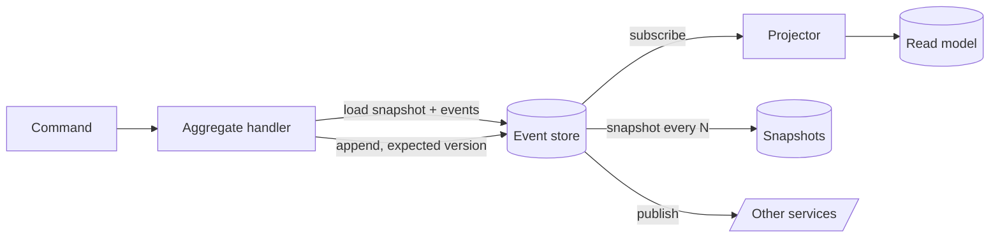

# Event Sourcing

> [!abstract] In one sentence
> Event sourcing makes the log of what happened the source of truth and treats current state as a cache derived from it — buying auditability, replay and time travel, and paying with a harder data model, schema evolution and the question of how to delete anything.

> [!tip] Deeper treatment in your system-design vault
> `system-design/09 Messaging and Event-Driven/Event Sourcing.md` — read it *after* you have written your own explanation below.

**Map:** [[Architecture Patterns MOC]] → [[HLD MOC]]

## Definition

**Event sourcing** persists the state of an aggregate as an ordered, append-only sequence of domain events (`AccountOpened`, `FundsDeposited`, `FundsWithdrawn`) rather than as its current values. Current state is obtained by loading the events and folding them in order; **snapshots** cache the fold at a point in the sequence; **projections** build query-friendly views from the same events. Nothing is ever updated or deleted in the log, only appended.

## Problem solved

A table that stores current state throws away history. Once `balance = 400`, you cannot answer "why", "what was it on Tuesday", or "replay this month under a corrected fee rule". Bolted-on audit tables are second-class and often disagree with the state they describe, because they are a dual write. Event sourcing makes history primary: the audit trail cannot disagree with the state because the state is computed from it, and any new question about the past is a new fold over the same log. For ledgers and regulated domains this is the natural model — accounting has been append-only for centuries.

## How it works

1. **Command handling.** A command (`Withdraw 100`) is validated against the aggregate's current state, loaded by replaying its events (or a snapshot plus the tail). If the invariant holds, the handler produces new events.
2. **Append with optimistic concurrency.** Events are appended to the aggregate's stream with an expected version; a concurrent writer gets a conflict and retries ([[Optimistic and Pessimistic Locking]]). One aggregate, one stream, one consistency boundary.
3. **Fold.** `state = events.reduce(apply, initial)`; `apply` is pure and total — every historical event type must still be applicable.
4. **Snapshots.** Every N events persist the folded state with its version; load snapshot plus tail instead of the whole stream.
5. **Projections.** Subscribers read the log and maintain read models ([[CQRS]]); they are idempotent and track their position so they can resume or be rebuilt from zero.
6. **Publishing.** The event store is also the source of events for other services, so the dual-write problem disappears: the store is the outbox.

```ts
type Event = { type: 'Deposited'; amount: number } | { type: 'Withdrawn'; amount: number };
const apply = (s: { balance: number }, e: Event) =>
  e.type === 'Deposited' ? { balance: s.balance + e.amount } : { balance: s.balance - e.amount };
const state = events.reduce(apply, { balance: 0 });
```

The traps are real: **schema evolution** (events live forever, so upcasters must translate every shape ever written), **deletion** (GDPR erasure against an immutable log usually means encrypting personal data per subject and discarding the key), and **debugging** (state at time T requires replay, and a projector bug looks like corrupted data).

## Architecture



## Use cases

- The requirement includes "complete audit trail", "explain this balance" or "replay under new rules": ledgers, wallets, trading, compliance.
- Business value in history itself: analytics over how state evolved, undo, temporal queries.
- Many derived views from the same facts that must be rebuildable when their shape changes, or collaborative systems where operations are replayed and merged ([[Client State and Reconnection]]).

## Limitations

- Querying across aggregates is impossible from the log; every query needs a projection, so CQRS is mandatory, not optional.
- Immutable history makes deletion, correction and privacy obligations awkward; corrections become compensating events.
- Every event shape ever written is a permanent contract; evolution needs versioning and upcasting ([[Event Schema Evolution]]).
- Developers must think in events and folds; for CRUD-shaped domains it adds cost with little benefit.

## Trade-offs

| You gain | You sacrifice |
|---|---|
| A complete, consistent audit trail that is the state, not a copy of it | Simple reads: every query is a projection you must build and keep in sync |
| Rebuildable views, replay and temporal queries | Simple deletion and correction; the log is forever |
| No dual write between state and published events | Model simplicity; versioned events and upcasters are permanent maintenance |

## Failure modes

- **Replay too slow**: a hot aggregate with millions of events and no snapshots → command latency grows linearly → found via p99 on load; fix with snapshots.
- **Breaking event change**: a deployed `apply` cannot handle an old event shape → replay fails or silently miscomputes → caught by replaying production history in CI.
- **Projector drift**: a non-idempotent or buggy projector → read model disagrees with the fold → noticed by reconciliation; fix by rebuild.
- **Unbounded personal data**: PII written into immutable events → an erasure request cannot be honoured → legal exposure; prevent with crypto-shredding from day one.

## Performance

Appends are sequential writes — fast on any store. Loads cost a snapshot read plus a short tail. Current-state reads go to projections, as fast as any denormalised store. Storage grows without bound, and per-event overhead plus projection duplication multiply the footprint; plan retention of snapshots and derived data, never of the log itself.

## Scalability

Streams partition naturally by aggregate id, so writes shard well ([[Sharding]]) and per-aggregate order is preserved; projectors scale as consumer groups. The pressure points at 10x are hot aggregates (one stream is a serial lane), total log size and rebuild time — a new projection over a large log can take hours unless you replay from snapshots.

## Operational impact

High. You operate an event store (purpose-built, PostgreSQL tables with a stream index, or [[Kafka]]), snapshotting, projectors with position tracking, rebuild tooling and schema versioning. Debugging is different rather than impossible: you can replay to any point, but you must learn to. Backups are of the log; projections are disposable.

## Alternatives

- **Current-state model plus [[Audit Logs]]** — wins for CRUD domains where history is a compliance checkbox rather than the product.
- **[[Change Data Capture]]** — gives a history of row changes without redesigning the model; wins when you want replayable events from an existing schema.
- **Append-only tables in the business schema** (a ledger table) — win for a single aggregate type without full event-sourcing machinery.

## Real-world examples

- The LMAX exchange is the classic published example: an in-memory business logic processor fed by a journaled event stream; double-entry accounting and Git are event sourcing older than the name.
- Martin Fowler's [[Martin Fowler - Event Sourcing]] and Kleppmann's [[Turning the Database Inside Out]] are the standard explanations.
- In a stack like yours: a wallet service where each account stream lives in PostgreSQL (`events(stream_id, version, type, payload)` with a unique index on `(stream_id, version)`), a balance projection in Redis, and the same events published to Kafka — with PII kept out of payloads or encrypted per customer.

## Practical exercise

1. Create `events(stream_id, version, type, payload, created_at)` in PostgreSQL via Docker Compose with a unique index on `(stream_id, version)`.
2. Implement `Deposit` and `Withdraw` in TypeScript or Java that load, fold, validate and append with an expected version; run two concurrent withdrawals and observe the conflict.
3. Build a `balances` projection; corrupt it deliberately and rebuild it from the log.
4. Append 100,000 events to one stream and measure command latency; add snapshots every 100 events and re-measure.
5. Rename a field in `Deposited`, add an upcaster, and replay the full log to prove old events still fold.

## Related concepts

### Prerequisites
- [[Event-Driven Architecture]] — events as the integration primitive
- [[CQRS]] — reads must come from projections
- [[Domain-Driven Design]] — aggregates define stream boundaries
- [[Data Modeling]] — modelling facts instead of state

### Related
- [[Audit Logs]] — the need this satisfies by construction
- [[Event Schema Evolution]] — versioning events that live forever
- [[Change Data Capture]] — the lighter path to a change history
- [[Kafka]] — a log you can build on, with caveats on per-stream reads
- [[Optimistic and Pessimistic Locking]] — expected-version appends
- [[Client State and Reconnection]] — snapshot plus replay on the client

### Builds on this
- [[Saga Pattern]] — a durable orchestrator persisted as an event-sourced state machine
- [[Real-Time Systems]] — live views as projections pushed to clients

### Design problems where it applies
- [[Design a Digital Wallet and Ledger]]
- [[Design a Payment System]]
- [[Design a Collaborative Document Editor]]
- [[Design an Inventory Management System]]

### Projects where it can be implemented
- [[Double-Entry Ledger Service]]
- [[Presence and Chat Service]]

### Resources
- [[Martin Fowler - Event Sourcing]] — the pattern and its consequences
- [[Turning the Database Inside Out]] — logs, materialised views and why
- [[Designing Data-Intensive Applications]] — chapter 11 on event sourcing and derived state

## Personal understanding

> [!question] Explain it without the source
> Write your own explanation here, from memory. Then compare it with the sections above and note what you missed.

### Mastery checklist
- [ ] I can explain it without the original resource
- [ ] I can describe the problem it solves
- [ ] I can compare it with its alternatives
- [ ] I can name its limitations and failure modes
- [ ] I can recognise when it is appropriate in a real system
- [ ] I have applied it in a system design
- [ ] I have validated my assumptions with an experiment or implementation

## Open questions

- [ ] Is Kafka a suitable event store when you need to load one aggregate's events by id, or does per-stream reading require a database-backed store?
- [ ] How should a correction to a past event be modelled — a compensating event, a new version, or a rewrite with a documented exception?
- [ ] What snapshot cadence minimises load latency without making snapshot storage a second source of truth?
