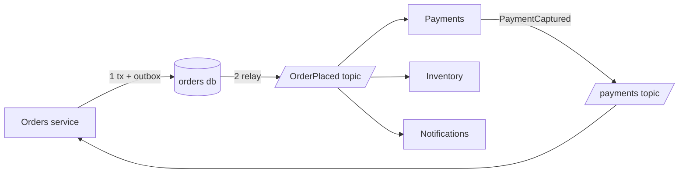

# Event-Driven Architecture

> [!abstract] In one sentence
> In an event-driven architecture a service records that something happened and moves on, and whoever cares reacts later — which decouples producers from consumers in time and availability, but hides the workflow in the broker and makes consistency eventual.

> [!tip] Deeper treatment in your system-design vault
> `system-design/09 Messaging and Event-Driven/Why Async Messaging Exists.md` — read it *after* you have written your own explanation below.

**Map:** [[Architecture Patterns MOC]] → [[HLD MOC]]

## Definition

**Event-driven architecture (EDA)** is a style in which components communicate by producing and consuming **events** — immutable records that a fact occurred (`OrderPlaced`, `PaymentCaptured`) — through a broker ([[Kafka]], SQS, Redis Streams) rather than by calling each other. A producer does not know who consumes; a consumer does not know who produced. The event is named in the past tense because it is a fact, not a request: a command asks someone to do something, an event says something was done.

## Problem solved

Synchronous calls couple the caller to the callee's availability, latency and API at the moment of the call. An order service that calls payments, inventory, notifications and analytics inline is as slow as the slowest and as available as the least available ([[Synchronous vs Asynchronous Communication]]), and adding a fifth consumer means changing it. Events invert this: the order service publishes one fact, consumers subscribe without the producer changing or waiting, a consumer's failure no longer fails the producer, and spikes are absorbed by the broker.

## How it works

Three flavours, in increasing order of commitment:

1. **Event notification.** The event carries an id and a type (`OrderPlaced {orderId}`); consumers call back for details. Minimal payload coupling, but a hidden synchronous dependency returns.
2. **Event-carried state transfer.** The event carries what consumers need (`OrderPlaced {orderId, customerId, lines, total}`); consumers keep their own copy and never call back. More autonomy, more duplicated data, and the payload becomes a contract ([[Event Schemas]]).
3. **[[Event Sourcing]].** The event log *is* the state; current state is derived by replay.

Mechanics that always apply:

- **Reliable publication.** Commit-then-publish is a dual write; use the [[Outbox Pattern]] or [[Change Data Capture]] so no committed change loses its event.
- **Delivery and duplicates.** Brokers give [[At-Least-Once Delivery]] in practice; consumers must be idempotent on the event id ([[Idempotency]], [[Duplicate Message Processing]]).
- **Ordering** is per key, not global; partition by aggregate id ([[Ordering Guarantees]]).
- **Choreography vs orchestration.** In choreography each service reacts to events and emits its own; nobody owns the flow. In orchestration a coordinator issues commands and reacts to replies ([[Saga Pattern]]). Choreography scales organisationally; orchestration is easier to see and debug.

EDA removes temporal and availability coupling. It hides *semantic* coupling: consumers still depend on the event's meaning and shape, and a workflow spread over six reactions is still a workflow, just one without a call stack.

## Architecture

> [!example]- Excalidraw version — the same diagram as an editable canvas
> ![[Event-Driven Architecture.excalidraw]]
> [[Event-Driven Architecture.excalidraw|Open in Excalidraw]] — needs the Excalidraw plugin (see [[Plugins to Install]]).

## Use cases

- The requirement reads "when X happens, Y and Z must eventually happen" and Y and Z are owned by other teams.
- Fan-out to many consumers (analytics, search indexing, notifications) that must not slow the producer ([[Fan-Out]]).
- Absorbing bursts ([[Backpressure]]) and decoupling the write path from slow or flaky third parties (email, webhooks, partner APIs).

## Limitations

- Eventual consistency is built in; a user may see the order before the inventory reflects it. Requirements that need read-your-write across services push back toward synchronous calls.
- The flow is invisible without tooling: "what happens after `OrderPlaced`?" requires a catalogue of subscriptions and [[Distributed Tracing]] across hops.
- Event schemas become public contracts that are hard to change ([[Event Schema Evolution]]), and request–response needs (validate this card now) do not fit.

## Trade-offs

| You gain | You sacrifice |
|---|---|
| Producers independent of consumers' availability and latency | Immediate consistency; every consumer sees the world slightly late |
| Adding consumers without touching producers | A visible call graph; the workflow lives in subscriptions |
| Natural buffering and replay through the broker | Simplicity: outbox, idempotency, DLQs and schema governance become mandatory |

## Failure modes

- **Lost events** from a dual write → downstream silently never reacts → noticed by reconciliation or a customer; fix with an outbox.
- **Poison event** that a consumer cannot process → the partition stalls behind it → consumer lag rises; needs a retry cap and a [[Dead-Letter Queues|dead-letter queue]].
- **Duplicate processing** after a consumer crash before commit → double emails, double ledger entries → prevented by idempotent handlers.
- **Choreography loops and surprise chains**: a reaction triggers an event that triggers the original producer → runaway load or inconsistent state → seen as an unexplained traffic multiplier; needs an event catalogue and loop detection.

## Performance

Publishing is cheap (an outbox insert and an async relay) and the producer's latency no longer includes any consumer. End-to-end latency becomes broker latency plus consumer lag — milliseconds on a healthy Kafka topic, seconds or more under backlog — so EDA trades request latency for completion latency. Throughput is bounded by partitions and consumer parallelism.

## Scalability

Excellent for fan-out and bursts: consumers scale independently within a [[Consumer Groups|consumer group]], and the broker absorbs spikes. The scaling limits are per-key ordering (one partition per key is a serial lane) and hot keys. Organisationally it scales well because teams subscribe rather than negotiate APIs, provided schemas are governed.

## Operational impact

Significant. You operate a broker, relays, consumer groups and dead-letter queues, and monitor consumer lag, DLQ depth and relay health. Debugging a flow means tracing an event id across several services' logs, so invest early in correlation ids and an event catalogue. Replay is a powerful repair tool and a dangerous one — replaying into non-idempotent consumers causes the incident you are fixing.

## Alternatives

- **Synchronous REST or gRPC orchestration** — wins when the caller needs the answer now and the chain is short.
- **[[Saga Pattern|Orchestrated workflows]]** (Temporal-style) — wins when the flow must be explicit, observable and compensable.
- **Shared database integration** — wins almost never; it couples schemas across teams.

## Real-world examples

- LinkedIn built Kafka precisely to move activity data between systems as event streams ([[Kafka Design Documentation]]); Uber's trip lifecycle and Netflix's playback pipelines are large published examples of event-driven integration.
- Martin Fowler's "What do you mean by Event-Driven?" distinguishes notification, state transfer, event sourcing and CQRS — the vocabulary used here.
- In a stack like yours: services on EKS publishing through an outbox to Kafka (MSK) or SQS, consumers in consumer groups; moving to Redis Streams changes the relay and consumer client, not the architecture — but check that idempotency and per-key ordering still hold.

## Practical exercise

1. With Docker Compose, run Redpanda (or Kafka) and two NestJS or Spring Boot services: `orders` publishes `OrderPlaced`; `inventory` and `notifications` consume.
2. Publish directly after commit (no outbox) and `kill -9` the producer between commit and publish in a loop; count lost events.
3. Add an outbox and a relay; confirm zero loss, then observe the duplicates and fix them with idempotent consumers keyed on event id.
4. Push 10,000 events in a burst with one consumer, then three in a group; measure lag and the effect of partitions.
5. Make `notifications` throw on one event, watch the partition stall, add a DLQ.

## Related concepts

### Prerequisites
- [[Synchronous vs Asynchronous Communication]] — why you want async at all
- [[Message Queues]] and [[Pub-Sub]] — the delivery mechanisms
- [[Microservices]] — the services being decoupled

### Related
- [[Outbox Pattern]] — reliable publication
- [[Eventual Consistency]] — the consistency model you accept
- [[Idempotency]] and [[Duplicate Message Processing]] — the consumer's obligation
- [[Fan-Out]] — one fact to many reactions
- [[Kafka]] — the usual backbone

### Builds on this
- [[CQRS]] — read models fed by events
- [[Event Sourcing]] — events as the source of truth
- [[Saga Pattern]] — multi-step business transactions over events
- [[Real-Time Systems]] — pushing events to clients
- [[Event Schemas]] — the contracts events become

### Design problems where it applies
- [[Design a Notification System]]
- [[Design a Payment System]]
- [[Design a Webhook Delivery System]]
- [[Design an Inventory Management System]]

### Projects where it can be implemented
- [[Webhook Relay]]
- [[Streaming Fraud Rules Engine]]
- [[Live Ops Dashboard]]

### Resources
- [[Designing Data-Intensive Applications]] — chapter 11 on stream processing and dataflow
- [[Kafka Design Documentation]] — the broker's guarantees
- [[Temporal Docs on Durable Execution]] — the orchestration alternative
- [[microservices.io - Saga Pattern]] — choreography versus orchestration

## Personal understanding

> [!question] Explain it without the source
> Write your own explanation here, from memory. Then compare it with the sections above and note what you missed.

### Mastery checklist
- [ ] I can explain it without the original resource
- [ ] I can describe the problem it solves
- [ ] I can compare it with its alternatives
- [ ] I can name its limitations and failure modes
- [ ] I can recognise when it is appropriate in a real system
- [ ] I have applied it in a system design
- [ ] I have validated my assumptions with an experiment or implementation

## Open questions

- [ ] How do you decide between event notification and event-carried state for a given consumer — by payload size, by the consumer's need for autonomy, or by who owns the schema?
- [ ] What is the smallest workable event catalogue (producer, schema, consumers, SLA) for a team of five services?
- [ ] When moving from Kafka to Redis Streams, which guarantees change — retention, per-key ordering, consumer-group semantics — and which consumers would notice?
