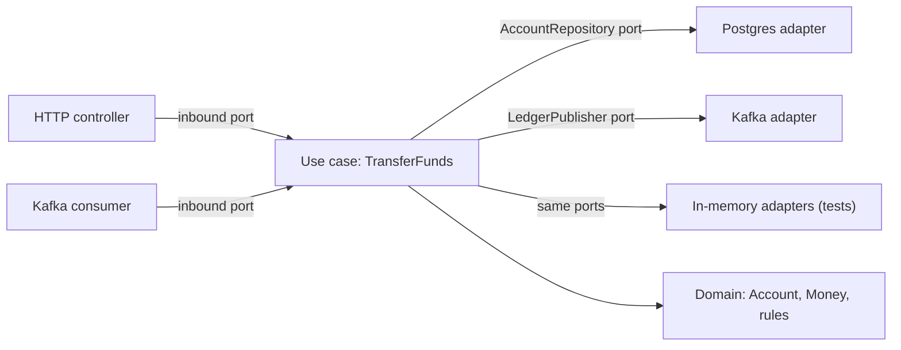

# Hexagonal Architecture

> [!abstract] In one sentence
> Hexagonal architecture makes the domain the centre of the application and the infrastructure its plug-ins: the core defines ports (interfaces) for everything it needs or offers, and adapters at the edge implement them, so dependencies point inward and the business logic runs without a database, a web server or a broker.

**Map:** [[Architecture Patterns MOC]] → [[HLD MOC]]

## Definition

**Hexagonal architecture** (Alistair Cockburn, 2005), also called **ports and adapters** and closely related to **clean architecture** and the **onion architecture**, organises a service into a **core** (domain model and application use cases) surrounded by **ports** — interfaces owned by the core — and **adapters** that implement those ports for specific technologies. **Driving** (primary) adapters call into the core: an HTTP controller, a message consumer, a CLI. **Driven** (secondary) adapters are called by the core through ports: a repository backed by PostgreSQL, a payment-provider client, an event publisher. The rule that makes it work is the **dependency direction**: adapters depend on the core; the core depends on nothing outside itself.

## Problem solved

In a typical layered service the "business logic" imports the ORM entity, the HTTP request type and the broker client, so it cannot run without all three, cannot be reused from a second entry point (a Kafka consumer doing what the REST endpoint does) and cannot change its database without touching every rule. Tests become slow integration tests or do not exist. Fixing the dependency direction makes the core plain code: fast unit tests with in-memory adapters, two entry points sharing one use case, infrastructure replaced by writing an adapter. It is [[Separation of Concerns]] with one enforceable rule.

## How it works

1. **Core.** Entities and value objects (`Transfer`, `Money`), domain rules and use cases such as `TransferFunds`. No framework annotations, no `HttpRequest`, no `@Entity`.
2. **Ports.** Interfaces defined *in the core*: an inbound port `TransferFundsUseCase` (what the core offers) and outbound ports `AccountRepository`, `LedgerPublisher` (what it needs). Ports speak the domain's language (`findByAccountId`, not `executeQuery`).
3. **Adapters.** Inbound: a Spring or NestJS controller that parses HTTP, calls the use case and maps the result; a Kafka listener doing the same for events. Outbound: a JPA or Prisma repository implementing `AccountRepository`; a Kafka producer implementing `LedgerPublisher`; in-memory doubles for tests.
4. **Wiring.** Dependency injection assembles the graph at the edge: the controller receives the use case, the use case receives the repository interface, and configuration picks the adapter. Enforce the direction with ArchUnit or ESLint boundaries so the core never imports an adapter package.
5. **Testing.** Unit-test the core with in-memory adapters in milliseconds; integration-test each adapter against its real technology (Testcontainers); a few end-to-end tests through real adapters ([[Testing Strategies]]).

```ts
// core/ports/AccountRepository.ts  (owned by the core)
export interface AccountRepository { load(id: string): Promise<Account>; save(a: Account): Promise<void>; }
// core/usecases/TransferFunds.ts
export class TransferFunds { constructor(private repo: AccountRepository, private pub: LedgerPublisher) {} /* rules */ }
// adapters/out/PrismaAccountRepository.ts implements AccountRepository
// adapters/in/TransferController.ts calls TransferFunds
```

In Spring Boot this is `domain`, `application`, `adapter.in.web` and `adapter.out.persistence` packages; in NestJS, a `core` module with providers bound to interfaces by token and `infrastructure` modules supplying implementations.

## Architecture



> [!example]- Excalidraw version — the same diagram as an editable canvas
> ![[Hexagonal Architecture.excalidraw]]
> [[Hexagonal Architecture.excalidraw|Open in Excalidraw]] — needs the Excalidraw plugin (see [[Plugins to Install]]).


## Use cases

- A service whose rules matter and change: payments, ledgers, pricing, eligibility — the requirement includes "the logic must be testable" or "we will swap the provider".
- Multiple entry points for the same behaviour (REST and events, or REST and a batch job).
- Expected infrastructure change: a broker migration (Kafka to Redis Streams), a provider replacement; and each module of a [[Modular Monoliths|modular monolith]] with a non-trivial domain.

## Limitations

- Ceremony: interfaces, DTO mapping at each boundary and extra packages; for a CRUD service it is overhead with no payoff.
- Mapping between domain objects and persistence models costs code and can hide performance problems (N+1 queries behind a clean repository port).
- Frameworks leak into the core (annotations, ORM entities as domain objects) unless the rule is enforced; and it says nothing about *where* service boundaries go — that is [[Domain-Driven Design]]'s job.

## Trade-offs

| You gain | You sacrifice |
|---|---|
| A core you can unit-test in milliseconds with no infrastructure | More files, interfaces and mapping code per feature |
| Infrastructure that can be replaced by writing an adapter | Direct use of framework conveniences in the business logic |
| One use case serving many entry points | Some performance transparency; the port hides what the adapter actually does |

## Failure modes

- **Leaky core**: an ORM entity is used as the domain object → a schema change breaks rules and lazy-loading exceptions appear in use cases → noticed when "unit" tests need a database; split domain and persistence models.
- **Anaemic ports** that mirror SQL (`findWhere(clause)`) → the core depends on persistence semantics through the back door → swapping the adapter becomes impossible.
- **Adapter hides cost**: `repo.loadAll()` behind a port issues thousands of queries → p99 spikes in production while unit tests pass → integration tests with query counting and tracing.
- **Dependency rule unenforced** → a controller type reaches the core "temporarily" → the architecture exists only in the diagram; add ArchUnit or lint rules in CI.

## Performance

Negligible runtime cost — an interface call and some mapping per boundary. The risk is indirect: abstraction can hide chatty adapters, so measure per-adapter latency and query counts. The build-time payoff is large: thousands of core tests run in seconds, which changes how often developers run them.

## Scalability

Neutral for runtime scaling; strong for team and change scaling. Entry points are added without touching rules and adapters replaced one at a time, so a broker migration becomes a bounded project. In a modular monolith each module can be its own hexagon — exactly the shape that extracts cleanly to a service.

## Operational impact

Low at runtime. In development it demands conventions (package layout, boundary rules in CI, a mapping approach) and some onboarding. Debugging is easier because a request's path is explicit — adapter in, use case, adapters out — and instrumenting each port gives per-dependency [[Distributed Tracing|spans]] for free.

## Alternatives

- **Classic layered architecture** (controller → service → repository with shared entities) — wins for small CRUD services where speed of writing beats swappability.
- **Transaction script** — wins for simple procedural logic with little domain complexity.
- **Framework-centric design** (Rails-style active record) — wins for productivity when the domain is thin and the framework is the product.

## Real-world examples

- Alistair Cockburn's original article ([[Hexagonal Architecture (Cockburn)]]) defines ports, adapters and the symmetry between driving and driven sides; clean architecture and onion architecture are the same dependency rule with different drawings.
- Netflix's engineering blog described adopting hexagonal architecture in a studio application so data sources could be swapped without touching business logic.
- In a stack like yours: a ledger service in Spring Boot with `domain`, `application` and `adapter` packages, JPA kept out of the domain, and a Kafka adapter that becomes a Redis Streams adapter when messaging moves — with the `TransferFunds` tests never noticing.

## Practical exercise

1. Take an existing NestJS or Spring Boot endpoint that charges an account and split it into a use case, an `AccountRepository` port and a `LedgerPublisher` port.
2. Implement in-memory adapters and unit-test the rules (insufficient funds, idempotent repeat); time the suite.
3. Implement the PostgreSQL adapter with Testcontainers and the Kafka adapter with a broker container; test them separately.
4. Add a Kafka consumer as a second inbound adapter calling the same use case; confirm no rule code changed.
5. Add an ArchUnit or ESLint rule forbidding `core` from importing `adapters`; break it on purpose and watch CI fail.

## Related concepts

### Prerequisites
- [[Separation of Concerns]] — the principle this makes concrete
- [[Domain-Driven Design]] — what the core contains and where its boundary lies

### Related
- [[Designing for Maintainability]] — the long-term goal
- [[REST]] and [[Message Queues]] — the technologies the inbound adapters wrap
- [[Outbox Pattern]] — a publisher adapter that writes to the outbox table
- [[Event-Driven Architecture]] — consumers as driving adapters

### Builds on this
- [[Modular Monoliths]] — each module as a hexagon with a public port
- [[Designing for Extensibility]] — ports are the plug-in points
- [[Testing Strategies]] — the fast unit layer of the pyramid assumes a core that runs without infrastructure

### Design problems where it applies
- [[Design a Payment System]]
- [[Design a Digital Wallet and Ledger]]
- [[Design a Feature Flag Service]]

### Projects where it can be implemented
- [[Double-Entry Ledger Service]]
- [[Rate Limiter Library]]
- [[Durable Job Scheduler]]

### Resources
- [[Hexagonal Architecture (Cockburn)]] — the original
- [[A Philosophy of Software Design (Talk)]] — deep modules and information hiding, the reasoning behind ports
- [[Martin Fowler - The Practical Test Pyramid]] — how the test layers map onto core and adapters

## Personal understanding

> [!question] Explain it without the source
> Write your own explanation here, from memory. Then compare it with the sections above and note what you missed.

### Mastery checklist
- [ ] I can explain it without the original resource
- [ ] I can describe the problem it solves
- [ ] I can compare it with its alternatives
- [ ] I can name its limitations and failure modes
- [ ] I can recognise when it is appropriate in a real system
- [ ] I have applied it in a system design
- [ ] I have validated my assumptions with an experiment or implementation

## Open questions

- [ ] Where do transactions live — does the use case own `BEGIN`/`COMMIT` through a port, or does an inbound adapter wrap the call?
- [ ] Is separate domain and persistence models always worth it, or is one model acceptable until the first divergence?
- [ ] How do you express an outbox write and the business write as one transaction without leaking the database into the core?
