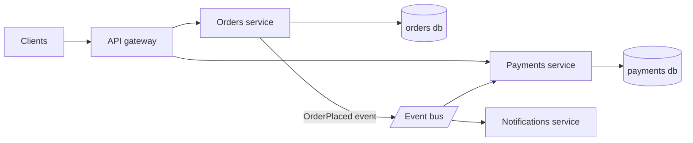

# Microservices

> [!abstract] In one sentence
> Microservices split a system into independently deployable services with private data, so teams can ship and scale on their own — at the cost of turning every cross-feature call into a network call with partial failure, eventual consistency and real operational weight.

> [!tip] Deeper treatment in your system-design vault
> `system-design/10 Architecture Styles/Monolith vs Microservices.md` — read it *after* you have written your own explanation below.

**Map:** [[Architecture Patterns MOC]] → [[HLD MOC]]

## Definition

A **microservices architecture** decomposes an application into services that are each built, deployed and scaled independently, own their data store exclusively, and communicate through network APIs ([[REST]], [[gRPC]]) or messages ([[Kafka]], queues). The defining property is *independent deployability*: a change to one service ships without coordinating a release with any other. Private data is what makes that possible; shared databases quietly remove it.

## Problem solved

Large organisations hit two walls with a [[Monoliths|monolith]]: one release train that hundreds of engineers queue for, and one scaling unit sized for its hungriest feature. Microservices address both by aligning the deployment unit with the team and the capability. They also allow heterogeneous technology and limit the blast radius of a bad deploy to one service. The honest framing: microservices solve organisational scaling problems first and technical ones second.

## How it works

1. **Boundaries from the domain.** Services follow [[Domain-Driven Design|bounded contexts]]: orders, payments, inventory. Boundaries drawn around technical layers or nouns without behaviour produce chatty, coupled services.
2. **Private data.** Each service owns its schema and is the only writer; others get data through its API or events, never a shared table. Cross-service reads become API calls or local replicas built from events ([[CQRS]]).
3. **Communication.** Synchronous calls for queries that need an answer now; events for facts others react to ([[Synchronous vs Asynchronous Communication]], [[Event-Driven Architecture]]). Every synchronous call needs a [[Timeouts and Retries|timeout]], and chain depth is your availability budget: five serial calls at 99.9% each give roughly 99.5%.
4. **Cross-service consistency.** No distributed transaction; an operation spanning services is a [[Saga Pattern|saga]] of local transactions with compensations, publishing through an [[Outbox Pattern|outbox]].
5. **Platform.** Each service needs [[Service Discovery|discovery]], an entry point ([[API Gateways]]), resilience ([[Circuit Breakers]], [[Bulkheads]]), [[Distributed Tracing|tracing]] and its own CI/CD. On Kubernetes most of this is a Service, an Ingress and a sidecar or library.

The anti-pattern is the **distributed monolith**: services deployed together, sharing a database, or calling each other synchronously in long chains. You pay the network and partial-failure tax while keeping the coupling you meant to remove.

## Architecture

## Use cases

- Several teams need to deploy on their own schedule, and release coordination is a measured bottleneck.
- Components with very different scaling or runtime needs (a WebSocket tier, a batch scorer, a CPU-bound media pipeline).
- A requirement for fault or regulatory isolation: recommendations must not take down checkout; card data needs its own deployable and store.

## Limitations

- Every call across a boundary can time out, partially fail or return stale data; the system is only as simple as your resilience story.
- Data consistency across services is eventual by construction; invariants that span services need sagas and reconciliation.
- Operational cost multiplies: pipelines, dashboards, alerts, on-call and security surface per service.
- Wrong boundaries are expensive to fix; a [[Modular Monoliths|modular monolith]] lets you find them first.

## Trade-offs

| You gain | You sacrifice |
|---|---|
| Independent deployment and scaling per service and team | In-process calls and local transactions across features |
| Fault and blast-radius isolation when boundaries are real | Simplicity: discovery, gateways, tracing and sagas become mandatory |
| Technology freedom per service | A single place to debug; latency and availability now compound across hops |

## Failure modes

- **Cascading failure**: one slow dependency ties up callers' thread pools → p99 and error rate rise several services away → whole request path down. Noticed via tracing; prevented with timeouts, breakers and bulkheads.
- **Distributed monolith**: a feature needs three services deployed in lockstep → noticed as release calendars and "deploy order" documents → the autonomy you paid for is gone.
- **Data drift between services**: a saga step fails without compensation or an event is lost → balances and inventory disagree → found days later by reconciliation; high blast radius in fintech.
- **Version skew**: a producer changes an event or API shape without [[Backward Compatibility|compatibility]] → consumers fail on deploy → fixed by schema discipline and contract tests.

## Performance

Each hop adds serialisation plus a network round trip — hundreds of microseconds to a few milliseconds inside a region — and tail latency compounds with fan-out and chain depth ([[Latency]]). Per-service throughput can be excellent, but end-to-end latency is usually worse than the equivalent monolith and must be managed with caching, async events and shallow call graphs.

## Scalability

The strong case: each service scales on its own metric and teams scale because ownership is explicit. At 10x the platform must scale too — service count, broker partitions, tracing volume, gateway capacity — and the control plane's cost becomes visible. Organisationally, microservices scale well past the point where a monolith's release process collapses.

## Operational impact

High. N deployables mean N pipelines, N dashboards and a shared platform (gateway, broker, mesh or client libraries). Debugging requires [[Distributed Tracing]] and correlation ids; capacity planning is per service; security needs per-service identities and secrets. Expect to staff a platform function beyond a dozen services.

## Alternatives

- **[[Modular Monoliths]]** — wins for most teams below a few dozen engineers; same boundaries, no network.
- **[[Monoliths]] with extracted satellites** — wins when only one or two capabilities need independence.
- **Serverless functions** — wins for spiky, event-triggered, stateless work; loses for long-lived connections and complex domains.

## Real-world examples

- Netflix, Amazon and Uber are the canonical large-scale adopters; Uber's later move to domain-oriented groupings of services is the documented correction for too-fine boundaries ([[Uber - Domain-Oriented Microservice Architecture]]).
- Amazon Prime Video's 2023 post about merging a distributed video-monitoring pipeline back into one process is a widely discussed example of the cost side.
- In a stack like yours: separate Spring Boot or NestJS deployments on EKS behind an ingress, each with its own RDS schema, events on Kafka or SQS, JWTs validated at the edge against the IAM service — the questions to keep asking are "could this be one service?" and "does any service share a table?".

## Practical exercise

1. Split a two-module app into `orders` and `payments` services with Docker Compose, each with its own PostgreSQL, communicating over HTTP.
2. Run k6 against `POST /orders` and compare p99 with the single-process version.
3. Inject 500 ms latency into `payments` with [[Toxiproxy]] and watch `orders` threads pile up; add a timeout and a circuit breaker and re-measure.
4. Kill `payments` mid-request and observe an order with no payment; fix it as a saga with an outbox and a compensating `CancelOrder`.
5. Count the components (gateway, broker, tracing) you added to make two services behave like one.

## Related concepts

### Prerequisites
- [[Monoliths]] — the style you are leaving and should have outgrown
- [[Domain-Driven Design]] — where the boundaries come from
- [[Synchronous vs Asynchronous Communication]] — the two ways services talk
- [[Data Ownership and Lifecycle]] — one writer per dataset

### Related
- [[Modular Monoliths]] — the rehearsal and the fallback
- [[Distributed Tracing]] — how you debug across services
- [[Database Scaling]] — private databases change the scaling story
- [[REST]] and [[gRPC]] — the synchronous contracts
- [[Scalability]] — the organisational and technical dimensions

### Builds on this
- [[API Gateways]] — a single entry point over many services
- [[Service Discovery]] — finding instances whose addresses change
- [[Saga Pattern]] — transactions without a shared database
- [[Circuit Breakers]] — surviving a sick dependency
- [[Event-Driven Architecture]] — decoupling services through events

### Design problems where it applies
- [[Design a Payment System]]
- [[Design a Ride-Sharing Service]]
- [[Design an API Gateway]]
- [[Design a Notification System]]

### Projects where it can be implemented
- [[Webhook Relay]]
- [[Presence and Chat Service]]

### Resources
- [[Building Microservices]] — the standard text
- [[Martin Fowler - Microservices]] — characteristics and prerequisites
- [[Uber - Domain-Oriented Microservice Architecture]] — what too many services looks like and the fix

## Personal understanding

> [!question] Explain it without the source
> Write your own explanation here, from memory. Then compare it with the sections above and note what you missed.

### Mastery checklist
- [ ] I can explain it without the original resource
- [ ] I can describe the problem it solves
- [ ] I can compare it with its alternatives
- [ ] I can name its limitations and failure modes
- [ ] I can recognise when it is appropriate in a real system
- [ ] I have applied it in a system design
- [ ] I have validated my assumptions with an experiment or implementation

## Open questions

- [ ] What is the practical minimum platform (gateway, discovery, tracing, CI) for five services on EKS, and what can be a library instead of infrastructure?
- [ ] How do you measure whether a system is a distributed monolith — deploy coupling, shared tables, synchronous chain depth?
- [ ] When a payments domain is split, which invariants must stay inside one service's transaction and which can be eventual?
