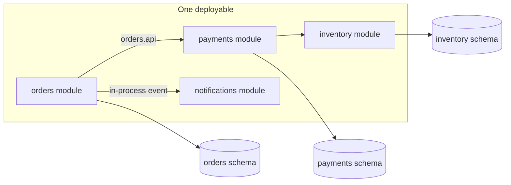

# Modular Monoliths

> [!abstract] In one sentence
> A modular monolith keeps one process and one deploy but draws service boundaries inside it — public module APIs, build-enforced dependency rules, schema ownership — so you get most of the organisational benefits of microservices and none of the network.

> [!tip] Deeper treatment in your system-design vault
> `system-design/10 Architecture Styles/Modular Monolith.md` — read it *after* you have written your own explanation below.

**Map:** [[Architecture Patterns MOC]] → [[HLD MOC]]

## Definition

A **modular monolith** is a [[Monoliths|monolith]] organised into modules that each own a business capability, expose a small public interface, and are forbidden — by tooling, not convention — from reaching into each other's internals or tables. Modules communicate through in-process calls to the public interface or through in-process events. The deployment unit is still one artefact; the architecture unit is the module.

## Problem solved

A plain monolith rots because nothing stops `orders` from calling a private method in `payments` or joining its tables. The usual reaction is to jump to [[Microservices]], which does enforce boundaries — with a network, partial failure and [[Distributed Transactions]] as the enforcement mechanism. That is an expensive way to get a compiler error. The modular monolith gets the boundary discipline first and defers the distribution cost until a module actually needs its own deployment or scaling. It also fixes the most common microservices failure: splitting along the wrong lines. Boundaries inside one repo are cheap to move; boundaries across services are not.

## How it works

1. **Modules by capability, not by layer.** Top-level packages are `orders`, `payments`, `inventory` — not `controllers`, `services`, `repositories`. Each module contains its own layers ([[Hexagonal Architecture]] inside, if you like) and its boundary follows a [[Domain-Driven Design|bounded context]].
2. **A public API per module.** One package (`orders.api`) with interfaces and DTOs is exported; everything else is package-private or marked internal. Other modules depend only on `api`.
3. **Enforced dependencies.** The rule "no module imports another module's internals, and no cycles" lives in the build: ArchUnit tests or Spring Modulith's verification in Java, ESLint `no-restricted-imports` or Nx module boundaries in TypeScript. A violation fails CI.
4. **Schema ownership.** Each module owns its tables. Other modules never query them directly; they call the module API or consume its events. One physical database, separate schemas per module (`orders.*`, `payments.*`) make the ownership visible and the later extraction mechanical.
5. **In-process events for loose coupling.** A module publishes `OrderPlaced` to an in-process event bus; subscribers react in the same transaction or asynchronously. Swap the bus for a broker plus an [[Outbox Pattern|outbox]] when a module is extracted.

```java
// ArchUnit: payments may only touch orders through orders.api
noClasses().that().resideInAPackage("..payments..")
  .should().dependOnClassesThat().resideInAPackage("..orders.internal..");
```

## Architecture



## Use cases

- A growing team (roughly 10–50 engineers) that feels ownership pain in a monolith but has no scaling or deployment-isolation reason to distribute.
- A domain whose boundaries are still being discovered: you want to be able to merge or split modules in a refactor, not a migration.
- A system that needs cross-module transactions today (bookings, ledgers) and may extract services later.
- The target state of a monolith clean-up before any [[Strangler Pattern|strangler]] extraction.

## Limitations

- It still deploys and scales as one unit; a module with a wildly different load profile gets no relief.
- Discipline must be tooled: without build-time enforcement it decays into an ordinary monolith within a year.
- One runtime and language for every module.
- Shared infrastructure (connection pool, heap, thread pools) means one module can still starve another unless you add internal [[Bulkheads|bulkheads]].

## Trade-offs

| You gain | You sacrifice |
|---|---|
| Service-like boundaries with in-process calls and local transactions | Independent deployment and scaling per module |
| Boundaries you can redraw in a pull request | The hard enforcement a network boundary gives for free |
| A mechanical extraction path when a module must become a service | Some ceremony: public APIs, DTO mapping, per-module schemas from day one |

## Failure modes

- **Boundary erosion**: someone adds a "temporary" import of another module's internals and the rule is not enforced → noticed months later when extraction is impossible → the system is a plain monolith again.
- **Cross-schema joins** for a report → the report breaks when a module moves to its own database → noticed in the extraction project, not before.
- **Synchronous in-process event chains** growing into long transactions → p99 of `POST /orders` climbs as more subscribers hook in → found via per-handler timing.
- **Shared-pool starvation**: one module's slow queries exhaust the connection pool → unrelated endpoints time out → whole process degraded.

## Performance

Identical to a monolith on the hot path: module calls are function calls, measured in nanoseconds, and cross-module work is one local transaction. The small overheads are DTO mapping at module boundaries and the in-process event bus. The gain is predictability: with boundaries enforced, you can reason about which modules a request touches and profile per module.

## Scalability

Scales exactly as the monolith does — replicas behind a [[Load Balancers|load balancer]] and a scaled database. The difference appears at the extraction point: because each module owns its schema and has one public interface, moving it to its own service means replacing the in-process adapter with an HTTP or message adapter and moving its schema, not untangling joins. Team scalability is the real win: modules map to owners.

## Operational impact

As light as a monolith to run, slightly heavier to build: boundary tests, per-module schemas, migration ownership and a convention for in-process events. Deploy, monitor and debug remain single-process. Make module names first-class in metrics and logs so on-call can attribute a problem to a module and its owner.

## Alternatives

- **[[Monoliths]]** without enforced modules — wins only for tiny teams and short-lived products.
- **[[Microservices]]** — wins when independent deployability or scaling is a real, present need and the team can run a distributed system.
- **Monolith plus extracted satellites** — wins when one or two capabilities have distinct needs; the modular monolith is the best base for this.

## Real-world examples

- Shopify's "componentisation" of its Rails monolith, enforced by the Packwerk tool, is the canonical published case ([[Shopify - Deconstructing the Monolith]]).
- Spring Modulith (Java) and Nx module boundaries (TypeScript) exist specifically to enforce this style in the build.
- Neal Ford and Mark Richards describe it as a first-class architecture style in [[Fundamentals of Software Architecture]].
- In a stack like yours: a Spring Boot or NestJS service with `orders`, `ledger` and `notifications` packages, ArchUnit or ESLint boundary rules in CI, and one PostgreSQL with a schema per module — extracting `notifications` later becomes a Friday-afternoon change rather than a quarter.

## Practical exercise

1. Start a NestJS or Spring Boot app with three modules: `orders`, `payments`, `notifications`, each with an `api` package and an `internal` package.
2. Add an ArchUnit test (Java) or ESLint `no-restricted-imports` rule (TypeScript) forbidding cross-module `internal` imports and cycles; make it fail CI.
3. Give each module its own PostgreSQL schema via Docker Compose; forbid cross-schema joins with a separate database role per module.
4. Publish `OrderPlaced` on an in-process event bus; have `notifications` subscribe.
5. Extract `notifications` into a second process: replace the in-process subscriber with a Redis Streams or Kafka consumer fed by an outbox. Measure how many files changed — that number is the pattern's payoff.

## Related concepts

### Prerequisites
- [[Monoliths]] — the baseline this adds structure to
- [[Separation of Concerns]] — modules are cohesion and coupling made explicit
- [[Domain-Driven Design]] — bounded contexts tell you where module lines go

### Related
- [[Hexagonal Architecture]] — the shape of each module's inside
- [[Data Ownership and Lifecycle]] — one owner per table, even in one database
- [[Designing for Maintainability]] — the goal the boundaries serve
- [[Outbox Pattern]] — what the in-process event bus becomes after extraction
- [[Event-Driven Architecture]] — in-process events are the rehearsal

### Builds on this
- [[Microservices]] — extraction of modules that need their own deployment
- [[Strangler Pattern]] — routing a module's traffic to its new home

### Design problems where it applies
- [[Design a Payment System]]
- [[Design an Inventory Management System]]
- [[Design a Ticket Booking System]]

### Projects where it can be implemented
- [[Double-Entry Ledger Service]]
- [[Durable Job Scheduler]]

### Resources
- [[Shopify - Deconstructing the Monolith]] — the published playbook
- [[Fundamentals of Software Architecture]] — the style and its scores
- [[Building Microservices]] — Newman's advice on when not to split

## Personal understanding

> [!question] Explain it without the source
> Write your own explanation here, from memory. Then compare it with the sections above and note what you missed.

### Mastery checklist
- [ ] I can explain it without the original resource
- [ ] I can describe the problem it solves
- [ ] I can compare it with its alternatives
- [ ] I can name its limitations and failure modes
- [ ] I can recognise when it is appropriate in a real system
- [ ] I have applied it in a system design
- [ ] I have validated my assumptions with an experiment or implementation

## Open questions

- [ ] Should cross-module calls go through interfaces that could be remote (DTOs, no shared entities) from day one, or is that premature?
- [ ] How do you run a per-module on-call rotation when every alert fires from one process?
- [ ] What does a per-module schema cost in PostgreSQL in practice — roles, migrations, connection pools — compared with one shared schema?
