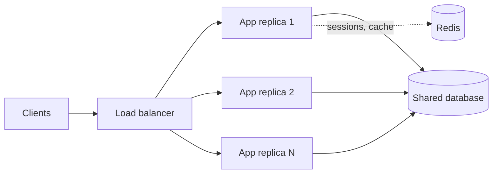

# Monoliths

> [!abstract] In one sentence
> A monolith ships the whole application as one deployable process over one database, which buys you in-process calls, local transactions and a single pipeline — at the price of one blast radius, one release train and one scaling unit.

> [!tip] Deeper treatment in your system-design vault
> `system-design/10 Architecture Styles/Monolith vs Microservices.md` — read it *after* you have written your own explanation below.

**Map:** [[Architecture Patterns MOC]] → [[HLD MOC]]

## Definition

A **monolith** is an application whose code is built, versioned and deployed as a single unit and runs as a single process type (possibly many identical replicas). All features share one codebase, one runtime, one deployment pipeline and, almost always, one database. Calls between features are function calls; data integrity across features is a local database transaction. "Monolith" describes the deployment shape, not the code quality: a monolith can be well-layered or a tangle.

## Problem solved

Before you have an architecture problem you have a product problem: you do not yet know which parts will change together, which will need to scale and where the real boundaries are. A monolith defers those decisions and keeps the cost of being wrong low. It removes the distributed-systems tax — no network between features, no partial failure, no [[Distributed Transactions]], no [[Service Discovery]] — and lets a small team ship with one pipeline, one log stream and one debugger. For most products under a few dozen engineers it is not a compromise; it is the fastest way to build the thing correctly.

## How it works

1. **One build.** The repository produces one artefact (a Spring Boot fat jar, a NestJS bundle, a container image); a breaking change between features fails the build rather than production.
2. **One process, many replicas.** The artefact runs behind a [[Load Balancers|load balancer]] as N stateless replicas. Horizontal scaling is a replica count, not a redesign, as long as no per-instance state exists (sessions in [[Redis]], files in [[Object Storage]]).
3. **One database.** Features share a schema and a connection pool; a request touching orders, payments and inventory does it in one `BEGIN … COMMIT`, which gives [[ACID]] across features for free.
4. **One release.** Every deploy ships everything and rollback is one artefact swap; [[Feature Flags]] separate deploy from release.

The real failure mode is not scale, it is **the big ball of mud**: with no enforced boundaries, every module reaches into every table and class, until a change in billing breaks search, the test suite takes an hour and nobody deploys on a Friday. The answer is internal structure ([[Modular Monoliths]], [[Separation of Concerns]]), not a network.

```text
app/
  orders/      service, repository, domain
  payments/    service, repository, domain
  inventory/   ...
  shared/      auth, logging, db config   <- the only thing everyone may import
```

## Architecture



## Use cases

- A new product or team under roughly 20–30 engineers where boundaries are still moving; the requirement says "ship v1 in three months".
- Workloads whose features share data heavily and need cross-feature transactions (bookings, ledgers, inventory).
- Latency-sensitive paths where in-process calls beat any RPC, and [[Operational Simplicity|operational simplicity]] matters more than independent scaling — or wherever the honest answer to "why split it?" is "because other companies did".

## Limitations

- One scaling unit: a CPU-hungry report generator and a latency-sensitive checkout share the same replicas and the same JVM heap.
- One release train: a slow or flaky test suite slows everyone; a bad deploy takes down every feature.
- Technology lock-in: one language and framework for all problems, including the ones it is poor at.
- Team contention: at a few hundred engineers, merge conflicts, shared on-call and shared ownership of a single database become organisational bottlenecks.

## Trade-offs

| You gain | You sacrifice |
|---|---|
| Local calls and local transactions; no distributed failure modes | Independent scaling and deployment of individual features |
| One pipeline, one log stream, one debugger, one on-call rotation | Fault isolation — a memory leak in one module takes the whole process down |
| Freedom to refactor across features in one commit | Clear ownership boundaries as the team grows; discipline must replace the compiler |

## Failure modes

- **Noisy-neighbour module**: a batch export saturates the connection pool or heap → p99 of every endpoint spikes at once → whole product degraded. Found via per-endpoint metrics and thread dumps.
- **Deploy-blocked by an unrelated failure**: a broken test in reporting blocks the fraud fix → you notice as a growing queue of unshipped changes → hotfix pressure and risky bypasses.
- **Schema coupling**: three modules write the same table with different invariants → silent data corruption surfaces weeks later in reconciliation → high blast radius in fintech.
- **Startup and build time creep**: 10-minute builds and 2-minute boots make rollbacks and autoscaling slow → noticed when scale-out lags a traffic spike.

## Performance

In-process calls cost nanoseconds against hundreds of microseconds for an in-datacentre RPC, so a request that would span five services completes with no serialisation and no network tail. The cost is that all features share one heap, one GC and one connection pool, so a heavy feature degrades every other one; profile per endpoint, not per process.

## Scalability

Horizontally the monolith scales fine for a long time: stateless replicas in front, [[Read Replicas]] and caching behind. The ceiling is usually the shared database and the team, not the process. At 10x load you scale replicas and the database; at 10x engineers you need enforced module boundaries or you will split the system under duress.

## Operational impact

Lowest of any style: one deployment, one dashboard, one runbook, and debugging is a stack trace rather than a [[Distributed Tracing|distributed trace]]. The burden arrives later as release coordination, a slow test suite and a database nobody dares to migrate; invest in CI speed and migration tooling ([[Schema Evolution]]) early.

## Alternatives

- **[[Modular Monoliths]]** — wins almost always as the next step: boundaries enforced in the build, still one deployable.
- **[[Microservices]]** — wins when teams need independent deployment and scaling badly enough to pay the distributed-systems cost.
- **Monolith plus a few extracted services** — wins when one component (image processing, ML scoring) has a genuinely different scaling or language profile; extract that, keep the rest.

## Real-world examples

- Shopify runs one of the largest Rails monoliths in production and chose to modularise rather than split it ([[Shopify - Deconstructing the Monolith]]); Stack Overflow has long served its traffic from a handful of web servers running one .NET application.
- Martin Fowler's "monolith first" position: nearly every successful microservice system he saw started as a monolith that was split later.
- In a stack like yours: a Spring Boot or NestJS service on EKS with several replicas, RDS behind it and Redis for sessions is a monolith; the question before splitting is which pain — deploy coupling, scaling, ownership — you are actually feeling.

## Practical exercise

1. Take a small Spring Boot or NestJS app with two modules (orders, reports) sharing one PostgreSQL via Docker Compose.
2. Load-test `POST /orders` with k6 at a steady rate and record p50/p99.
3. Trigger a heavy `GET /reports/export` concurrently and watch the orders p99 — the noisy-neighbour cost of one process.
4. Fix it inside the monolith with a separate thread pool or connection pool for reports (a [[Bulkheads|bulkhead]]), then re-measure.
5. Stretch: add an ArchUnit or ESLint rule so `orders` cannot import `reports` internals, and watch it fail the build.

## Related concepts

### Prerequisites
- [[Separation of Concerns]] — the discipline that keeps one process from becoming one tangle
- [[Horizontal vs Vertical Scaling]] — how a single deployable scales
- [[Load Balancers]] — replicas of one artefact behind one entry point

### Related
- [[Database Scaling]] — the shared database is usually the first real ceiling
- [[Connection Pooling]] — one pool shared by every feature
- [[Deployment and Rollback Strategies]] — one artefact, one rollback
- [[Evaluating Architectural Complexity]] — the honest comparison with splitting
- [[Operational Simplicity]] — the monolith's strongest argument

### Builds on this
- [[Modular Monoliths]] — the monolith with enforced internal boundaries
- [[Microservices]] — what you get when you turn module boundaries into network boundaries
- [[Strangler Pattern]] — how a monolith is replaced incrementally

### Design problems where it applies
- [[Design a URL Shortener]]
- [[Design a Ticket Booking System]]
- [[Design a Digital Wallet and Ledger]]

### Projects where it can be implemented
- [[Durable Job Scheduler]]
- [[Double-Entry Ledger Service]]

### Resources
- [[Shopify - Deconstructing the Monolith]] — the case for modularising instead of splitting
- [[Martin Fowler - Microservices]] — including the monolith-first argument
- [[Fundamentals of Software Architecture]] — monolithic styles and their characteristics

## Personal understanding

> [!question] Explain it without the source
> Write your own explanation here, from memory. Then compare it with the sections above and note what you missed.

### Mastery checklist
- [ ] I can explain it without the original resource
- [ ] I can describe the problem it solves
- [ ] I can compare it with its alternatives
- [ ] I can name its limitations and failure modes
- [ ] I can recognise when it is appropriate in a real system
- [ ] I have applied it in a system design
- [ ] I have validated my assumptions with an experiment or implementation

## Open questions

- [ ] At what team size does release coordination in a monolith measurably slow delivery, and is a modular monolith enough to push that point out?
- [ ] How do you give one hot module its own scaling without a split — separate replica groups of the same artefact with different routing?
- [ ] Which signals (deploy frequency, change failure rate, blast radius of incidents) would justify an extraction in a payments monolith?
